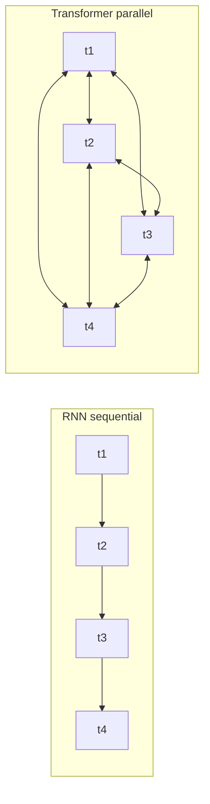
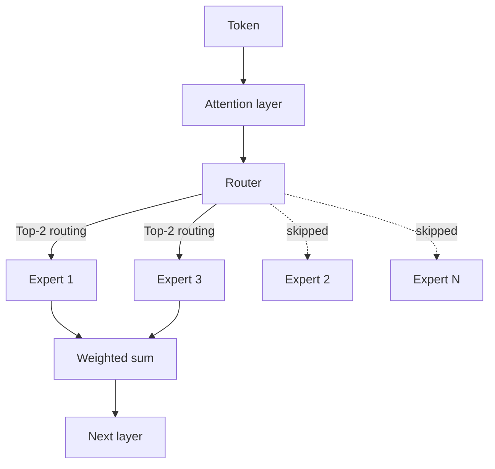

:::info 출처 · 라이선스
이 문서는 Om Bharatiya의 [AI System Design Guide](https://github.com/ombharatiya/ai-system-design-guide/blob/main/01-foundations/01-llm-internals.md)(MIT License, © 2026 Om Bharatiya)를 한국어로 옮긴 **비공식 번역본**입니다. MIT 라이선스에 따른 저작권 고지를 포함합니다. 번역·편집 책임은 SecureNomad에 있습니다. 전체 안내는 [소개 · 출처 · 라이선스](../index.md)를 참고하세요. 번역 기준: 원문 커밋 `ed955b2`(2026-10-09). 아직 번역되지 않은 챕터로의 링크는 원문(GitHub)으로 연결됩니다.
:::

# LLM 내부 구조

현대 LLM의 아키텍처 핵심을 다룬다: 트랜스포머, MoE, 어텐션 수식, RoPE, GQA, KV 캐시, 그리고 2026년 모델 설계를 이끄는 추론 최적(inference-optimal) 스케일링 전환.

이 장은 대규모 언어 모델의 핵심 개념을 다룬다. 이 내부 구조를 이해해야 AI 시스템에 대한 아키텍처 결정을 올바르게 내릴 수 있다. 이런 아키텍처 선택이 실제로 어떤 영향을 미치는지는 [추론 최적화](https://github.com/ombharatiya/ai-system-design-guide/tree/main/04-inference-optimization)(KV 캐시, PagedAttention), [모델 분류 체계](https://github.com/ombharatiya/ai-system-design-guide/blob/main/02-model-landscape/01-model-taxonomy.md)(프로덕션에서의 MoE 모델)를 참고하고, MoE·RoPE·ALiBi·GQA·MLA의 정의는 [용어집](https://github.com/ombharatiya/ai-system-design-guide/blob/main/GLOSSARY.md)을 참고하라.

## 트랜스포머 혁명

2017년 이전에는 시퀀스 모델링이 토큰을 순차적으로 처리하는 순환 구조(RNN, LSTM)에 의존했다. 이 방식에는 두 가지 문제가 있었다.

1. **학습이 느렸다**: 순차 처리라 병렬화가 불가능했다.
2. **장거리 의존성 포착이 어려웠다**: 정보가 수많은 은닉 상태를 거쳐 흘러가야 했다.

트랜스포머 아키텍처는 "Attention Is All You Need"(Vaswani et al., 2017)에서 소개되었고, 순환(recurrence)을 셀프 어텐션으로 대체함으로써 두 문제를 모두 해결했다.

**분산 시스템 엔지니어를 위한 멘탈 모델:**
순환은 각 단계가 이전 단계에 의존하는 단일 스레드 요청 파이프라인에 가깝다. 셀프 어텐션은 모든 노드가 다른 모든 노드에 병렬로 질의할 수 있는 완전 연결 그래프에 가깝다.



---

## 아키텍처 변형

원래 트랜스포머의 어느 부분을 사용하느냐에 따라 세 가지 주요 변형이 등장했다.

| 아키텍처 | 어텐션 종류 | 예시 | 적합한 용도 |
|--------------|---------------|----------|----------|
| 인코더 전용(Encoder-only) | 양방향 | BERT, RoBERTa | 분류, 개체명 인식(NER), 임베딩 |
| 디코더 전용(Decoder-only) | 인과적(좌→우) | GPT-3, Llama, Qwen, Mistral | 텍스트 생성, 챗 |
| 인코더-디코더 | 교차 어텐션(cross-attention) | T5, BART | 번역, 요약 |
| 인과적 인코더-디코더(2026) | 인과적; 디코더 KV를 인코더 상태에서 투영 | DeepSeek V4.1-Flash | 작은 KV 캐시로 장문맥 서빙 |

### 디코더 전용 (오늘날 대부분의 LLM)

```
┌─────────────────────────────────────────────────────┐
│                 Decoder Block (×N)                  │
│  ┌───────────────────────────────────────────────┐  │
│  │           Masked Self-Attention               │  │
│  │   (Each token attends only to previous)       │  │
│  └───────────────────────────────────────────────┘  │
│                         │                           │
│                    Add & Norm                       │
│                         │                           │
│  ┌───────────────────────────────────────────────┐  │
│  │              Feed-Forward Network             │  │
│  └───────────────────────────────────────────────┘  │
│                         │                           │
│                    Add & Norm                       │
└─────────────────────────────────────────────────────┘
                          │
                          ▼
                   Output Probabilities
```

**디코더 전용이 지배적인 이유:**
- 가장 단순한 아키텍처
- 사전학습 목표(다음 토큰 예측)가 생성과 정확히 들어맞음
- 연산량에 따라 잘 확장됨

### 인코더 전용 (BERT 계열)

양방향 어텐션을 쓴다. 각 토큰이 다른 모든 토큰을 본다. 자기회귀적으로 텍스트를 생성하지는 못하지만, 이해(understanding) 과제에서 탁월하다.

**실무적 의미:**
- 분류(의도 탐지, 감성 분석)에 파인튜닝
- 임베딩 모델의 백본
- 특정 과제에 더 작고 빠름

### 인코더-디코더 (인코더의 귀환)

디코더 전용이 여전히 지배적이지만, 인코더가 T5식 번역 스택이 아니라 대형 생성 모델 **내부에** 다시 등장했다. 공개된 예시는 **DeepSeek V4.1-Flash**(2026년 9월 10일, MIT 가중치)다. 이는 **인과적 인코더-디코더**로, 40개 레이어가 20개 인과적 인코더 레이어와 20개 디코더 레이어로 나뉘며, 디코더의 전역 KV 캐시는 인코더의 최종 은닉 상태에서 투영된다. DeepSeek은 프리필 시 토큰당 활성 파라미터 8B, 디코드 시 16B, 그리고 토큰당 전역 KV 890바이트(V4-Flash의 약 1/4)를 보고한다.

**시스템 설계에서 중요한 이유:** 이제 프리필과 디코드의 활성 파라미터 수가 서로 다르고, KV 캐시도 더 이상 레이어당 하나의 K/V 스택이 아니다. "FLOPs = 2 × 활성 파라미터"도, 교과서적 KV 공식도 모델 카드의 실제 수치를 봐야 한다. [프리필과 디코드 단계](06-inference-pipeline.md)를 참고하라.

---

## 전문가 혼합(MoE)

**오픈 가중치 프런티어 모델의 기본 아키텍처다**(DeepSeek V4·V4.1, Kimi K3, GLM-5.3, Qwen3.8, MiMo-V2.6, Tencent Hy4; 이전에는 Llama 4 Maverick, Mixtral). Google의 Gemini 기술 보고서와 모델 카드는 희소 MoE 트랜스포머로 기술되어 있다. OpenAI와 Anthropic은 아키텍처를 공개하지 않으므로, GPT나 Claude의 내부에 대한 주장은 추측으로 취급하라.

MoE는 밀집(dense) 피드포워드 네트워크(FFN)를 여러 "전문가(expert)"와, 주어진 토큰을 어떤 전문가가 처리할지 고르는 "라우터(router)"로 대체한다.

```
┌─────────────────────────────────────────────────────┐
│                 MoE Layer (Decoder)                 │
│  ┌───────────────────────────────────────────────┐  │
│  │               Attention Layer                 │  │
│  └───────────────────────────────────────────────┘  │
│                         │                           │
│                 ┌───────▼───────┐                   │
│                 │     Router    │                   │
│                 └─┬───┬───┬───┬─┘                   │
│          ┌────────┘   │   │   └────────┐            │
│          ▼            ▼   ▼            ▼            │
│   ┌──────────┐ ┌──────────┐ ┌──────────┐ ┌──────────┐│
│   │ Expert 1 │ │ Expert 2 │ │ Expert 3 │ │ Expert N ││
│   └────┬─────┘ └────┬─────┘ └────┬─────┘ └────┬─────┘│
│        └────────────┴───┬───┴────────────┘        │
└─────────────────────────▼───────────────────────────┘
```

### 시스템 설계에서 중요한 MoE의 뉘앙스

1. **총 파라미터 vs 활성 파라미터**: Xiaomi MiMo-V2.6-Pro(2026년 9월)는 1.02T 파라미터를 저장하지만 토큰당 42B만 활성화한다. DeepSeek V4 Pro는 총 1.6T / 활성 49B다. Llama 4 Maverick은 총 400B / 활성 17B로, 128개의 라우팅 전문가와 공유 전문가 하나를 MoE 레이어마다 번갈아 둔다.
    - **메모리 제약**: 모든 전문가는 어딘가에 상주해야 한다. 1.02T 파라미터는 FP8로 약 1TB이고, 4비트로도 여전히 500GB 이상이며, 이는 KV 캐시를 더하기 전이다. Xiaomi의 SGLang 레시피는 MiMo-V2.6-Pro를 8-GPU 노드 두 대(16-way 텐서 병렬)에 분산한다.
    - **연산 제약**: 토큰당 FLOPs는 총 1.02T가 아니라 활성 42B에 비례한다.
    - **큰 배치에서의 함정**: 토큰마다 다른 전문가로 라우팅되므로, 큰 배치는 매 스텝 대부분의 전문가를 건드리고 대역폭 절감 효과가 줄어든다. MoE 서빙은 단지 "더 작은 모델"이 아니라, 전문가 배치(expert placement)와 all-to-all 통신(전문가 병렬) 문제다.
2. **라우팅 붕괴(Routing Collapse)**: 라우터가 한 전문가만 고르면 나머지는 학습되지 않는다. 현대 모델은 **부하 분산 손실(load balancing loss)**과 **보조 손실(auxiliary loss)**로 모든 전문가가 활용되도록 한다.
3. **DeepSeek의 개선**: **멀티헤드 잠재 어텐션(MLA)**(DeepSeek-V2에서 도입)과 **보조 손실 없는 부하 분산**(DeepSeek-V3)이 MoE 효율의 사실상 표준이 되었고, 다른 연구소들도 MLA를 채택했다(Kimi K2, Tencent Hy4). DeepSeek 자신은 더 나아갔다. V4(2026년 4월 프리뷰)는 Compressed Sparse Attention과 Heavily Compressed Attention의 하이브리드를 쓰는데, DeepSeek은 1M 토큰에서 V3.2 대비 KV 캐시의 약 10%, 토큰당 FLOPs의 27%만 필요하다고 밝혔다. V4.1-Flash(2026년 9월)는 Compressed Sparse Attention 2와 FP4 KV 캐싱을 추가했다([어텐션 메커니즘](03-attention-mechanisms.md) 참고).

토큰당 라우팅 결정을 플로차트로 보면:



---

## 스케일링 법칙: 학습 최적 vs 추론 최적

원래의 친칠라(Chinchilla) 법칙(2022)은 **학습 최적(Training-Optimal)**에 초점을 맞췄다. 주어진 학습 예산에서 최적의 모델 크기를 찾는 것이다.

업계는 이제 **추론 최적(Inference-Optimal)** 스케일링으로 옮겨갔다.
- **과잉 학습(Over-training)**: 작은 모델(예: Llama 3 8B)을 친칠라 지점을 훨씬 넘는 방대한 데이터(15T+ 토큰)로 학습한다.
- **왜?**: 수백만 사용자에 대한 추론 비용이 일회성 학습 비용을 압도한다. 10배 더 오래 학습한 7B 모델이, 친칠라 지점에서 학습한 70B 모델보다 서빙 비용이 싸다.

---

## 네이티브 멀티모달리티

이전 모델은 **비전 어댑터(Vision Adapter)**(고정된 CLIP식 비전 인코더를 LLM에 연결)를 사용했다. 프런티어 모델은 이제 **네이티브 멀티모달**로 학습되며, 2026년 오픈 릴리스는 설계가 얼마나 진화했는지 보여준다.

- **공유 어휘(Shared Vocabulary)**: 시각 토큰과 텍스트 토큰이 같은 잠재 공간에 존재한다.
- **단일 트랜스포머**: 동일한 블록이 픽셀과 텍스트를 모두 처리한다.
- **인코더 없는 입력**: Gemma 4 12B "Unified"(2026년 6월, Apache 2.0)는 원시 이미지 패치와 오디오 파형을 경량 선형 레이어를 통해 별도 비전 인코더 없이 바로 LLM 임베딩 공간으로 투영한다.
- **오픈 플래그십의 기본값이 된 멀티모달**: MiMo-V2.6은 텍스트·이미지·비디오·오디오를 받고, GLM-5.3-Flash는 GUI 에이전트용으로 설계된 최초의 네이티브 멀티모달 GLM-5 모델이며, DeepSeek V4.1-Flash는 네이티브 이미지 입력을 추가했다. 이제 셀프 호스팅 스택은 텍스트뿐 아니라 이미지·오디오 토큰까지 예산에 넣어야 한다.
- **이점**: 어댑터 방식보다 공간 추론과 교차 모달 그라운딩이 더 우수하다.

---

## 셀프 어텐션 메커니즘

셀프 어텐션은 핵심 혁신이다. 시퀀스 안의 각 토큰이 다른 모든 토큰에 "주의를 기울여"(정보를 모아) 처리하도록 한다.

### 직관

다음 문장을 보자: "The animal didn't cross the street because it was too tired."(그 동물은 너무 지쳐서 길을 건너지 않았다.)

여기서 "it"은 무엇을 가리키는가? 이해하려면 "it"을 "animal"과 연결해야 한다. 셀프 어텐션은 모든 토큰 쌍 사이의 관련성 점수를 계산해 이런 연결을 학습한다.

### 수식

차원 d, 토큰 수 n의 입력 시퀀스 X에 대해:

```
Q = XW_Q   (Query: 내가 무엇을 찾고 있는가?)
K = XW_K   (Key: 나는 무엇을 담고 있는가?)
V = XW_V   (Value: 나는 무엇을 기여하는가?)

Attention(Q, K, V) = softmax(QK^T / √d_k) × V
```

**단계별로:**
1. **QK^T**: 내적으로 쿼리와 키의 유사도를 측정(n × n 행렬)
2. **/ √d_k**: 차원이 클 때 소프트맥스가 포화되지 않도록 스케일링
3. **softmax**: 확률로 변환(각 행의 합이 1)
4. **× V**: 어텐션 가중치에 따른 값(value)의 가중합

### 왜 √d_k로 나누는가?

**면접 단골 질문**: 수치 안정성에 대한 이해를 드러내므로 자주 묻는다.

스케일링이 없으면 차원 d가 커질수록 내적 값이 비례해 커진다. 큰 내적 값은 소프트맥스를 기울기가 사라지는 포화 영역으로 밀어넣는다.

```python
# Without scaling (problematic for large d)
d = 512
q = np.random.randn(d)
k = np.random.randn(d)
dot = np.dot(q, k)  # Expected magnitude: ~√d ≈ 22.6

# With scaling
scaled_dot = dot / np.sqrt(d)  # Expected magnitude: ~1
```

### 어텐션 복잡도

| 연산 | 시간 복잡도 | 공간 복잡도 |
|-----------|-----------------|------------------|
| QK^T 계산 | O(n²d) | O(n²) |
| Softmax | O(n²) | O(n²) |
| V와의 가중합 | O(n²d) | O(nd) |

O(n²) 복잡도가 문맥 길이를 제한한다. 100K 문맥 창은 레이어당 100억 번의 어텐션 계산을 뜻한다.

---

## 멀티헤드 어텐션

단일 어텐션 대신, 현대 트랜스포머는 서로 다른 측면에 병렬로 주의를 기울이는 여러 "헤드(head)"를 쓴다.

```
┌─────────────────────────────────────────────────────────────┐
│                    Multi-Head Attention                      │
│                                                              │
│   ┌─────────┐  ┌─────────┐  ┌─────────┐       ┌─────────┐   │
│   │ Head 1  │  │ Head 2  │  │ Head 3  │  ...  │ Head h  │   │
│   │ d_k=64  │  │ d_k=64  │  │ d_k=64  │       │ d_k=64  │   │
│   └────┬────┘  └────┬────┘  └────┬────┘       └────┬────┘   │
│        │            │            │                  │        │
│        └────────────┴────────────┴──────────────────┘        │
│                              │                               │
│                         Concatenate                          │
│                              │                               │
│                         W_O (project)                        │
└─────────────────────────────────────────────────────────────┘
```

**왜 여러 헤드인가?**
- 헤드마다 다른 패턴을 학습한다(구문, 의미, 상호 참조)
- 앙상블 기법과 비슷하다: 여러 관점이 견고함을 높인다
- 헤드 간 병렬 처리가 가능하다

**전형적인 구성:**
- GPT-3 175B: 96 헤드 × 128 차원 = 총 12,288 차원
- Llama 2 70B: 64 헤드 × 128 차원 = 총 8,192 차원

### 그룹 쿼리 어텐션(GQA)

**프로덕션 시스템에 결정적**: 표준 멀티헤드 어텐션은 KV 캐시에 헤드마다 별도의 K와 V를 저장해야 한다. GQA는 여러 헤드 그룹이 K와 V를 공유한다.

| 어텐션 종류 | 쿼리당 K,V | KV 캐시 절감 | 예시 |
|----------------|---------------|-------------------|----------|
| 멀티헤드(MHA) | 1:1 | 기준선 | GPT-3 |
| 그룹 쿼리(GQA) | 일반적으로 8:1 | 약 8배 | Llama 2 70B, Llama 3, Mistral |
| 멀티쿼리(MQA) | 전체:1 | 약 n_heads배 | PaLM, Falcon |

**실무적 영향:**
Llama 3 70B(Llama 2 70B와 동일한 어텐션 형태)를 8K 문맥(BF16)에서:
- MHA KV 캐시(만약 64개 KV 헤드였다면): 요청당 약 21GB
- GQA KV 캐시(실제 8개 KV 헤드): 요청당 약 2.7GB

이는 배치 크기, 나아가 처리량(throughput)에 직접 영향을 준다.

---

## 위치 인코딩

셀프 어텐션은 순열 불변(permutation-invariant)이다. 위치 정보가 없으면 "dog bites man"과 "man bites dog"가 동일해진다. 위치 인코딩은 시퀀스 순서를 주입한다.

### 사인파(원래 트랜스포머)

서로 다른 주파수의 사인·코사인 함수를 사용한다:

```
PE(pos, 2i) = sin(pos / 10000^(2i/d))
PE(pos, 2i+1) = cos(pos / 10000^(2i/d))
```

**특성:**
- 결정적이며 학습 파라미터가 없음
- 이론적으로 더 긴 시퀀스로 외삽 가능
- 실제로는 외삽이 잘 되지 않음

### 학습된 절대 위치

각 위치마다 별도의 임베딩을 학습한다:

```python
position_embeddings = nn.Embedding(max_length, d_model)
```

**특성:**
- 단순하고 효과적
- 학습 길이를 넘어서는 외삽 불가
- 대부분의 초기 모델(GPT-2, BERT)

### 회전 위치 임베딩(RoPE)

쿼리와 키 벡터를 회전시켜 위치를 인코딩한다:

```
RoPE(x, pos) = x × cos(pos × θ) + rotate(x) × sin(pos × θ)
```

**특성:**
- 상대적: 어텐션이 (pos_q - pos_k)에 의존
- 절대 위치보다 외삽이 나음
- 사용: Llama, Mistral, PaLM, Qwen, DeepSeek
- 문맥 확장: Position Interpolation, YaRN 같은 스케일링 기법이 학습된 RoPE 창을 늘린다. Qwen3.8-Flash-Next는 네이티브 262K이고 YaRN으로 1M에 도달한다.

### ALiBi (선형 편향 어텐션)

위치 의존적 편향을 어텐션 점수에 직접 더한다:

```
Attention = softmax(QK^T / √d_k - m × distance)
```

여기서 m은 헤드별 기울기, distance는 |pos_q - pos_k|이다.

**특성:**
- 임베딩을 수정하지 않음
- 외삽이 매우 우수
- 사용: BLOOM, MPT

### 위치 인코딩 비교

| 방식 | 외삽 | 연산 오버헤드 | 현대적 사용 |
|--------|---------------|------------------|--------------|
| 사인파 | 나쁨 | 없음 | 드묾 |
| 학습된 절대 | 불가 | 최소 | 레거시 |
| RoPE | 좋음 | 약 5% | 대부분의 LLM |
| ALiBi | 매우 좋음 | 약 2% | 일부 LLM |

---

## 피드포워드 네트워크

각 트랜스포머 레이어에는 각 위치를 독립적으로 처리하는 피드포워드 네트워크(FFN)가 있다:

```python
def feed_forward(x):
    hidden = activation(x @ W1 + b1)  # Expand: d → 4d
    output = hidden @ W2 + b2         # Contract: 4d → d
    return output
```

**핵심 특성:**
- 위치별(position-wise): 각 위치에 동일한 가중치 적용
- 확장 비율: 보통 4배(예: 4096 → 16384 → 4096)
- 파라미터가 있는 곳: FFN이 레이어 파라미터의 약 2/3를 차지

### 활성화 함수

| 활성화 | 수식 | 특성 | 사용 |
|------------|---------|------------|-------|
| ReLU | max(0, x) | 단순, 희소 | 원조 |
| GELU | x × Φ(x) | 매끄러움, BERT에서 사용 | GPT-2, BERT |
| SwiGLU | Swish(xW) × xV | 최신 기술 | Llama, PaLM |

SwiGLU는 게이팅 메커니즘을 더해 성능을 높이는 대신, FFN 파라미터를 약 50% 더 쓴다.

### GLU 변형

```python
# Standard FFN
hidden = gelu(x @ W1)
output = hidden @ W2

# SwiGLU FFN
gate = silu(x @ W_gate)
hidden = x @ W_up
output = (gate * hidden) @ W_down
```

---

## 레이어 정규화

레이어 정규화는 활성값을 정규화해 학습을 안정화한다:

```python
def layer_norm(x, gamma, beta):
    mean = x.mean(dim=-1, keepdim=True)
    var = x.var(dim=-1, keepdim=True)
    normalized = (x - mean) / sqrt(var + eps)
    return gamma * normalized + beta
```

### Pre-LN vs Post-LN

**Post-LN(원래 트랜스포머):**
```
x = LayerNorm(x + Attention(x))  # Post-LN: 잔차 연결 후 정규화
```

**Pre-LN(현대 LLM):**
```
x = x + Attention(LayerNorm(x))  # Pre-LN: 서브레이어 전에 정규화
```

| 변형 | 학습 안정성 | 최종 성능 | 사용 |
|---------|-------------------|-------------------|-------|
| Post-LN | 더 어려움 | 약간 나음 | 초기 논문들 |
| Pre-LN | 훨씬 쉬움 | 좋음 | 대부분의 현대 LLM |

Pre-LN은 세심한 학습률 튜닝 없이도 깊은 모델을 학습할 수 있어 표준이 되었다.

### RMSNorm

평균 중심화를 생략한 단순화 버전:

```python
def rms_norm(x, gamma):
    rms = sqrt(mean(x^2) + eps)
    return gamma * (x / rms)
```

LayerNorm보다 약 10~15% 빠르면서 성능은 비슷하다. Llama, Mistral에서 사용.

---

## 전체 조립

완전한 트랜스포머 레이어:

```python
class TransformerLayer:
    def __init__(self, d_model, n_heads, d_ff):
        self.attn_norm = RMSNorm(d_model)
        self.attn = MultiHeadAttention(d_model, n_heads)
        self.ff_norm = RMSNorm(d_model)
        self.ff = SwiGLU_FFN(d_model, d_ff)
    
    def forward(self, x, mask=None):
        # Pre-norm attention with residual
        h = x + self.attn(self.attn_norm(x), mask)
        # Pre-norm FFN with residual
        out = h + self.ff(self.ff_norm(h))
        return out
```

**전체 모델:**
```
Token IDs → Embedding → [Transformer Layer × N] → Output Norm → LM Head → Logits
```

---

## 꼭 알아둘 숫자들

### 모델 크기

| 모델 | 파라미터 | 레이어 | 헤드 | 차원 | FFN 차원 |
|-------|------------|--------|-------|-----------|---------|
| GPT-3 | 175B | 96 | 96 | 12,288 | 49,152 |
| Llama 2 70B | 70B | 80 | 64 | 8,192 | 28,672 |
| Llama 2 7B | 7B | 32 | 32 | 4,096 | 11,008 |
| Mistral 7B | 7B | 32 | 32 | 4,096 | 14,336 |

### 메모리 요구량

```
모델 가중치 ≈ 파라미터당 바이트 × 파라미터 수
- 70B at BF16: ~140 GB; FP8: ~70 GB; FP4 (NVFP4/MXFP4 블록 스케일 포함): ~37-40 GB
- 7B at BF16: ~14 GB

토큰당 KV 캐시 (BF16, 표준 MHA/GQA 어텐션):
= 2 (K and V) × layers × kv_heads × head_dim × 2 bytes
- Llama 2/3 70B (80 layers, 8 KV heads, head_dim 128):
  2 × 80 × 8 × 128 × 2 = 320 KiB per token
- 8K 문맥: 요청당 ~2.7 GB; 128K (Llama 3.1): ~43 GB
- 동일 형태의 완전 MHA (64 KV heads): 토큰당 2.6 MB, 8K에서 ~21 GB
- MLA, 슬라이딩 윈도, 선형 어텐션 하이브리드, 압축 KV는 이 공식을
  깨뜨린다: DeepSeek V4.1-Flash는 토큰당 전역 KV 890바이트를 보고
  (슬라이딩 윈도 KV는 별도이며 창 길이로 상한됨)
```

### 연산 요구량

```
토큰당 FLOPs, 순전파 ≈ 2 × 활성 파라미터
- 70B dense 모델: 토큰당 ~140 GFLOPs
- 100 토큰 생성: ~14 TFLOPs

H100 SXM: ~989 TFLOPS dense BF16, ~3.35 TB/s HBM 대역폭
- 배치 1에서 토큰 하나의 산술 연산: ~0.14 ms
- BF16 가중치 140 GB를 한 번 읽기: ~42 ms
- 배치 1 디코드는 약 300배 메모리 바운드다; 배치를 묶으면 각 가중치
  읽기가 여러 요청에 분할 상환된다(실제로 70B BF16은 2개 이상의 GPU에
  걸치며, 핵심은 이 비율이다)
```

---

## 핵심 요약

- RNN에서 트랜스포머로의 전환은 품질만이 아니라 병렬화의 문제였다. GPU 스케일링 법칙이 그 뒤를 따른 이유다.
- MoE는 총 파라미터(메모리 비용)와 활성 파라미터(연산 비용)를 분리한다. MiMo-V2.6-Pro는 1.02T를 저장하지만 토큰당 42B로 계산한다. 절감 효과는 작은 배치에서 가장 크고, 큰 배치에서는 매 스텝 대부분의 전문가를 건드린다.
- 프로덕션에서는 추론 최적 스케일링이 친칠라를 이긴다. 모델 수명 동안 추론 비용이 학습 비용을 압도하므로 작은 모델을 과잉 학습한다.
- GQA는 기본 KV 캐시 최적화다(Llama 70B에서 8배). 서빙 비용을 논하기 전에 N:G 비율을 이해하라. 2026년 오픈 플래그십은 MLA, 슬라이딩 윈도·선형 어텐션 하이브리드, 압축 KV로 더 나아갔고, 이제 토큰당 KV 바이트가 모델 간 수십~수백 배 차이 난다. 교과서 공식이 아니라 모델 카드로 산정하라.
- RMSNorm을 쓴 Pre-LN이 현대의 기본값이다. 면접 답변에서 Post-LN이 보이면, 그 지원자는 2018년 논문을 참조하고 있는 것이다.

---

## 면접 질문

### Q: 트랜스포머 어텐션이 왜 O(n²)인지, 그리고 어떤 대안이 있는지 설명하라.

**좋은 답변:**
어텐션은 모든 토큰 간의 쌍별 유사도를 계산한다. 시퀀스 길이 n에 대해:
- QK^T는 [n, d] × [d, n] = 헤드당 n² 곱셈
- 어텐션 가중치 저장: n² 실수

대안:
- 희소 어텐션(Longformer): 지역 + 전역 패턴으로 O(n)
- 선형 어텐션(Performer): 랜덤 특성 근사로 O(n)
- Flash Attention: 연산은 여전히 O(n²)이지만 커널 융합으로 메모리는 O(n)
- 상태공간 모델(Mamba): 완전 선형 O(n)
- 하이브리드(2026년 프로덕션의 답): 선형 어텐션이나 슬라이딩 윈도 레이어를, 소수의 완전/희소 어텐션 레이어와 번갈아 배치한다. Qwen3.8-Flash-Next는 네 레이어 중 세 개에서 Gated DeltaNet을 돌리고, MiMo-V2.6-Pro는 슬라이딩 윈도 60개와 전역 10개 레이어를 쓴다.

트레이드오프: 완전한 장거리 의존성에는 n²가 필요하지만, 대부분의 과제는 모든 쌍별 상호작용을 필요로 하지 않는다. 순수 선형 어텐션은 정밀한 회상(recall)을 잃기 때문에, 프로덕션 모델은 완전/희소 어텐션 레이어를 완전히 버리지 않고 일부 유지한다.

### Q: KV 캐시란 무엇이며 서빙에서 왜 중요한가?

**좋은 답변:**
자기회귀 생성 중에는 한 번에 한 토큰씩 생성한다. 캐싱이 없다면 매 스텝 이전 모든 토큰의 K와 V를 다시 계산해야 한다.

KV 캐시는 이전 위치의 K와 V를 저장한다. 새 토큰마다:
1. 새 위치에 대해서만 Q, K, V 계산
2. 새 K, V를 캐시된 K, V에 이어붙임
3. 전체 K, V로 어텐션 계산

이로써 K와 V 계산의 토큰당 복잡도가 O(n)에서 O(1)로 줄어든다.

**비용:** 메모리가 시퀀스 길이에 선형으로 증가한다. Llama 70B(GQA, 8 KV 헤드, BF16)의 KV 캐시는 8K 문맥에서 요청당 약 2.7GB, 128K에서 약 43GB다. GQA가 없으면 8배 더 커진다. 이는 배치 크기를 제한하며, PagedAttention, KV 양자화(FP8 KV 캐시를 보통 FP4 가중치와 짝지은 것이 2026년의 대표 서빙 구성), 호스트 메모리로의 오프로드 같은 기법을 요구한다.

### Q: 현대 LLM은 왜 Post-LN 대신 Pre-LN을 쓰는가?

**좋은 답변:**
Pre-LN은 정규화를 각 서브레이어 뒤가 아니라 앞에 둔다. 이로써 잔차 연결을 통한 기울기 경로가 더 직접적이 된다.

Post-LN에서는 기울기가 정규화를 통과해야 하는데, 학습 초반에 불안정을 일으킬 수 있다. Post-LN은 학습률 워밍업과 세심한 초기화가 필요하다.

Pre-LN은 특별한 초기화 없이도 매우 깊은 모델(100+ 레이어)을 학습할 수 있게 한다. 트레이드오프는 약간 낮은 최종 성능이지만, 실제로는 학습 안정성이 그만한 가치가 있다.

### Q: MHA, MQA, GQA의 차이는?

**좋은 답변:**
셋 다 K와 V 헤드를 어떻게 공유하느냐만 다른 멀티헤드 어텐션 변형이다.

- **MHA(멀티헤드 어텐션)**: 각 쿼리 헤드가 자신의 K, V 헤드를 가짐. N:N 비율.
- **MQA(멀티쿼리 어텐션)**: 모든 쿼리 헤드가 단일 K, V 헤드를 공유. N:1 비율.
- **GQA(그룹 쿼리 어텐션)**: 쿼리 헤드 그룹이 K, V 헤드를 공유. N:G 비율(일반적으로 G=8).

KV 캐시의 메모리 영향:
- MHA: 전체 크기
- MQA: 1/N 크기(단, 품질 저하)
- GQA: 1/G 크기(최선의 트레이드오프)

Llama 2 70B는 64개 쿼리 헤드에 8개 KV 헤드로 GQA를 써서, 품질 손실을 최소화하며 KV 캐시를 8배 줄인다.

---

## 참고 문헌

- Vaswani et al. "Attention Is All You Need" (2017)
- Su et al. "RoFormer: Enhanced Transformer with Rotary Position Embedding" (2021)
- Press et al. "Train Short, Test Long: Attention with Linear Biases" (ALiBi, 2022)
- Shazeer "GLU Variants Improve Transformer" (2020)
- Ainslie et al. "GQA: Training Generalized Multi-Query Transformer Models" (2023)
- Peng et al. "YaRN: Efficient Context Window Extension of Large Language Models" (2023)
- DeepSeek-AI "DeepSeek-V3 Technical Report" (2024)
- [DeepSeek-V4.1-Flash model card](https://huggingface.co/deepseek-ai/DeepSeek-V4.1-Flash) (2026)
- [Illustrated Transformer](https://jalammar.github.io/illustrated-transformer/)
- [The Annotated Transformer](https://nlp.seas.harvard.edu/2018/04/03/attention.html)

---

*다음: [토큰화 심층 분석](02-tokenization-deep-dive.md)*
