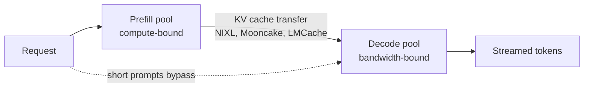

:::info 출처 · 라이선스
이 문서는 Om Bharatiya의 [AI System Design Guide](https://github.com/ombharatiya/ai-system-design-guide/blob/main/01-foundations/06-inference-pipeline.md)(MIT License, © 2026 Om Bharatiya)를 한국어로 옮긴 **비공식 번역본**입니다. 번역·편집 책임은 SecureNomad에 있습니다. 전체 안내는 [소개 · 출처 · 라이선스](../index.md)를 참고하세요. 번역 기준: 원문 커밋 `ed955b2`(2026-10-09).
:::

# 추론 파이프라인

이 장은 LLM이 추론 시 텍스트를 생성하는 방식, 관련된 연산 단계, 프로덕션 서빙의 핵심 지표를 다룬다.

## 생성 기초

LLM은 텍스트를 자기회귀적으로 생성한다: 한 번에 한 토큰씩, 이전 모든 토큰을 문맥으로 사용한다.

```
Input: "The quick brown"
Step 1: Generate "fox" -> "The quick brown fox"
Step 2: Generate "jumps" -> "The quick brown fox jumps"
Step 3: Generate "over" -> "The quick brown fox jumps over"
...
```

### 생성 루프

```python
def generate(prompt: str, max_tokens: int, model) -> str:
    tokens = tokenize(prompt)
    
    for _ in range(max_tokens):
        # Forward pass: get logits for next token
        logits = model.forward(tokens)
        
        # Sample next token from probability distribution
        next_token = sample(logits[-1])
        
        # Check for stop condition
        if next_token == EOS_TOKEN:
            break
        
        tokens.append(next_token)
    
    return detokenize(tokens)
```

---

## 프리필과 디코드 단계

추론에는 특성이 다른 두 단계가 있다:

### 프리필 단계

전체 입력 프롬프트를 병렬로 처리한다.

```
Input: "The quick brown fox" (4 tokens)

Prefill:
- Process all 4 tokens simultaneously
- Compute attention across all pairs
- Populate KV cache for all positions
- Output: logits for next token
```

**특성:**
- 연산 바운드(행렬 연산이 많음)
- 토큰 간 병렬화 가능
- 시간이 프롬프트 길이에 비례
- 생성당 한 번 발생

### 디코드 단계

한 번에 한 토큰씩 생성한다.

```
Decode step 1:
- Input: new token position only
- Attend to all KV cache (prompt + previously generated)
- Generate one token

Decode step 2:
- Append new K, V to cache
- Input: newest token position
- Generate next token

...repeat until done
```

**특성:**
- 메모리 바운드(매 스텝 가중치와 KV 캐시를 HBM에서 다시 읽음)
- 순차적(다음을 시작하려면 각 스텝을 끝내야 함)
- 토큰당 시간이 대체로 일정
- 중단 조건까지 반복

### 왜 중요한가

| 단계 | 병목 | 최적화 |
|-------|------------|--------------|
| 프리필 | 연산(GPU 코어) | Flash Attention, 더 나은 GPU |
| 디코드 | 메모리 대역폭 | GQA, 배칭, 양자화, 추측 디코딩 |

**서빙 함의:**
- 긴 프롬프트는 프리필 시간을 늘림(TTFT에 영향)
- 긴 생성은 디코드 시간을 늘림(총 지연에 영향)
- 배칭은 프리필보다 디코드 효율에 더 도움

### 프리필/디코드 분리(Disaggregation)

두 단계의 병목이 정반대이므로, 대규모 배포는 이를 별도 풀에서 실행한다: 프리필 워커가 KV 캐시를 만들어 넘기고, 디코드 워커가 토큰을 스트리밍한다.



- **이득은 peak 처리량이 아니라 goodput이다**: TTFT와 토큰 간 지연 SLO를 모두 만족하는 요청률. 프리필 버스트가 진행 중인 디코드를 더 이상 막지 않는다. (vLLM의 2026년 9월 분리 서빙 가이드가 이렇게 설명.)
- **비용은 KV 전송이다**: BF16 Llama-3.1-70B는 토큰당 320 KiB를 저장하므로, 1만 토큰 프롬프트는 디코드에 약 3 GB를 넘기고, 400 Gb/s에서 약 65 ms가 TTFT에 더해진다. 짧은 프롬프트는 종종 그럴 가치가 없다. NVIDIA Dynamo 1.5는 이를 디코드로 직행시키는 조건부 우회를 추가했다.
- **칩 간 버전**은 프리필을 HBM GPU에, 디코드를 SRAM이나 웨이퍼 스케일 부품에 두어 프리미엄 지연 티어를 만든다: NVIDIA Rubin + Groq 3 LPX(프로덕션), AMD Helios + Cerebras(발표, Cerebras Cloud 경유), Intel + SambaNova 청사진.
- **이제 모델이 이 분리를 중심으로 설계된다**: DeepSeek V4.1-Flash는 프리필에서 토큰당 8B, 디코드에서 16B 파라미터를 활성화한다.

---

## 샘플링 전략

로짓을 계산한 뒤 다음 토큰을 선택해야 한다. 전략마다 다른 출력이 나온다.

### 그리디 디코딩

항상 최고 확률 토큰을 고른다:

```python
def greedy_sample(logits):
    return torch.argmax(logits)
```

**특성:**
- 결정적
- 긴 생성에서 종종 반복적
- 사실/구조화 출력에 적합

### Temperature 샘플링

소프트맥스 전에 로짓을 스케일해 무작위성을 조절한다:

```python
def temperature_sample(logits, temperature=1.0):
    scaled_logits = logits / temperature
    probs = torch.softmax(scaled_logits, dim=-1)
    return torch.multinomial(probs, num_samples=1)
```

**Temperature 효과:**

| Temperature | 동작 | 사용 사례 |
|-------------|----------|----------|
| 0 | 그리디(수학적으로 결정적이나 배치 GPU 서빙에서 비트 단위 동일은 아님) | 사실 Q&A, 코드 |
| 0.3-0.7 | 낮은 무작위성 | 일반 과제 |
| 1.0 | 기준선 | 창작 |
| 1.5+ | 높은 무작위성 | 브레인스토밍 |

### Top-K 샘플링

확률 상위 K개 토큰만 고려:

```python
def top_k_sample(logits, k=50):
    values, indices = torch.topk(logits, k)
    probs = torch.softmax(values, dim=-1)
    sampled_idx = torch.multinomial(probs, num_samples=1)
    return indices[sampled_idx]
```

**효과:** 말이 안 될 수 있는 저확률 토큰을 걸러낸다.

### Top-P(뉴클리어스) 샘플링

누적 확률이 P를 넘을 때까지 토큰을 포함:

```python
def top_p_sample(logits, p=0.9):
    sorted_probs, sorted_indices = torch.sort(
        torch.softmax(logits, dim=-1), descending=True
    )
    cumulative_probs = torch.cumsum(sorted_probs, dim=-1)
    
    # Find cutoff
    cutoff_idx = torch.searchsorted(cumulative_probs, p)
    
    # Sample from truncated distribution
    selected_probs = sorted_probs[:cutoff_idx + 1]
    selected_probs = selected_probs / selected_probs.sum()
    sampled_idx = torch.multinomial(selected_probs, num_samples=1)
    
    return sorted_indices[sampled_idx]
```

**Top-K 대비 장점:** 확률 분포에 따라 동적으로 조정. 고신뢰 예측은 더 적은 토큰을, 불확실한 예측은 더 많은 토큰을 포함한다.

### 흔한 구성

| 사용 사례 | Temperature | Top-P | Top-K |
|----------|-------------|-------|-------|
| 코드 생성 | 0-0.2 | 0.95 | - |
| 사실 Q&A | 0.1-0.3 | 1.0 | - |
| 일반 챗 | 0.7 | 0.9 | - |
| 창작 | 1.0 | 0.95 | - |
| 브레인스토밍 | 1.2 | 1.0 | - |

이 설정은 셀프 호스팅 엔진과, 여전히 샘플링 파라미터를 받는 호스티드 모델에 적용된다. 많은 호스티드 프런티어 모델은 더 이상 받지 않는다. 호스티드 프런티어 모델의 샘플링 제어를 참고하라.

### 반복 페널티

최근 생성된 토큰의 확률을 낮춘다:

```python
def apply_repetition_penalty(logits, generated_tokens, penalty=1.2):
    for token_id in set(generated_tokens):
        logits[token_id] /= penalty
    return logits
```

**변형:**
- Presence penalty: 등장한 모든 토큰에 페널티
- Frequency penalty: 등장 횟수에 비례해 페널티

### 호스티드 프런티어 모델의 샘플링 제어

위 내용은 셀프 호스팅 엔진에 여전히 적용된다: vLLM, SGLang, llama.cpp는 전체 기능을 노출한다. 호스티드 추론 모델은 이 손잡이를 제거하고 있다:

| 공급사 | 바뀐 점 |
|----------|--------------|
| Anthropic | Claude API는 Claude Opus 4.7과 이후 모든 Claude 모델에서 기본값이 아닌 `temperature`·`top_p`·`top_k`에 400을 반환. Python SDK 1.0(2026-08-20)은 Messages 메서드 시그니처에서 이를 제거해, 전달 시 `TypeError` 발생(구형 모델은 `extra_body`로 여전히 받을 수 있음). |
| Google | 2026-07-21 Gemini API에서 `temperature`·`top_p`·`top_k` 폐기. Gemini 3.8 Flash는 `thinking_budget`을 `thinking_level`(`low`, 기본 `medium`, `high`)로 대체. |
| OpenAI | GPT-6 Astra(2026-09-03)는 커스텀 `temperature`·`top_p`를 받지 않고 logprobs도 반환하지 않음. |

이제 제어면은 샘플러가 아니라 **추론 effort**(또는 thinking level)다. 바뀌는 점:
- **결정성**: "재현성을 위해" `temperature=0`을 설정하던 코드가 이제 깨지거나 단계적으로 폐기된다(Claude API 400, Anthropic Python SDK 1.0의 `TypeError`, GPT-6 Astra 미지원, Gemini 폐기). 게다가 애초에 비트 동일 출력을 보장한 적도 없다. 배치 GPU 서빙, MoE 라우팅, 부동소수점 축약 순서 때문에, 엔진이 일정 처리량을 희생해 결정적·배치 불변 모드를 돌리지 않는 한 출력은 실행마다 달라진다.
- **신뢰 신호**: 라우팅·기권·사람 에스컬레이션을 위한 logprob 기반 점수화는 Astra에서 작동하지 않는다. 대신 보정된 분류기, 검증 패스, 구조화된 자기 평가를 쓰라.
- **다양성**: best-of-n 다양성은 이제 temperature를 올려서가 아니라, 프롬프트 변형·다른 모델·공급사 자체 샘플링에서 온다.
- **추상화 레이어**: 샘플링 파라미터를 하드코딩한 래퍼는 이 모델들로 전환하면 깨진다. 공급사별 파라미터는 모델별 얇은 설정 뒤에 두라.

---

## 중단 조건

생성은 중단 조건이 충족될 때까지 계속된다:

### EOS 토큰

모델이 시퀀스 끝 토큰을 생성:

```python
if next_token == tokenizer.eos_token_id:
    break
```

### 최대 토큰

생성 길이의 하드 한도:

```python
for i in range(max_tokens):
    # generate...
```

### 중단 시퀀스

생성을 종료하는 커스텀 문자열:

```python
stop_sequences = ["###", "\n\n", "Human:"]

for seq in stop_sequences:
    if output.endswith(seq):
        output = output[:-len(seq)]
        break
```

---

## 추측 디코딩(Speculative Decoding)

**지연 민감 디코드에서 모든 주요 서빙 엔진의 표준이다.**

저렴한 드래프터가 다음 K개 토큰을 제안하고, 타깃 모델이 한 번의 순전파로 K개를 모두 검증해, 동의하는 가장 긴 접두부와 자신이 샘플링한 토큰 하나를 유지한다. 표준 기각 샘플링 검증에서는 출력 분포가 타깃과 정확히 일치하므로, 추측은 품질이 아니라 속도를 바꾼다.

```
Drafter (cheap): proposes "The", "quick", "brown", "fox", "jumps"
Target (large):  verifies all 5 in ONE forward pass
Result: if the target accepts 4, it adds 1 of its own: 5 tokens for one
        large forward pass (plus the drafter's cost)
```

| 방법 | 드래프트 출처 | 상태(2026년 10월) |
|--------|------------------------|-----------------------|
| 드래프트 모델 | 같은 토크나이저의 별도 소형 모델 | 여전히 지원; 맞는 소형 모델 필요 |
| EAGLE-3 | 타깃 은닉 상태로 학습된 경량 헤드 | 내장 헤드 없는 모델의 흔한 선택 |
| MTP 헤드 | 모델에 포함된 멀티토큰 예측 모듈 | DeepSeek V3 이후; MiMo-V2.6-Pro(5레이어 MTP, 패스당 7토큰); Qwen3.8-Flash-Next(4B MTP 모듈) |
| DSpark | 체크포인트에 번들된 DeepSeek 드래프터 | DeepSeek-V4-Flash-DSpark·V4-Pro-DSpark(2026-06-27)는 드래프트 모듈을 붙인 동일 체크포인트; vLLM `method: "dspark"`에 추측 토큰 7개 |
| DFlash 2 | 블록 전체를 병렬 제안하는 블록 확산 드래프터 | Inco AI, 2026-08-18; Qwen3.8-27B에서 2.7~3.4배(벤더 보고); 8/19~27 SGLang·vLLM·llama.cpp에 병합 |
| N-gram, 프롬프트 룩업, 서픽스 디코딩 | 프롬프트나 이전 출력의 부분 문자열 | 추가 모델 없음; 텍스트가 반복되는 RAG·코드 편집·에이전트 루프에 강함 |

2024년 인기였던 Medusa 헤드는 더 이상 vLLM에 문서화되지 않는다(`medusa` 메서드 값은 여전히 허용). EAGLE-3나 모델 자체 MTP 헤드를 선호하라.

**배치 크기의 함정.** 추측은 추가 연산을 써서 대역폭 바운드 디코드 스텝을 절약한다. 낮은 동시성에선 그 연산이 공짜지만, 높은 동시성에선 GPU가 이미 바쁘고 기각된 드래프트 토큰은 모두 낭비다. 그래서 고전적 조언이 "큰 배치에선 끄라"였다. vLLM의 **적응형 검증**(2026-08-14; v0.30에서 MTP·EAGLE-3·DFlash 드래프터로 확장)은 각 드래프트 위치의 생존 확률을 점수화해 스텝당 전역 상위 B개 드래프트 슬롯만 허용한다. DeepSeek-V4-Pro-0813에서 7개 드래프트 토큰 중 첫째는 70% 이상, 마지막은 10% 미만 생존하며, vLLM은 동시성 256까지 추측이 유익하다고 보고한다.

**운영상 결과:**
- 이제 배포사가 가중치와 함께 드래프터를 제공하므로, 셀프 호스트 처리량 추정은 추측이 켜진 것으로 가정해야 하고, 평가 동등성 점검은 실제 서빙하는 추측 경로로 돌려야 한다.
- MLPerf Inference v6.1(2026년 9월)은 gpt-oss-120b Interactive 시나리오에서 추측 디코딩을 허용하므로, 그 테스트 결과에 포함될 수 있다.

전체 설명은 [추측 디코딩](https://github.com/ombharatiya/ai-system-design-guide/blob/main/04-inference-optimization/03-speculative-decoding.md)을 참고하라.

---

## 지연 지표

### 첫 토큰까지 시간(TTFT)

요청부터 첫 생성 토큰까지의 시간.

```
TTFT = network_latency + queue_time + prefill_time
```

**TTFT에 영향:**
- 프롬프트 길이(프리필은 프롬프트 길이에 선형으로 증가, 이차 어텐션이 지배하는 장문맥에서 더 빠르게)
- 모델 크기
- GPU 속도
- 큐 깊이

**목표:**
- 인터랙티브 챗: &lt; 500ms
- 실시간: &lt; 200ms
- 배치: 덜 중요

### 초당 토큰(TPS)

첫 토큰 이후 토큰 생성 속도. 요청당 TPS는 **토큰 간 지연**(ITL, time per output token)의 역수다.

```
TPS = (total_tokens - 1) / (total_time - TTFT)
```

**TPS에 영향:**
- 모델 크기(MoE는 활성 파라미터)
- 배치 크기
- GPU 메모리 대역폭
- KV 캐시 크기
- 추측 디코딩 수락률

**전형적 값:**
- H100의 Llama 70B: 요청당 30-50 토큰/초
- 호스티드 프런티어 API, 표준 티어: 요청당 수십 토큰/초, 모델·추론 effort·부하에 따라 변동
- 소형 모델(7B): 100+ 토큰/초

추론 모델은 첫 가시 토큰 전에 숨은 사고 토큰이 스트리밍되므로, 사용자 체감 TTFT에는 디코드 단계 일부가 포함된다. 첫 *가시* 토큰까지 시간을 따로 측정하라.

### 속도는 가격이 매겨진 티어다

공급사들은 이제 모델과 별개로 속도를 판다:
- **OpenAI**: Fast 티어(2026-07-30 Priority에서 개명)는 Standard의 2배(GPT-5.5는 2.5배); Ultrafast는 6배로 2026-09-29부터 GPT-6 Astra에서 GA. GPT-5.6 Sol Ultrafast는 선택 고객 프리뷰로 Cerebras에서 최대 750 출력 토큰/초.
- **Anthropic**: Claude Opus 5.5의 fast 모드는 100만당 $8/$40(표준의 2배), Claude API 한정 리서치 프리뷰.
- **확산 LM**은 토큰별 디코드를 병렬 정제로 대체: Inception은 Mercury 2.5가 NVIDIA GPU에서 1,107 토큰/초, 100만당 $0.20/$0.75라고 보고.

지연은 이제 라우팅 차원이다: 사용자 대면 턴은 fast 티어로, 백그라운드 에이전트 스텝은 Standard나 Batch로 보내라.

### 총 지연

```
Total = TTFT + (output_tokens / TPS)
```

**예시:**
- TTFT: 200ms
- TPS: 50 토큰/초
- 출력: 100 토큰
- 총: 200ms + 2000ms = 2.2s

### 처리량(Throughput)

단위 시간당 완료 요청 수:

```
Throughput = concurrent_requests * TPS / average_output_tokens
```

큰 배치는 처리량을 높이지만 요청당 지연을 늘릴 수 있다.

### Goodput과 파레토 곡선

peak 처리량과 배치 1 속도는 단독으로 오해를 부른다. **Goodput**은 TTFT와 ITL SLO를 동시에 만족하는 요청률이다. 엔진이나 가속기를 비교할 때는 자신의 SLO에서, 자신과 비슷한 트래픽으로 **처리량 대 인터랙티비티 파레토 곡선**을 비교하라.

SemiAnalysis의 AgentX 시나리오(프리픽스 재사용이 높은 멀티턴·장문맥 에이전트 트래픽)는 운영점이 얼마나 중요한지 보여준다. DeepSeek V4 Pro에서, 소유 비용 가정하 사용자당 170 토큰/초에서 Vera Rubin NVL72가 GB300의 TCO당 처리량 약 67배지만, 3년 렌탈 가격·80 토큰/초 P90 SLA에서는 GB300 NVL72보다 토큰 62%만 더 많다고 보고한다(분석가 보고). 같은 하드웨어, 같은 모델인데 인터랙티비티 목표와 비용 기준에 따라 67배 헤드라인이거나 1.6배 결과다. 어떤 가속기 주장을 받아들이기 전에 둘 다 요구하라.

---

## 메모리·연산 요구량

### 모델 가중치

```
Memory = parameters * bytes_per_parameter

70B model in BF16: 70B * 2 bytes   = 140 GB
70B model in FP8:  70B * 1 byte    = 70 GB
70B model in INT4 or FP4: 70B * 0.5 bytes = 35 GB
  (plus block scales: NVFP4 ~4.5 bits/weight, ~39 GB; MXFP4 ~4.25 bits, ~37 GB)
```

**2026년의 정밀도:** FP4 가중치(NVIDIA는 NVFP4, AMD·기타 OCP 포맷 하드웨어는 MXFP4) + FP8 KV 캐시가 대표 서빙 구성이며, SGLang은 로드 시 NVFP4 체크포인트를 MXFP4로 재양자화해 AMD에서 돌릴 수 있다. 낮은 정밀도는 좋은 커널이 있어야만 이긴다: NVIDIA Dynamo의 Nemotron 3.5 Lightning 레시피는 Marlin 커널에서 BF16이 NVFP4보다 80% 빠르고, CuTeDSL 커널에서 12% 빠르다고 측정했다. FP4가 더 빠르다고 가정하기 전에 정확한 커널 경로를 벤치마크하라.

MoE 모델은 **총** 파라미터로 메모리를(모든 전문가가 상주해야 함), **활성** 파라미터로 연산을 산정하라.

### KV 캐시

```
Per token: 2 * layers * kv_heads * head_dim * bytes
Per request: per_token * sequence_length

Llama 3.x 70B (80 layers, 8 KV heads via GQA, head_dim 128, BF16):
= 2 * 80 * 8 * 128 * 2 bytes
= 320 KiB per token

At 4K context:   ~1.3 GB per request
At 8K context:   ~2.7 GB per request
At 128K context: ~43 GB per request
(FP8 KV halves these. Full MHA with 64 KV heads would be 8x larger.)
```

이 공식은 표준 GQA/MHA 레이어에만 성립한다. 슬라이딩 윈도·선형 어텐션·압축 KV 모델은 자체 계산이 필요하다. [하이브리드·희소 어텐션](03-attention-mechanisms.md)을 참고하라.

### 총 GPU 메모리

```
Total = model_weights + kv_cache * batch_size + activations

Example: Llama 3.x 70B, 8K context, batch 16
- Weights (INT4/FP4): ~35-40 GB
- KV cache (BF16, 8K, batch 16): 16 * 2.7 GB = ~43 GB
- Activations and runtime overhead: ~5 GB
- Total: ~83-88 GB, just over one H100 80GB. Fits one H200 141GB,
  or one H100 with FP8 KV (~21 GB of KV instead of ~43 GB)
```

### 토큰당 FLOPs

```
Forward pass FLOPs ≈ 2 * active parameters

70B dense model:
≈ 140 GFLOPs per token

At 40 tokens/sec for one request:
≈ 5.6 TFLOPS sustained, under 1% of an H100's ~989 dense BF16 TFLOPS.
Decode is bound by memory bandwidth, not FLOPs, until batching
raises arithmetic intensity.
```

---

## 스트리밍

인터랙티브 애플리케이션에서는 토큰을 생성되는 대로 스트리밍한다:

### 서버 전송 이벤트(SSE)

```python
# Server
async def generate_stream(prompt: str):
    for token in model.generate_iter(prompt):
        yield f"data: {json.dumps({'token': token})}\n\n"
    yield "data: [DONE]\n\n"

# Client
async for event in sse_client.stream("/generate"):
    token = json.loads(event.data)["token"]
    display(token)
```

### 이점

| 측면 | 스트리밍 | 비스트리밍 |
|--------|-----------|---------------|
| 체감 지연 | TTFT만 | 전체 생성 시간 |
| 사용자 경험 | 점진적 | 대기 후 완성 |
| 조기 종료 | 사용자가 중단 가능 | 기다려야 함 |
| 메모리 | 낮음 | 높음(응답 버퍼) |

### 구현 세부

- 각 토큰 후 flush
- 연결 끊김을 우아하게 처리
- 매우 빠른 생성에는 버퍼링 고려
- 일부 프레임워크는 기본 버퍼링; 스트리밍 시 비활성화
- 첫 토큰이 클라이언트에 도달하기 전에만 페일오버하라. 이후 다른 백엔드로 재시도하면 이미 보여준 출력과 중복되거나 모순된다. 이제 게이트웨이가 이를 직접 구현한다(Envoy AI Gateway 1.1의 `streamIdleTimeout`은 첫 토큰이 안 오면 다음 백엔드로 이동)

---

## 프로덕션 고려 사항

### 처리량을 위한 배칭

여러 요청을 묶어 GPU 활용을 극대화한다:

```python
# Without batching: GPU underutilized
for request in requests:
    response = model.generate(request)

# With batching: parallel processing
batch = collect_requests(timeout_s=0.010, max_batch=32)
responses = model.generate_batch(batch)
```

### 연속 배칭과 프리픽스 캐싱

**연속 배칭(반복 수준 스케줄링):**
정적 배칭과 달리, 연속 배칭은 배치 내 어떤 요청이 EOS 토큰에 도달하는 즉시 새 요청을 투입한다. Anyscale은 2023년 순진한 정적 배칭 대비 최대 23배 처리량을 측정했고, 이제 모든 주요 엔진이 기본으로 수행한다. 수용 제어와 함께 쓰라: vLLM 0.29는 `--max-num-queued-reqs`와 `--max-num-queued-tokens`를 추가해, 과부하 시 무한 큐와 폭주하는 TTFT 대신 빠른 에러를 반환한다.

**프리픽스 캐싱(vLLM 자동 프리픽스 캐싱, SGLang RadixAttention):**
공통 접두부(시스템 프롬프트, 도구 정의, 퓨샷 예시, 이전 에이전트 턴)의 KV 텐서를 캐시한다.
- **TTFT 감소**: 공유 접두부의 프리필을 건너뛰므로, 프롬프트의 공유 비율만큼 절감된다. 길고 안정적인 접두부를 가진 에이전트 루프가 가장 큰 이득.
- **메커니즘**: vLLM은 고정 크기 KV 블록을 그 앞의 모든 것을 키로 한 체인으로 해싱하고, SGLang은 접두부를 래딕스 트리에 저장한다. 축출된 블록은 티어 체인을 따라 내려갈 수 있다: GPU HBM → 호스트 DRAM → 디스크·오브젝트 스토리지·피어 노드.
- **보안**: 공유 프리픽스 캐시는 테넌트 간 타이밍 사이드 채널이다. 적중이 미적중보다 빨리 반환되기 때문이다. 테넌트별로 캐시 키에 솔트를 섞고(vLLM `cache_salt`) 엔진을 패치 상태로 유지하라: vLLM 권고 GHSA-935w-9g4m-p28p(0.30.0에서 수정)는 한 API 경로의 도구 연속 턴에서 솔트가 누락됨을 발견했다. vLLM 0.30.0을 하한으로 삼으라. 2026년 8~9월 권고 물결에는 단일 요청 엔진 킬과 모델 로드 RCE(둘 다 0.28.0에서 수정)도 있었다.

### 멀티-LoRA 서빙

**시나리오:** 하나의 베이스 모델 위에서 1000개의 서로 다른 파인튜닝 모델(어댑터)을 서빙.
**과제:** 1000개 개별 모델을 로드하면 테라바이트급 VRAM이 필요.

**해법(LoRAX / S-LoRA가 개척, 이제 vLLM·SGLang 네이티브):**
1. 베이스 모델 하나를 VRAM에 로드.
2. LoRA 어댑터(메가바이트)를 호스트 RAM이나 SSD에 저장.
3. 요청 ID에 따라 순전파 중 어댑터를 동적으로 교체.
4. **구현**: 같은 배치의 여러 다른 어댑터에 대해 행렬-벡터 곱을 수행하는 특수 커널(S-LoRA) 사용.

### 요청 우선순위

```python
class RequestQueue:
    def __init__(self):
        self.high_priority = asyncio.Queue()
        self.low_priority = asyncio.Queue()
    
    async def get_next(self):
        if not self.high_priority.empty():
            return await self.high_priority.get()
        return await self.low_priority.get()
```

**우선순위 기준:**
- 고객 등급
- 요청 유형
- 대기 시간
- 추정 연산 비용

### 타임아웃 처리

```python
async def generate_with_timeout(prompt: str, timeout: float):
    try:
        result = await asyncio.wait_for(
            model.generate(prompt),
            timeout=timeout
        )
        return result
    except asyncio.TimeoutError:
        return {"error": "timeout", "partial": partial_output}
```

### 우아한 성능 저하(Graceful Degradation)

```python
async def generate_with_fallback(prompt: str):
    try:
        return await primary_model.generate(prompt)
    except RateLimitError:
        return await fallback_model.generate(prompt)
    except TimeoutError:
        return await small_fast_model.generate(prompt)
```

적어도 하나의 폴백은 벤더를 교차하게 하라. 공급사 장애는 그 벤더의 모든 모델·제품을 한꺼번에 내리는 경향이 있어, 형제 모델로의 폴백이 같은 순간 함께 실패하곤 한다. 2026년 8월 16일~9월 29일 Anthropic 상태 페이지에는 주요·심각 장애가 최소 12건 기록됐고, OpenAI의 9월 29일 장애(약 5시간 20분)는 API·ChatGPT·Codex를 함께 강타했다.

### 비용 추적

```python
@dataclass
class RequestMetrics:
    input_tokens: int          # uncached input. Anthropic reports cache reads
                               # separately; OpenAI's input count includes
                               # cached tokens, so subtract them first
    cached_input_tokens: int   # cache reads
    output_tokens: int         # includes reasoning tokens
    model: str
    latency_ms: float
    cost_usd: float

def calculate_cost(metrics: RequestMetrics) -> float:
    # USD per 1M tokens, standard tier list prices as of October 2026.
    # Ignores cache-write premiums, batch discounts and long-context surcharges.
    pricing = {
        "gpt-6-sol": {"input": 2.00, "cached": 0.20, "output": 10.00},
        "claude-sonnet-5-5": {"input": 2.00, "cached": 0.20, "output": 10.00},
    }
    rates = pricing[metrics.model]
    return (
        (metrics.input_tokens / 1_000_000) * rates["input"] +
        (metrics.cached_input_tokens / 1_000_000) * rates["cached"] +
        (metrics.output_tokens / 1_000_000) * rates["output"]
    )
```

---

## 면접 질문

### Q: 프리필과 디코드 단계의 차이를 설명하라.

**좋은 답변:**
LLM 추론에는 뚜렷이 다른 두 단계가 있다:

**프리필:**
- 전체 입력 프롬프트를 한 번에 처리
- 모든 토큰이 병렬로 서로에게 주의
- 모든 프롬프트 위치의 KV 캐시를 채움
- 연산 바운드: GPU 코어를 효율적으로 사용
- 시간이 프롬프트 길이에 비례

**디코드:**
- 한 번에 한 토큰 생성
- 새 토큰이 모든 KV 캐시 항목에 주의
- 새 K, V를 캐시에 추가
- 메모리 바운드: 매 스텝 가중치(작은 배치에서 지배적)와 KV 캐시(장문맥·큰 배치에서 지배적)를 다시 읽음
- 토큰당 시간이 대체로 일정하며 KV 캐시가 커질수록 조금씩 증가

시스템 설계에 중요한 이유:
- 긴 프롬프트는 TTFT를 늘림(프리필 집약)
- 배칭은 프리필보다 디코드에 더 도움
- 단계마다 다른 최적화 전략

### Q: temperature와 top-p는 생성에 어떻게 영향을 주는가?

**좋은 답변:**
둘 다 토큰 선택의 무작위성을 제어한다:

**Temperature:**
- 소프트맥스 전에 로짓을 스케일
- 낮음(0-0.3): 더 결정적, 고확률 토큰 선택
- 높음(1.0+): 더 무작위, 확률 분포를 평탄화
- 0: 그리디 디코딩

**Top-p(뉴클리어스 샘플링):**
- 누적 확률 > p인 가장 작은 토큰 집합으로 필터
- 분포에 따라 컷오프를 동적 조정
- 고신뢰: 소수 토큰 고려
- 저신뢰: 다수 토큰 고려

전형적 프로덕션 설정:
- 사실 Q&A: temperature 0.1, top-p 0.95
- 일반 챗: temperature 0.7, top-p 0.9
- 창작: temperature 1.0+, top-p 0.95

핵심은 둘이 함께 작동한다는 점이다. temperature는 분포를 재구성하고, top-p는 잘라낸다.

2026년 유의점: 많은 호스티드 추론 모델이 더 이상 이 파라미터를 받지 않는다(Claude API는 Opus 4.7부터 기본값 외 값을 거부, Google은 2026년 7월 Gemini API에서 폐기, GPT-6 Astra는 미지원). 이 모델들에선 추론 effort가 주 레버이고 샘플러 설정은 공급사의 선택이다. 위 표는 셀프 호스팅 엔진에는 여전히 유효하다.

### Q: API가 더 이상 temperature를 받지 않을 때 재현 가능한 출력을 어떻게 얻는가?

**좋은 답변:**
먼저 목표를 분리하라. 배치 GPU 서빙에서는 temperature 0에서도 비트 동일 출력이 보장된 적이 없으므로, "재현 가능"은 "같은 바이트"가 아니라 "시스템이 동일하게 동작할 만큼 안정적"을 뜻해야 한다.

대신 내가 의존하는 것:
1. **출력 공간을 제약하라.** JSON 스키마 구조화 출력, 분류용 enum, 거부·재시도 검증기. "비결정성" 불만 대부분은 애초에 자유 형식일 필요가 없던 자유 텍스트에 관한 것이다.
2. **움직이는 모든 것을 고정하라.** 정확한 모델 ID, effort 수준, 프롬프트 버전, 도구 정의. 공급사가 안정 모델 ID 아래 버그를 고치기도 하므로(OpenAI는 2026년 9월 GPT-6 Sol·Luna 이미지 이해에서 그렇게 함), 공급사가 변경을 알리면 평가를 다시 돌려라.
3. **입력으로 캐시하라.** 동일 요청은 정규화된 입력을 키로 한 응답 캐시가 같은 답을 공짜로 반환.
4. **단일 실행이 아니라 분산을 측정하라.** 평가는 각 케이스를 여러 번 돌려 통과율과 퍼짐을 추적한다. 회귀는 분포의 이동이다.
5. **비트 정확성이 요구되면 셀프 호스트하라**(감사 리플레이, 일부 규제 워크플로): 오픈 가중치, 그리디 디코딩, 엔진의 결정적·배치 불변 모드를, 처리량 비용을 감수하고.

### Q: TTFT와 TPS를 결정하는 것은?

**좋은 답변:**
**TTFT(첫 토큰까지 시간):**
- 서버 도달 네트워크 지연
- 큐 대기 시간
- 프리필 연산 시간
- 지배 요인: 프롬프트 길이, GPU 연산 속도

**TPS(초당 토큰):**
- 디코드 단계 효율
- 가중치·KV 캐시 읽기 메모리 대역폭
- 지배 요인: 메모리 대역폭, 배치 크기, 모델 크기(MoE는 활성 파라미터)

최적화 전략이 다르다:
- TTFT: 가능하면 프롬프트 축소, 더 빠른 네트워킹, 큐잉 최소화
- TPS: 배치 크기 증가, GQA/MQA 모델 사용, 메모리 접근 최적화, 낮음~중간 동시성에서 추측 디코딩 활성화

트레이드오프: 배칭은 TPS(처리량)를 높이지만, 요청이 배치 형성을 기다리면 TTFT(지연)를 늘릴 수 있다.

### Q: 모델 서빙을 위한 GPU 요구량을 어떻게 추정하겠는가?

**좋은 답변:**
주요 메모리 소비처는 셋이다:

1. **모델 가중치:**
   - BF16/FP16: 파라미터 * 2 바이트
   - FP8/INT8: 파라미터 * 1 바이트
   - FP4/INT4: 파라미터 * 0.5 바이트(+ 블록 스케일)
   - MoE: 활성이 아니라 총 파라미터로 계산

2. **KV 캐시:**
   - 토큰당: 2 * layers * kv_heads * head_dim * 2 바이트(BF16), 표준 GQA/MHA 모델만
   - 요청당: per_token * sequence_length
   - 총: per_request * batch_size

3. **활성값:** 보통 5-10% 오버헤드

Llama 3.x 70B 서빙 예(GQA, 8 KV 헤드):
- 가중치(INT4/FP4): ~35-40 GB
- KV 캐시(8K 문맥, 배치 8, BF16): 8 * 2.7 GB = ~21 GB
- 필요: 총 ~60-65 GB

하드웨어 옵션:
- 4비트 가중치 1x H100 80GB, 8K에서 배치를 약 13-14까지 늘릴 여유
- FP8 가중치(70 GB) 1x H200 141GB, 더 큰 배치
- FP8 텐서 병렬 2x H100 80GB, 또는 장문맥용(128K에선 요청당 KV ~43 GB)

피해야 할 실수는 KV 헤드가 아니라 쿼리 헤드로 KV를 산정하는 것이다: 이 예에서 168 GB, 8배 과대가 된다. 그리고 하이브리드 어텐션 모델(슬라이딩 윈도·선형·압축 KV)은 모델 자체 KV 수치를 쓰라. 그다음 자신의 SLO에서 벤치마크로 처리량을 검증하라.

---

## 참고 문헌

- Holtzman et al. "The Curious Case of Neural Text Degeneration" (nucleus sampling, 2020)
- Kwon et al. "Efficient Memory Management for Large Language Model Serving with PagedAttention" (vLLM, 2023)
- Leviathan et al. "Fast Inference from Transformers via Speculative Decoding" (2023)
- [vLLM Documentation](https://docs.vllm.ai/)
- [vLLM: Disaggregated Serving Guide](https://vllm.ai/blog/2026-09-29-disaggregated-serving-guide) (2026)
- [vLLM: Adaptive Verification for Speculative Decoding](https://vllm.ai/blog/2026-08-14-dspark-adaptive-verification) (2026)
- [TensorRT-LLM](https://github.com/NVIDIA/TensorRT-LLM)
- [OpenAI API Documentation](https://platform.openai.com/docs/api-reference)

---

*이전: [임베딩과 벡터 공간](05-embeddings-and-vector-spaces.md) | 다음: [모델 분류 체계](https://github.com/ombharatiya/ai-system-design-guide/blob/main/02-model-landscape/01-model-taxonomy.md)*
