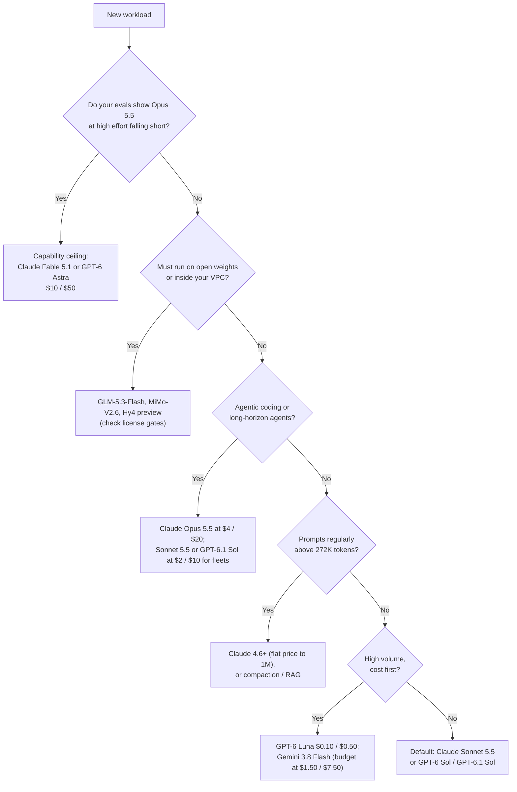

:::info 출처 · 라이선스
이 문서는 Om Bharatiya의 [AI System Design Guide](https://github.com/ombharatiya/ai-system-design-guide/blob/main/02-model-landscape/04-model-selection-guide.md)(MIT License, © 2026 Om Bharatiya)를 한국어로 옮긴 **비공식 번역본**입니다. 번역·편집 책임은 SecureNomad에 있습니다. 전체 안내는 [소개 · 출처 · 라이선스](../index.md)를 참고하세요. 번역 기준: 원문 커밋 `ed955b2`(2026-10-09). 모델·가격 수치는 그 시점 스냅샷이라 빠르게 낡습니다.
:::

# 모델 선택 가이드

역량, 비용, 지연, 운영 요소를 고려해 용도에 맞는 LLM을 고르는 실전 프레임워크.

## 선택 프레임워크

### 의사결정 트리 (2026년 10월)



2026년 9월에 트리를 바꾼 두 가지. Anthropic은 이제 고객에게 **Opus 5.5**로 시작하라고 안내한다. Fable 5.1 비용의 40%이면서 Anthropic 자체 출시 표에서 에이전트·코딩 벤치마크를 앞선다(벤더 보고). 그래서 천장 티어는 시작점이 아니라 에스컬레이션 경로다. 그리고 $2 / $10 중간 티어(Sonnet 5.5, GPT-6 Sol, GPT-6.1 Sol)가 벤더 보고 에이전트 평가에서 플래그십에 충분히 가까워, 대부분의 에이전트 트래픽은 Opus급 가격이 필요 없을 수 있다. 플릿을 옮기기 전에 자신의 과제로 확인하라.

### 핵심 선택 요소

| 요소 | 가중치 | 고려 사항 |
|--------|--------|----------------|
| **에이전트 신뢰성** | 높음 | 도구 호출 정확도, 다단계 계획, 이진 과제 완료 |
| **과제당 비용** | 높음 | 토큰 단가가 아니라 과제당 토큰 × 가격. 에이전트 루프는 5~10배 토큰을 쓰고, 과제당 토큰은 모델 간 몇 배 차이 |
| **문맥 회상과 가격** | 높음 | 1M에서의 회상, 그리고 벤더가 장문맥 절벽을 과금하는지(OpenAI 272K 초과, xAI 200K) |
| **레이트 리밋 천장** | 높음 | **(시니어 뉘앙스)**: 공급사가 429 없이 당신의 P99 처리량을 감당하는가, 월 지출 상한이 트래픽을 강제 중단시키는가? |
| **데이터 처리** | 높음 | ZDR 가능 여부(Opus 5.5·Sonnet 5.5 가능; Fable 5.1은 명시 승인 시만; OpenAI Agents API는 불가)와 약 10% 레지던시 프리미엄 |
| **생태계 성숙도** | 높음 | 프로덕션 실적, SDK 지원, 엔터프라이즈 SLA |
| **수명 여유** | 중간 | 플랫폼별 폐기 하한·통지 기간(Opus 5.5, Sonnet 5.5, Fable 5.1: 2027년 9월 이전 폐기 없음) |

---

## 역량 비교

### 프런티어 모델 비교 (2026년 10월)

아래 점수는 출처를 라벨로 표기한다. "AA"는 Artificial Analysis Intelligence Index v4.3.2(Claude 항목은 "with fallback"); 이전 인덱스 버전은 비교 불가.

| 모델 | 강점 | 약점 | 문맥 | 적합 |
|-------|-----------|------|---------|----------|
| **Claude Opus 5.5** ($4 / $20) | Anthropic 권장 기본값. AA 58, 최고점. Anthropic 출시 표 모든 행에서 Fable 5.1을, 대부분 행에서 Astra를 앞섬(Terminal-Bench 4.0 xhigh 66.4% vs 57.9%), 단 AutomationBench(41.4% vs 40.0%)·Terminal-Bench-Science(64.6% vs 58.7%)는 Astra 우위; 모두 벤더 보고. 이후 Sonnet 5.5가 더 높은 Terminal-Bench 점수 보고. 캐시 읽기 0.05배; ZDR 가능 | 기본 effort가 `medium`으로 하락; 사고 비활성 불가; 강제 `tool_choice`는 400; 헤드라인 점수에 Opus 4.8·5 안전 폴백 포함 | 1M / 출력 128K | 에이전트 코딩, 컴퓨터 사용, 어려운 프로덕션 |
| **Claude Sonnet 5.5** ($2 / $10) | Anthropic 에이전트 평가에서 Opus 5.5와 몇 점 차(벤더 보고 Terminal-Bench 4.0 70.6%, OSWorld 2.1 부분 80.1%). AA 56. ZDR 가능 | 벤더 수치 독립 재현 전; `thinking: disabled`는 400; 사고 블록은 생성 계정에 묶임 | 1M / 128K | 에이전트 플릿, 대규모 코딩, 기본 챗 |
| **Claude Fable 5.1** ($10 / $50) | Anthropic 천장. 1M까지 정액 $10 / $50, 캐시 읽기 0.025배. Terminal-Bench 4.0 리더보드 57.88%(max) | Opus 5.5가 Anthropic 자체 표에서 40% 가격으로 앞섬; AA 53; 30일 보관, ZDR은 승인 시만 | 1M / 128K | 더 높은 effort의 Opus 5.5도 평가를 통과 못 하는 과제 |
| **GPT-6 Astra** ($10 / $50) | OpenAI 천장. Terminal-Bench 4.0 리더보드 1위(58.18%, max). 코딩 과제당 GPT-5.6 Sol 토큰의 약 1/3(AA). AA 53 | 272K 초과 시 요청 전체 $20 / $75; temperature·top_p·logprobs·`none` effort 없음; 사이버 Critical 등급 첫 OpenAI 모델이라 Daybreak 밖 익스플로잇 작업 제한 | 1.05M / 128K | OpenAI 스택 천장 작업; 토큰 효율이 가격을 상쇄하는 긴 코딩 과제 |
| **GPT-6.1 Sol** ($2 / $10) | AA 52. 캐시 읽기 0.05배. Codex CLI 기본 | GPT-6 Sol 1주 뒤인 9/29 출시라 독립 평가 부족; 272K 절벽; 기본 effort `medium` | 1.05M / 128K | OpenAI 측 코딩·전문 작업 기본값 |
| **GPT-6 Sol / GPT-6 Luna** ($2 / $10; $0.10 / $0.50) | GPT-5.6 가격의 절반; Luna가 OpenAI 바닥을 다시 내림 | 9/25 수정 전까지 이미지 이해 저하(같은 ID로 패치); Terra 티어 없음 | 1.05M / 128K | Sol: 일반 프로덕션. Luna: 라우팅·분류·추출 |
| **Gemini 3.8 Flash** ($0.75 / $3.75 도입가; 2027-01-01부터 $1.50 / $7.50) | DeepSWE v1.1에서 GPT-6 Astra·Opus 5와 74% 동률을 최저 과제당 비용($2.36)으로. Gemini 컴퓨터 사용(프리뷰) 권장 모델 | 1/1 가격 2배; 과제당 추론 토큰 더 씀; AA 41; 출력 상한 65,536 | 1M / 65K | 코딩 에이전트 과제당 비용 리더; 대량 RAG |
| **Grok 4.7** ($2 / $6) | $2-입력 모델 중 최저 출력가; 새롭고 더 큰 베이스 모델 | 200K에서 요청 전체 2배; AA 46, 4.6보다 2점 위; fast 변형은 Cursor·Grok Build에만 | 500K | 200K 미만 출력 중심 작업 |
| **Muse Spark 1.3** ($1.25 / $4.25) | $2 / $10 티어보다 한참 아래인 $1.25 / $4.25에 AA 48 | 1.2보다 장황해 과제당 비용 상승; 기여자 티어는 데이터를 가격과 교환 | 1M | 가격 민감 일반 작업(과제당 비용 확인 후) |

**폐기됐으나 아직 서빙:** Claude Opus 5, Sonnet 5, Fable 5, Opus 4.8; GPT-5.6 Sol·Terra·Luna; GPT-5.5. Claude Sonnet 4.5는 2026-11-30 폐기.

**발표됐으나 미출시(2026-10-01 기준):** Google의 **Gemini 4 Argon**(9/30 발표)은 Fairwind 프로그램의 사이버 방어자에게 먼저 롤아웃, 유료 API·AI Ultra 접근은 미정 시점. 도입가 $2 / $10(이후 $4 / $20), Google은 출력을 1M 토큰으로 올린다고 하며, AA는 출시 전 high-effort 실행을 53으로 측정. 출시 전까지 Gemini 3.1 Pro Preview가 Google 유일의 Pro급 API 모델. **Claude Haiku 5.5**는 "앞으로 몇 주 내" 발표됨.

### 예산 모델 비교

| 모델 | 비용(100만 입력/출력) | 품질 신호 | 문맥 | 적합 |
|-------|----------------------------|----------------|---------|----------|
| **GPT-6 Luna** | $0.10 / $0.50 | GPT-5.6 Luna 후속, 절반 가격 | 1.05M | 라우팅, 분류, 추출 |
| **Gemini 3.8 Flash** | $0.75 / $3.75 도입; 2027-01-01부터 $1.50 / $7.50 | DeepSWE v1.1 74%(삼자 동률) | 1M | 코딩 에이전트, RAG |
| **DeepSeek V4.1-Flash** | 피크 $0.30 / $1.20; 오프피크 반값 | AA 39 | 1M | 오프피크 예약 배치(주말 전체 오프피크) |
| **GLM-5.3-Flash** | $0.15 / $0.50 | AA 42 | 1M | MIT 가중치: API든 셀프 호스트든 같은 모델 |
| **MiMo-V2.6-Flash** | $0.14 / $0.28 (OpenRouter) | - | 1M | MIT, 309B / 15B 활성; API를 넘어서면 8-GPU 노드 하나에 적합 |
| **Claude Haiku 4.5** | $1.00 / $5.00 | 현재 유일 Haiku | 200K | Anthropic 스택 fast 티어; Haiku 5.5와 Foundry 11/15 폐기 대비 |

### 오픈 가중치 모델

| 모델 | 파라미터 | 라이선스 | AA v4.3.2 | 적합 |
|-------|------------|---------|-----------|----------|
| **Xiaomi MiMo-V2.6-Pro** | 1.02T / 42B 활성 | MIT | 46 | 최상위 오픈 모델; 8-GPU 노드 둘 |
| **Z.ai GLM-5.3** | 744B / 40B 활성 | MIT + 매출 100억 달러 초과 MaaS 운영자 보안 심사 | 45 | 에이전트 코딩 |
| **Moonshot Kimi K3** | 2.8T / 104B 활성 | 커스텀: 매출 2000만 달러 초과 MaaS는 별도 계약 | 44 | 라이선스가 맞으면 강력한 제너럴리스트 |
| **Z.ai GLM-5.3-Flash** | 320B / 18B 활성 | MIT | 42 | 에이전트 코딩 기본 셀프 호스트 후보 |
| **Qwen3.8-Flash-Next** | 125B / 6B 활성 + 51B N-gram 메모리 | Qwen Community 1.0(MaaS·코딩/오피스 비서 사업은 별도 라이선스) | 40 | Qwen4 아키텍처 프리뷰; 호스트 RAM 파라미터 메모리 |
| **DeepSeek V4.1-Flash** | 552B(763B 체크포인트); 8B / 16B 활성 | MIT | 39 | 저렴한 1M 문맥 서빙 |
| **Tencent Hy4 preview** | 770B / 49B 활성 | Apache 2.0 | - | 프런티어 인접 규모 중 가장 깨끗한 라이선스 |
| **Qwen3.8-27B** | 27B dense | Apache 2.0 | 34 | 단일 GPU급 |
| **Inkling-Small** | ~266B / 12B 활성 | Apache 2.0 | 26 | 최상위 미국 오픈 가중치 모델 |
| **NVIDIA Nemotron 3 Ultra** | 550B / 55B 활성 | OpenMDW-1.1 | 23 | NVIDIA 스택 오픈 에이전트 |

벤치마크보다 라이선스를 먼저 확인하라. 여러 선도 오픈 모델이 이제 MaaS 재판매자를 겨냥한 매출 게이트 상업 조건을 달고 있고, Mistral Medium 3.5의 가중치는 월 매출 2000만 달러 초과 시 모든 권리를 철회한다. Llama 4는 Scout(총 109B)와 Maverick(총 약 400B)만 출시했고, Llama 4 8B·70B·405B는 없다.

---

## 용도 매핑

### 애플리케이션 유형별 (2026년 10월)

| 용도 | 권장 모델 | 근거 |
|----------|-------------------|-----------|
| **역량 천장 연구 / 최난제** | Claude Fable 5.1, GPT-6 Astra | 더 높은 effort의 Opus 5.5가 평가를 통과 못 할 때만 에스컬레이션; Fable은 1M까지 정액, Astra는 272K 초과 2배 |
| **자율 개발** | Claude Opus 5.5, Sonnet 5.5, GPT-6.1 Sol; 과제당 비용엔 Gemini 3.8 Flash | Opus 5.5가 Anthropic 출시 표 모든 행에서 Fable을, 코딩 행에서 Astra를 앞섬(Astra는 AutomationBench·Terminal-Bench-Science 우위), Sonnet 5.5는 몇 점 차 보고(둘 다 벤더 보고); Sonnet 5.5·GPT-6.1 Sol이 $2 / $10로 플릿 커버 |
| **엔터프라이즈 RAG** | Claude Sonnet 5.5, Gemini 3.8 Flash, 추출엔 GPT-6 Luna | Claude 정액 1M 가격; 대량엔 Flash; OpenAI 프롬프트는 272K 미만 유지 |
| **고객 지원** | GPT-6 Luna, Gemini 3.8 Flash(낮은 thinking), Claude Haiku 4.5 | 낮은 지연·비용; 어려운 티켓은 중간 티어로 에스컬레이션 |
| **추론 / 디버그** | Claude Opus 5.5(high·xhigh), GPT-6 Astra, Claude Fable 5.1 | effort가 다이얼; 평가가 이득을 보일 때만 max 지불 |
| **컴퓨터 사용** | Claude Opus 5.5, Gemini 3.8 Flash, GPT-6 Astra | OSWorld 2.0 리더보드(v2.1 전체): Opus 5 max effort, 이진 44.33%. 벤더 보고 부분 점수: Opus 5.5 81.8%, Astra 72.6%(서로·이진과 비교 불가) |
| **음성 에이전트** | `gpt-live-1`, Gemini 3.8 Live, `gpt-realtime-2.1` | 분당·토큰당 과금 모델이 다름; [실시간 음성 에이전트](https://github.com/ombharatiya/ai-system-design-guide/blob/main/18-voice-and-audio-agents/01-realtime-voice-agents.md) 참고 |
| **비디오 / 멀티모달** | 비디오·오디오엔 Gemini 3.8 Flash; 이미지 중심엔 GPT-6 Sol·Claude Opus 5.5 | Gemini는 텍스트·이미지·비디오·오디오·PDF 입력을 네이티브로; GPT-6 Sol·현재 Claude는 텍스트·이미지 입력, 오디오·비디오 없음 |
| **프라이빗 에이전트** | GLM-5.3-Flash, MiMo-V2.6, Hy4 preview(오픈 가중치) | 가장 강력한 허용적 라이선스 에이전트 모델 |

### 제약별

| 제약 | 접근 |
|------------|----------|
| **지연 결정적** | 속도 티어(OpenAI Fast 2배, Ultrafast 6배; Anthropic Opus fast 모드), 소형 모델(GPT-6 Luna, 낮은 thinking Gemini 3.8 Flash, Claude Haiku 4.5), 확산 모델(Mercury 2.5, 벤더 보고 1,107 토큰/s), 또는 셀프 호스트 소형 모델 |
| **프롬프트 &gt; 272K 토큰** | Claude 4.6 이후(1M까지 정액), Gemini 3.8 Flash; OpenAI·xAI는 요청 전체 재가격, 단 GPT-6 Luna는 장문맥 요율 $0.20 / $0.75에도 저렴. Llama 4 Scout의 10M 창은 32K 넘으면 빠르게 저하 |
| **제로 데이터 유출** | VPC 내 셀프 호스트 GLM-5.3-Flash·MiMo-V2.6·Hy4 preview, 또는 ZDR 가능 API(Claude Opus 5.5, Sonnet 5.5) |
| **복잡한 도구 사용** | Claude Opus 5.5 또는 GPT-6.1 Sol. 최신 Claude는 `auto` + 엄격 도구 스키마 사용; 강제 `tool_choice`는 400 |
| **장수명 규제 워크로드** | 공개 하한이 있는 모델(Opus 5.5·Sonnet 5.5·Fable 5.1 2027년 9월 이전 없음; Bedrock의 GPT-6 Astra 2027-09-08 이전 없음) |

---

## 비용 분석

### 비용 모델링 (2026년 10월)

| 모델 | 입력 / 1M | 출력 / 1M | 비고 |
|-------|------------|-------------|-------|
| **Claude Fable 5.1** | $10.00 | $50.00 | 1M까지 정액; 캐시 읽기 $0.25 |
| **GPT-6 Astra** | $10.00 | $50.00 | 272K 초과 시 요청 전체 $20 / $75 |
| **Claude Opus 5.5** | $4.00 | $20.00 | Anthropic 기본값; 캐시 읽기 $0.20 |
| **GPT-5.6 Sol** | 프로모 $4.00(정가 $5.00) | 프로모 $20.00(정가 $30.00) | 프로모는 2026-11-21까지만 보장 |
| **Claude Sonnet 5.5** | $2.00 | $10.00 | Sonnet 5와 같은 가격 |
| **GPT-6.1 Sol / GPT-6 Sol** | $2.00 | $10.00 | 272K 초과 $4 / $15; 6.1은 캐시 0.05배 |
| **Gemini 3.1 Pro Preview** | $2.00 | $12.00 | 200K 초과 $4 / $18 |
| **Grok 4.7** | $2.00 | $6.00 | 200K 프롬프트 이상 모든 토큰 $4 / $12 |
| **Muse Spark 1.3** | $1.25 | $4.25 | 과제당 토큰 주의 |
| **Gemini 3.8 Flash** | $0.75 도입, 2027-01-01부터 $1.50 | $3.75 도입, 2027-01-01부터 $7.50 | 장수명에는 2027 수치 사용 |
| **DeepSeek V4.1-Flash** | 피크 $0.30 | 피크 $1.20 | 오프피크 반값 |
| **GPT-6 Luna** | $0.10 | $0.50 | 볼륨 티어 |

전체 요율표·캐시 조건·폐기 캘린더는 [가격과 비용](03-pricing-and-costs.md)에 있다.

### 비용 비교 예시

쿼리당 입력 1K + 출력 500 토큰, Standard 티어, 캐시 없음 가정:

| 볼륨 | GPT-6 Astra | Claude Opus 5.5 | Sonnet 5.5 / GPT-6 Sol | Gemini 3.8 Flash(도입 / 정가) | GPT-6 Luna |
|--------|-------------|-----------------|------------------------|---------------------------------|------------|
| 월 1만 쿼리 | $350 | $140 | $70 | $26.25 / $52.50 | $3.50 |
| 월 100만 쿼리 | $35,000 | $14,000 | $7,000 | $2,625 / $5,250 | $350 |

*통찰: 토큰 단가 표는 격차를 과장한다. DeepSWE v1.1에서 74% 삼자 동률은 Gemini 3.8 Flash $2.36, GPT-6 Astra $4.43, Claude Opus 5 $11.84(과제당)였다. Flash(도입가)와 Astra의 13배 정가 격차가 과제당 1.9배가 됐다. 과제당 토큰이 다르기 때문. 토큰이 아니라 과제에 가격을 매겨라.*

---

## 운영 고려 사항

### 레이트 리밋과 쿼터

| 공급사 | 티어 | 예시 한도 | 비고 |
|----------|------|----------------|-------|
| Anthropic | Start / Build / Scale | 월 지출 상한 $500 / $1,000 / $200,000. Scale: Opus 5.5·Sonnet 5.5는 10,000 RPM, 10M ITPM, 2M OTPM; Fable 5.x는 4,000 RPM, 4M ITPM, 800K OTPM | 지출 상한은 매월 1일 00:00 UTC까지 `retry-after` 없이 429 `enforced_spend_limit_reached` 반환. 캐시 읽기는 ITPM에 미산입 |
| OpenAI | Tier 1-5 | 모델별. GPT-6 Astra Ultrafast: 500K TPM(티어 1-3), 1M(티어 4), 5M(티어 5). `gpt-live-1`: 동시 세션 25~500 | 9/2부터 너무 빠르게 치솟는 트래픽은 429 `slow_down`; 과부하는 503, 둘 다 선택적 `Retry-After` |
| Amazon Bedrock | 서비스 쿼터 | GPT-6 Astra 출력 토큰은 TPM 쿼터를 10배로 소모 | Legacy 모델은 신규 고객 차단, 기존 고객도 15일 유휴 후 접근 상실 가능 |

정확한 수치는 조직 한도 페이지를 확인하라. 티어·모델에 따라 바뀐다.

### 신뢰성 패턴

```python
class ReliableModelClient:
    def __init__(self):
        self.providers = {
            "primary": AnthropicClient(model="claude-sonnet-5-5"),
            "fallback1": OpenAIClient(model="gpt-6-sol"),
            "fallback2": GoogleClient(model="gemini-3.8-flash"),
        }

    async def generate(self, prompt: str) -> str:
        for name, client in self.providers.items():
            try:
                return await client.generate(prompt)
            except RateLimitError as e:
                if e.code == "enforced_spend_limit_reached":
                    alert_finops(name)      # hard monthly cap: retrying will not help
                elif e.code == "slow_down":
                    await ramp_down(name)   # traffic grew too fast; back off this provider
                continue
            except ServiceError:            # includes 503 overload
                continue

        raise AllProvidersUnavailable()
```

**폴백은 벤더를 교차해야 한다.** Anthropic은 2026-08-16~09-29 주요·심각 장애가 최소 12건, OpenAI는 9/29 API·ChatGPT·Codex에 걸쳐 약 5시간 20분 장애를 겪었다. 같은 벤더 폴백은 그 실패를 공유한다.

**Claude 모델 간 대화 중간 페일오버는 주의가 필요하다.** Fable 5.1, Opus 5.5, Sonnet 5.5에서 사고 블록은 그것을 생성한 모델과 대화 접두에 묶인다. 폴백 모델은 읽지 못하는 블록을 조용히 버리고, 2026-08-31 이후 생성된 계정에선 사고 블록 앞의 무엇이든 재작성하면 400을 반환한다. 히스토리는 추가만(append-only)으로 재생하고, 폴백으로 가는 길에 편집하지 마라.

### 추상화 레이어

```python
class LLMClient:
    """Unified interface for multiple providers."""
    
    def __init__(self, config: dict):
        self.default_model = config["default_model"]
        self.clients = self._init_clients(config)
    
    async def generate(
        self,
        messages: list[dict],
        model: str = None,
        **kwargs
    ) -> str:
        model = model or self.default_model
        client = self._get_client(model)
        
        # Normalize request format
        normalized = self._normalize_request(model, messages, kwargs)
        
        # Call provider
        response = await client.generate(**normalized)
        
        # Normalize response
        return self._normalize_response(response)
    
    def _normalize_request(self, model: str, messages: list[dict], kwargs: dict) -> dict:
        # Handle differences between providers and model generations:
        # - Newest Claude models and GPT-6 Astra reject temperature/top_p: drop them
        # - Claude Fable 5.1 / Opus 5.5 / Sonnet 5.5 return 400 on forced tool_choice
        #   ("any" or "tool"): send "auto" plus strict tool schemas instead
        # - GPT-6 Astra tool calling requires the Responses API
        # - Set reasoning effort explicitly; defaults change between versions
        pass
```

---

## 멀티모델 전략

### 모델 라우팅

```python
class ModelRouter:
    def __init__(self):
        self.classifier = QueryClassifier()
        self.models = {
            "simple": "gpt-6-luna",
            "complex": "claude-sonnet-5-5",
            "code": "claude-opus-5-5",
            "long_context": "claude-sonnet-5-5",  # flat price to 1M
            "reasoning": "gpt-6.1-sol"
        }
    
    async def route(self, query: str, context_length: int) -> str:
        # Classify query complexity
        query_type = await self.classifier.classify(query)
        
        # Override for long context: avoid whole-request repricing
        # above 272K on OpenAI (and at 200K on xAI)
        if context_length > 272_000:
            return self.models["long_context"]
        
        return self.models[query_type]
```

### 캐스케이드 패턴

**논리**: 1B 모델이 할 수 있는 과제에 70B 모델을 쓰지 마라. "라우터"로 신뢰도를 점수화한다.

```python
class ModelCascade:
    """The 'Efficiency First' Pattern."""
    
    async def generate_optimized(self, query: str):
        # 1. Draft check (SLM / Classifier)
        if is_simple_intent(query):
            return await gpt_6_luna.generate(query)
            
        # 2. Main Generation (Efficient model)
        response = await claude_sonnet_5_5.generate(query)
        
        # 3. Validation / Escalate
        if needs_verification(response):
            return await claude_opus_5_5.generate(
                f"Verify this: {response}", effort="high"
            )
            
        return response
```

**시니어급 팁:** 오류 시 같은 모델을 재시도하는 대신 즉시 더 큰 모델이나 다른 공급사(OpenAI → Anthropic)로 점프하는 "의미적 폴백(Semantic Fallback)"을 구현해 상관된 실패를 피하라.

---

## 면접 질문

### Q: 프로덕션 앱에서 OpenAI·Anthropic·Google 모델 중 어떻게 고르는가?

**좋은 답변:**

"선택은 구체적 요구에 달렸다:

**대부분의 프로덕션 워크로드**는 Claude Sonnet 5.5나 GPT-6 Sol / GPT-6.1 Sol(모두 $2 / $10)로 시작한다. 에이전트 코딩엔 Anthropic이 이제 기본으로 권하는 Claude Opus 5.5($4 / $20)를 테스트한다. 평가가 천장을 필요로 함을 보일 때만 Claude Fable 5.1이나 GPT-6 Astra($10 / $50)로 라우팅한다.

**장문맥 앱**은 창 크기만큼 가격이 중요하다. Claude 4.6 이후는 1M까지 정액이고, OpenAI는 272K 초과, xAI는 200K에서 요청 전체를 재가격한다. 절벽은 싼 모델에선 덜 중요하다: GPT-6 Luna의 장문맥 요율($0.20 / $0.75)이 Gemini 3.8 Flash 도입가 $0.75 / $3.75보다 여전히 싸고, Flash는 2027-01-01에 2배가 된다. 어느 쪽이든 믿기 전에 내 문서로 깊이별 회상을 확인한다.

**비용 민감 대량**은 GPT-6 Luna($0.10 / $0.50)나 Gemini 3.8 Flash를 토큰이 아니라 과제당 비용으로 비교한다.

**실무 접근:**
1. 중간 티어 모델로 프로토타입해 용도 검증
2. 배포할 effort 수준으로 내 특정 과제에서 평가
3. 벤더 교차 폴백이 있는 추상화 레이어로 쉽게 전환
4. 단순 요청을 싼 모델로 라우팅해 비용 최적화
5. (모델, 플랫폼) 쌍별 폐기 날짜 추적

벤치마크 점수만 믿지 않는다. 벤더 헤드라인은 최적 하네스·effort를 반영하며, 리더보드에서 낮은 모델이 내 도메인에선 탁월할 수 있다."

### Q: 셀프 호스트 vs API 공급사는 언제 선택하나?

**좋은 답변:**

"통제 vs 운영 부담의 트레이드오프다.

**API를 쓸 때:**
- 트래픽이 GPU 노드를 24시간 바쁘게 유지 못함(8x H100 노드 월 $16K-23K; GPT-6 Luna 대비 손익분기엔 월 수천만 요청 필요)
- 최신 모델 즉시 필요
- 팀에 GPU 인프라 전문성 부족
- 변동 워크로드로 용량 계획 어려움
- 출시 속도가 결정적

**셀프 호스트할 때:**
- 데이터가 인프라를 떠날 수 없고(컴플라이언스) 맞는 ZDR·레지던시 옵션 없음
- 지속 볼륨이 노드를 포화시킴(프런티어 정가가 아니라 라우팅된 API 청구와 비교)
- P99 100ms 미만 지연 필요
- 커스텀 가중치·파인튜닝 필요(OpenAI는 2027-01-06 기존 고객 신규 파인튜닝 작업 중단)
- 조용한 교체·강제 폐기 없이 모델 동작·버전 완전 통제

**라이선스를 먼저 확인:** MIT·Apache 2.0 옵션(GLM-5.3-Flash, MiMo-V2.6, DeepSeek V4.1-Flash, Hy4 preview)은 깨끗; Kimi K3, GLM-5.3, Qwen 커뮤니티 라이선스, Mistral Medium 3.5는 상업 게이트.

**하이브리드가 흔히 최선:**
- 대량·예측 가능 워크로드는 셀프 호스트
- 스파이크·특수 모델은 API
- 셀프 호스트 실패 시 API 폴백

셀프 호스트의 숨은 비용: GPU 조달, 엔지니어링 시간, 모델 업데이트, 모니터링. 인프라에 전담 엔지니어 1-2명을 반영하라."

### Q: 모델 버전이 이제 매주 나온다. 프로덕션을 깨지 않으면서 모델 선택을 최신으로 유지하려면?

**좋은 답변:**

"Anthropic은 출시 3개월 만에 Sonnet 5를 5.5로 교체했고, OpenAI는 GPT-6 Sol 1주 뒤 6.1 Sol을 냈다. 모델 업그레이드를 프로젝트가 아니라 상시 파이프라인으로 다룬다:

1. **정확한 모델 ID를 고정하되, 서빙되는 것을 검증한다.** 고정은 필요조건이지 충분조건이 아니다: DeepSeek는 폐기된 `deepseek-v4-flash` 이름을 V4.1-Flash로 라우팅하고, xAI의 폐기 Grok 슬러그는 grok-4.3 요율로 과금되며, Azure Foundry는 날짜 지정 gpt-4o 2024-05-13조차 2026-12-09 gpt-5.6-sol로 자동 업그레이드한다. 각 응답이 보고하는 모델을 로깅하고 바뀌면 경보.
2. **품질만이 아니라 API 계약을 diff한다.** Opus 5.5는 기본 effort를 high→medium으로 바꿨고, Sonnet 5.5는 `thinking: disabled`를 거부, 최신 Claude는 강제 `tool_choice`를 거부, GPT-6 Astra는 temperature·logprobs를 뺐다. 각각 벤치마크에 품질 회귀 없이 코드를 깨거나 지연을 바꾼다.
3. **모든 변경을 프로덕션 effort의 내 평가 스위트로 게이트한다**, 변경 없는 ID의 공급사 측 수정 포함. OpenAI는 9/25 GPT-6 Sol 이미지 이해를 새 이름 없이 고치며 이미지 평가 재실행을 안내했다.
4. **섀도 후 카나리**, 품질 점수만이 아니라 과제당 비용·지연·거부율(일부 Anthropic 거부는 이제 과금)·에스컬레이션율 비교.
5. **(모델, 플랫폼)별 폐기 날짜 레지스트리**를 90·60·30일 경보와 함께 유지. 통지 기간은 60일(Anthropic)·6개월(OpenAI GA)부터 프리뷰 2주, OpenAI `gpt-5.4-cyber` 20일까지.

비용은 작지만 영구적인 평가·마이그레이션 예산이다. 대안은 그 변화를 장애로 알게 되는 것이다."

---

## 참고 문헌

- OpenAI API: https://developers.openai.com/api/docs
- Anthropic API: https://platform.claude.com/docs
- Anthropic models overview: https://platform.claude.com/docs/en/models/overview
- Google AI: https://ai.google.dev/
- Artificial Analysis: https://artificialanalysis.ai/
- Arena (formerly LMArena): https://arena.ai/
- Terminal-Bench leaderboard: https://www.tbench.ai/

---

*이전: [가격과 비용](03-pricing-and-costs.md) | 다음: [파인튜닝 가이드](https://github.com/ombharatiya/ai-system-design-guide/blob/main/03-training-and-adaptation/02-fine-tuning-strategies.md)*
