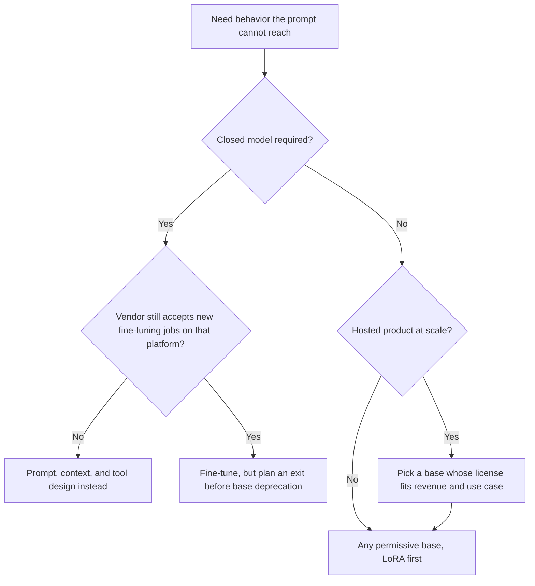

:::info 출처 · 라이선스
이 문서는 Om Bharatiya의 [AI System Design Guide](https://github.com/ombharatiya/ai-system-design-guide/blob/main/03-training-and-adaptation/02-fine-tuning-strategies.md)(MIT License, © 2026 Om Bharatiya)를 한국어로 옮긴 **비공식 번역본**입니다. 번역·편집 책임은 SecureNomad에 있습니다. 전체 안내는 [소개 · 출처 · 라이선스](../index.md)를 참고하세요. 번역 기준: 원문 커밋 `ed955b2`(2026-10-09).
:::

# 파인튜닝 전략

파인튜닝은 사전학습 모델을 특정 과제·도메인·스타일에 맞춘다. 오늘날 파인튜닝은 "사실을 가르치는" 것보다 "형식과 행동을 가르치는" 것에 가깝다.

## 언제 파인튜닝하나

파인튜닝 전에 물어라: **이게 프롬프트 엔지니어링이나 RAG로 풀리는가?**

| 요구 | 더 나은 해법 | 이유 |
|-------------|-----------------|-----|
| 새로운 사실/지식 | **RAG** | LLM은 FT로 사실을 암기하는 데 약하고, RAG가 갱신이 쉽다. |
| 특정 출력 형식 | **파인튜닝** | 복잡한 프롬프트 없이 JSON/XML을 안정적으로 출력하게 가르침. |
| 톤/페르소나 | **파인튜닝** | 시스템 프롬프트보다 훨씬 일관적. |
| 지연 감소 | **파인튜닝** | 긴 퓨샷 프롬프트 필요를 줄임. |
| 비공개 도메인 언어 | **연속 사전학습** | 전문 어휘(의료·법률·사내 코드)를 가르침. |

---

## 지도 파인튜닝(SFT)

사전학습 후 첫 단계. 모델을 `(프롬프트, 응답)` 쌍으로 학습한다. 명령 튜닝(instruction tuning)은 여러 과제 유형의 지시와 이상적 응답으로 하는 SFT로, 베이스 모델을 어시스턴트로 바꾸는 것이 바로 이것이다.

### 품질의 위계
**"완벽한" 예시 1,000개가 노이즈 섞인 100만 개를 이긴다.**
- **골든 세트:** 도메인 전문가가 손수 큐레이션(기술 과제는 박사급).
- **부정 제약 학습:** 모델이 **하지 말아야 할** 것의 예시 포함(예: "사과하지 마라", "AI라고 언급하지 마라").
- **트레이스 유도 세트:** 평가 점수나 사람 리뷰로 필터링한 프로덕션 트레이스가 이제 분포 내 SFT 데이터의 가장 싼 원천이다; LLMOps 플랫폼이 이 경로를 직접 제공(LangSmith Fine-Tuning, 2026-09-24부터 퍼블릭 베타).

---

## 연속 사전학습(도메인 적응)

"2단계 사전학습"이라고도 한다.
- **방법**: 특정 도메인의 원시 텍스트로 학습(예: 금융 모델용 전체 SEC 공시).
- **목표**: 도메인 언어의 통계적 분포 학습.
- **뉘앙스**: "파국적 망각"을 막기 위해 훨씬 낮은 학습률(원래의 약 1/10)이 필요.

---

## PEFT vs 전체 파라미터

| 항목 | 전체 파라미터 FT | PEFT(LoRA, QLoRA) |
|---------|-------------------|--------------------|
| GPU VRAM | 매우 높음(모델 크기 × 4-12) | 낮음(모델 크기 × 1.5) |
| 속도 | 기준 | 2-3배 빠름 |
| 위험 | 높음(파국적 망각) | 낮음 |
| 배포 | 과제당 모델 하나 | 베이스 하나 + 여러 어댑터 |
| **결론** | 파운데이션 학습용으로 한정 | **프로덕션 표준** |

---

## 하이퍼파라미터 튜닝

### 1. 학습률(LR)
- **전체 파라미터 SFT**: `1e-5`~`5e-5`가 표준.
- **LoRA**: 약 10배 높게(`1e-4`~`2e-4`), 작은 어댑터 행렬만 움직이므로.
- **너무 높으면**: 모델이 "붕괴"해 반복하거나 횡설수설.

### 2. LoRA의 랭크(r)
- 복잡한 추론 과제엔 높은 랭크(`r=64`~`r=256`).
- 단순 스타일/톤 변경엔 낮은 랭크(`r=8`).

### 3. 패킹(Packing)
처리량을 극대화하려 여러 짧은 예시를 EOS 토큰으로 구분해 하나의 4k/8k 시퀀스로 "패킹"한다.
- **문제**: 셀프 어텐션이 예시 간에 누출될 수 있음.
- **해법**: 예시 간 어텐션을 막는 **블록 마스킹 FlashAttention**.

---

## 어디서 파인튜닝하나

"나중에 비공개 모델을 파인튜닝한다" 계획은 실행이 점점 어려워지고, 오픈 베이스는 이제 공급 계약처럼 읽어야 할 라이선스 조건을 달고 온다.

**비공개 모델 파인튜닝이 축소되고 있다.** OpenAI는 셀프서브 파인튜닝을 단계적으로 종료한다(2026-05-07 발표): 파인튜닝한 적 없는 조직은 작업 생성 불가; 7/2부터 직전 60일간 파인튜닝 모델 추론을 한 조직만 가능; **2027-01-06**부터 활성 고객도 신규 작업 생성 불가. 기존 파인튜닝 모델은 베이스가 폐기될 때까지 서빙된다. Azure OpenAI는 자체 일정을 유지하므로, 모델 계열만이 아니라 플랫폼을 확인하라.

**오픈 가중치 파인튜닝이 기본 경로다.** 학습은 자기 GPU나 추론 파트너를 통해 실행(LangSmith는 오픈 가중치용 트레이스 유도 SFT 작업을 Fireworks·Baseten으로 라우팅). 이 패턴은 프런티어까지 확장된다: Cognition의 SWE-2는 Kimi K3(총 2.8T / 활성 104B)에서 후학습됐고, Fireworks의 Ember-1은 K3 위에서 추론을 단축한다(K3 대비 약 40% 적은 토큰, 벤더 보고). 제품 연구소는 베이스를 사서 후학습으로 경쟁한다.

**베이스 라이선스가 공급망 조건이 된다.** 데이터셋에 투자하기 전에 확인하라:

| 베이스 | 호스티드 제품에 중요한 라이선스 게이트 |
|------|-----------------------------------------------|
| Kimi K3 | 커스텀: 회사·계열사가 MaaS 사업을 하고 (계열 포함) 12개월 매출이 2000만 달러 초과면 별도 계약 필요 |
| Qwen3.8-Flash-Next | Qwen Community License 1.0: 모든 MaaS·코딩/오피스 비서 사업에 별도 라이선스, 매출 하한 없음 |
| GLM-5.3 | MIT + 12개월 매출 100억 달러 초과 MaaS 공급자 보안 심사 조항 |
| DeepSeek V4.1-Flash, MiMo-V2.6 | MIT |
| Gemma 4 12B, Granite 4.2(원문 표기), Qwen3.8-27B | Apache 2.0 |

---

## 면접 질문

### Q: 도메인 데이터를 SFT 세트에 넣는 대신 연속 사전학습을 쓰는 이유는?

**좋은 답변:**
SFT는 데이터 생성 측면에서 "비싸다": 프롬프트/답 쌍이 필요하다. 연속 사전학습은 방대한 원시·비라벨 도메인 텍스트로 모델의 내부 표현에 전문 어휘와 스타일을 가르친다. 모델이 "그 언어를 말하게" 되면, 작은 SFT 세트로 그 언어에서의 "과제"(분류, 요약 등)를 가르친다.

### Q: 파인튜닝 중 모델이 일반 능력을 "잊지" 않게 하려면?

**좋은 답변:**
이것이 "파국적 망각(Catastrophic Forgetting)"이다. 두 주요 완화책:
1. **리허설:** 원래 사전학습 데이터의 5-10%를 파인튜닝 세트에 섞음.
2. **PEFT(LoRA):** 가중치의 작은 비율만 학습하므로 원래 "지식"이 베이스 가중치에 고정되어 망각 위험이 크게 준다.

### Q: 로드맵에 "2027년 1분기 지원 트랜스크립트로 GPT 파인튜닝"이 있다. 무엇을 바꾸나?

**좋은 답변:**
먼저 계획이 여전히 실행 가능한지 확인한다: OpenAI는 2027-01-06 활성 고객 신규 셀프서브 파인튜닝 작업을 중단하고, 최근 파인튜닝 모델 추론이 없는 조직은 이미 작업 생성 불가. 그러니 베이스 폐기 시점 탈출 계획과 함께 컷오프 전에 작업을 돌리거나, 커스터마이징을 옮긴다. 둘째, 파인튜닝이 정말 필요한지 묻는다: 대부분의 "지원 톤·형식" 목표는 모델 업그레이드에도 살아남는 시스템 프롬프트·퓨샷·구조화 출력으로 가능하다. 정말 가중치가 필요하면, 필터링된 트레이스 유도 데이터로 오픈 가중치 베이스를 LoRA로 파인튜닝하고, (서비스로 호스팅 시) 라이선스(Apache 2.0·MIT)로 베이스를 고르며, 다음 베이스에 어댑터를 재학습할 수 있도록 데이터셋·평가 스위트를 이식 가능하게 유지한다. 지속되는 자산은 체크포인트가 아니라 큐레이션된 데이터와 평가다.

---

## 참고 문헌
- Hu et al. "LoRA: Low-Rank Adaptation of Large Language Models" (2021)
- Ouyang et al. "Training language models to follow instructions" (InstructGPT, 2022)
- Dettmers et al. "QLoRA: Efficient Finetuning of Quantized LLMs" (2023)
- OpenAI. [Deprecations](https://developers.openai.com/api/docs/deprecations) (fine-tuning wind-down)

---

*다음: [LoRA, QLoRA, PEFT](03-lora-qlora-peft.md)*
