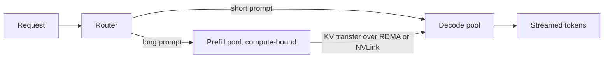

:::info 출처 · 라이선스
이 문서는 Om Bharatiya의 [AI System Design Guide](https://github.com/ombharatiya/ai-system-design-guide/blob/main/04-inference-optimization/04-batching-strategies.md)(MIT License, © 2026 Om Bharatiya)를 한국어로 옮긴 **비공식 번역본**입니다. 번역·편집 책임은 SecureNomad에 있습니다. 전체 안내는 [소개 · 출처 · 라이선스](../index.md)를 참고하세요. 번역 기준: 원문 커밋 `ed955b2`(2026-10-09).
:::

# 배칭 전략

배칭은 LLM 처리량을 높이고 비용을 줄이는 주 레버다. 서빙 프레임워크는 단순 요청 수준 배칭을 넘어 서브토큰·반복 수준 오케스트레이션으로, 그리고 대규모에선 프리필과 디코드를 별도 하드웨어로 분리하는 데까지 나아갔다.

## 정적 vs 동적 배칭

전통 ML(분류)에선 모든 요청이 같은 크기이고 함께 시작/종료해야 하는 **정적 배칭**을 쓴다. 가변 응답 길이 때문에 LLM엔 비효율적이다. **동적 배칭**(NVIDIA Triton 등)은 짧은 타임아웃까지 기다려 요청을 배치로 모아 활용을 높이지만, 여전히 각 배치를 하나의 단위로 완료까지 돌린다.

---

## 연속 배칭(반복 수준)

연속 배칭(Orca·vLLM이 개척)은 새 요청이 배치에 합류하고 완료된 요청이 매 토큰 생성 스텝 끝에 떠나게 한다.

| 측면 | 정적 배칭 | 연속 배칭 |
|--------|-----------------|---------------------|
| **합류/이탈** | 시작/끝에만 | 아무 반복 |
| **GPU 활용** | 낮음(가장 긴 것 대기) | 높음(항상 포화) |
| **처리량** | 1배 | **4-10배** |
| **지연** | 가장 짧은 것에 최악 | 균형 |

**수용 제어가 배칭만큼 중요하다.** 연속 배처는 큐잉 지연이 모두의 TTFT를 망칠 때까지 기꺼이 일을 받는다. vLLM v0.29.0은 `--max-num-queued-reqs`·`--max-num-queued-tokens`를 추가해, 엔진이 무한 큐를 쌓는 대신 초과 부하를 일찍 거절할 수 있게 했고, 게이트웨이는 이를 다른 레플리카로 보내라는 신호로 다룰 수 있다.

---

## 인플라이트 배칭(프리필-디코드 융합)

이전엔 서빙 엔진이 "프리필"(무거운 연산) 배치 OR "디코드"(무거운 메모리) 배치를 처리했다.
**인플라이트 배칭**(TensorRT-LLM; vLLM·SGLang은 청크 프리필로 동일)은 둘을 섞는다:
- 1개 요청은 프리필 단계.
- 15개 요청은 디코드 단계.
- **이점**: 프리필 요청이 GPU 유휴 연산 코어를, 디코드 요청이 메모리 대역폭을 활용.

---

## 청크 프리필

거대 문맥 프롬프트(1M+ 토큰)는 프리필 단계에 배치를 수 초 멈춰 "스톨(stall)"을 일으킨다.

**해법: 청크 프리필**
128k 토큰을 한 번에 프리필하는 대신, 엔진이 프리필을 작은 청크로 쪼개 다른 사용자의 진행 중 디코드 스텝과 인터리브한다. 무거운 요청이 와도 안정적 **TPOT**을 유지한다. 스텝당 토큰 예산이 튜닝 손잡이다: vLLM은 v0.28.0(2026년 8월)에서 기본 `max_num_batched_tokens`를 8,192→16,384로 올려, 약간 높은 토큰 간 지연을 더 나은 프리필 처리량과 교환했다. SLO가 ITL 바운드면 낮춰라.

---

## 프리필/디코드 분리

청크 프리필은 병목이 반대인 두 단계가 한 GPU 풀을 공유한다. **분리 서빙**은 각 단계에 자체 풀을 주고(크기·심지어 다른 하드웨어로 구성), 그 사이로 KV 캐시를 옮긴다.

- **이득을 goodput으로 보라**, peak 처리량이 아니라 TTFT·ITL SLO를 둘 다 만족하는 요청률. 프리필 버스트가 디코드를 더 이상 막지 않고, 각 풀이 독립 확장.
- **KV 전송에 가격을 매겨라.** BF16 Llama-3.1-70B는 토큰당 320 KiB라, 1만 토큰 프롬프트가 디코드에 약 3 GB를 넘겨 400 Gb/s에서 약 65 ms가 TTFT에 더해진다. 짧은 프롬프트는 전송이 절감보다 비싸, NVIDIA Dynamo v1.5는 짧은 요청을 디코드로 직행시킨다(조건부 분리 우회).
- **배관이 이제 상류에 있다.** vLLM은 10여 개 KV 커넥터(NIXL, LMCache, Mooncake, FlexKV, AMD MoRI-IO, 체이닝 MultiConnector)를 제공하고, 토큰화를 CPU 전용 프런트엔드로 옮겨 GPU가 토큰 입출력만 보게 할 수 있다.
- **P/D를 넘어선다.** 인코더 분리는 멀티모달 인코더를 분리; 실험적 vLLM 플러그인(2026년 7월)은 MoE용으로 어텐션과 FFN/전문가 레이어를 따로 확장되는 서비스로 분리. 하드웨어 벤더는 칩 간 버전을 제안: GPU 프리필 + SRAM·웨이퍼 스케일 디코드(NVIDIA Rubin + Groq 3 LPX, AMD Helios + Cerebras), [서빙 인프라](06-serving-infrastructure.md)에서 다룸.

---

## 면접 질문

### Q: LLM에 연속 배칭이 정적 배칭보다 우월한 이유는?

**좋은 답변:**
정적 배칭은 배치의 모든 요청이 가장 긴 생성 완료를 기다리게 한다("가장 긴 꼬리" 문제). 한 사용자가 500토큰, 다른 사용자가 5토큰을 요청하면, 5토큰 사용자에 대해 GPU가 495사이클 유휴다. 연속 배칭은 5토큰 사용자 요청이 마지막 토큰 직후 GPU를 떠나게 해, VRAM·연산 슬롯을 큐의 새 요청에 해방한다. 이로써 전체 하드웨어 클러스터의 "초당 토큰"을 극대화한다.

### Q: LLM 서빙의 "스톨"이란 무엇이며 청크 프리필이 어떻게 완화하나?

**좋은 답변:**
"스톨"은 거대 새 요청이 와서 그 프리필 단계(연산 집약)가 2-3초 걸릴 때 발생한다. 이 동안 GPU가 프리필로 너무 바빠 "디코드" 단계의 기존 사용자에게 토큰을 못 내, 그들의 TPOT이 치솟는다. 청크 프리필은 그 3초 프리필을 작은 200ms "청크"로 쪼개, 한 청크를 처리하고 다른 모두에게 한 번 디코딩한 뒤 다음 프리필 청크로 돌아간다. 이로써 모든 사용자에게 일관되고 매끄러운 경험을 보장한다.

### Q: 분리 프리필/디코드가 한 풀의 청크 프리필을 이기는 때는?

**좋은 답변:**
프롬프트가 길고 SLO가 TTFT·토큰 간 지연 둘 다 빡빡할 때. 청크 프리필은 여전히 디코드 스텝이 프리필 청크와 연산을 공유해, 긴 프롬프트 버스트에 ITL이 흔들린다; 분리는 그 간섭을 없애고 프리필·디코드 용량을 따로 확장해 goodput을 높인다. 비용은 KV 전송이다: BF16 70B dense에서 토큰당 약 320 KiB라 1만 토큰 프롬프트가 약 3 GB, 400 Gb/s에서 약 65 ms를 옮기므로, 빠른 인터커넥트가 필요하고 짧은 프롬프트는 분리를 우회해야 한다. 운영 표면(두 풀, KV 인식 라우터, 커넥터 실패)도 는다. 중간 규모 짧은 프롬프트 챗은 청크 프리필 + 프리픽스 캐싱의 단일 풀이 단순하고 대개 충분; 대규모 장문맥 에이전트 트래픽은 분리가 보통 goodput에서 이기고, 컴팩트 KV(잠재·희소 어텐션) 모델이 전송을 더 싸게 한다.

---

## 참고 문헌
- Yu et al. "Orca..." (2022)
- NVIDIA. "TensorRT-LLM: In-Flight Batching" (2023)
- vLLM Project. "Iteration-Level Scheduling" (2023)
- Zhong et al. "DistServe..." (2024)
- vLLM Blog. "Disaggregated serving guide" (2026)

---

*다음: [PagedAttention](05-paged-attention.md)*
