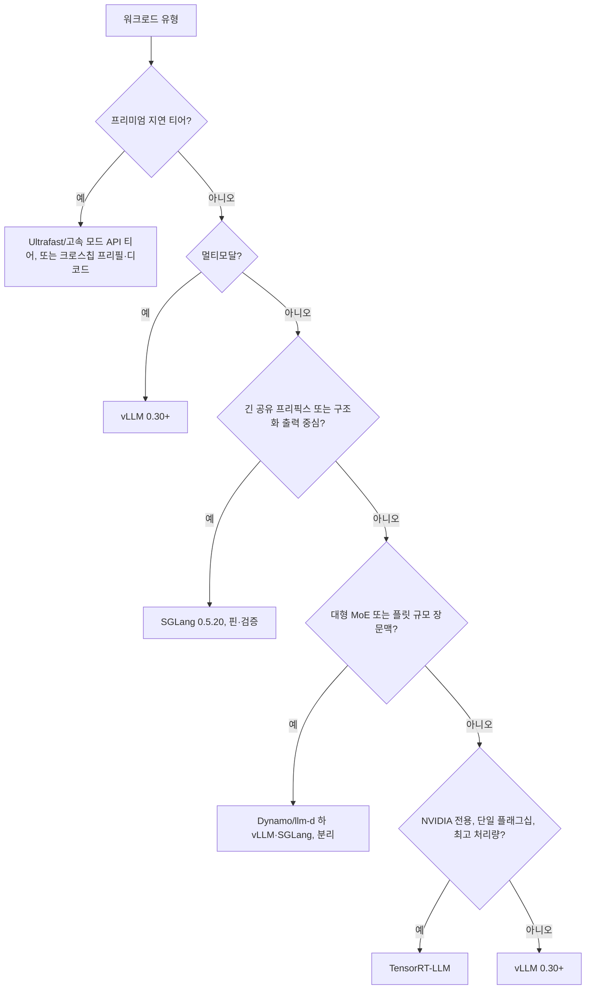

:::info 출처 · 라이선스
이 문서는 Om Bharatiya의 [AI System Design Guide](https://github.com/ombharatiya/ai-system-design-guide/blob/main/04-inference-optimization/06-serving-infrastructure.md)(MIT License, © 2026 Om Bharatiya)를 한국어로 옮긴 **비공식 번역본**입니다. 번역·편집 책임은 SecureNomad에 있습니다. 전체 안내는 [소개 · 출처 · 라이선스](../index.md)를 참고하세요. 번역 기준: 원문 커밋 `ed955b2`(2026-10-09). 엔진 버전·CVE·하드웨어 가격 등 휘발성 수치는 빠르게 바뀌므로 최신 값은 [영문 원문](https://github.com/ombharatiya/ai-system-design-guide/blob/main/04-inference-optimization/06-serving-infrastructure.md)과 각 벤더 보안 권고를 확인하세요.
:::

# 서빙 인프라

대규모 LLM 배포엔 로드 밸런싱, 모델 병렬화, 멀티테넌트 격리를 다루는 인프라 계층이 필요하다. 초점이 "모델 하나 서빙"에서 "추론 플릿 오케스트레이션"으로 옮겨갔다: KV 인식 라우팅, 분리된 프리필·디코드 풀, 그리고 프리미엄 티어에선 단계별로 다른 칩.

## 추론 게이트웨이

게이트웨이는 AI 워크로드의 "교통 관제소"다.

| 구성요소 | 책임 |
|-----------|---------------------------|
| **인증·레이트 리밋** | 토큰 기반 쿼터와 테넌트 격리. |
| **모델 라우터** | 특정 모델 버전으로 요청 유도(카나리/A-B). |
| **KV 인식 라우터** | 이미 프리픽스를 캐시에 가진 레플리카로 요청을 보냄(부하·예측 지연 가중). 단순 스티키 세션을 대체: Kubernetes Gateway API Inference Extension(GAIE) + llm-d Endpoint Picker, 또는 NVIDIA Dynamo 라우터. Google은 멀티클러스터 GKE Inference Gateway에서 라우팅 오버헤드 1% 미만 보고. |
| **수용·페일오버** | 스트림이 열리기 전 과문맥·과용량 요청 거절, 시간 내 토큰이 안 오면 다른 백엔드로 전환(Envoy AI Gateway v1.1의 `streamIdleTimeout`). |
| **출력 필터** | 스트리밍 응답에 실시간 안전·PII 정제. |

게이트웨이는 보유한 모든 공급자 자격증명을 한곳에 모으므로 최상의 공격 표적이 된다. 2026년 LiteLLM만 해도 미인증 RCE(CVE-2026-37004, CVSS 9.8)와, 운영자의 저장된 공급자 키를 공격자 호스트로 보내는 인증된 `api_base` 리다이렉트(CVE-2026-84377)가 있었다. 게이트웨이를 여느 인터넷 노출 서비스처럼 핀·패치하고, 라우팅 파라미터를 클라이언트에서 받지 말고 허용목록화하라. 호스팅 API를 호출한다면 페일오버가 벤더를 넘어야 한다. 벤더 장애는 그 API·챗 앱·코딩 에이전트를 함께 내리기 때문이다: OpenAI의 2026-09-29 사고는 셋 모두에 약 5시간 20분 걸쳤고, Anthropic 상태 페이지는 8/16~9/29 사이 주요·심각 사고를 최소 12건 기록했다. 게이트웨이 설계는 [AI 게이트웨이 장](https://github.com/ombharatiya/ai-system-design-guide/blob/main/11-infrastructure-and-mlops/03-ai-gateways-and-model-routing.md)(영문)에서 깊게 다룬다.

---

## 모델 병렬화

단일 GPU에 안 맞는 모델(예: Llama 3.1 405B는 KV 캐시 전에 BF16 가중치만 약 810 GB)은 쪼개야 한다.

### 1. 텐서 병렬화(TP)
개별 레이어/텐서를 여러 GPU에 분할.
- **지연**: 낮음(가장 빠름).
- **통신**: 높음(NVLink 필요).
- **표준**: 단일 노드(8 GPU) 또는 단일 NVLink 도메인(NVL72 랙 최대 72 GPU) 내 프로덕션 서빙의 90%에 사용.

### 2. 파이프라인 병렬화(PP)
서로 다른 레이어를 분할(예: 레이어 1-40은 GPU 1, 41-80은 GPU 2).
- **지연**: GPU에서 높음(마이크로배치 오버헤드).
- **효율**: 낮은 활용(버블 시간).
- **표준**: 여러 노드에 걸친 거대 모델. 예외가 규칙을 증명한다: 웨이퍼 스케일 시스템은 웨이퍼 간 활성값만 넘나들어 레이어 경계에서 파이프라인; OpenAI GPT-5.6 Sol Ultrafast 프리뷰가 여러 Cerebras CS-3에 걸쳐 최대 750 출력 tok/s로 이렇게 돈다.

### 3. 전문가 병렬화(EP)
MoE 모델의 전문가를 GPU에 분산하고, 각 토큰의 은닉 상태를 선택된 전문가를 가진 GPU로 올투올 교환으로 라우팅(DeepEP가 흔한 커널 라이브러리). EP + 데이터 병렬 어텐션이 DeepSeek·Kimi·Qwen급 MoE의 표준 레이아웃.

### 4. 컨텍스트 병렬화(CP)
긴 시퀀스를 GPU에 분할. 디코드 컨텍스트 병렬화(DCP)는 아주 긴 문맥의 KV 캐시를 샤딩; SGLang이 기본 Blackwell MLA 백엔드에서 돌리고, 8×B300에 DCP 최대 256K 입력으로 분리 서빙 하 DSpark 추측을 검증했다.

### 5. 어텐션-FFN 분리(실험적)
어텐션(KV 캐시 소유)과 FFN/전문가 레이어를 따로 확장되는 서비스로 운영. vLLM이 NVIDIA GPU·Ascend NPU용 MoE 실험 플러그인 제공, NVIDIA는 Vera Rubin + Groq 3 LPX 서빙 모드의 하나로 명시.

---

## 멀티 GPU 오케스트레이션

Kubernetes가 기본 기반이고 그 위에 LLM 특화 계층: Ray 기반 서빙 **KubeRay**, 멀티노드 레플리카 **LeaderWorkerSet**, Gateway API Inference Extension 위 KV 인식 라우팅·오토스케일 **llm-d**, vLLM·SGLang·TensorRT-LLM 위 오케스트레이션 **NVIDIA Dynamo**.

- **이기종 클러스터**: 프런티어 모델용 H100과 소형 모델용 L4를 한 클러스터에 혼합. 혼합 벤더 풀도 이제 벤치마크됨: Cisco의 MLPerf Inference v6.1 제출은 8×H200 + 8×MI350X를 하나의 추론 풀로 돌림.
- **오토스케일**: CPU·표준 메모리가 아니라 **KV 캐시 활용**과 큐 깊이로 확장. Dynamo의 Kubernetes 플래너는 총 GPU 전력 한도로 확장을 제한할 수도.
- **콜드 스타트**: 스케일아웃을 모델 로드 시간이 지배. vLLM v0.30.0 **Fast Start**(`--load-format ipc_cache`)는 이미 양자화·TP 샤딩된 가중치를 쥔 GPU별 데몬을 두고 재시작 엔진에 CUDA IPC로 매핑. SGLang의 오버랩 체크포인트 스테이징(`--startup-weight-load-mode overlap`)은 H100에서 Qwen3-32B를 2.38배 빨리 시작(84.8초→35.6초).
- **시뮬레이션으로 계획**: SGLang의 CPU 전용 시뮬레이터는 실제 스케줄러·캐시를 지연 모델과 돌려 TTFT를 약 6% 이내(32K~128K 트레이스에서 최대 10%)로 예측; Dynamo AISimulate(구 AIConfigurator)는 구성 탐색. GPU를 사거나 빌리기 전에 시뮬레이션하라.

---

## 스트리밍과 장수명 연결

LLM은 거의 항상 **SSE(Server-Sent Events)** 나 **WebSocket**으로 서빙된다.

**인프라 과제**: 표준 L4 로드 밸런서는 장수명 AI 연결에 약하다.
- **해법**: "시퀀스 종료" 토큰을 이해하고 연결 수준이 아니라 사용자 턴 *사이에* 트래픽을 재조정하는 **L7 로드 밸런서**(Envoy/Istio) 사용.
- **첫 토큰 전에 실패하라, 후가 아니라.** Envoy AI Gateway v1.1은 `streamIdleTimeout` 내 토큰이 안 오면 다음 백엔드로 전환; 토큰이 스트리밍된 뒤의 백엔드 실패는 조용한 중복 답이 아니라 504로 드러난다. Dynamo 프런트엔드도 스트림 열기 전 과문맥 요청을 거절하고 과부하 시 503 반환. 첫 토큰 이후 재시도는 멱등 도구 호출과 함께 클라이언트·에이전트 루프에 속한다.

---

## 추론 엔진(2026년 10월)

엔진 선택은 더 이상 "어느 게 제일 빠른가"가 아니다. 선도 엔진마다 워크로드 범주를 하나씩 차지했고, 대규모 플릿에선 오케스트레이션 계층(Dynamo·llm-d)이 엔진 위에 앉는다. 정답은 패치된 버전에 고정한 **워크로드별 엔진**이다.

| 구성요소 | 현재(2026-10-01 기준) | 중요한 변화 |
|-----------|---------------------------------|---------------------------|
| **vLLM** | v0.30.0(9/22); 약 2주 릴리스 주기 | v0.29부터 Model Runner V2 기본(구 러너 제거는 v0.32 목표); 큐 수용 제어; Fast Start; 디스크로 계층 KV 오프로드; `vllm serve`가 폐기된 `python -m vllm.entrypoints.openai.api_server` 대체 |
| **SGLang** | v0.5.20(9/18) | 슬라이딩 윈도 인식 래딕스 캐시; CPU 전용 시뮬레이터; MXFP4 재양자화로 AMD에 NVFP4 체크포인트; `--enable-response-store` 없으면 `/v1/responses` 미저장 |
| **TensorRT-LLM** | v1.2.1 안정(4/20); v1.3.0rc29(9/29) | 1.0(2025년 9월)부터 PyTorch 백엔드 기본 → 모델별 엔진 빌드 불필요; v1.3 RC는 AutoDeploy 통합 제거(파괴적) |
| **NVIDIA Dynamo** | v1.5.0(9/21) | 플러그형 KV 인식 라우터 정책; 조건부 분리 우회; KVBM 폐기(v1.6.0 제거 목표) |
| **llm-d / GAIE** | llm-d v0.10.0(9/29); GAIE v1.6.2(9/17) | Endpoint Picker가 GAIE→llm-d로 이동; llm-d는 이제 업스트림 vLLM 이미지 사용·프로덕션 이미지 cosign 서명 |

### vLLM: 기본 오픈 엔진

[vLLM](https://docs.vllm.ai/)은 워크로드가 "연속 배칭 하의 Llama/Mistral/Qwen/DeepSeek"일 때 기본 오픈 엔진으로 남는다: 가장 넓은 모델 커버리지, 가장 쉬운 운영, 가장 빠른 당주 보안 패치. 공격 표면도 가장 크다. 2026-08-11~09-28에 20개 넘는 권고를 냈고, 그중:

- **CVE-2026-90553**(high, 0.28.0 수정): 모델 프로세서 로더가 `trust_remote_code=False`에도 악성 레포 코드를 실행.
- **CVE-2026-93592**(high, 0.28.0 수정): 음수 토큰 ID의 미인증 요청 하나가 `/v1/embeddings`·`/pooling`에서 CUDA 컨텍스트를 오염시켜 재시작 전까지 모든 클라이언트에 엔진 중단.
- **GHSA-935w-9g4m-p28p**(low, 0.30.0 수정): 한 코드 경로가 테넌트별 `cache_salt`를 누락해 크로스테넌트 프리픽스 캐시 타이밍 오라클 재개방.

연초 2월 멀티모달 RCE(CVE-2026-22778, 비디오 처리)는 v0.14.1에서 수정. **기준선: vLLM 0.30.0 이상.** 교훈은 일반화된다: GPU 엔진은 공동 운명 도메인이니, 입력이 디바이스에 닿기 전 검증하고, 모든 경로에서 프리픽스 캐시를 솔팅하고, 신뢰하는 레포에서만 모델을 로드하라.

### SGLang: 프리픽스 중심·구조화 워크로드

[SGLang](https://github.com/sgl-project/sglang)은 프리픽스 재사용이 많고 구조화 출력인 워크로드에서 앞선다: **RadixAttention** 프리픽스 캐싱, 순전파와 겹친 제약 디코딩, 일급 MoE 서빙(DeepEP v2, Hopper의 W4A8 MXFP4 MoE, Blackwell의 디코드 컨텍스트 병렬화). v0.5.20 래딕스 트리는 프리픽스 분기점에 슬라이딩 윈도 상태를 캐싱해, 공유 시스템 프롬프트 DeepSeek-V4-Flash에서 토큰 적중률을 43.8%→60.8%로 올리고 평균 TTFT를 1.57초→1.07초로 낮췄다.

**보안 자세**: 2026년 3월 멀티모달 ZMQ 브로커·인코더 병렬 분리의 치명 RCE(CVE-2026-3059, 3060)는 v0.5.10에서 수정. 5월 배치(CVE-2026-7301/7302/7304, 치명: 전 인터페이스 바인드 + `pickle.loads` 스케줄러 소켓, 경로 탐색, 커스텀 로짓 프로세서 통한 `dill.loads`)는 0.5.12까지 영향 버전을 나열하나 권고 DB에 패치 버전이 기록되지 않았다. 그러니: 0.5.13 이상 핀 + 권고 대조, 내부 ZMQ·RPC 소켓을 파드 밖에 절대 노출 금지, 신뢰 못 할 호출자에 커스텀 로짓 프로세서 비활성. 이 자세라면 SGLang은 멀티모달 트래픽에도 괜찮다; 옛 "멀티모달은 SGLang 금지" 규칙은 이후 패치된 CVE에 근거했다.

### TensorRT-LLM: 최고 NVIDIA 처리량

[TensorRT-LLM](https://github.com/NVIDIA/TensorRT-LLM)은 손튜닝 모델에 대해 순수 NVIDIA 하드웨어에서 처리량 선두로 남는다. Blackwell의 커스텀 FP4/FP8 커널이 흔히 오픈 엔진을 앞서고 Triton·NIM과 긴밀 통합. 옛 운영 반론인 "모델마다 수 시간 엔진 빌드"는 더 이상 유효치 않다: 1.0부터 PyTorch 백엔드가 기본이라 모델이 여느 엔진처럼 로드된다. 남은 비용은 **NVIDIA 종속**과 **RC 많은 릴리스 주기**(안정 라인은 4월 v1.2.1; v1.3는 수개월째 RC이고 파괴적 제거 포함). NVIDIA에 전념했고 한두 플래그십 모델이 모든 tok/s가 필요하면 값어치가 있다; 아니면 vLLM·SGLang이 더 유연하다.

### 엔진 위 오케스트레이션: Dynamo와 llm-d

플릿 규모에선 비용을 움직이는 결정(어느 레플리카가 요청을 받나, 언제 분리하나, 어떻게 확장하나)이 엔진 위에 산다. **NVIDIA Dynamo** v1.5는 플러그형 스코어러·피커 정책과 하드·소프트 세션 어피니티로 KV 캐시 겹침에 라우팅하고, SGLang HiCache·vLLM 디스크 티어의 캐시 이벤트를 인덱싱하고, 짧은 요청을 디코드로 직행시키며, 전송에 선택적 TLS/mTLS를 지원. **llm-d**는 Kubernetes Gateway API 세계에서 같은 역할. 둘 다 젊고 빠르게 바뀐다; 버전을 핀하고 폐기(Dynamo KVBM, GAIE 제거된 알파 API)를 읽어라.

같은 생태계의 정밀도 유의점: Dynamo의 갱신된 Nemotron 3.5 Lightning 레시피는 Marlin 커널에서 BF16이 NVFP4보다 80%, CuTeDSL에서 12% 빠르다고 측정. 모델·커널 백엔드별로 정밀도를 벤치마크하라; [양자화 심층 분석](../03-training-and-adaptation/07-quantization-deep-dive.md) 참고.

### MoE 인식 서빙(Llama 4 Maverick, DeepSeek V4, Kimi K3)

MoE 모델은 서빙 비용이 배치 크기에 매끄럽게 비례한다는 가정을 깼다. MoE 서빙 엔진에 중요한 속성:

- **전문가 가중치 상주**: 토큰당 17B 활성인 400B MoE(Llama 4 Maverick)는 VRAM 대부분을 주어진 토큰이 안 쓰는 전문가에 쓴다. 엔진은 전문가-토큰 라우팅을 인지해 EP로 전문가를 퍼뜨리거나, 핫 전문가를 고정하거나, 콜드 전문가를 스트리밍해야.
- **전문가 라우팅 지연**: 라우터 결정이 **토큰마다** 일어나 측정 가능한 비용 추가. 엔진은 배치 차원에 걸쳐 라우팅 결정을 배칭.
- **비단조 배칭 프로파일**: 배치에 요청을 더하면 더 콜드한 전문가 집합이 활성화돼 처리량이 *줄 수도*. 최적 배치 크기는 배치 수가 아니라 배치 내 **라우팅 패턴 분포**에 달렸다.
- **단계별·계층별 파라미터**: DeepSeek V4.1-Flash는 프리필 시 토큰당 약 8B, 디코드 시 16B 활성화, Qwen3.8-Flash-Next는 호스트 DRAM에 둘 51B N-gram 메모리 추가. 프리필 풀·디코드 풀·호스트 메모리를 따로 산정.
- **구성요소별 정밀도**: DeepSeek-V4는 FP4 전문가 가중치 + 대부분 다른 파라미터 FP8이라, 혼합 정밀도 MoE 커널 지원이 실제 처리량을 결정.

| 엔진 | MoE 경로, 2026년 10월 |
|--------|------------------------|
| vLLM 0.30 | 전문가 병렬화; 적응형 검증의 번들 DSpark/MTP 추측; 희소-MLA 디코드용 HiSparse 호스트 상주 KV 티어; 실험적 어텐션-FFN 플러그인 |
| SGLang 0.5.20 | DeepEP v2; Hopper의 W4A8 MXFP4 MoE(DeepSeek-V4-Flash 출력 처리량 +12%); Blackwell MLA의 DCP; 분리 서빙 하 DSpark |
| TensorRT-LLM 1.3 RC | FP4 MLA와 MLA 기반 DSpark 드래퍼; 릴리스 후보만 |

면접용 통찰: **MoE 서빙은 더 이상 "더 큰 가중치의 vLLM"이 아니다.** 다른 스케줄링·메모리 배치 문제이고, 엔진들이 모두 전용 MoE 경로를 지었다.

### 프리미엄 지연 티어: 크로스칩 분리

옛 지름길은 "대형 모델의 50ms 미만 TTFT는 Cerebras·Groq 호출"이었다. 2026 패턴은 **이기종 프리필·디코드**: 프리필엔 연산 밀집 HBM GPU, 대역폭 바운드 디코드엔 SRAM·웨이퍼 스케일 부품.

| 조합 | 상태 | 비고 |
|---------|--------|-------|
| NVIDIA Vera Rubin NVL72 + Groq 3 LPX | LPX 2026-08-24부터 완전 양산; Nebius 첫 클라우드 | 랙당 256 LPU·128 GB SRAM. 모드: P/D(Rubin 프리필, LPX 디코드), 어텐션-FFN 분할, 또는 LPX를 추측 드래퍼로. The Register는 SRAM 용량 탓에 LPX 랙 하나가 100K 토큰 입력에서 약 배치 12에 상한 추정 |
| AMD Helios + Cerebras WSE | 발표; H2 2026 Cerebras Cloud 선 출시 | 프롬프트·대형 문맥 처리는 Helios, 디코드는 Cerebras; Cerebras 단독 대비 와트당 최대 5배 tok/s(AMD/Cerebras 모델링) |
| GPU + SambaNova RDU(SambaNova·Intel) | 청사진(2026-04-08) | 프리필 GPU, 디코드 SambaNova RDU, 에이전트 도구 실행 Intel Xeon 6 CPU |

표 뒤 사업적 사실 둘: NVIDIA의 2025년 12월 Groq 거래는 비독점 기술 라이선스 + 채용(조건 비공개, 약 170~200억 달러 보도)이고, GroqCloud는 LPX·Rubin을 배포하는 독립 NVIDIA Cloud Partner로 계속. SambaNova는 인수되지 않았고 7/8에 110억 밸류 10억 1차 클로즈 발표.

속도는 API 티어로도 팔린다: OpenAI Ultrafast 티어는 Standard의 6배이고 2026-09-29 GPT-6 Astra에 GA, Anthropic은 Claude API에서 Opus 5.5 연구 프리뷰 고속 모드를 1M 토큰당 $8/$40로 제공. 위 작은 배치 상한이 이 티어가 프리미엄인 이유다. 자체 구축 크로스칩 설계의 숨은 비용은 풀 간 KV 이동이다; 요청별로 예산화하라.

### 결정 프레임워크: 워크로드별 엔진

팀이 실제 배포하는 워크로드에 대한 더 명시적 매핑:

| 워크로드 | 엔진 선택(2026년 10월) | 이유 |
|----------|---------------------------|-----|
| 공개 챗봇(혼합 트래픽, 빠른 패치 필수) | **vLLM 0.30+** | 운영 최용이, 최고 보안 주기 |
| JSON 함수 호출 백엔드, 긴 공유 프리픽스 에이전트 루프 | **SGLang 0.5.20**(핀, 내부 소켓 파드 내) | RadixAttention 프리픽스 재사용·겹친 제약 디코딩 |
| 단일 모델 지연 임계(한 모델, 한 팀) | B300·Rubin의 **TensorRT-LLM** | 최고 NVIDIA 처리량, 엔진 빌드세 사라짐 |
| 멀티모달(이미지·오디오·비디오 입력) | **vLLM 0.30+** | 가장 넓은 멀티모달 커버리지; 검증·핀된 SGLang도 가능 |
| 추론 모델(긴 CoT, 낮은 동시성) | 배포사 MTP·DSpark 드래퍼의 **vLLM**·**SGLang** | 디코드 바운드; 적응형 검증 추측 디코딩이 주 레버 |
| 플릿 규모 MoE(DeepSeek V4, Kimi K3, Llama 4 Maverick) | **Dynamo**·**llm-d** 하 **vLLM**·**SGLang**, 분리 | 전문가 병렬화, KV 인식 라우팅, 분리 프리필·디코드 풀 |
| 프리미엄 50ms 미만 TTFT·초고 tok/s/사용자 | **API 속도 티어**(Ultrafast·고속 모드) 또는 **크로스칩 P/D** | GPU만으론 대형 모델에서 합리적 배치로 이 사용자당 속도 불가 |

### 운영 자세

- **항상 패치된 버전에 있어라.** 추론 엔진·게이트웨이는 이제 웹 서버급 CVE 주기를 가진다. 현재 하한:

| 구성요소 | 하한 | 이유 |
|-----------|-------|--------|
| vLLM | 0.30.0 | 모델 로드 RCE·요청 하나 엔진 킬(0.28.0 수정); 프리픽스 캐시 오라클(0.30.0 수정) |
| SGLang | 0.5.13 이상, 권고 대조 검증 | 2026년 5월 치명 CVE가 0.5.12까지 영향 버전 나열, 패치 버전 미기록 |
| LiteLLM(쓴다면) | 사용 마이너 라인의 CVE-2026-84377 수정 릴리스(1.88.6, 1.89.7, 1.90.7, 1.91.5, 1.92.2, 1.93.2, 1.94.3, 1.95.1, 1.96.2) | `api_base` 통한 저장 키 유출; 업그레이드 전까지 `general_settings.allow_client_side_credentials=false`. 손상된 PyPI 릴리스 1.82.7·1.82.8도 회피 |

- **요청 하나가 레플리카의 모든 테넌트를 내릴 수 있다고 가정하라.** 게이트웨이에서 토큰 ID·미디어·크기를 검증하고, 폭발 반경이 중요하면 신뢰 못 할 테넌트를 별도 레플리카에, 엔진 재시작에 알림.
- **둘째 엔진에 카나리를 돌려라.** 프로덕션은 vLLM, 1-5% 카나리는 SGLang·TensorRT-LLM, 품질·지연 괴리에 알림. 엔진별 버그를 잡고 더 빠른 이전 경로 확보.
- **엔진을 배포 매니페스트의 일부로 다뤄라.** 모델은 "Llama 4 Maverick"이 아니라 "이 배치 설정·커널 백엔드·추측 방법·하드웨어의 vLLM v0.30.0 위 Llama 4 Maverick"이다. 기본값(커널 백엔드, 배치 예산, 모델 러너)이 릴리스마다 바뀌니 전부 핀하라.
- **파레토 곡선에서 벤치마크하라.** 에이전트 트래픽의 처리량-인터랙티비티 곡선(SemiAnalysis InferenceX AgentX)과 MLPerf Inference v6.1(종단 RAG·엣지 에이전트 테스트 추가, gpt-oss-120b Interactive로 추측 디코딩 확장) 사용. [추론 기초](01-inference-fundamentals.md) 참고.
- **보안 권고 피드를 지켜보라**, 릴리스 노트만이 아니라: [vLLM 권고](https://github.com/vllm-project/vllm/security/advisories), [SGLang 권고](https://github.com/sgl-project/sglang/security/advisories), [TensorRT-LLM CVE 목록](https://nvd.nist.gov/vuln/search/results?form_type=Basic&search_type=all&query=tensorrt-llm).

---

## 면접 질문

### Q: 저지연 서빙에 파이프라인 병렬화보다 텐서 병렬화가 선호되는 이유는?

**좋은 답변:**
텐서 병렬화(TP)는 단일 레이어의 행렬곱을 여러 GPU에서 동시에 수행하므로 그 레이어 지연이 GPU 수만큼 준다. 반대로 파이프라인 병렬화(PP)는 서로 다른 레이어를 순차 처리한다. GPU 2가 레이어 40-80을 할 동안, 여러 요청의 깊은 파이프라인(배칭)이 없으면 GPU 1은 유휴다. 단일 사용자 요청에 PP는 모든 GPU 지연을 더하지만, TP는 지연을 모든 GPU에 나눈다. 뉘앙스: TP는 레이어별 올리듀스에 아주 빠른 인터커넥트가 필요해 느린 링크에선 PP가 이기고, 각 단계가 엄청 빠르고 웨이퍼 간 활성값만 넘나드는 웨이퍼 스케일 하드웨어에선 파이프라이닝이 가장 빠른 사용자당 속도를 내는 방법이다.

### Q: 멀티테넌트 LLM 클러스터에서 "시끄러운 이웃"을 어떻게 다루나?

**좋은 답변:**
**계층형 반복 수준 스케줄링**으로 다룬다. 각 테넌트에 총 GPU 사이클의 "지분"을 배정한다. 연속 배칭 루프에서 스케줄러는 한 테넌트가 KV 캐시 슬롯 100%를 차지하지 않도록 보장한다. 테넌트 A가 시스템을 압도하면, 스케줄러는 테넌트 B·C의 "프리필" 스텝을 우선하거나, 사이클당 A의 디코드 반복 일부만 처리한다. 이는 게이트웨이의 토큰 버킷 레이트 리밋과 서빙 엔진의 특정 스케줄링 정책, 그리고 큐 수준 수용 제어(제한된 큐 요청·토큰)로 강제돼, 초과 부하가 모두의 TTFT를 부풀리는 대신 일찍 거절된다.

### Q: 변형된 요청 하나가 vLLM 레플리카를 크래시시키고 그 위 모든 테넌트가 서비스를 잃었다. 설계 교훈은?

**좋은 답변:**
GPU 추론 엔진은 공동 운명 도메인이다. CVE-2026-93592에서 음수 토큰 ID의 미인증 요청 하나가 임베딩 엔드포인트에서 CUDA 디바이스 측 어서션을 걸어 CUDA 컨텍스트를 오염시켰고, 어떤 try/except도 못 잡아 엔진 전체가 재시작 전까지 죽었다. 0.28.0 이상 패치가 그 버그를 고치지만 교훈은 구조적이다. 입력이 디바이스에 닿기 전 검증하라: 범위 내 토큰 ID, 별도 프로세스에서 디코드·크기 검사한 미디어, 게이트웨이에서 경계한 요청 크기. 폭발 반경을 제한하라: 신뢰 못 할 테넌트와 불필요 엔드포인트에 별도 레플리카·풀(안 쓰면 임베딩·풀링 경로 비활성). 빨리 탐지·복구하라: GPU 경로를 실행하는 헬스 체크, 자동 재시작, 재시작이 분이 아닌 초가 되게 하는 Fast Start식 가중치 캐싱. 프리픽스 캐시에도 같은 부류의 위험을 적용하라 — 모든 경로가 테넌트별 솔팅을 안 하면 크로스테넌트 사이드 채널이다.

### Q: 초고 tok/s/사용자가 필요한 에이전트 제품용 프리미엄 저지연 티어를 설계하라.

**좋은 답변:**
먼저 사는 걸로 충분한지 확인한다: OpenAI Ultrafast 티어(Standard의 6배, GPT-6 Astra에 GA)와 Anthropic의 Opus 5.5 고속 모드가 바로 이걸 팔고, 대부분 팀엔 2-6배 가격 프리미엄이 자체 구축보다 싸다. 자체 호스팅한다면 2026 패턴은 크로스칩 분리다: 연산 바운드 프리필엔 HBM GPU(Vera Rubin), 대역폭 바운드 디코드엔 SRAM·웨이퍼 스케일 부품(Groq 3 LPX, Cerebras), 언제 분리할지는 KV 인식 라우터가 고름. 바로잡을 수치는 풀 간 요청별 KV 전송 비용(밀집 모델은 토큰당 수백 KiB, 잠재·희소 어텐션은 훨씬 적음)과 SRAM 제한 디코드의 배치 상한(The Register는 100K 문맥에서 LPX 랙 하나가 약 배치 12에 상한 추정)이며, 이것이 사용자당 비용을 정한다. 배포사 드래퍼의 추측 디코딩을 더하고, 지연 임계 트래픽만 티어로 라우팅하고, 별도 가격을 매기고, GPU 전용 폴백을 둔다 — 이들은 클라우드 가용성이 제한된 새 부품이기 때문이다.

---

## 참고 문헌
- Narayanan et al. "Efficient Large-Scale Language Model Training on GPU Clusters Using Megatron-LM" (2021)
- Shoeybi et al. "Megatron-LM..." (2019)
- vLLM. [Releases](https://github.com/vllm-project/vllm/releases), "Disaggregated serving guide" (2026)
- SGLang. [Releases](https://github.com/sgl-project/sglang/releases)
- NVIDIA. Dynamo v1.5.0 release, "Groq 3 LPX now in full production" (2026)
- Kubernetes SIGs. Gateway API Inference Extension v1.6.0
- MLCommons. MLPerf Inference v6.1 results (2026)

---

*다음: [비용 최적화 플레이북](07-cost-optimization-playbook.md)*
