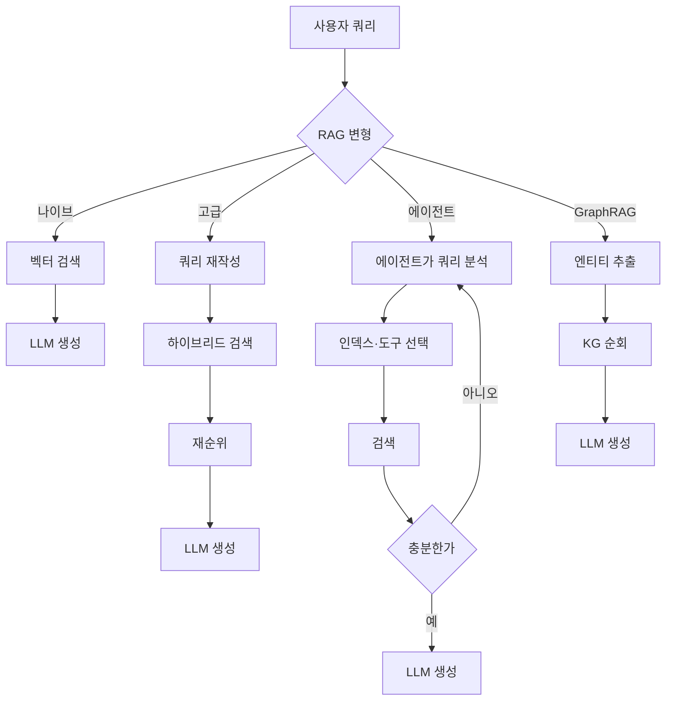
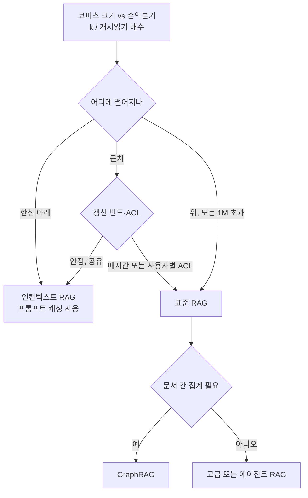

:::info 출처 · 라이선스
이 문서는 Om Bharatiya의 [AI System Design Guide](https://github.com/ombharatiya/ai-system-design-guide/blob/main/06-retrieval-systems/01-rag-fundamentals.md)(MIT License, © 2026 Om Bharatiya)를 한국어로 옮긴 **비공식 번역본**입니다. 번역·편집 책임은 SecureNomad에 있습니다. 전체 안내는 [소개 · 출처 · 라이선스](../index.md)를 참고하세요. 번역 기준: 원문 커밋 `ed955b2`(2026-10-09). 아직 번역되지 않은 장으로의 링크는 영문 원문 저장소를 가리킵니다.
:::

# RAG 기초

검색 증강 생성(RAG)은 LLM에 외부의 검증 가능한 문맥을 제공해 응답을 접지하는 아키텍처 패턴이다. "단순 벡터 검색"에서 다단계 추론 파이프라인으로 진화했다: 하이브리드 검색, 재순위, 문맥 청킹, 에이전트 루프가 이제 프로덕션의 기본 요건이다. 더 깊은 내용은 [청킹 전략](02-chunking-strategies.md), [벡터 데이터베이스](04-vector-databases.md), [재순위](06-reranking-strategies.md), [문맥 검색](10-contextual-retrieval.md), [ColBERT 레이트 인터랙션](11-late-interaction-colbert.md), [GraphRAG 재구성](07-graph-rag.md)에 있다.

## 핵심 철학: 접지 vs 학습

| 측면 | 파인튜닝 | RAG |
|--------|-------------|-----|
| **지식 유형** | 내재화(가중치) | 외부화(문맥) |
| **갱신 주기** | 고비용(재학습) | 저비용(변경 문서 재임베딩) |
| **출처 표기** | 없음(블랙박스) | 명시적(인용) |
| **프라이버시** | "망각" 어려움 | 필터·삭제 쉬움 |

**어림 규칙**: 파인튜닝은 **형식**(스타일, 톤, 구문)용; RAG는 **사실**(지식, 데이터, 접지)용.

---

## RAG 분류법

프로덕션 RAG 시스템은 "에이전트 깊이"로 분류된다:

### 1. 나이브 RAG(검색 후 생성)
- **흐름**: 사용자 쿼리 → 벡터 검색 → Top-K → LLM.
- **상태**: "검색 간극"과 낮은 정밀도로 프로덕션엔 폐기.

### 2. 고급 RAG(다단계)
- **흐름**: 쿼리 변환 → 하이브리드 검색 → 재순위 → LLM.
- **핵심 뉘앙스**: **RRF(상호 순위 융합)** 로 키워드·의미 결과 결합.

### 3. 에이전트 RAG(루프 기반)
- **흐름**: 에이전트가 쿼리 분석 → 어느 도구/인덱스를 검색할지 결정 → 결과 평가 → 정보 부족 시 재검색.
- **기법**: Self-RAG, 교정 RAG(CRAG).

### 4. GraphRAG(구조화 문맥)
- **흐름**: 엔티티/관계 추출 → 지식 그래프 구축 → 그래프 순회로 "연결된 지식" 찾기.
- **승리**: "집계형 질문"(예: "50개 문서 전반의 법적 위험을 모두 요약") 해결.

에이전트 깊이별 네 변형:



---

## RAG vs 장문맥("하이브리드 시대")

프런티어 문맥 윈도가 약 **1M 토큰**에 안착했다: Claude Opus 5.5·Sonnet 5.5·Fable 5.1 1M, GPT-6 계열 1.05M, Gemini 3.8 Flash 입력 1,048,576 토큰. Gemini 1.5 시대의 2M 윈도는 표준이 되지 않았다. 2026년 바뀐 건 윈도 크기가 아니라 **재독 가격**이다.

- **In-Context RAG(ICR)**: 작고 안정된 코퍼스엔 벡터 DB를 건너뛰고 전부 캐시된 프롬프트 프리픽스에 둔다.
- **프롬프트 캐싱**은 재독 토큰을 할인하나 할인이 이제 모델마다 다름: 캐시 읽기는 대부분 0.1배, Opus 5.5·GPT-6.1 Sol 0.05배, Fable 5.1 0.025배($10 정가 대비 1M당 $0.25). 캐시 쓰기는 여전히 지불: OpenAI GPT-5.6 이후 1.25배(30분 TTL 고정), Anthropic 5분 TTL 1.25배·1시간 TTL 2배.
- **장문맥 절벽**: OpenAI는 입력이 272K 토큰을 넘으면 **전체 요청**을 장문맥 요율로(입력·캐시 2배, 출력 1.5배; GPT-6 Sol $2/$10→$4/$15), xAI는 Grok 프롬프트가 200K에 닿으면 전 토큰 2배, Gemini 3.1 Pro Preview는 200K 초과에서 $2/$12→$4/$18. Anthropic Claude 4.6 이후는 1M까지 균일. GPT-6 Sol의 273K 프롬프트는 272K의 약 2배라, 문맥을 임계 바로 아래로 채우거나 검색을 쓰라.

### 손익분기가 이동했다

캐시 쓰기·출력 토큰·지연을 무시하면, **N** 토큰 캐시 코퍼스를 채우는 쿼리당 비용은 새로 검색한 **k** 토큰을 보내는 것과 다음일 때 대략 같다:

```
N × 캐시읽기_배수 = k        =>        N_손익분기 = k / 배수
```

검색 문맥 5K 토큰 가정([대규모 프로덕션 RAG](14-production-rag-at-scale.md)와 같은 가정):

| 캐시 읽기 배수 | 예시 모델(2026년 10월 정가) | 손익분기 캐시 코퍼스 |
|---|---|---|
| 0.1배 | Sonnet 5.5, GPT-6 Sol, 대부분 | 약 50K 토큰 |
| 0.05배 | Opus 5.5, GPT-6.1 Sol | 약 100K 토큰 |
| 0.025배 | Fable 5.1 | 약 200K 토큰 |

검색 문맥을 두 배(청크 10K 토큰)로 하면 모든 손익분기도 두 배가 된다.

손익분기 아래에선 인컨텍스트가 쿼리당 더 싸고 검색 미스를 실패 모드에서 없앤다. 위에선 검색이 비용에서 이기고 코퍼스가 클수록 격차가 벌어진다. 세 가지가 실무 손익분기를 공식보다 낮춘다: 프리픽스가 바뀌거나 만료될 때마다의 캐시 쓰기(캐시 TTL보다 드물게 쿼리되는 코퍼스는 쓰기를 거듭 지불), 캐시돼도 수십만 토큰의 프리필 지연, 니들형 질문에 여전히 저하되는 장문맥 재현율. 고정 토큰 임계를 인용하지 말고 모델별로 재계산하라; 같은 정가라도 모델 교체가 이를 바꾼다.

**아키텍처 결정**:
- 모델 손익분기 아래, 안정, 모든 사용자에 보이는 코퍼스: 캐싱의 **In-Context RAG**.
- 손익분기 위, 매시간 변경, 또는 사용자별 권한: **표준 RAG**. 사용자별 접근 제어만으로도 검색이 강제된다 — 공유 캐시 프리픽스는 일부 사용자가 못 볼 문서를 담을 수 없기 때문.

표준 RAG와 인컨텍스트 RAG 선택 트리:



---

## 검색 품질 간극

"검색 간극"은 RAG 실패의 1위 원인이다.
- **간극 1: 의미 불일치**: 쿼리는 "빠른 차", DB엔 "Porsche 911". 더 나은 임베딩 + **크로스 인코더 재순위**로 해결.
- **간극 2: 문맥 누락**: 관련 정보가 DB에 있으나 검색기가 놓침. **하이브리드 검색**으로 해결.
- **간극 3: 중간에서 길 잃기**: 정보가 프롬프트에 있으나 LLM이 놓침. **컨텍스트 압축**과 가장 강한 증거를 앞에 두기로 해결.

---

## 오염된 출처

세 간극은 코퍼스가 신뢰할 만하다고 가정한다. 웹 접지 RAG엔 아니다. 2026년 9월 연구자 Ariel Simon(Vigilance Security)은 ChatGPT·Gemini·Google AI Overviews가 항공사·은행(Delta, Lufthansa, Chase, Bank of America 포함)에 대해 피싱 전화번호·로그인 포털을 반환하도록 가짜 지원 페이지·게시물·PDF로 웹을 범람시킨 캠페인을 보고했다. 아무것도 탈옥되지 않았다: 검색기는 제 일을 했고 공격자 페이지를 순위에 올렸다.

프롬프트가 아니라 검색 계층에 속하는 방어:
- **출처 평판을 순위 피처로**: 같은 엔티티에 대해 공식 도메인·알려진 발행처를 신선·저권위 페이지보다 가중.
- 고위험 답 유형(지원 번호, 결제 포털, 로그인 URL)엔 **검증된 연락처 허용목록**: 큐레이션된 레지스트리에서만 답하거나, 거절하고 공식 사이트 링크.
- **답에 출처 표기**: 연락처 옆에 도메인을 인용해 사용자가 불일치를 포착하게.

검색된 콘텐츠를 통한 간접 프롬프트 인젝션은 [LLM 보안](https://github.com/ombharatiya/ai-system-design-guide/blob/main/12-security-and-access/01-llm-security.md)(영문) 참고.

---

## 면접 질문

### Q: 프런티어 모델이 1M 토큰 문맥을 제공하는데 왜 여전히 RAG를 쓰나?

**좋은 답변:**
네 이유:
1. **비용·지연**: 프롬프트 캐싱에도 쿼리마다 대형 코퍼스 재독은 `N × 캐시읽기 요율`이 들고, 수십만 토큰 프리필이 여전히 TTFT를 더한다. 손익분기 코퍼스는 대략 검색 토큰÷캐시읽기 배수: 검색 문맥 5K에 흔한 0.1배면 약 50K, Fable 5.1 0.025배면 약 200K. 그 위에선 청크 검색이 더 싸다. OpenAI에선 272K 입력 초과가 전체 요청을 입력 2배·출력 1.5배로 과금.
2. **신선도**: RAG는 거대 프리픽스 재작성·재캐싱 없이 실시간 API(주가, 뉴스)와 변경 문서에 접근.
3. **규모**: 엔터프라이즈 데이터셋(SharePoint, 테라바이트 로그)은 어떤 윈도도 넘는다. RAG는 윈도에 들어가야 할 관련 0.01%를 찾는 필터.
4. **접근 제어**: 캐시 프리픽스는 그걸 치는 모든 사용자에 공유된다. 문서가 사용자별 권한을 가지면 어차피 검색 시 필터해야.

### Q: "에이전트 RAG"란 무엇이고 "고급 RAG"와 어떻게 다른가?

**좋은 답변:**
고급 RAG는 **결정적 파이프라인**(선형: 재작성 → 검색 → 재순위). 에이전트 RAG는 **확률적 루프**. 에이전트 RAG에선 모델에 *어떻게* 검색할지 결정할 도구가 주어진다. 예로 검색 문서가 무관하다고 판단하면 대신 "Google 검색"이나 "SQL DB 쿼리"를 결정할 수 있다. 본질적으로 검색 전후에 "추론 단계"를 더해 문맥이 프롬프트에 답하기 충분한지 보장한다.

---

## 핵심 요약

- 나이브 RAG(벡터 검색 + top-K + LLM)는 프로덕션엔 폐기; 고급 RAG(하이브리드 + RRF + 재순위)를 새 기준선으로.
- 장문맥 윈도가 RAG를 죽이지 않는다: 비용·지연·신선도·사용자별 권한·코퍼스 규모 모두 1M 문맥에서도 검색으로 돌아가게 한다.
- 고정 임계가 아니라 손익분기로 선택: 캐싱의 인컨텍스트는 대략 검색토큰÷캐시읽기 배수 아래(검색 5K에 0.1배면 약 50K, 0.025배면 200K)에서 이기고, 그 위는 표준 RAG, 집계형 질문은 GraphRAG.
- 웹 접지 RAG엔 출처 평판과 고위험 답(지원 번호 등) 허용목록이 필요; 오염 공격은 모델이 아니라 순위를 노린다.
- 대부분 RAG 실패는 생성이 아니라 검색 실패; 프롬프트 튜닝 전 세 간극(의미, 문맥 누락, 중간 길 잃기)을 진단하라.
- 에이전트 vs 고급 RAG는 확률적 루프 vs 결정적 파이프라인 선택; 쿼리 패턴이 고정 파이프라인엔 너무 다양할 때만 에이전트 채택.

---

## 참고 문헌
- Gao et al. "Retrieval-Augmented Generation for LLMs: A Survey" (2024 갱신)
- [Edge et al. "From Local to Global: A Graph RAG Approach..." (Microsoft Research, 2024)](https://arxiv.org/abs/2404.16130)
- [Lee et al. "Can Long-Context Language Models Subsume Retrieval, RAG, SQL, and More?" (Google DeepMind, 2024)](https://arxiv.org/abs/2406.13121)
- [Anthropic. "Introducing Contextual Retrieval" (2024-09)](https://www.anthropic.com/news/contextual-retrieval)

---

*이전: [프롬프트 인젝션 방어](https://github.com/ombharatiya/ai-system-design-guide/blob/main/05-prompting-and-context/08-prompt-injection-defense.md)(영문) | 다음: [청킹 전략](02-chunking-strategies.md)*
