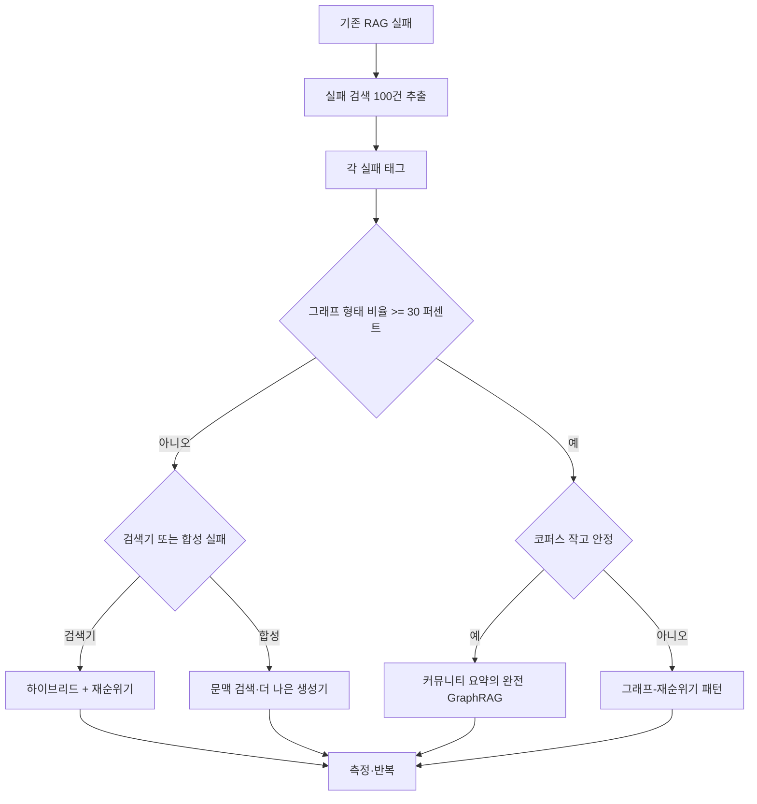
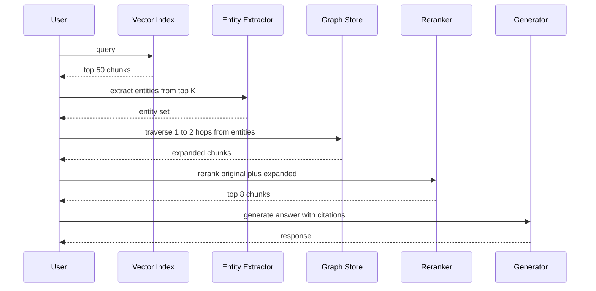

:::info 출처 · 라이선스
이 문서는 Om Bharatiya의 [AI System Design Guide](https://github.com/ombharatiya/ai-system-design-guide/blob/main/06-retrieval-systems/07-graph-rag.md)(MIT License, © 2026 Om Bharatiya)를 한국어로 옮긴 **비공식 번역본**입니다. 번역·편집 책임은 SecureNomad에 있습니다. 전체 안내는 [소개 · 출처 · 라이선스](../index.md)를 참고하세요. 번역 기준: 원문 커밋 `ed955b2`(2026-10-09).
:::

# GraphRAG

GraphRAG는 **지식 그래프(KG)** 와 **검색 증강 생성**의 결합이다. 벡터 RAG가 "특정 청크 찾기"에 능한 반면, GraphRAG는 전체 데이터셋에 걸친 **전역 추론**을 위해 설계됐다.

## GraphRAG가 실제로 이길 때(와 아닐 때)

GraphRAG는 그래프 형태 질문을 위한 전문 도구이지 벡터 RAG의 기본 업그레이드가 아니다. 프로덕션 검색 워크로드의 약 80%엔 하이브리드 BM25+dense 검색 후 크로스 인코더 재순위가 구축·운영이 더 싸고 답 품질에서 경쟁적이다. 그래프는 벡터 유사도가 복구 못 하는 멀티홉 순회가 질문에 진짜 필요할 때만 지을 값어치가 있다.

결정은 미학이 아니라 데이터 기반이어야. 기존 RAG의 실패 검색 100건을 뽑아 각각을 세 버킷 중 하나로 태그하고 분포가 결정하게 하라:

1. **어휘·청킹 실패**: 답이 코퍼스에 있었으나 검색기가 못 내놓음. 검색기 고침(더 나은 임베딩, 하이브리드 점수, 큰 top-k, 재순위기, 문맥 검색).
2. **합성 실패**: 검색기가 옳은 청크를 냈으나 생성기가 잘못 결합. 프롬프트·재순위기·모델 고침.
3. **그래프 형태 실패**: 답이 표면 텍스트를 공유 안 하는 문서 전반의 관계 체인을 따라야 했음. 이것이 GraphRAG 버킷.

세 번째 버킷이 실패의 30% 미만이면 그래프를 짓지 마라. 구축·유지 비용이 본전을 못 뽑는다. 30% 이상이면 GraphRAG(또는 아래 그래프-재순위기 하이브리드)가 옳은 다음 투자.

### GraphRAG가 옳은 도구인 워크로드

패턴은 같다: 질문이 어떤 단일 청크에도 공존하지 않는 엔티티를 연결해야 하고, 관계 자체가 표면 임베딩이 못 잡는 의미 무게를 지닌다.

- **신약 발견·생의학 연구**: 유전자·단백질·화합물·질병 전반의 경로 추적. UMLS 접지 변형 GraLC-RAG가 이 도메인에 튜닝됨.
- **금융 사기 조직**: 서로 명시 안 하는 문서 전반의 계정·장치·위치·거래 연결.
- **법적 판례 체인**: 각 판례가 직계 부모만 참조하는 여러 관할 계층의 인용 추적.
- **엔터프라이즈 조직도·정책 소유**: "지역 Y에서 정책 X 예외를 누가 승인?" 같은 질문은 보고 라인·정책 소유 엣지 순회 필요.
- **레포 규모 코드 인텔리전스**: 콜 그래프·타입 계층·의존 관계가 본질적으로 그래프 형태; 소스 코드 청크 위 벡터 유사도는 답을 찾게 하는 구조를 잃음.

### 결정 흐름

### 유지보수 꼬리

GraphRAG의 숨은 비용은 추출이 아니라 유지보수다. 코퍼스가 드리프트: 새 문서 도착, 엔티티 이름 변경, 관계 재작성. 1월에 지은 그래프가 4월엔 유의하게 틀리다. 변경 문서에 추출을 재실행하고 diff 전반의 엔티티 동일성을 조정하는 분기 갱신을 계획하라. 이 갱신의 LLM 비용·엔지니어링 시간을 미리 예산화하거나, 그래프를 짓지 마라. 이 단계를 건너뛴 팀은 자신 있게 틀리게 검색하는 그래프로 끝나는데, 이는 그래프 없는 것보다 나쁘다.

별도 그래프 스토어의 운영 비용이 충분히 실제라, 선도 에이전트 메모리 라이브러리가 그걸 버렸다: Mem0 v2.0.0(2026-04)은 Neo4j·Memgraph·Kuzu·Apache AGE 드라이버 코드 약 4,000줄을 제거하고 이제 엔티티 링크를 기존 벡터 스토어 내 병렬 컬렉션에 두고 의미·BM25 신호와 한 점수로 융합. "그래프"가 대부분 부스팅용 엔티티 공존이면 벡터 옆 엔티티 컬렉션으로 충분할 수 있다; 타입 관계 위 멀티홉 순회엔 진짜 그래프 DB를 예약하라.

---

## 그래프-재순위기 패턴

완전 GraphRAG가 첫 빌드로 옳은 경우는 드물다. 더 싼 하이브리드는 그래프-재순위기로, 구축 비용의 일부로 멀티홉 이점 대부분을 겨냥한다. 직관은 코퍼스 전체에 그래프 인덱스가 필요 없다는 것; top-k 벡터 결과에 나타난 엔티티를 덮는 그래프를, 연결 증거를 찾을 만큼만 확장하면 된다.

흐름:

1. 가진 하이브리드 점수로 사용자 쿼리의 top-50 청크를 벡터 검색.
2. 엔티티 추출기(작은 파인튜닝 모델·구조화 출력 LLM 호출)가 그 50개에서 고유명사 추출.
3. 그 엔티티에서 1-2홉 그래프 순회가 연결 엔티티와 그것이 나타난 청크 반환.
4. 확장 후보 집합(원 50 + 그래프 확장 청크)이 크로스 인코더 재순위기로.
5. 상위 재순위 청크가 생성기로.

전역 그래프 인덱스가 아니라 쿼리가 닿는 그래프 조각만 지연 구축. 구축 비용이 한 자릿수 떨어진다. 손대지 않은 영역을 재인덱스 안 하니 유지보수 꼬리가 줄어든다. 실무자 보고(통제 벤치 아님)는 완전 GraphRAG 품질 향상의 약 70-80%를 선불 비용의 약 20%로; 자신의 실패셋에서 측정하라.

### 패턴 흐름

### 최근 변형(2024~2026)

알아둘 변형 짧은 투어:

- **HippoRAG·HippoRAG 2**(Princeton, 2024·2025): 검색을 메모리 그래프 위 Personalized PageRank 문제로 다룸, Microsoft GraphRAG보다 낮은 인덱스 비용으로 멀티홉 벤치 강한 결과.
- **LightRAG**(HKU, 2024): 더 단순한 인덱싱의 엔티티 중심 검색; 전역 질문 재현율 일부를 훨씬 빠른 구축·갱신과 교환.
- **GraLC-RAG**(2026-03): 생의학용 UMLS 접지와 짝지은 그래프 인식 레이트 청킹, 멀티홉 생의학 QA에 강한 발표 결과.
- **Microsoft GraphRAG**(2025년 2.x, 2026년 3.x): 원래 커뮤니티 요약 접근, 증분 갱신·훨씬 싼 추출로 재설계; 로컬 멀티홉이 아니라 진짜 전역 요약이 필요하면 이걸 쓰라. 3.x 라인(2026-01 3.0.0은 모노레포 재구성; 2026-09 3.2.0은 동시성 안전 SQLite 캐시 추가)은 유지보수이지 새 방법 아님.

네 변형 전반의 일반 방향은 같다: 덜 모놀리식 인덱싱, 더 증분·지연 그래프 구축, "전역 요약" 워크로드(Microsoft식 커뮤니티가 여전히 이김)와 "로컬 멀티홉" 워크로드(HippoRAG식 순회가 더 싸고 경쟁적)의 더 명확한 분리.

관련 2026 제품 범주는 코퍼스를 한 번 구조화 아티팩트(요약·추출·엔티티-관계 그래프)로 컴파일해 에이전트가 직접 쿼리하게 한다, 쿼리마다 청크 검색이 아니라. Pinecone Nexus(2026-08-06 GA)가 가장 명확한 예; 트레이드오프는 [에이전트 RAG](08-agentic-rag.md) 참고.

**출처:**
- [Microsoft GraphRAG](https://microsoft.github.io/graphrag)
- [HippoRAG: Neurobiologically Inspired Long-Term Memory](https://arxiv.org/abs/2405.14831)
- [Edge et al., From Local to Global: A GraphRAG Approach](https://arxiv.org/abs/2404.16130)
- [Graph-aware late chunking (arXiv 2603.22633)](https://arxiv.org/html/2603.22633v1)
- [Anthropic Contextual Retrieval (2024-09)](https://www.anthropic.com/news/contextual-retrieval)

---

## 벡터 RAG의 한계

벡터 RAG는 공간의 "점"에서 작동한다. 다음 같은 질문엔 실패한다:
- *"직원 리뷰 500개 전반의 주요 테마는?"*
- *"Project Alpha와 Q3 예산 삭감 사이 모든 연결을 보여줘."*

**문제**: 벡터 검색은 "유사 텍스트"를 찾으나 "연결된 엔티티"를 이해 못 한다.

---

## GraphRAG 아키텍처

현대 GraphRAG 파이프라인은 세 단계:

1. **추출**: LLM이 텍스트를 훑어 **엔티티**(사람·프로젝트·날짜)와 **관계**(예: "사람 A가 프로젝트 B에 *작업함*") 추출.
2. **그래프 구축**: 엔티티를 노드, 관계를 엣지로 그래프 DB(Neo4j, Memgraph)에 저장.
3. **쿼리**:
   - **로컬 검색**: 노드와 이웃 찾기.
   - **전역 검색**: **커뮤니티 요약**으로 고수준 질문 답.

---

## 커뮤니티 요약

Microsoft가 대중화, 다음을 포함:
1. 그래프 알고리즘(예: Leiden)으로 연관 노드 클러스터(커뮤니티) 식별.
2. *각* 커뮤니티에 자연어 요약 생성.
3. 쿼리 시 원시 청크 대신 **요약** 검색.

**승리**: 모델이 1M 토큰을 안 읽고 "큰 그림" 질문에 답하게 함.

---

## 엔티티-관계 검색

프로덕션 스택은 **하이브리드 그래프-벡터 검색**을 쓴다.
- **Dense 패스**: 임베딩으로 가장 유사한 노드 찾기.
- **그래프 패스**: 그 노드의 엣지를 순회해 쿼리와 의미적으론 안 유사하나 논리적으로 연결된 관련 "지지" 정보 찾기.

---

## 언제 GraphRAG를 쓰나

| 특징 | 벡터 RAG | GraphRAG |
|---------|------------|----------|
| **데이터 유형** | 비구조 텍스트 | 고도 연결 데이터 |
| **쿼리 유형**| "X 찾기" | "X와 Y의 관계 설명" |
| **규모** | 페타바이트 | 수백만 엔티티 |
| **비용** | 낮음 | 높음(추출이 비쌈) |

**권고**: 문서 간 연결이 내용만큼 중요한 **내부 지식 베이스**(위키, 코드베이스, 법률 저장소)에 GraphRAG를 쓰라.

---

## 면접 질문

### Q: "추출" 단계가 GraphRAG의 병목인 이유는?

**좋은 답변:**
KG 추출은 토큰 집약적: 모든 청크가 LLM을 거치고 보통 한 번 넘게(추출 + 놓친 엔티티 잡는 "gleaning" 패스), 출력이 큰 구조화 JSON. 토큰 가격이 충분히 떨어져 원시 API 비용은 거의 블로커가 아니다. 1만 페이지 코퍼스는 약 600만 입력 토큰; GPT-6 Luna($0.10/$0.50) 한 패스는 몇 달러, Claude Opus 5.5($4/$20, 사고가 출력 과금) 같은 프런티어 추론 모델은 출력·반복 패스 계산 시 수백 달러대. 진짜 병목은 처리량(대형 코퍼스 재추출 시 레이트 리밋), 엔티티 해소 품질, 코퍼스 변경마다 재추출. 표준 완화는 초기 패스에 **SLM 기반 추출**, 겹치는 엔티티 간 "충돌 해소"엔 큰 모델 예약. Microsoft LazyGraphRAG는 커뮤니티 요약 비용을 쿼리 시까지 미뤄 더 지연.

### Q: GraphRAG는 집계 질문의 "문맥 윈도" 한계를 어떻게 해결하나?

**좋은 답변:**
집계 질문(예: "1,000 문서의 감성 요약")엔 표준 RAG가 1,000 청크를 문맥 윈도에 넣어야 해 불가능하거나 금지적으로 비싸다. GraphRAG는 **사전 요약**으로 해결. 그래프의 정보 클러스터(커뮤니티)를 계층적으로 요약. 사용자가 전역 질문을 하면 시스템이 고수준 커뮤니티 요약만 검색하는데, 이는 압축되고 정보 풍부해 모델이 응축 렌즈로 전체 데이터셋을 "보게" 한다.

---

## 참고 문헌
- Edge et al. "From Local to Global: A GraphRAG Approach" (Microsoft Research, 2024)
- Neo4j. "Generative AI and Graph Databases" (2025)
- WhyHow AI. "Deterministic RAG with Knowledge Graphs" (2024)

---

*이전: [재순위 전략](06-reranking-strategies.md) | 다음: [에이전트 RAG](08-agentic-rag.md)*
