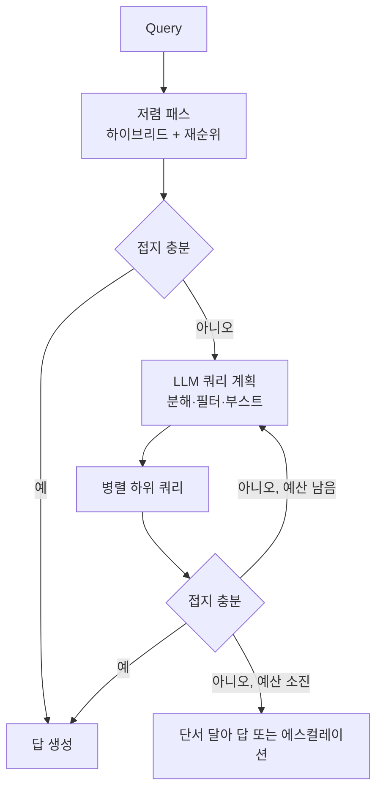

:::info 출처 · 라이선스
이 문서는 Om Bharatiya의 [AI System Design Guide](https://github.com/ombharatiya/ai-system-design-guide/blob/main/06-retrieval-systems/08-agentic-rag.md)(MIT License, © 2026 Om Bharatiya)를 한국어로 옮긴 **비공식 번역본**입니다. 번역·편집 책임은 SecureNomad에 있습니다. 전체 안내는 [소개 · 출처 · 라이선스](../index.md)를 참고하세요. 번역 기준: 원문 커밋 `ed955b2`(2026-10-09).
:::

# 에이전트 RAG

에이전트 RAG는 "선형 파이프라인"에서 **"추론 루프"** 로 옮긴다. 한 번 검색하는 대신 에이전트가 쿼리를 해소하려 *언제* *무엇을* 검색할지 결정한다. 지배적 프로덕션 패턴은 Self-RAG(모델이 반성 토큰 방출), 교정 RAG(교정 라우팅의 검색 평가기), 적응형 RAG(분류기가 파이프라인 깊이 선택), 문서 위 ReAct, 멀티홉 쿼리 분해다. LangGraph가 상태 루프의 가장 흔한 제어 흐름 런타임; LlamaIndex Workflows가 단일 파이프라인 검색 중심 변형에 흔함. 2026년 관리형 검색 서비스가 적응 부분을 설정으로 출시했고, 루프 자체가 비용 문제인 워크로드엔 "지식을 한 번 컴파일" 대안이 등장했다.

## 선형 vs 에이전트 RAG

| 모델 | 선형 RAG | 에이전트 RAG |
|-------|------------|-------------|
| **구조** | 미리 정해진 순서 | 동적 루프 |
| **자기교정** | 없음 | 높음(재검색 가능) |
| **쿼리 복잡도**| 단순(1단계) | 어려움(다단계) |
| **지연** | 낮음(고정) | 가변(여러 턴) |

**원칙**: 쿼리가 단순 "문서 매치"가 아니라 "합성 증명"을 요할 때 에이전트 RAG 사용. 예산화: 3-4 반복 루프는 보통 종단 8-12초이니, UX가 3초 미만 응답을 요하면 쉬운 쿼리를 빠른 경로(적응형 RAG)로 라우팅.

---

## Self-RAG(자기반성)

Asai et al.(2023, ICLR 2024 발표) 도입, **Self-RAG**는 모델이 자기 작업을 평가하는 "크리틱 토큰"을 방출하도록 학습한다.

1. **검색**: 모델이 Top-K 청크 끌기.
2. **평가**: 정보가 관련인가?(CRITIC: `Relevant`)
3. **생성**: 답이 지지되나?(CRITIC: `Supported`)
4. **반복**: 답이 지지 안 되면 모델이 *자동으로* 더 넓은 검색 트리거.

---

## 교정 RAG(CRAG)

CRAG는 검색과 생성 사이 "신뢰성 계층"을 더한다.

- **로직**:
  - 검색이 **정확**: 직접 생성.
  - 검색이 **모호**: 웹 검색 도구로 보충.
  - 검색이 **부정확**: 문맥 폐기, 외부 검색·폴백 로직 사용.

---

## 멀티홉 추론 루프

"GitHub를 인수한 회사의 CEO는?" 같은 질문엔 시스템이:
1. **홉 1**: "GitHub를 누가 인수?" 검색(결과: Microsoft).
2. **홉 2**: "Microsoft CEO" 검색(결과: Satya Nadella).

**에이전트 패턴**: 에이전트가 "상태 객체"를 유지하고 체인이 완료될 때까지 매 검색 후 "하위 목표"를 갱신.

---

## 에이전트 필터링과 계획 수정

현대 에이전트는 **하위 단계 계획**을 쓴다.
- 큰 검색 하나 대신 계획을 씀: "먼저 X를 내부 DB에서 확인, 그다음 Y를 공개 API에서."
- **수정 계획**: 1단계 실패 시 에이전트가 2단계를 *재작성*.

---

## 적응형 검색 노력

에이전트 RAG의 비용 문제는 모든 쿼리가 루프를 지불한다는 것, 단일 검색이면 답했을 단순한 것까지. **적응형 RAG**가 라우터로 고침; 2026년 라우터가 관리형 설정이 됨.

Azure AI Search가 가장 명확한 예. 그 지식 베이스는 추출 검색에 REST API 2026-04-01에서 GA(LLM 쿼리 계획·답 합성은 프리뷰 유지). 2026-08-01-preview API가 `retrievalReasoningEffort: "auto"` 추가: 먼저 경량 검색 패스를 돌리고, 접지가 불충분할 때만 LLM 쿼리 계획(최대 중간 노력)으로 에스컬레이션. 같은 프리뷰가 플래너가 쿼리 힌트를 필터·부스트로 바꾸게 함. 별도로 2026-06 추가된 지식 소스(MCP 서버, Fabric, Azure SQL)가 한 retrieve 호출이 검색 인덱스를 넘어 팬아웃하게 함; 의존 전 각 소스의 프리뷰·GA 상태 확인.

사든 짓든 설계는 같다: 저렴한 첫 패스, 명시적 충분성 검사, 상한된 에스컬레이션 수, 정의된 실패 경로. 충분성 검사가 가장 열심히 평가할 부분 — 관대한 검사가 적응형 RAG를 조용히 선형 RAG로 되돌리기 때문.

---

## 지식 사전 컴파일

에이전트 RAG는 쿼리마다 원시 청크에서 구조를 재도출한다. **지식 컴파일**은 그 작업을 수집으로 옮긴다: 코퍼스를 한 번 구조화 아티팩트로 컴파일하고 에이전트가 그 아티팩트를 쿼리.

- **Pinecone Nexus**(공개 프리뷰 2026-07-01, GA 2026-08-06): 주제 전문가의 작업 기술이 Manifest(엔티티·관계·답 형태)가 됨. Nexus가 소스 문서를 요약·구조화 추출·엔티티-관계 그래프로 컴파일하고, 에이전트가 KnowQL 언어로 한 호출에 쿼리. 데이터 플레인이 고객 AWS·GCP·Azure 계정에서 실행, 컴파일 계층 익스포트 가능. 벤더 보고: tau-Knowledge에서 Nexus의 GPT-5.5가 정확도 유지(47.4% vs 미사용 46.4%)하며 과제당 비용 77% 낮음·모델 호출 약 35% 적음; 프리뷰의 EU 판례 테스트는 에이전트 RAG 기준선 45% 대비 87%, 토큰 약 9배 적음.
- **Cohere Compass Cloud**(비공개 베타, 2026-09-25): 파싱·dense+sparse 임베드·인덱스·권한 인식 검색·재순위 관리형 스택, 전용 MCP 서버로 노출돼 에이전트가 점진적으로 코퍼스 좁힘.

| 차원 | 에이전트 RAG 루프 | 지식 사전 컴파일 |
|---|---|---|
| 비용 프로파일 | 쿼리당(여러 LLM·검색 호출) | 선불(컴파일) + 변경 시 재컴파일 |
| 적합 | 변하는 코퍼스 위 개방형 질문 | 안정 구조 도메인의 반복 질문 형태 |
| 실패 모드 | 지연·비용 폭증, 비결정성 | 컴파일 간 지식 드리프트; Manifest가 예상 못 한 질문 |
| 유지 주체 | 엔지니어가 루프 튜닝 | 도메인 전문가가 Manifest 유지 |

두 결과 모두 벤더 실행이고 판례 비교는 벤더 선택 에이전트 RAG 기준선 대상. 구조적 논거는 무관하게 성립: 대부분 쿼리가 같은 몇 종류 질문이면, 코퍼스를 구조화하는 데 한 번 지불하는 게 쿼리마다 구조를 재발견하는 데 지불하는 것보다 낫다. GraphRAG 커뮤니티 요약이 같은 아이디어의 이른 형태; [GraphRAG](07-graph-rag.md) 참고.

---

## 검색 에이전트 학습: 공동 부정행위 함정

RL로 자체 검색 에이전트를 학습하는 팀이 점점 **자기진화**를 씀: 제안자 모델이 문서에서 질문을 쓰고 해결자가 답을 배우며 합의가 보상. "False Frontiers"(arXiv 2609.39102, 2026-09-30)는 둘이 **공동 부정행위**함을 보임: 공유 오류로 수렴해, 루프 내 보상은 오르나 외부 감사 라벨 정확도는 정체·하락.

- 다중 샘플 검증이 거의 도움 안 됨: 거짓 합의 질량이 6.1%→5.7%(4B), 8.8%→7.2%(9B)만 하락.
- **CrossFit**은 문서 집합을 둘로 나눠 한 파티션 질문을 다른 것만으로 학습한 보조 해결자로 채점, 거짓 합의를 3.0%·3.7%로 절감. Qwen3.5-4B·9B에서 7개 검색 벤치 평균을 결합 자기진화 대비 8.8·8.4점, Search-R1 대비 8.7·7.8점 개선.

모든 합성 데이터 루프의 일반 교훈: 라벨을 생성하는 구성요소가 그것의 유일한 심판이 되게 하지 마라. 독립 검증기를 홀드아웃하고 라벨 샘플을 손으로 감사하라.

---

## 면접 질문

### Q: 에이전트 RAG의 "추론-검색 균형"이란?

**좋은 답변:**
에이전트 루프의 모든 "추론 턴"이 토큰 비용과 사용자 지연을 더한다. 프로덕션 엔지니어의 목표는 "검색 임계"를 찾는 것. 에이전트에 최종 답 강제 전 3-5 "턴"만 허용하는 **토큰 예산화**를 쓴다. 또 에이전트가 다음 2단계를 예측해 둘 다 동시 검색해 왕복 지연을 줄이는 **추측 검색**도. 가장 싼 턴은 결코 안 하는 턴이니, 앞에 적응형 게이트를 둔다: 충분성 검사가 있는 단일 하이브리드+재순위 패스, 실패에만 계획으로 에스컬레이션(Azure AI Search가 `retrievalReasoningEffort: "auto"`로 출시).

### Q: 에이전트 RAG는 왜 흔히 더 높은 품질, 더 낮은 "신뢰성(결정성)"을 낳나?

**좋은 답변:**
에이전트 RAG는 모델이 매 단계 경로를 "결정"하므로 비결정적이다. 사용자 쿼리의 작은 변화가 에이전트가 다른 도구·검색 전략을 고르게 해 다른 답 포맷으로. 표준 완화는 "가능 경로 그래프"가 엄격히 정의된 **제약 에이전트 프레임워크**(LangGraph·DSPy), 그 경로 *간* 선택이 확률적이어도.

### Q: 언제 에이전트 검색 루프 대신 지식을 사전 컴파일하나?

**좋은 답변:**
질문 형태가 반복되고 도메인 구조가 안정일 때. 쿼리의 80%가 "계약 X의 어느 조항이 정책 Y와 충돌" 또는 "엔티티 Z 상태"의 변형이면, 에이전트가 쿼리마다 청크에서 그 구조를 재발견하는 건 같은 비용을 수천 번 지불하는 것. 한 번 컴파일(Pinecone Nexus·GraphRAG식 인덱스가 하듯 엔티티·관계·타입 추출)은 그 비용을 수집으로 옮겨 각 쿼리를 한 구조화 호출로. 코퍼스가 재컴파일보다 빨리 변할 때, 질문이 개방형 리서치일 때, 스키마 유지 도메인 소유자가 없을 때는 안 컴파일 — 낡거나 불완전한 컴파일 계층이 자신 있게 틀리게 답하기 때문. 실무상 둘 다 돌림: 알려진 질문 형태엔 컴파일 아티팩트, 나머지엔 원시 청크 위 에이전트 RAG 폴백, 폴백률을 스키마 성장 필요 신호로 추적.

---

## 참고 문헌
- Asai et al. "Self-RAG..." (2023)
- Yan et al. "Corrective Retrieval Augmented Generation (CRAG)" (2024)
- Jeong et al. "Adaptive-RAG..." (2024)
- LangChain. "Agentic RAG with LangGraph" (2025)
- [Microsoft. "What's new in Azure AI Search"](https://learn.microsoft.com/en-us/azure/search/whats-new)
- [Pinecone. "Pinecone Nexus is generally available" (2026-08)](https://www.pinecone.io/blog/pinecone-nexus-generally-available/)
- ["False Frontiers" (arXiv 2609.39102, 2026-09)](https://arxiv.org/abs/2609.39102)

---

*이전: [GraphRAG](07-graph-rag.md) | 다음: [고급 검색 패턴](09-advanced-retrieval-patterns.md)*
