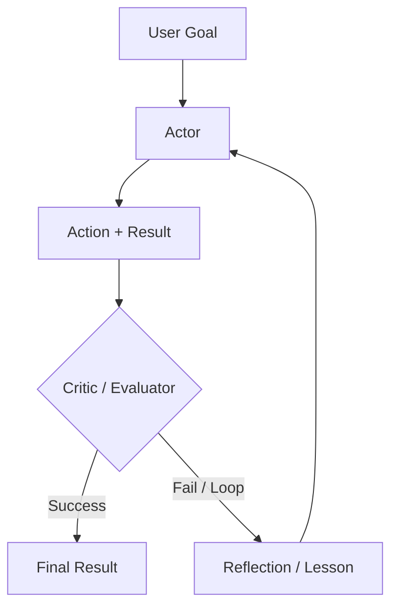

:::info 출처 · 라이선스
이 문서는 Om Bharatiya의 [AI System Design Guide](https://github.com/ombharatiya/ai-system-design-guide/blob/main/07-agentic-systems/02-reasoning-loops-react-and-beyond.md)(MIT License, © 2026 Om Bharatiya)를 한국어로 옮긴 **비공식 번역본**입니다. 번역·편집 책임은 SecureNomad에 있습니다. 전체 안내는 [소개 · 출처 · 라이선스](../index.md)를 참고하세요. 번역 기준: 원문 커밋 `ed955b2`(2026-10-09).
:::

# 추론 루프: ReAct와 그 너머

추론 루프는 에이전트 제어 흐름을 정의한다. **ReAct**가 2023 기준선이었으나, 현 시스템은 추론 네이티브 모델 위에 돌아가는 **Plan-and-Solve**·**자기반성**·**추론 시 스케일링** 같은 더 정교한 패턴을 쓴다.

## 루프의 진화

| 시대 | 패턴 | 핵심 철학 |
|-----|---------|-----------------|
| **2023** | ReAct | 사고와 행동 인터리브. |
| **2024** | Reflexion | 오류 평가·재시도. |
| **2025** | System 2 루프 | 신뢰성 있는 다단계 로직에 숨은 CoT. |
| **2026** | 엔지니어링된 하네스 루프 | 도구 호출 사이 사고 인터리브, 하네스가 종료·검증·예산 소유([루프 엔지니어링](12-loop-engineering.md) 참고). |

---

## ReAct: 추론 + 행동

에이전트의 90%를 위한 기본 루프:
1. **사고**: "X를 찾아야 해."
2. **행동**: `search_engine("X")`
3. **관찰**: "X는 Y에 있다."
4. **반복**.

**비판**: ReAct는 취약하다. 검색이 "결과 없음"을 반환하면 나이브 ReAct 에이전트는 흔히 같은 검색을 다시 시도. 현대 루프는 **"부정 제약"**(예: "이미 본 검색 결과를 시도 말라")을 주입.

---

## 자기반성 루프

Reflexion은 루프에 **"크리틱"** 단계를 더한다.

**이점**: 이 "반성"을 단기 메모리에 저장해 에이전트가 현 세션에서 안 통하는 것의 "정신 지도"를 구축.

---

## Plan-and-Solve

한 번에 한 단계 결정(탐욕적)하는 대신 에이전트가 먼저 **정적 계획**을 만들고 실행.

1. **플래너**: "A, 그다음 B, 그다음 C를 하겠다."
2. **실행기**: 단계 수행.
3. **재플래너**: B 실패 시 국소 수정이 아니라 전체 재계획 트리거.

**왜?**: 계획이 "확률적 오류"를 줄임. 경로에 전념해 모델이 잡음 도구 결과에 덜 산만해짐.

---

## 플로우 엔지니어링(LangGraph)

현대 에이전트 시스템이 "챗 인터페이스"에서 **"상태 기계"**로 옮겨감.

- **순환 그래프**: 선형 순서 대신 모델이 "정제" 노드나 "검증" 노드로 여러 번 루프백할 수 있는 그래프 정의.
- **마이크로 에이전트**: 그래프의 각 노드가 전문 "프롬프트"나 "도구".

**핵심 뉘앙스**: "에이전트"가 더 이상 LLM만이 아니다; 에이전트는 **그래프 실행 엔진**.

---

## 면접 질문

### Q: 언제 "추론 루프"(ReAct) vs "Plan-and-Solve" 아키텍처를 쓰나?

**좋은 답변:**
환경이 예측 불가한 **탐색적** 과제(예: URL 구조를 아직 모르는 새 웹사이트 브라우징)엔 **ReAct**. 에이전트가 모든 관찰에 반응해야. 예측 가능하나 복잡한 워크플로(예: 알려진 5개 API로 재무 보고서 생성)엔 **Plan-and-Solve**. 계획이 모델의 "방황"을 막고 서로 의존 않는 단계의 병렬화를 허용.

### Q: "추론 시 스케일링"이란 무엇이고 에이전트 루프와 어떻게 관련되나?

**좋은 답변:**
추론 시 스케일링(2024 OpenAI o1이 대중화)은 학습만이 아니라 *응답 생성 중* 더 많은 컴퓨트를 쓰는 것. 현 API엔 **노력** 설정으로 표면화: GPT-6 Astra가 low~max 다섯 레벨, Claude Opus 5.5·Fable 5.1이 노력 파라미터로 적응형 사고 스케일. 에이전트 맥락에서 더 많은 사고는 모델이 행동 전념 전 대안을 저울질함을 뜻해 "실세계" 도구 호출 수와 실패율을 줄일 수 있다. 면접에서 분리하는 둘. 첫째, 벤더가 추론 모델이 내부적으로 명시 트리 탐색을 돈다고 하지 않았다; **탐색 트리**(best-of-N, 검증기의 MCTS)를 원하면 분기를 보고 점수할 수 있는 하네스에 짓는다. 둘째, 노력은 단계별 튜닝하는 비용·지연 손잡이니, 플래너를 높은 노력·일상 실행 단계를 낮은 노력으로 돌리고 모든 도구 호출에 최대 사고를 지불 안 한다.

---

## 참고 문헌
- Yao et al. "ReAct..." (2022). https://arxiv.org/abs/2210.03629
- Shinn et al. "Reflexion..." (2023). https://arxiv.org/abs/2303.11366
- Wang et al. "Plan-and-Solve Prompting" (2023). https://arxiv.org/abs/2305.04091

---

*다음: [도구 사용과 Model Context Protocol(MCP)](03-tool-use-and-mcp.md)*
