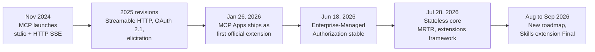
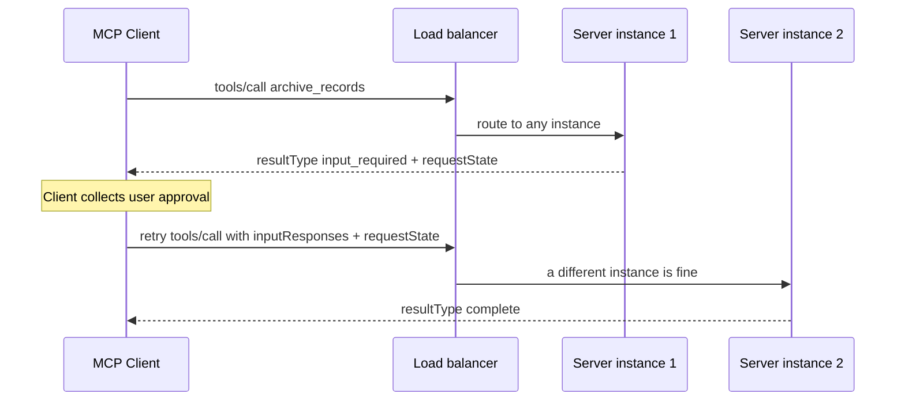
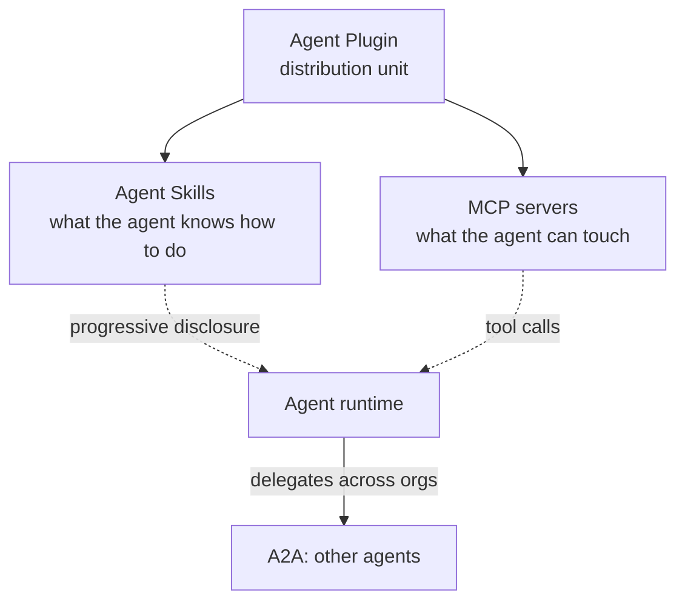
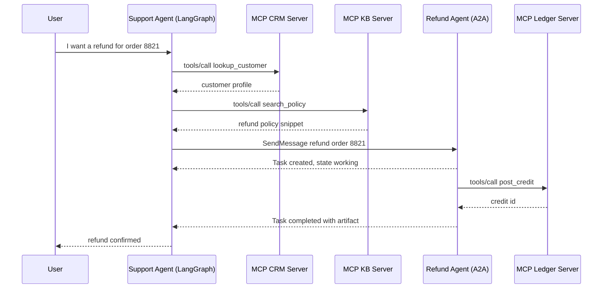
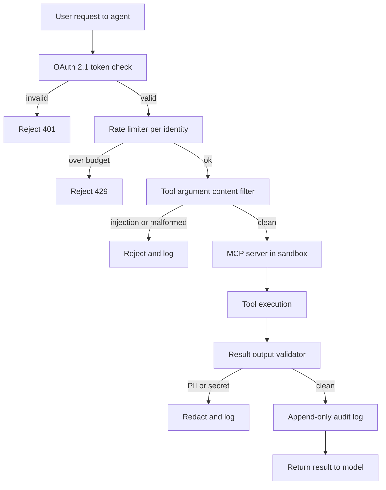

:::info 출처 · 라이선스
이 문서는 Om Bharatiya의 [AI System Design Guide](https://github.com/ombharatiya/ai-system-design-guide/blob/main/07-agentic-systems/03-tool-use-and-mcp.md)(MIT License, © 2026 Om Bharatiya)를 한국어로 옮긴 **비공식 번역본**입니다. 번역·편집 책임은 SecureNomad에 있습니다. 전체 안내는 [소개 · 출처 · 라이선스](../index.md)를 참고하세요. 번역 기준: 원문 커밋 `ed955b2`(2026-10-09).
:::

:::note 번역 주
원문은 외부 자료로, 기업명·제품명·프로토콜명은 원문 표기를 충실히 유지합니다. 코드·명령·JSON·머메이드·ASCII 다이어그램은 원문 그대로 둡니다.
:::

# 도구 사용과 MCP

도구는 에이전트의 "손"이다. 업계는 **Model Context Protocol(MCP)**로 표준화했는데, 파편화된 커스텀 도구 정의를 로컬 stdio나 원격 Streamable HTTP로 도는 단일 통신 계층으로 대체한다. Streamable HTTP와 OAuth 2.1 인가가 2025 스펙 개정에 도착했고(해설이 흔히 "MCP 2.0"이라 부르나 그 이름의 스펙 릴리스는 없고, 2026-07의 SDK 2.x 메이저는 별개 번호), **2026-07-28 개정**이 프로토콜 코어를 상태 비저장으로 재구축해 MCP 출시 이래 최대 개편이 됐다(아래 상태 비저장 재작성 참고). 병행해 **Agent-to-Agent(A2A)**가 MCP의 도구 접근 계층을 에이전트 조율로 보완하고, 2026-08부터 두 프로토콜이 같은 Linux Foundation 산하 Agentic AI Foundation에 있다.

---

## 도구 사용 메커니즘

도구 사용은 3단계 사이클로 일어난다:
1. **스키마 제시**: 모델에 도구의 JSON 스키마가 주어짐.
2. **의도 · 추출**: 모델이 "호출"을 출력(예: `{"tool": "get_weather", "args": {"city": "Tokyo"}}`).
3. **실행 · 문맥화**: 시스템이 함수를 돌려 결과를 프롬프트로 되먹임.

**뉘앙스**: 프로덕션 스택은 더 이상 도구 정의를 시스템 프롬프트에 "하드코딩"하지 않는다. 사용자 의도에 따라 필요한 도구만 당기는 **동적 매니페스트**를 쓴다.

하네스 코드에 중요한 2026 제공자 측 변화 셋:

- **최신 Claude 모델에서 강제 도구 사용이 사라졌다.** Fable 5.1, Mythos 5.1, Opus 5.5, Sonnet 5.5가 `any`·`tool`의 `tool_choice`에 HTTP 400 반환; `auto`·`none`만 남음. "JSON 얻으려 도구 호출 강제"하던 옛 추출 패턴은 `auto` + strict tool use나 structured outputs로 옮겨야.
- **캐시 손실 없이 대화 중 도구 변경 가능.** Anthropic의 `inline-tools-2026-09-15` 베타(9/22)가 프롬프트 캐시 무효화 없이 대화 중 시스템 메시지 안에서 도구를 정의·교체·제거하고, 가져온 MCP 도구 목록을 `mcp_tool_listing` 블록에 핀해 서버가 세션 중 정의를 바꾸지 못하게.
- **GPT-6 Astra의 도구 호출은 Responses API 필요**, Astra는 `temperature`·`top_p`·logprobs를 뺌, 그래서 샘플링 튜닝이나 도구 라우팅에 logprobs 읽던 하네스는 다른 메커니즘 필요.

---

## Model Context Protocol (MCP)

Anthropic이 개발(2024-11 출시)해 이제 Anthropic·OpenAI·Google·Microsoft·AWS 전반의 보편 도구 통합 표준인 MCP는 모델이 데이터·도구가 어디 있든 상호작용하게 한다. 거버넌스가 2025-12 Linux Foundation의 Agentic AI Foundation으로 이전.

- **MCP 클라이언트**: AI 애플리케이션(예: 당신의 에이전트 코드).
- **MCP 서버**: Tools(함수)·Resources(데이터)·Prompts(템플릿)를 노출하는 독립 프로세스.
- **통신**: stdio(로컬)나 Streamable HTTP(원격) 위 JSON-RPC.

### 왜 MCP인가?
- **보안**: 도구가 모델 로직이 아닌 자기 프로세스에서 실행.
- **이식성**: "Postgres 도구"를 한 번 작성해 Claude·GPT·Llama에서 사용.
- **발견성**: 표준 `tools/list`·`resources/read`·`prompts/list` 메서드, 그리고 2026-07-28 개정이 필수화한 `server/discover` RPC.

---

## 고정밀 도구 정의

프로덕션 품질 도구는 포함해야:

1. **엄격 타입 검증**: Pydantic·Zod로 호출 실행 전 스키마 강제, 제공자 strict tool mode를 켜 생성 시 인자를 스키마로 제약.
2. **상세 독스트링**: 언제 *쓰지 말아야* 하는지 기술.
3. **신뢰 임계**: 모델이 도구 호출에 `confidence` 점수 출력하게. 보정된 확률이 아니라 라우팅 힌트로 다룸.
4. **의도적, 모델 가시 오류**: MCP Python SDK 2.1.0부터 핸들러의 예기치 않은 예외는 로깅되고 클라이언트는 `Error executing tool <name>`만 봄; 모델이 행동해야 할 메시지엔 `ToolError` 발생. 이 기본값이 옳으나(스택 트레이스가 내부 유출) 행동 가능 오류는 유출이 아니라 설계돼야 함.

```python
# MCP Python SDK 2.x: `pip install mcp` now resolves to 2.x, and FastMCP was renamed MCPServer.
# Projects not ready to migrate should pin mcp<2 (v1 receives security and critical fixes only).
from mcp.server import MCPServer

mcp = MCPServer("analytics")

@mcp.tool()
def execute_sql(query: str) -> list[dict]:
    """Run ONE read-only SELECT against the analytics replica.
    Do NOT use for DDL or writes: DROP, DELETE, and UPDATE are rejected
    by the database role, not just by this docstring."""
    ...  # parameterize, enforce a row limit, run under a read-only role
```

---

## MCP vs. OpenAI Function Calling

| 특성 | OpenAI 네이티브 | MCP |
|---------|---------------|-----|
| **결합** | 높음(OpenAI 전용) | 낮음(불가지론) |
| **전송** | API 바디 내 JSON | JSON-RPC(로컬/원격) |
| **데이터 접근**| 네이티브 데이터 "Resource" 없음 | 네이티브 `Resources` 지원 |
| **적합** | 프로토타이핑 | 엔터프라이즈 오케스트레이션 |

비교는 표가 시사하는 것만큼 양자택일이 아니다. OpenAI의 Responses API, Agents SDK, 관리형 Agents API(2026-09-10 퍼블릭 베타)가 모두 원격 MCP 서버를 소비하므로, function calling은 제공자 API 내부의 와이어 포맷이고 MCP는 도구가 패키징·보안·도달되는 방식이다.

---

## 스트리밍 도구 호출

프런티어 모델은 **부분 도구 추측(Partial Tool Speculation)** 지원.
전체 JSON 생성을 기다리는 대신, 스트림에 도구 이름·핵심 ID가 보이자마자 도구 결과 "프리페치"를 시작. 체감 지연을 **400-800ms** 줄임.

---

## 2025 개정: Streamable HTTP와 인증

MCP 스펙 개정은 번호가 아니라 날짜: 2024-11-05, 2025-03-26, 2025-06-18, 2025-11-25, 2026-07-28(현행). **2025-03-26** 개정(2025-03)이 원격 MCP를 실용화한 두 변화를 도입했고, 2025-06-18 개정이 인증 모델을 오늘 쓰는 형태로 굳혔다. "2026-03 비준된 MCP 2.0"은 같은 변화를 1년 늦게 잘못 연대한 흔한 오기.

### 1. Streamable HTTP 전송
출시기 MCP는 로컬에 stdio, 원격에 별도 Server-Sent Events 채널의 HTTP 사용. **Streamable HTTP**가 HTTP+SSE를 단일 엔드포인트로 대체: 클라이언트가 JSON-RPC 메시지를 POST하면 서버가 평범한 JSON 응답으로, 여러 메시지 보내야 할 땐 SSE 스트림으로 답.

```
[MCP Client] ──── POST /mcp (JSON-RPC) ────→ [MCP Server]
             ←─── JSON response, or an SSE stream ───
```

- 로컬 프로세스뿐 아니라 클라우드 마이크로서비스로 배포된 MCP 서버 가능
- stdio는 로컬 전송으로 남음; HTTP+SSE는 2025-03-26 이래 폐기 예정이고 2026-07-28 개정이 스펙 공식 폐기 트랙으로 이동

### 2. OAuth 2.1 인가
원격 MCP 서버는 PKCE의 OAuth 2.1 요구 가능. 2025-06-18부터 MCP 서버는 OAuth **리소스 서버**: Protected Resource Metadata(RFC 9728)로 인가 서버를 광고하고, 클라이언트는 RFC 8707 `resource` 파라미터를 보내 모든 토큰이 한 서버에 대상 바인딩. 토큰 없는 요청은 클라이언트에 어디서 시작할지 알리는 챌린지를 받음:

```http
HTTP/1.1 401 Unauthorized
WWW-Authenticate: Bearer resource_metadata="https://mcp.example.com/.well-known/oauth-protected-resource",
                         scope="files:read"
```

이는 서버별 세밀 접근 제어의 엔터프라이즈 MCP 서버를 가능케. 2025-11-25 개정이 권장 등록 메커니즘으로 Client ID Metadata Documents와 증분 스코프 동의(서버가 HTTP 403 `insufficient_scope`에 필요 스코프로 답하는 step-up)를 추가. 2026-07-28 개정이 이어 Dynamic Client Registration을 폐기해 그 메타데이터 문서를 선호하고, 인가 서버가 RFC 9207 `iss` 파라미터를 보낼 때 클라이언트가 이를 검증하게 함, 둘 다 아래 다룸.

---

## MCP 2026-07-28: 상태 비저장 재작성

2026-07-28 MCP 프로젝트가 10주 릴리스 후보 동결 후 스펙 개정 **2026-07-28**, MCP 출시 이래 최대 프로토콜 개편을 확정. 핵심: **프로토콜 코어가 이제 상태 비저장**. `initialize` 핸드셰이크와 `Mcp-Session-Id` 헤더가 사라지고, 모든 요청이 프로토콜 버전·클라이언트 역량을 `_meta`에 싣고, 서버는 결과 `_meta`로 자신을 식별. 교차 호출 상태는 평범한 도구 인자로 전달되는 명시적 서버 발행 핸들로 이동. 실무 결과는 원격 MCP 서버가 이제 공유 세션 상태 없이 평범한 라운드 로빈 로드 밸런서 뒤 수평 확장 배포로 돌 수 있다는 것, 전엔 스티키 세션이나 공유 세션 스토어가 필요했다.

### MCP가 여기까지 온 길



### MCP 세 세대 비교

| 차원 | 출시(2024-11) | Streamable HTTP 시대(2025 개정) | 2026-07-28 개정 |
|-----------|-------------------|--------------------------------------|---------------------|
| **세션 모델** | 상태 저장 `initialize` 핸드셰이크 | 상태 저장, Streamable HTTP 위 `Mcp-Session-Id` | 상태 비저장; 버전·역량이 매 요청 `_meta`에 |
| **전송** | stdio, HTTP+SSE | Streamable HTTP 추가 | 필수 `Mcp-Method`/`Mcp-Name` 라우팅 헤더의 Streamable HTTP; HTTP+SSE 공식 폐기 |
| **서버 개시 요청** | Sampling, roots(서버 푸시) | elicitation 추가 | 제거; Multi Round-Trip Requests로 대체(클라이언트가 상태로 재시도) |
| **호출 중 사용자 입력** | 없음 | `elicitation/create` 푸시 | `input_required` 결과 + `requestState`로 클라이언트 재시도 |
| **장기 작업** | 없음 | 실험적 | Tasks 공식 확장(폴 기반 핸들) |
| **서버 렌더 UI** | 없음 | MCP Apps가 확장으로 출시(2026-01) | MCP Apps가 공식 확장 프레임워크로 흡수 |
| **인증** | 표준화 없음 | OAuth 2.1 + PKCE, DCR; 2025-11-25에 CIMD·step-up 스코프 동의 추가 | OAuth 강화: RFC 9207 `iss` 검증, 발행자 바인딩 자격증명, CIMD가 DCR 대체; 엔터프라이즈 IdP용 EMA 확장 |
| **목록 캐싱** | 없음 | 없음 | 목록·읽기 결과에 `ttlMs` + `cacheScope` 필수; 프롬프트 캐시 적중 위한 결정적 도구 정렬 |
| **스트림 복구** | 없음 | SSE `Last-Event-ID` 재개성 | 제거; 클라이언트가 요청 재발행, 내구 작업은 Tasks |
| **수평 확장** | 단일 프로세스 | 로드 밸런서 뒤 스티키 세션 | 어느 인스턴스나 어느 요청 처리; 공유 상태 없음 |

### Multi Round-Trip Requests (MRTR)

서버 개시 요청 패턴(`elicitation/create`, `sampling/createMessage`, `roots/list`)이 제거. 서버가 호출 중 사용자 입력 필요 시 `resultType: "input_required"`, `inputRequests` 배열, 불투명 `requestState` 블롭의 결과를 반환; 클라이언트가 입력을 모아 원 요청을 `inputResponses` 붙여 재시도. 상태가 재시도에 실리므로 로드 밸런서 뒤 어느 서버 인스턴스나 중단된 호출 재개 가능. 이것이 human-in-the-loop 승인 게이트를 상태 비저장 수평 확장과 호환되게 함.



모든 결과가 이제 필수 `resultType` 필드 보유(`complete`·`input_required`; Tasks 같은 확장이 추가 값); 이를 결한 구 서버 결과는 `complete`로 취급.

### 폐기·제거된 것

개정은 또 최소 12개월 폐기 기간과 공개 폐기 기능 레지스트리의 공식 기능 수명주기(Active·Deprecated·Removed)를 채택. 이 개정에 새로 폐기된 기능(Roots, Sampling, Logging, DCR)의 최조기 제거는 2027-07-28; 2025-03에 이미 폐기된 HTTP+SSE는 더 이른 시계.

| 기능 | 2026-07-28 상태 | 마이그레이션 |
|---------|----------------------|------------|
| `initialize` 핸드셰이크, `Mcp-Session-Id` | 제거 | 요청별 `_meta`의 버전·역량; 탐침 위한 `server/discover` RPC |
| `elicitation/create`, `sampling/createMessage`, `roots/list` | 제거 | Multi Round-Trip Requests |
| SSE 스트림 재개성(`Last-Event-ID`) | 제거 | 요청 재발행; 내구 작업은 Tasks 확장 |
| Roots | 폐기 | 도구 파라미터·리소스 URI·서버 설정으로 디렉터리 전달 |
| Sampling | 폐기 | LLM 제공자 API 직접 호출 |
| Logging | 폐기 | stderr(stdio)나 OpenTelemetry |
| HTTP+SSE 전송 | 공식 폐기 | Streamable HTTP |
| Dynamic Client Registration(RFC 7591) | 폐기 | Client ID Metadata Documents(클라이언트 ID가 메타데이터 호스팅 URL) |

RPC 메커니즘(`elicitation/create`, `sampling/createMessage`, `roots/list`)은 코어 프로토콜에서 제거되고 그들이 섬긴 기능은 마이그레이션 경로와 함께 폐기, 그래서 양쪽 행이 위에 나타남.

작으나 설계 관련된 전송 변화 둘: `Mcp-Method`·`Mcp-Name` HTTP 헤더가 이제 Streamable HTTP POST에 필수라 로드 밸런서·게이트웨이·WAF가 JSON-RPC 바디 파싱 없이 MCP 트래픽 라우팅·필터 가능; 목록 결과(`tools/list`, `prompts/list`, `resources/list`)는 `ttlMs`·`cacheScope` 선언해야 해 클라이언트에 도구 카탈로그 캐싱의 원칙적 답을 줌.

### 확장 프레임워크

코어가 이제 의도적으로 작고, 나머지 전부는 **확장**, 역-DNS ID로 식별, 코어 스펙과 독립 버전, SEP 프로세스 내 Extensions Track으로 거버넌스. 공식 확장:

| 확장 | 상태 | 하는 일 |
|-----------|--------|--------------|
| **Tasks** (`io.modelcontextprotocol/tasks`) | 공식; AWS 기여 재설계 폴 기반 수명주기 | 도구 호출이 태스크 핸들로 답 가능; 클라이언트가 `tasks/get` 폴, `tasks/update`로 중간 입력, `tasks/cancel`로 취소. 요청보다 오래 사는 작업의 표준 답. |
| **MCP Apps** | 2026-01-26부터 공식 | 도구가 `ui://` 템플릿 선언; 호스트가 샌드박스 iframe에 렌더(DOM 접근 없음, deny-by-default CSP), UI-호스트 통신은 postMessage 운반 JSON-RPC, UI 트리거 액션은 같은 도구 호출 동의 경로. Claude·ChatGPT·VS Code·Goose·Microsoft 365 Copilot 등이 렌더. |
| **Enterprise-Managed Authorization (EMA)** | 2026-06-18부터 안정 | 조직이 IdP 통해 MCP 서버 접근을 중앙 프로비저닝: OIDC·SAML 어서션을 ID-JAG로 교환(RFC 8693), JWT 베어러 그랜트(RFC 7523)가 이를 MCP 접근 토큰으로 교역, 사용자별 동의 화면 없음. Okta가 첫 지원 IdP; Claude·VS Code가 출시에 지원. ID-JAG 그랜트 자체는 아직 IETF OAuth WG 인터넷 드래프트(-04), RFC 아님이라 와이어 수준 변화 예상. |

### 마이그레이션 체크리스트

- `initialize`/세션-ID 로직 제거; `_meta`에 버전·역량 전송, `server/discover` RPC 구현(이제 MUST).
- elicitation·sampling 플로를 MRTR로 전환: `requestState`의 `input_required` 반환, `inputResponses` 재시도 수용.
- 교차 호출 상태를 도구 인자로 전달되는 명시 핸들로 이동, 또는 Tasks 확장 채택.
- `Mcp-Method`/`Mcp-Name` 헤더 방출, 목록 결과에 `ttlMs`/`cacheScope` 선언, 도구를 결정적 순서로 반환.
- DCR에서 Client ID Metadata Documents로 인증 마이그레이션 계획; RFC 9207별 `iss` 검증, 발행자 간 클라이언트 자격증명 재사용 금지.
- 실제 작업 예산: 유지관리자 스스로 커스텀 구현이 상당한 노력에 직면한다 경고.

출처: modelcontextprotocol.io/specification/2026-07-28/changelog, blog.modelcontextprotocol.io

---

## MCP 확장과 생태계 (2026년 10월)

이 장이 2026-05까지 추적한 로드맵 항목이 대체로 출시됐다. 2026-10 현재 상태:

| 로드맵 항목(2026-05 틀) | 상태(2026-10) |
|---------------------------------|--------------------|
| 전송 확장성 / 상태 비저장 코어 | 2026-07-28 개정에 **출시**(위 상태 비저장 재작성 참고). 8/22 로드맵은 더 나아감: 단일 바인딩으로 Streamable HTTP, 로컬 서버는 stdin/stdout로도 |
| MCP Apps(서버 렌더 UI) | 2026-01-26 첫 공식 확장으로 **출시**; Claude·ChatGPT·VS Code·Goose·Microsoft 365 Copilot 등이 렌더. Apps SDK가 ext-apps 2.0.0(9/8)에서 와이어 프로토콜 불변인 채 v2 TypeScript 패키지로 이동, 그래서 2.x View가 1.x 호스트에서, 2.x 호스트가 1.x View를 렌더: 와이어 중단 없는 SDK 수준 중단, 확장 프레임워크가 설계된 바 |
| Tasks 확장(장기 작업) | 2026-07-28 개정에 `io.modelcontextprotocol/tasks`로 **출시**, 폴 기반 태스크 핸들 중심 재설계, 다만 확장 저장소가 아직 사전 릴리스 태그(v0.2.0-v0.2.2, 9/23-30)만 보유라 인터페이스는 정착 중으로 다룸. 8/22 로드맵은 Tasks(SEP-2663)를 결국 코어에 포함 목표, tasks·subscriptions·progress notifications가 한 수명주기·취소 모델·오류 표면 공유하도록 컴포지션 검토 후 |
| 엔터프라이즈 인증 | 2026-06-18 Enterprise-Managed Authorization 확장으로 **출시**(Okta 첫 IdP; Claude·VS Code 출시 시). 다음은 에이전트 아이덴티티: DPoP 발신자 제약 토큰(SEP-1932)·Workload Identity Federation(SEP-1933)은 아직 열린 드래프트, 다만 TypeScript 클라이언트 2.1.0은 이미 DPoP 포함 |
| MCP Server Cards(연결 전 발견) | 아직 실험적(SEP-2127, 검토 중). 카드는 이제 `GET <streamable-http-url>/server-card`에, 클라이언트는 도메인 AI Catalog(`/.well-known/ai-catalog.json`)의 항목으로 찾음, A2A 에이전트 카드·Claude Code 플러그인도 나열하는 Linux Foundation 산하 Agent Card WG 유지 교차 프로토콜 인덱스. 코어 `server/discover` RPC와 구별 |
| MCP Registry | 아직 프리뷰(`registry.modelcontextprotocol.io`), API v0.1 동결; GA 시점 미발표. 릴리스 v1.8.1(8/6)이 GitHub Pages 조직 네임스페이스 탈취 수정 |
| Skills over MCP(신규) | 2026-09-13 `io.modelcontextprotocol/skills` 확장(SEP-2640)으로 **Final**; 아래 참고 |

**발견에 이제 구분할 두 계층이 있다:** 도메인 AI Catalog가 서버 카드를 가리키는 연결 전 발견(실험적; 레지스트리·크롤러·허용목록에 공급) vs. 인-프로토콜 `server/discover` RPC(2026-07-28부터 필수 코어; 버전 협상에 공급). 같은 카탈로그 문서가 MCP 서버와 A2A 에이전트를 인덱싱하므로 엔터프라이즈 플랫폼이 양쪽 원격 역량을 한 곳에서 허용목록 가능하나, 표준이 아니라 방향으로 제시.

### 8월 22일 로드맵의 우선순위

코어 유지관리자가 2026-08-22 6-12개월 로드맵을 발표, 다섯 영역에 신속 SEP 검토. 다음 스펙 개정 날짜는 미제시.

| 우선 영역 | 빌더에 의미 |
|---------------|----------------------------|
| **에이전트 메시징 프리미티브** | 서버 개시 이벤트·웹훅(Triggers and Events WG); Tasks·subscriptions·progress notifications가 한 수명주기로 수렴 |
| **HTTP 네이티브 전송** | 도처에 단일 바인딩(Streamable HTTP), 로컬 서버는 stdio 위로도; 캐싱을 `ttlMs`/`cacheScope`에서 ETag로 확장, 버전 도구 호출 결과 포함 |
| **에이전트 아이덴티티·엔터프라이즈 보안** | DPoP와 workload identity federation·ID-JAG·RFC 8693 토큰 교환 기반 위임 아이덴티티 모델을 확정할 Agent Identity WG(형성 중), IETF OAuth·WIMSE 그룹과 조율; 인간 재석 여부(대화형 클라이언트 vs 헤드리스 에이전트) 어테스트 논의 중 |
| **개선된 프리미티브** | `tools/call` 결과 형태 재설계(`content`·`structuredContent` 동시 반환이 구현 분기 유발); 대형 도구 카탈로그용 실험적 서버 측 점진 발견 |
| **SDK 개발자 경험** | 공식 확장 계약; 스펙·적합성 스위트에서 Tier 1 SDK·퀵스타트 생성 실험 |

이것이 세우는 두 미래 지향 면접 질문: 자기 아이덴티티의 헤드리스 에이전트가 어떻게 MCP 서버에 도달하나, 그리고 문맥 윈도를 터뜨리지 않고 2,000 도구 카탈로그를 어떻게 제공하나.

### Skills over MCP

Agent Skills(`SKILL.md` 폴더)가 2026-08-19 Claude API에서 베타를 떠났고, MCP skills 확장(9/13 Final)이 서버가 설명하는 도구 옆에 스킬을 파일시스템·플러그인에 복사하지 않고 발행하게 함. 선언하는 서버는 `skills/list`·`skills/get` 구현, 스킬 파일은 평범한 `resources/read`로 읽음. 각 스킬 항목이 프런트매터와 파일별 SHA-256 다이제스트·크기의 완전 파일 매니페스트 보유.

호스트 규칙이 배울 부분, "원격 서버가 내 에이전트가 로드하는 지시를 조용히 바꾸지 못하게 어떻게?"의 스킬 버전인 rug pull에 답하니:

- 호스트는 사용 전 크기·다이제스트·프런트매터를 **반드시 검증**하고, 지속 승인을 전체 매니페스트에 **반드시 바인딩**, 그래서 파일 변경·추가·제거가 승인을 철회.
- 호스트는 스킬 파일을 **프리페치 금지**, 스킬 내용을 신뢰 불가로 **반드시 취급**.
- 스킬의 `allowed-tools` 그랜트나 호스트 측 코드 실행은 스킬별 명시 승인 필요, 교차 서버 읽기는 양 서버 지명한 호출별 승인 필요.

채택은 초기: Hugging Face MCP 서버가 구현, MCP Inspector 2.6.0이 부분 지원, 공식 SDK PR은 9월 말 아직 열림. 스킬이 다른 곳에서도 버전 프로덕션 아티팩트가 되는 중(AWS가 9/30 에이전트 툴킷에 `update-skill` 명령 추가)이라 패키지 의존성과 같은 핀·업데이트 검토를 부여.

**생태계 규모:** SDK 다운로드가 월 수억. 프로토콜 자체의 7/28 릴리스 게시가 Tier 1 SDK 전반 월 5억 가까이 인용; Anthropic이 별도로 월 4억·연중 4배 증가 보고, 그래서 집계는 정밀 수치가 아니라 자릿수로 다루고 인용 전 지표 정의 확인. 8월 한 커넥터 디렉터리 하나가 **950개 넘는 MCP 서버** 나열. 7/28 최종 릴리스에 AWS·Cloudflare·Google Cloud·Microsoft·Netlify가 출시 지원 발표. Microsoft가 Microsoft 365 관리 센터에서 관리하는 MCP 기반 Federated Copilot Connectors 출시, Apple이 Xcode를 외부 코딩 에이전트의 MCP 호스트로, Bloomberg가 내부 에이전트 도구 계층으로서 MCP 프로덕션 사례 연구 발행.

**상태 비저장 개정 마이그레이션은 실재하나 느리다.** 2026-09 npm 다운로드: v1 TypeScript SDK(`@modelcontextprotocol/sdk`) 약 231.9M 대 `@modelcontextprotocol/core` 약 30.6M, `@modelcontextprotocol/server` 25.4M, `@modelcontextprotocol/client` 19.1M. 단일 패키지 비교로 v2는 이제 v1 물량의 대략 8-13%, 8월 중순 한 자릿수 초반에서 상승, v1도 여전히 성장(8/14까지 30일 약 207M). 긴 이중 버전 기간 대비: C# SDK v2.2.0(8/13)이 단일 엔드포인트가 2025-11-25 상태 저장 클라이언트와 2026-07-28 상태 비저장 클라이언트 둘 다 섬기는 `HttpServerSessionMode` 추가, 혼합 클라이언트 서버 플릿 운영 시 복사할 패턴.

SDK 메이저는 와이어 프로토콜이 안 깨져도 코드를 깬다. Python에서 `pip install mcp`가 2.0.0(7/28) 이래 2.x로 해결: `FastMCP`가 `MCPServer`로, 단일 `Client`가 v1의 전송+`ClientSession` 계층 대체, v1은 보안·치명 수정만, 그래서 `FastMCP` import하는 튜토리얼이 fresh install에 깨짐. 에이전트 프레임워크가 수주 내 따름(OpenAI Agents SDK 0.20.0이 두 메이저 지원; LangChain 1.4.0이 MCP 인터럽트 라우팅을 협상 프로토콜 시대로 게이트), 모든 프레임워크가 공유하는 의존성 내 메이저 버전의 폭발 반경을 보임. Tier 1 SDK는 이제 TypeScript·Python·C#·Go·Rust(8/21 승격)·Ruby(9/28 승격); Java는 Tier 2, Swift·PHP·Kotlin은 Tier 3. 적합성 스위트가 개정별 동결 요구 세트 발행(10/1 현재 0.2.0-alpha.12).

**거버넌스**: MCP는 Linux Foundation의 Agentic AI Foundation(AAIF) 산하 거버넌스, 이제 6개 프로젝트(MCP, goose, AGENTS.md, agentgateway, A2A, 구 Envoy AI Gateway인 Agent Router) 호스팅, 8/12 247개 회원 조직 보고. Governance WG가 Contributor Ladder와 도메인별 WG가 전체 코어 유지관리자 검토 없이 SEP(Specification Enhancement Proposals) 수용하는 위임 모델 운영; 2026-07-28 개정이 공식 Extensions Track 추가, 9/28부터 SEP 작성자가 SEP PR 열기 전 관련 WG·IG와 논의해야. AAIF가 9/14 첫 벤더 중립 MCP 자격증명 Model Context Protocol Associate(MCPA) 출시: $250, 90분, 2026-07-28 정렬, 시험 24%가 보안·거버넌스.

출처: modelcontextprotocol.io(스펙·로드맵·확장), blog.modelcontextprotocol.io, github.com/modelcontextprotocol, aaif.io

---

## 에이전트 플러그인

MCP가 에이전트의 도구 도달법을 표준화한다. **Agent Plugins**(2026-08-06 1.0.0 도달)는 역량 묶음을 에이전트에 *배송*하는 법을 표준화. Amazon·Cursor·Microsoft·OpenAI·Vercel 출신 기술 운영위 거버넌스의 벤더 중립 패키징 포맷, GitHub이 8/12 VS Code·Copilot CLI·Copilot SDK·Copilot 앱 전반 GA. 1.0.0이 아직 유일 발행 버전; 1.1.0 작업 드래프트가 8/19 열려 네임스페이스 스킬 발견·이식 표시명과 아이콘·서버별 MCP 확장 데이터 제안, 모두 아래 skills+MCP 경계 내.

플러그인은 디렉터리:

```
my-plugin/
├── plugin.json          # required manifest
├── skills/              # optional: Agent Skills (SKILL.md files)
│   └── code-review/
│       └── SKILL.md
├── mcp.json             # optional: MCP server declarations
└── com.example.client/  # optional: client-specific extras, namespaced
```

`mcp.json` 스키마는 세 서버 형태 지원(command·args·env의 stdio; Streamable HTTP; SSE), 클라이언트가 로드 시 주입하는 두 환경 변수 `PLUGIN_ROOT`·`PLUGIN_DATA` 예약.

연구할 설계 결정은 스펙이 표준화를 **거부**하는 것. 이식 가능한 컴포넌트 유형은 둘뿐: skills와 MCP 서버. Commands·hooks·subagents·rules·LSP 서버는 네임스페이스 디렉터리에 실리지 않는 한 클라이언트 전용. 이것이 이식 표면을 플러그인이 진정 어디서나 돌 만큼 작게 유지하고, 빠르게 움직이는 클라이언트 전용 부분을 상호운용성 못 깨는 네임스페이스로 민다.

### 세 계층이 맞는 법



| 계층 | 표준화 | 단위 | 거버넌스 |
|-------|--------------|------|------------|
| **Agent Skills** (`SKILL.md`) | 에이전트가 적용하는 절차·도메인 지식 | 프런트매터와 선택 스크립트·에셋의 폴더; MCP skills 확장으로 원격 제공도 | agentskills.io |
| **MCP** | 도구·데이터·리소스 접근 | stdio·Streamable HTTP 위 JSON-RPC 말하는 서버 | Linux Foundation, Agentic AI Foundation |
| **Agent Plugins** | 위 둘의 배포·설치 | `plugin.json`의 디렉터리 | Agent Plugins TSC |
| **A2A** | 벤더·조직 경계 넘는 에이전트 간 위임 | Agent Card로 기술되는 에이전트 엔드포인트(서명 선택) | Linux Foundation, Agentic AI Foundation(2026-08부터) |

플랫폼 팀 실무 결과: 엔터프라이즈 관리에 이제 한 제어점. GitHub이 기존 `managed-settings.json` 재사용해 플러그인 설치·마켓플레이스 접근·MCP 서버 허용목록이 모두 같은 파일로 관리. 내부 에이전트 플랫폼을 세운다면 플러그인이 검토·서명·배포 단위, 개별 서버가 아님.

**따라오는 보안 경고:** 플러그인이 지시(skills)를 역량(MCP 서버)과 묶으므로, 설치는 북마크 추가보다 패키지 설치에 가까움. 스킬 정적 분석은 강한 탐지 한계: 발행 결과가 데이터 탈출 93% 탐지나 자연어 프롬프트 인젝션 42%, **호스트 파괴 0%**, 파괴 스킬이 합법적인 것과 동일해 보이는 평범한 셸 명령을 쓰니. 적응 공격자는 더 밀어붙임: Pretext 공격(arXiv 2609.39607)이 LLM 보조 스킬 스캐너를 페이로드를 코드에서 자연어로 옮기고 파일 간 쪼개 최대 97% 회피. 플러그인을 의존성처럼 검토: 버전 핀, 서명 소스 선호, 플러그인이 로드하는 에이전트의 액션 표면을 넓히게 두지 말 것.

**그리고 핀을 검증.** Plugin4Shell(AIR Security, 2026-09-17)이 Claude Code·Codex·GitHub Copilot·Gemini CLI가 40-hex 커밋 SHA에 핀된 플러그인을 체크아웃 트리가 핀과 일치하는지 안 보고 설치함을 보임. Git이 SHA와 이름 같은 브랜치를 선호해, 해시 모양 브랜치명 수용 호스트에선 저장소 소유자가 이미 승인된 코드를 교체 가능, 백그라운드 업데이트가 클릭 없이 당김. Claude Code(2.1.179)·Codex(0.146.0)가 수정; Copilot은 공개 시 수정 없음. 제어는 체크아웃 후 작업 트리에 실제 존재하는 커밋을 해결하고 불일치 시 중단. 하네스 확장이 힘을 얻을수록 판돈 상승: Claude Code mods(2.1.287, 10/1)는 도구 호출 재작성·권한 요청 승인·거부 가능한 플러그인 배포 TypeScript 함수, Anthropic이 샌드박스 안 됐다 경고, 그래서 플러그인 검토가 이제 에이전트 신뢰 경계의 일부.

---

## Agent-to-Agent Protocol (A2A)

Google이 2025-04 **Agent2Agent(A2A)** 프로토콜을 도입, MCP가 다루지 않는 문제 해결: **다른 벤더의 에이전트들**이 (도구뿐 아니라) 서로 어떻게 통신하나?

### A2A가 푸는 것

MCP는 에이전트가 **도구·데이터**에 연결되는 법 정의. A2A는 **오케스트레이터 에이전트가 다른 벤더·프레임워크의 전문가 에이전트에 과제를 위임**하는 법 정의, 메모리·도구·문맥 공유 안 할 때도.

### 기술 기반

- HTTP 기반, v1.0에 세 바인딩: **JSON-RPC, gRPC, REST**(MCP와 같은 웹 기반, 쉬운 통합)
- OpenAPI 인증 스킴과 동등한 엔터프라이즈급 인증 지원
- **Agent Cards**: 에이전트의 역량·스킬·엔드포인트 기술하는 JSON 메타데이터 문서, `GET /.well-known/agent-card.json`에 제공(`agent.json` 아님). JWS 서명은 선택

### A2A 태스크 수명주기

v1.0 메서드는 `SendMessage`, `SendStreamingMessage`, `GetTask`, `ListTasks`, `CancelTask`, `SubscribeToTask`, REST 바인딩 `POST /message:send`·`GET /tasks/{id}` 등. `POST /tasks`나 `tasks.create`는 없음: 클라이언트가 **메시지**를 보내고, 서버가 직접 답할지 **태스크**를 만들지 결정. 그것이 면접관이 탐침하는 설계 선택.

```
[Client Agent] ── SendMessage (POST /message:send) ──→ [Remote Agent]
                                                        │ server decides: reply, or create a Task
               ←── Message, or Task {id, state: working} ┘
[Client Agent] ── SubscribeToTask / GetTask ──→
               ←── streamed status updates and artifacts
               ←── Task completed (final artifact)
```

A2A 태스크는 스트리밍 상태 업데이트의 장기 작업 지원, 분·시간 걸치는 엔터프라이즈 워크플로에 적합.

**v1.1이 추가하는 것(미출시).** `dev-1.1` 브랜치 작업에 단조 증가 `Task.generation` 필드(2026-08-12 머지) 포함. 클라이언트가 이로 누락 이벤트 탐지, `current_generation`으로 롱폴, `if_generation_match`로 compare-and-set, 불일치 시 HTTP 412나 gRPC `ABORTED` 실패. 여러 클라이언트가 한 장기 원격 태스크를 손실 없이 안전 조종하는 교과서 답. 로드맵(9/15)에 양방향 스트리밍과 코딩 하네스 통합용 공식 A2A CLI도.

### 업계 채택

- 출시에 50+ 기술 파트너, Atlassian·Salesforce·SAP·LangChain·PayPal 포함
- 2025-06 **Linux Foundation** 기증, 2026-08-17 **Agentic AI Foundation** Growth Stage 프로젝트로 수용, 그래서 MCP·A2A가 이제 한 중립 재단 공유; AAIF가 150+ 지원 조직과 Google Cloud·Amazon Bedrock AgentCore·Microsoft Azure AI Foundry의 네이티브 A2A 지원 인용
- **v0.3**(2025-07)이 gRPC 지원·서명 Agent Cards·확장 Python SDK 지원 추가. **v1.0.0**이 2026-03-12 출시, **v1.0.1**(2026-05-28)이 2026-10 현재 여전히 최신 스펙 릴리스; 프로토콜 v1.2는 없음. 높은 번호는 SDK: a2a-python 1.2.1(1.2 라인이 다중 복제 클러스터 모드 추가), a2a-js 1.3.0, a2a-java 1.4.0.Final, a2a-go v2.6.0
- NIST가 A2A/MCP 모멘텀에 부분 응답해 2026-02 "AI Agent Standards Initiative" 출시

출처: github.com/a2aproject/A2A(릴리스·스펙·로드맵), aaif.io/blog/a2a-joins-aaif

---

## 프로토콜 지형: 도구, 에이전트, 결제

프로덕션 엔터프라이즈 시스템에선 여러 프로토콜이 다른 계층에서 동시 작동:

| 프로토콜 | 계층 | 목적 | 거버넌스 |
|----------|-------|---------|-------------|
| **MCP** | Agent-to-Tool | 보편 도구·데이터 접근 | Linux Foundation(Agentic AI Foundation) |
| **A2A** | Agent-to-Agent | 벤더 간 에이전트 위임 | Linux Foundation(Agentic AI Foundation, 2026-08부터) |
| **ACP** (Agent Communication Protocol) | Agent Communication | 경량 비동기 에이전트 메시징(REST) | IBM 기원; 2025-08 A2A에 병합 |

### 서로 보완하는 법

```
┌──────────────────────────────────────────┐
│            Enterprise System             │
│                                          │
│  ┌─────────┐  A2A   ┌─────────┐         │
│  │ Agent A  │◄──────►│ Agent B │         │
│  │(Vendor X)│        │(Vendor Y)│        │
│  └────┬─────┘        └────┬─────┘        │
│       │ MCP                │ MCP          │
│  ┌────▼─────┐        ┌────▼─────┐        │
│  │ DB Tool  │        │ API Tool │        │
│  │ Server   │        │ Server   │        │
│  └──────────┘        └──────────┘        │
└──────────────────────────────────────────┘
```

**핵심 통찰**: MCP와 A2A는 경쟁이 아니라 보완. MCP는 에이전트-도구 연결, A2A는 에이전트-에이전트 조율. 프로덕션 시스템은 둘 다 사용.

**ACP 노트**: IBM 기원 Agent Communication Protocol(ACP) 팀이 2025-08 작업을 A2A에 병합해 통합 에이전트 통신 표준 개발. 신규 프로젝트는 A2A를 주 에이전트 간 프로토콜로 목표.

### 커머스 계층

물건 사는 에이전트는 셋째 계층 필요: 사용자 의도 증명, 체크아웃 중 step-up 인증 처리, 계량 도구 결제. 네 노력이 커버, 매우 다른 성숙도:

| 프로토콜 | 커버 | 상태(2026-10) |
|----------|--------|-----------------------|
| **UCP** (Universal Commerce Protocol) | Shopping·Payment·Common 수직 걸친 발견·카트·체크아웃 | 릴리스 v2026-08-25가 벤더 불가지 3DS2 같은 대역 외 단계·결제 일정과 분할 결제·위임 아이덴티티 제공자 위한 Actions 프리미티브 추가; Lodging Booking 드래프트 9/24 머지 |
| **Agentic Commerce Protocol** (OpenAI·Stripe) | 카트·제품 피드·주문·인증·MCP | 아직 베타 레이블; 최신 날짜 스펙 2026-04-17 |
| **AP2** (Agent Payments Protocol, Google) | 사용자가 승인한 것 증명하는 결제 권한 | v0.2.0(2026-04-28); 이후 릴리스 없음 |
| **x402** | 402 상태 코드로 HTTP 위 호출별 결제; 카드·스테이블코인 | x402 Foundation이 2026-07-14 Linux Foundation 산하 출시; 10/1까지 50+ 회원 |

약어 충돌 주시: 구 자료에서 "ACP"는 IBM의 Agent Communication Protocol(이제 A2A 일부); 커머스 자료에선 OpenAI·Stripe Agentic Commerce Protocol. 시스템 설계상 x402가 비커머스 에이전트에 가장 닿을 조각: API·MCP 도구 호출을 계량·결제하는 표준법, 에이전트의 도구 예산을 토큰 지출과 같은 상한 필요한 실제 지출로 바꿈.

---

## A2A v1.0과 프로덕션 MCP

A2A v1.0.0이 2026-03-12 출시(흔히 반복되듯 4월 Google Cloud Next 아님), 프로젝트는 2026-08까지 Agentic AI Foundation으로 안 옮김, AAIF가 150+ 지원 조직 셈한 때. **Agent Card 서명은 v1.0 선행**: v0.3.0이 이미 JWS(RFC 7515) 서명 정의, v1.0이 규범적 서명 절차(RFC 8785 JSON 정규화, signatures 필드는 서명 내용서 제외) 추가하며 서명을 선택 유지. 이것이 클라이언트 에이전트가 `https://refunds.acme.com/.well-known/agent-card.json`의 원격 에이전트가 실제 ACME 소속인지 과제 발행 전 검증하게 함, ACME가 카드 서명하고 클라이언트가 서명 확인한다면. 네이티브 A2A 클라이언트/서버 지원이 Google ADK·LangGraph·CrewAI·LlamaIndex·Semantic Kernel·Microsoft Agent Framework(AutoGen 후속)에 출시.

### 컴포지션 패턴: 환불 위임하는 지원 에이전트

LangGraph 고객 지원 에이전트가 대화 상태와 MCP 도구 세트(CRM·티켓 검색·지식 베이스) 소유. 사용자가 환불 요청 시 그 작업은 다른 팀 Finance 환불 에이전트에 속함, A2A 엔드포인트 뒤 살며 자기 정책·감사 로그·SOX 제어 강제. 지원 에이전트는 환불 DB를 직접 호출 않음; A2A 메시지를 보내 Finance 에이전트가 장기 태스크 열지 포함 결정하게.



지원 에이전트는 원장을 전혀 안 봄. 환불 에이전트가 자기 MCP 서버로 원장 접근을 소유하고 다른 정책 강제. A2A 태스크는 비동기: 지원 에이전트가 환불 처리 중 홀드 메시지로 사용자에 양보하고 아티팩트 도착 시 재부착 가능.

### MCP 2026 로드맵 하이라이트: 둘 다 출시

이 절이 2026 중반 추적한 두 로드맵 항목, 전송 확장성과 엔터프라이즈 관리 인증이 둘 다 안착. 전송 확장성은 세션 재개가 아니라 반대 설계로 도착: 2026-07-28 개정이 프로토콜 코어서 세션을 통째 제거(위 상태 비저장 재작성 참고). 엔터프라이즈 관리 인증은 2026-06 Enterprise-Managed Authorization 확장으로 출시. RFC 8707 자세가 여전히 유효하고 이제 더 강화: MCP 서버는 OAuth 리소스 서버, 토큰은 특정 서버 URI에 대상 바인딩돼 서버 간 재생 불가. 다음 우선순위는 위 8월 22일 로드맵에.

### MCP 프로덕션 하드닝

STDIO MCP 서버는 프로세스 경계가 신뢰 경계라 암묵 가정, 2026이 그 가정의 오류를 계속 증명. 론치 경로 자체가 공격 표면: Chainlit(CVE-2026-45018, critical, 2.12.0 수정)에서 MCP stdio 엔드포인트가 실행 파일 이름만 허용목록 대조, 그래서 `npx -y -c <payload>`가 통과해 임의 셸 명령 실행, `allowed_executables` 미설정이 allow-all. 바이너리 이름이 아니라 전체 명령과 인자를 허용목록. 아키텍처 수정은 2단계:

1. **STDIO MCP 서버를 TLS의 HTTP 전송으로 마이그레이션** 가능한 곳 어디나. HTTP 전송이 명시 신뢰 경계(네트워크) 강제하고 STDIO가 못 하는 OAuth 2.1 리소스 서버 강제 가능. HTTP가 자동 안전은 아님: 인증 없이 `0.0.0.0`에 바인딩된 로컬 HTTP 서버는 DNS 리바인딩으로 어느 브라우저 탭서나 도달 가능. mysql_mcp_server 0.4.2 이전(CVE-2026-59971, CVSS 10.0)이 SSE 모드에 정확히 그걸 배송해 피해자 브라우저가 미인증 `execute_sql` 호출, 기본 stdio 모드는 영향 없음. 로컬 서버를 루프백에 바인딩, 인증 요구, `Origin`·`Host` 검증.
2. **마이그레이션 못 할 STDIO 서버는** 호스트 파일시스템 마운트 없음·네트워크 egress 없음·엄격 CPU·메모리 예산·읽기 전용 이미지의 전용 컨테이너로 각 서버 실행. 컨테이너를 신뢰 경계로; 침해 폭발 반경이 컨테이너. egress 정책 없는 격리는 불충분: ToolHive(CVE-2026-58197)가 컨테이너화 MCP 서버가 `host.docker.internal`로 호스트 서비스 도달하게 함.

### 상태 핸들 하이재킹: 상태 비저장 코어의 새 공격 표면

2026-07-28 상태 비저장 재작성이 프로토콜 수준 세션 제거, 그래서 교차 요청 상태 필요한 서버가 이제 명시 핸들(카트 ID·워크플로 ID) 발행해 평범한 도구 인자로 반환. 개정 보안 베스트 프랙티스 문서가 결과 공격을 명명: **상태 핸들 하이재킹**, 비인가 당사자가 핸들을 얻거나 추측해 다른 사용자 상태를 읽거나 변경.

요구사항이 직접 따르고, 실패 모드가 조용하니 외울 가치:

- 인가 구현 서버는 **모든 인바운드 요청을 반드시 검증**하고 상태 핸들 소지를 인증으로 **취급 금지**. 핸들은 이름이지 자격증명 아님.
- 핸들은 **비결정적이어야**, 안전 난수 생성기에서.
- 핸들은 **서버 측에서 인증 사용자에 바인딩돼야**, 예로 사용자 ID가 클라이언트 전송분이 아니라 검증 토큰서 파생되는 `<user_id>:<handle>`로 상태 키잉.

이게 들리는 것보다 중요한 이유: 상태 저장 시대엔 세션 자체가 아이덴티티를 실어, 허술한 서버가 우연히 일부 격리를 공짜로 얻음. 상태 비저장엔 공짜가 없음. 모든 요청이 핸들이 의미를 갖기 전 누가 묻는지 재확립해야.

**오늘 현장은 얼마나 나쁜가?** 인터넷 대면 MCP 서버의 첫 대규모 동적 감사(arXiv 2608.00150, 2026-07-31)가 21,000+ 공개 도달 인스턴스 발견, 640을 프로덕션 확인, 414를 동적 테스트. **91.8%가 OAuth 인증이 전혀 없음**, 687 도구 인스턴스가 미제어 셸 실행 노출. 공개 인터넷서 도달 가능한 MCP 서버는 기능 전에 인가 검토가 필요하다 취급.

이후 권고 흐름이 확증. 2026-08-15부터 10-01 사이 GitHub Advisory Database가 제목에 MCP 있는 73개 검토 권고(9 critical) 발행, 임의 파일 읽기·쓰기·경로 순회(약 24)·인증·인가 우회(약 20)·SSRF·DNS 리바인딩 또는 Origin 검사 누락(8)이 선두. 인기 커뮤니티 **mcp-atlassian** 서버(Jira·Confluence)가 9/22 하루에 25개(0.22.0 수정): critical(CVE-2026-77244)이 비어있지 않은 문자열 아무거나 수용한 HTTP 전송 토큰 검증기, 여러 `upload_attachment` 결함이 임의 서버 로컬 파일 읽어 Jira·Confluence 첨부로 탈출. IBM ContextForge 샌드박스 서버(CVE-2026-53710, CVSS 10.0, 1.0.2 수정)가 정규식 가드 Python 샌드박스는 샌드박스가 아님을 보임: 런타임 구성 dunder 이름이 `execute_code` 도구로 클래스 계층을 `subprocess.Popen`까지 걸음. 네 규칙: 토큰을 존재가 아니라 암호학적으로 검증; 업로드·첨부 도구를 탈출 채널로 취급; 실행 파일이 아니라 인자를 허용목록; 컨테이너에 격리만이 아니라 egress 정책.

### OAuth 믹스업: 멀티 서버 클라이언트가 Confused Deputy

2026-09-28·30 공식 SDK가 인가 서버 믹스업 권고 발행(TypeScript CVE-2026-104850 / GHSA-6qxp-vccf-f47h, Python GHSA-qx49-fqc8-xw99, 둘 다 CVSS 7.5). SDK OAuth 클라이언트가 어느 인가 서버가 클라이언트 자격증명 받을지 MCP 서버가 결정하게 둠, 그래서 악성·침해 서버가 자기 인가 서버를 지명하고 사용자 상호작용 없이 저장 리프레시 토큰·클라이언트 시크릿·번들 제공자 서명 어서션 수령 가능. TypeScript 1.31.0 / 2.2.0·Python 1.30.0 / 2.2.0 수정, 다만 업그레이드가 전부 수정은 아님:

- 머신 투 머신 제공자(client credentials·private-key JWT·cross-app access)에 기대 발행자 명시 부여(`expectedIssuer`; Python `issuer=`, 3.0에 필수).
- 업그레이드 전 지속된 자격증명은 발행자 없이 태그·소거까지 노출 유지.
- 새 대화형 로그인도 MCP 서버가 지명하는 인가 서버로. 스펙 RFC 9207 `iss` 검증이 교체된 인가 응답을 잡으나, 자체로는 클라이언트가 서버 선택 발행자로 저장 자격증명 보내는 것을 못 막음.

설계 규칙: **모든 자격증명을 발행자에 바인딩, 리소스 서버가 시크릿 가는 곳을 선택 못 하게.**

### SDK 기본값과 도구별 인가

**SDK가 이제 기본 강제하는 한계.** DoS 수정 묶음(8/19-9/30)이 어느 MCP 엔드포인트에나 복사할 기본값 변경: TypeScript 2.1.0·Python이 요청 바디를 4 MiB 상한(HTTP 413)하고 TypeScript이 JSON-RPC 배치를 100 상한; Python 1.30.0·2.2.0이 30분 유휴 레거시 상태 저장 세션 닫고 서버당 10,000 세션 상한(초과 503), CVE-2026-59951이 미회수 상태 저장 세션의 메모리 고갈 보인 후; Go 1.8.0이 JSON 중첩·SSE 이벤트 크기·stdio 라인 길이 제한. 클라이언트도 공격 가능: Python 클라이언트가 서버 선언 `outputSchema`의 `$ref`를 타임아웃 없이 동기 fetch(GHSA-rwrf-2pqf-9j8j), SSRF·로컬 파일 읽기 가능. 세션별 서버 상태가 DoS 표면, 이것이 상태 비저장 개정의 운영 논거, 도구 출력 스키마가 클라이언트에 대한 공격자 제어 입력.

**스펙 앞선 도구별 인가.** TypeScript 서버 2.1.0(9/23)이 도구·리소스·프롬프트별 요청 시 스코프 챌린지(`requireScopes`) 추가, 핸들러 실행 전 HTTP 403 `insufficient_scope` 답, TypeScript 클라이언트 2.1.0이 DPoP 발신자 제약 토큰(RFC 9449, 드래프트 SEP-1932 따름) 추가, 그래서 도난 베어러 토큰만으론 불충분.

### 프로덕션 MCP 심층 방어 체크리스트

- 모든 원격 MCP 서버가 PKCE·대상 바인딩 토큰(RFC 8707)의 OAuth 2.1 뒤 실행, 매 요청 서명·발행자·대상 검증.
- 클라이언트가 모든 저장 자격증명을 발행자에 바인딩하고 MCP 서버가 지명하는 인가 서버로 전송 거부.
- 쓰기 가능·민감 도구가 step-up 스코프 요구(403 `insufficient_scope`); 고가치 배포는 DPoP 바인딩 토큰.
- 로컬 HTTP 서버가 루프백에 바인딩하고 `Origin`·`Host` 검증; 요청 바디 상한(4 MiB), 서버 세션 상한·회수.
- STDIO 서버가 `network: none`·읽기 전용 루트 파일시스템·호스트 볼륨 마운트 없음·`nproc`·`memory` 상한의 컨테이너 내 실행; 론치 명령을 인자와 함께 허용목록.
- 모든 도구 호출을 사용자 아이덴티티·바인딩 토큰 대상·도구 이름·인자 해시·결과 해시와 로깅. 로그를 추가 전용 스토어로 배송.
- 레이트 리미터가 모든 MCP 서버 앞에, 사용자 아이덴티티 범위. 쓰기 가능 도구엔 버스트 예산 타이트.
- 도구 인자가 서버 도달 전 콘텐츠 필터 통과: 문자열 필드에 패턴 기반 프롬프트 인젝션 탐지, 구조화 필드에 스키마 검증, 필요 없는 도구엔 셸 메타문자 하드 거부.
- 도구 결과가 모델 되먹임 전 출력 검증기 통과: PII 탐지·시크릿 탐지·크기 상한·알려진 탈출 마커 콘텐츠 필터.
- 위험 도구(파일 쓰기·셸 실행·아웃바운드 HTTP)가 모델이 안전 호출하리라 의존하지 않고 인간 승인 단계나 서명 역량 토큰 요구.

모든 방어 계층의 요청 흐름:



파이프라인은 의도적으로 보수적. 모든 계층이 거부 가능; 다섯 게이트 전부 통과한 결과만 모델 도달.

**이 절 출처:**
- [A2A v1.0.1 릴리스](https://github.com/a2aproject/A2A/releases/tag/v1.0.1)·[A2A joins AAIF](https://aaif.io/blog/a2a-joins-aaif)
- [MCP 로드맵](https://modelcontextprotocol.io/development/roadmap)·[The New MCP Roadmap (2026-08-22)](https://blog.modelcontextprotocol.io/posts/mcp-roadmap/)
- [MCP TypeScript SDK OAuth 믹스업 권고 (GHSA-6qxp-vccf-f47h)](https://github.com/modelcontextprotocol/typescript-sdk/security/advisories/GHSA-6qxp-vccf-f47h)
- [GitHub Advisory Database: 검토된 MCP 권고](https://github.com/advisories?query=type%3Areviewed+mcp)
- [RFC 8707: Resource Indicators for OAuth 2.0](https://www.rfc-editor.org/rfc/rfc8707)
- [Adversa AI: Top MCP Security Resources May 2026](https://adversa.ai/blog/top-mcp-security-resources-may-2026/)
- [Anthropic Constitutional Classifiers](https://www.anthropic.com/research/constitutional-classifiers)

---

## 컴퓨터 사용 도구 (Anthropic)

Anthropic이 2024-10 Claude 3.5 Sonnet과 함께 컴퓨터 사용을 베타로 배송. 2026-08-19 Claude API GA 도달(Google Cloud 8/20; Bedrock·AWS의 Claude Platform·Foundry는 아직 베타), 클라이언트 **툴셋** `computer_toolset_20260801`으로: 17개 멤버 도구(스크린샷·줌·클릭·드래그·타이핑·키 입력·스크롤·대기)로 확장되는 한 도구 배열 항목, 멤버별 설정, 베타 헤더 없음. 디스플레이 크기는 이제 반환하는 스크린샷서 옴; 구 `name`·`display_width_px`·`display_height_px`·`display_number` 필드는 거부.

| 도구 | 역량 | 노트 |
|------|------------|-------|
| `bash` (`bash_20250124`) | 셸 명령 실행 | 턴 걸친 지속 세션 |
| `text_editor` (`text_editor_20250728`, 이름 `str_replace_based_edit_tool`) | 파일 읽기·생성·편집 | `view`, `create`, `str_replace`, `insert` |
| `computer_toolset_20260801` | 마우스·키보드·스크린샷·줌 | 17 멤버; 배치 액션; Claude API·Google Cloud GA |
| `browser_toolset_20260801` | 애플리케이션 호스팅 브라우저 조종 | 31 멤버(4 옵트인); 픽셀뿐 아니라 접근성 트리 요소 ref 타깃; Claude API·Google Cloud만 |

```python
import anthropic

client = anthropic.Anthropic()

response = client.messages.create(  # GA: no beta namespace or beta header
    model="claude-opus-5-5",
    max_tokens=4096,
    tools=[
        {"type": "computer_toolset_20260801"},  # display size comes from your screenshots
        {"type": "text_editor_20250728", "name": "str_replace_based_edit_tool"},
        {"type": "bash_20250124", "name": "bash"},
    ],
    messages=[{"role": "user", "content": "Open Firefox, go to GitHub, and clone my repo."}],
)
```

**마이그레이션 함정:** Claude Opus 5.5·Sonnet 5.5가 Claude API·Google Cloud에서 구 `computer_20251124` 도구에 HTTP 400 반환(Bedrock은 아직 수용), `claude-3-7-sonnet-20250219`나 `claude-sonnet-4-20250514` 타깃 샘플은 은퇴 모델 가리킴.

**배치 액션이 인간 게이트를 옮긴다.** Claude가 이제 한 턴에 여러 컴퓨터 `tool_use` 블록 반환 가능. 실행기가 순서대로 돌고 첫 실패에 멈춰, 이후 각 블록에 `is_error`와 "Not executed: an earlier computer action in this turn failed"로 답. 한 모델 왕복이 다단계 결과 중대 액션을 완료 가능해 단계별 지연·비용 절감하나 모델 턴 사이 둔 확인이 너무 늦게 도착함을 의미. Anthropic 문서가 인간 검사를 각 블록 실행 전에 둠: 배치 도착 시 모든 액션 검사, 각 결과 중대 액션이 (배치 중간 것 포함) 실행 전 일시정지. 거부를 실패처럼 취급: 그 블록에 `is_error` 반환, 나머지 배치에 halt 텍스트로 답, 모델이 재계획하게.

**요소 ref가 웹 과제의 신뢰성 레버.** 브라우저 툴셋에서 `read_page`가 `[ref_2]` 같은 참조의 접근성 트리 반환, 클릭·폼 입력·업로드가 좌표 대신 ref 타깃 가능. Ref는 레이아웃 시프트 생존하나 탭 범위라 내비게이션 후 낡음. Anthropic이 반환 페이지 텍스트·스크린샷을 프롬프트 인젝션 스캔, 보안 가이던스가 최소 권한 체크리스트 겸함: 자격증명 없는 fresh 브라우저 프로필, 루프백·링크 로컬·사설 범위 차단하는 네트워크 계층 도메인 허용목록, http/https URL만, 과제가 필요 않는 한 옵트인 멤버(`javascript_exec`·`file_upload`·`read_console`·`read_network`)는 끔.

**컴퓨터 사용 프로덕션 안전 규칙:**
1. 항상 샌드박스 VM(Docker + VNC나 E2B 클라우드)에서 실행
2. 파괴 액션 전 중대 상태를 스크린샷 검증
3. 비가역 액션(파일 삭제·폼 제출)에 HITL(Human-in-the-Loop) 사용, 각 그런 액션 실행 전 검사, 배치 중간도
4. 폭주 루프를 모델이 아니라 하네스에서 상한: 최대 반복 수와 에이전트 밖 강제 지출 상한(Claude Managed Agents 세션이 `budget_reached`로 일시정지하는 하드 예산 수용). Anthropic 문서가 스크린샷당 대략 1,000-1,800 입력 토큰 추정, 그래서 긴 세션은 입력 지배; 스크린샷을 측당 2000 px 이하로 리사이즈하거나 요청당 20개 이하 이미지 유지

---

## Context7: 라이브 문서 MCP

2026 가장 실용적 MCP 서버 하나가 **Context7**. 코딩 에이전트의 "낡은 학습 데이터" 문제 해결:

```
# Without Context7:
Agent: "I'll use langchain's `create_openai_tools_agent` function..."
(This API is from the 0.x line; LangChain is on 1.x)

# With Context7 MCP:
Agent -> MCP: resolve-library-id("langchain")
Agent -> MCP: query-docs(library_id, "create an agent with tools")
MCP -> Agent: Returns current 1.x docs
Agent: "I'll use the 1.x `create_agent` API..."
```

**원격 서버 설정(Claude Code `.mcp.json`):**
```json
{
  "mcpServers": {
    "context7": {
      "type": "http",
      "url": "https://mcp.context7.com/mcp",
      "headers": { "Authorization": "Bearer ${CONTEXT7_API_KEY}" }
    }
  }
}
```

Context7은 API 키 생성·코딩 에이전트 설정하는 가이드 설치기(`npx ctx7 setup`)도 배송. 두 도구는 `resolve-library-id`·`query-docs`; 에이전트가 모델 학습 컷오프 이래 API 바뀌었을 라이브러리에 코드 쓰기 전 호출. 로컬 `npx` stdio 서버서 베어러 키의 호스팅 HTTP 엔드포인트로의 이동이 전 생태계가 하는 로컬→원격 이동.

---

## 면접 질문

### Q: MCP가 "도구 과다"(스키마 오버로드) 문제를 어떻게 푸나?

**좋은 답변:**
MCP 자체는 안 푼다. 프로토콜은 카탈로그(`tools/list`, 2026-07-28부터 `ttlMs`·`cacheScope` 선언해야 클라이언트 캐시 가능)를 공급하고, 클라이언트가 모델이 볼 것 결정. 2023엔 50 스키마 로딩이 도구 선택을 저하하고 문맥 소각. 현 답은 세 부분. 첫째 **지연 로딩·도구 검색**: 대부분 도구를 프롬프트 밖에 두고 모델이 카탈로그 검색, 필요할 때만 스키마 로드. Cursor가 (벤더 수치) MCP 도구를 동적 문맥으로 옮겨 MCP 도구 호출 세션서 총 토큰 46.9% 절감 보고, 대부분 도구가 소수 대화에만 필요하니. 둘째 **캐시 보존 변경**: 도구 추가가 그 지점부터 프롬프트 캐시 무효화했어서 동적 로딩이 캐싱과 싸움. Anthropic `inline-tools-2026-09-15` 베타가 캐시 안 터뜨리고 대화 중 시스템 메시지에 도구 추가, 가져온 MCP 도구 목록 핀해 서버가 세션 중 정의 못 바꾸게. 셋째 **서버 측 점진 발견**, 8/22 MCP 로드맵이 수천 카탈로그용 실험적 우선순위로 나열. 대략 30 도구 넘으면 표면을 서브에이전트·스킬별로 나눠 각 문맥이 필요분만 싣게도.

### Q: MCP 서버로 "도구 로직"을 "에이전트 앱"서 분리하는 게 왜 중요?

**좋은 답변:**
관심사 분리. 도구 로직(예: Python 스크래퍼)이 별도 MCP 서버에 살면 스크래핑 인프라를 LLM 오케스트레이터와 독립 스케일 가능. 더 중요히 **보안 샌드박스** 제공. 모델이 도구 인자로 인젝션 시도해도 MCP 서버 프로세스만 영향, 코어 에이전트 상태에 네트워크 접근 제로로 컨테이너화 가능. 경계는 양방향: 2026 권고(OAuth 믹스업, Python 클라이언트의 `outputSchema` `$ref` SSRF)가 클라이언트도 모든 서버를 신뢰 불가 입력으로 취급해야 함을 보임.

### Q: 프로덕션 멀티 에이전트 시스템서 MCP와 A2A가 어떻게 함께?

**좋은 답변:**
**다른 통신 계층** 다룸. MCP는 에이전트-도구 프로토콜: MCP 서버로 어느 에이전트에나 DB·API·파일 표준 접근. A2A는 에이전트-에이전트 프로토콜: (벤더 X의) 오케스트레이터가 메모리·문맥 공유 없이 (벤더 Y의) 전문가에 과제 위임. 프로덕션에선 모든 도구 연결에 MCP, 벤더 간 조율 필요 시 A2A. 예로 LangGraph 조달 오케스트레이터가 MCP로 재고 DB 쿼리, 다른 팀 호스팅 컴플라이언스 에이전트에 A2A `SendMessage` 보내 장기 태스크 열지 결정하게. 핵심 설계 원칙: 에이전트 자기 도구 스택 내 MCP, 조직·벤더 경계 넘어 A2A. 둘 다 이제 Agentic AI Foundation 산하, "우리가 거는 프로토콜을 누가 제어하나"의 거버넌스 질문을 단일 벤더 스펙보다 잘 답함.

### Q: 에이전트가 OAuth로 12개 서드파티 MCP 서버에 연결. 악성 서버 하나가 다른 것들 자격증명 훔치는 걸 어떻게 막나?

**좋은 답변:**
이게 에이전트 클라이언트가 confused deputy인 OAuth 믹스업 공격, 2026-09 말까지 공식 SDK의 live 버그 클래스(TypeScript CVE-2026-104850, Python GHSA-qx49-fqc8-xw99): 서버가 자기 인가 서버 지명해 저장 리프레시 토큰·클라이언트 시크릿 수집 가능. 내 제어:

1. **발행자 바인딩.** 모든 저장 리프레시 토큰·클라이언트 시크릿·서명 어서션이 온 발행자 기록, 클라이언트가 서버 메타데이터 뭐라든 다른 곳에 제시 거부. 머신 투 머신 제공자엔 발견이 아니라 기대 발행자 명시 설정.
2. **인가 응답 검증.** 리디렉트 전 기대 발행자 기록, 복귀 시 RFC 9207 `iss` 파라미터 검사; 2026-07-28 스펙이 인가 서버 보낼 때 이를 요구.
3. **대상 바인딩·단수명 토큰**(RFC 8707), 한 서버가 얻은 토큰도 형제에 재생 불가, DPoP 지원 곳엔 더해 도난 토큰이 키 없이 무용.
4. **MCP 서버별 수용 가능 인가 서버 허용목록**, 모델이 안 보는 자격증명 볼트에.
5. **패치 후 위생.** SDK 업그레이드가 업그레이드 전 저장 자격증명 보호 안 해, 그걸 태그·소거하고 재동의 강제.

원칙: 리소스 서버가 시크릿 가는 곳을 절대 선택 못 함.

---

## 참고 문헌
- Model Context Protocol. "Specification revision 2026-07-28: Changelog" (2026-07). https://modelcontextprotocol.io/specification/2026-07-28/changelog
- Model Context Protocol. "Authorization" (revision 2026-07-28). https://modelcontextprotocol.io/specification/2026-07-28/basic/authorization
- Model Context Protocol blog. "The New MCP Roadmap" (2026-08-22). https://blog.modelcontextprotocol.io/posts/mcp-roadmap/
- Model Context Protocol. "Skills extension overview" (2026-09). https://modelcontextprotocol.io/extensions/skills/overview
- Model Context Protocol blog. "Enterprise-Managed Authorization" (2026-06). https://blog.modelcontextprotocol.io/posts/enterprise-managed-auth/
- Anthropic. "The Model Context Protocol Specification" (2025)
- A2A Project. "Agent2Agent Protocol Specification v1.0.1" (2026-05). https://github.com/a2aproject/A2A/releases/tag/v1.0.1
- Agentic AI Foundation. "A2A joins AAIF's open agentic stack" (2026-08). https://aaif.io/blog/a2a-joins-aaif
- Linux Foundation. "Agent2Agent Protocol Project" (2025)
- AIR Security. "Plugin4Shell" (2026-09). https://www.air.security/blog-posts/plugin4shell
- Anthropic. "Computer use tool" documentation. https://platform.claude.com/docs/en/agents-and-tools/tool-use/computer-use-tool
- NIST. "AI Agent Standards Initiative" (2026-02)
- JSON-RPC 2.0 Specification.
- Pydantic Documentation.

---

*다음: [멀티 에이전트 오케스트레이션](04-multi-agent-orchestration.md)*
