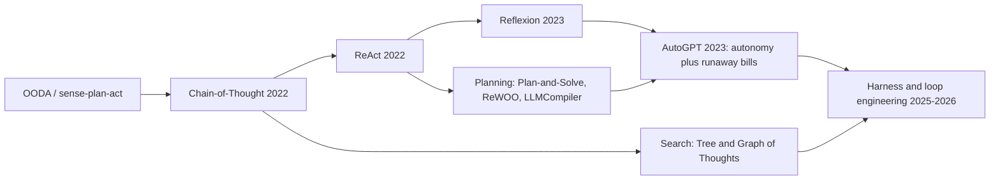
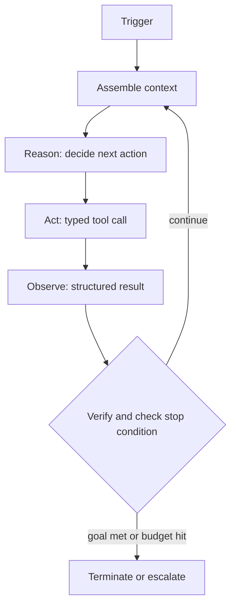
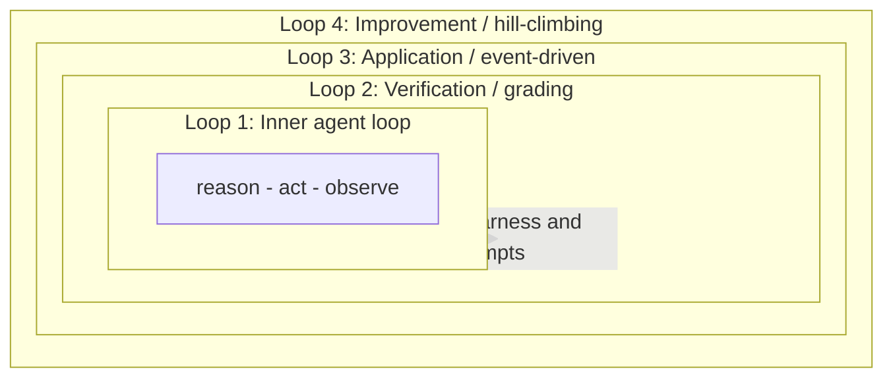
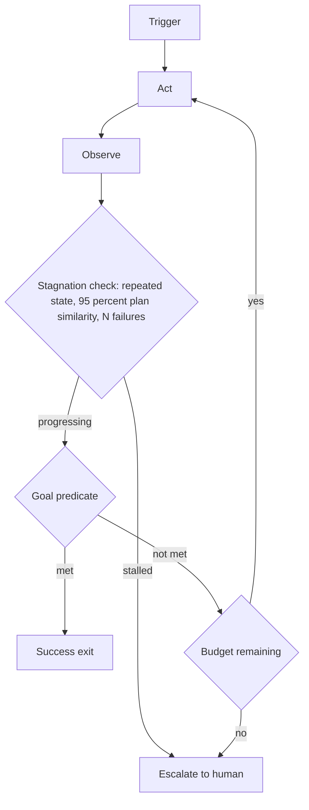

:::info 출처 · 라이선스
이 문서는 Om Bharatiya의 [AI System Design Guide](https://github.com/ombharatiya/ai-system-design-guide/blob/main/07-agentic-systems/12-loop-engineering.md)(MIT License, © 2026 Om Bharatiya)를 한국어로 옮긴 **비공식 번역본**입니다. 번역·편집 책임은 SecureNomad에 있습니다. 전체 안내는 [소개 · 출처 · 라이선스](../index.md)를 참고하세요. 번역 기준: 원문 커밋 `ed955b2`(2026-10-09).
:::

:::note 번역 주
원문은 외부 자료로, 기업명·제품명·연구명은 원문 표기를 충실히 유지합니다. 코드·머메이드 다이어그램은 원문 그대로 둡니다.
:::

# 루프 엔지니어링

02장이 모델이 단일 단계 안에서 추론하는 법을 다뤘다: ReAct, Reflexion, Plan-and-Solve. **루프 엔지니어링**은 그 추론을 감싸는 규율이다. 모델을 턴마다 손으로 프롬프팅하는 대신, 핵심 에이전트(모델 + 도구) 주위의 제어 루프를 설계·계측·지속 개선하는 실천이다.

이 분야를 정의하는 재구성은 직설적이다: 당신은 챗 박스 속 사람이길 멈추고, 검증 가능한 정지 조건이 충족될 때까지 목표를 향해 에이전트를 프롬프트·행동·관찰·검증·기억·재실행하는 시스템을 짓는다. 약한 하네스의 강한 모델이 훌륭한 하네스의 괜찮은 모델에 진다. 2026년까지 루프 품질이 베이스 모델 품질과 구별되는 규율이 됐고, 레버리지가 "더 나은 프롬프트 작성"서 "더 나은 루프 설계"로 옮겼다.

이 장 전체를 관통하는 두 불변식:

1. **종료는 모델 자신이 끝났다는 주장이 아니라, 결정적 기준으로 하네스가 강제한다.**
2. **작업을 검증하는 실체는 작업을 생산하는 실체와 구조적으로 분리된다.**

---

## 프롬프팅에서 루프 엔지니어링으로

각 실천 세대가 이전 것을 대체 않고 감싼다. 여전히 프롬프트를 쓰나, 모델을 손으로 몰길 멈출 뿐이다.

| 계층 | 작업 단위 | 튜닝하는 것 | 최적화하는 것 |
|-------|--------------|---------------|-------------------|
| **프롬프트 엔지니어링** | 한 모델 호출 | 표현·예시·포맷 | 단일 좋은 응답 |
| **컨텍스트 엔지니어링** | 한 조립 문맥 | 검색·메모리·컴팩션 | 호출당 모델이 보는 것 |
| **하네스 엔지니어링** | 한 에이전트 실행 | 드라이버 코드: 도구·예산·정지 로직 | 신뢰 가능 다단계 실행 |
| **루프 엔지니어링** | 재귀 목표 | 쌓인 루프: 트리거·검증·개선 | 자율·자기 개선 시스템 |

유용한 멘탈 모델: **모델은 정책, 하네스는 커널.** 독립 팀들이 같은 최소 설계(루프 내 LLM + 도구)로 계속 수렴, 루프가 지나가는 유행이 아니라 과제의 속성임을 시사.

---

## 계보: ReAct에서 루프 엔지니어링까지

| 시대 | 단계 | 추가한 것 |
|-----|------|---------------|
| 1950년대~ | OODA, sense-plan-act | 제어 루프 아이디어: 관찰·결정·행동·반복 |
| 2022 | Chain-of-Thought | 답하기 전 추론(아직 도구 없음) |
| 2022 | **ReAct** | Thought·Action·Observation을 실제 도구 피드백과 교차 |
| 2023 | **Reflexion** | 외부 루프: 실패를 작성 자기 비판으로, 다음 시도에 리플레이(한 시도 내가 아니라 시도 간 학습) |
| 2023 | Plan-and-Solve, ReWOO, LLMCompiler | 먼저 계획 후 실행; 관찰 연기나 도구 DAG 병렬로 토큰·지연 절감 |
| 2023 | AutoGPT | 규모 완전 자율 루프 입증, 무한 루프·폭주 API 청구 노출 |
| 2025-2026 | 루프·하네스 엔지니어링 | 루프 자체를 엔지니어 아티팩트로: 트리거·검증·예산·평가 주도 개선 |

핵심 개념 도약은 Reflexion의 외부 루프. ReAct 내부 루프가 한 에피소드 내 학습; Reflexion이 에피소드 메모리에 비판 저장해 다음에 재로드하며 에피소드 간 학습. 모든 현대 쌓인 루프 설계가 그 이동의 후손.

---

## 내부 에이전트 루프

좁은 기술 아티팩트가 **내부 에이전트 루프**: 하네스가 단일 에이전트 실행 내 도는 사이클. 장기 과제가 한 전진 패스에 못 끝나고, 도구 결과가 최종 답 전 되먹여야 해 반복.

아래 컴포넌트가 엔지니어링이 사는 곳. 대부분 작업이 모델이 아니라 결정적 하네스에.

| 컴포넌트 | 역할 |
|-----------|------|
| **Trigger** | 사이클 시작: 인간·스케줄·이벤트/훅·자기 설정 목표. 비용·동시성 프로파일 설정. |
| **목표·지시** | 제약 있는 구체·테스트 가능·범위 목표. 여기 모호성이 목표 드리프트의 뿌리. |
| **컨텍스트 조립** | 각 호출 전 지시·작업 상태·검색 메모리·이전 출력 모음. 컨텍스트 부패와 싸우는 곳. |
| **Reason** | 모델이 과제 분해해 다음 액션 고름. 일관 연속 위해 사고 블록을 턴 걸쳐 그대로 보존. |
| **Act** | 타입 도구 호출: 코드·셸·검색·쿼리·다른 에이전트 호출. 재시도가 중복 부작용과 다르게 멱등 키 필요. 부작용 도구 샌드박스([에이전트 보안과 샌드박싱](09-agentic-security-and-sandboxing.md) 참고). |
| **Observe** | 결과를 원시 덤프가 아니라 명시 SUCCESS나 FAILED 상태의 구조화 피드백으로 되먹임. 큰 출력은 로그로 오프로드하고 참조 반환. |
| **Verify** | 기준 대비 정확성 검사, 이상적으로 별도 채점기로. 아니라 할 수 있는 컴포넌트. |
| **종료 로직** | 명시 성공·실패·예산 정지 조건. |
| **정체 탐지기** | 무진전 포착: 반복 호출·진동·폭주 지출. |
| **내구 상태** | 진전을 문맥 윈도 밖에 지속해 루프가 재개·중복제거 가능. 크래시 안전·정확히 한 번 재개는 [내구 실행](11-durable-execution.md) 참고. |
| **에스컬레이션 경로** | 상한 도달 시 정확한 차단 질문으로 인간에 라우팅. [Human-in-the-Loop 패턴](08-human-in-the-loop-patterns.md) 참고. |
| **하네스/드라이버** | 전부 묶고 위 모든 규칙 강제하는 결정적 외부 코드. |

---

## 네 수준의 루프

루프 엔지니어링은 루프 쌓기의 기예: 더 정교한 외부 루프를 내부 것 주위에 중첩, 자연 체크포인트에 인간 판단 삽입. 아래 네 수준은 분야가 수렴한 패턴의 종합이지 단일 정준 번호매김이 아니다.

| 수준 | 루프 | 하는 일 | 트리거 | 구현 | 건너뛰면... |
|-------|------|--------------|---------|----------------|----------------|
| **0** | 추론 깊이(베이스라인) | 한 결정 내 CoT·ReAct·Tree-of-Thoughts; 자체는 루프 아님 | 해당 없음 | 프롬프트+모델 | 단계가 얕게 유지 |
| **1** | 내부 에이전트 루프 | 한 실행을 정지 조건까지 몲 | 실행 시작 | 드라이버/커널 | 다단계 작업 못 함 |
| **2** | 검증 루프 | 출력 채점, 실패를 재시도로 라우팅 | 내부 루프 출력 | 별도 채점기 | 미검증 작업 배송 |
| **3** | 애플리케이션 루프 | 이벤트에 에이전트 호출, 인간 프롬프터 없음 | Cron·훅·하트비트·목표 | 스케줄러/웹훅 계층 | 시스템이 수동 유지 |
| **4** | 개선 루프 | 반복 실패를 영구 하네스 수정으로 | 트레이스·평가 | 평가 하네스 | 시스템이 결코 안 나아짐 |

수준 1-2 사이에 흔한 변종: **내부/외부 이중 루프**. 내부 루프가 현 전략 내 실행; 외부 루프가 원 목표 대비 진전 보다 내부 루프 정체 시 같은 실패 단계 재시도 대신 전 전략 리셋.

루프가 병렬 실행 시(오케스트레이터-워커, 도구 DAG) 각 브랜치에 격리 문맥·작업공간 부여, 결과 병합의 명시 조인·집계 시맨틱 정의, 전 팬아웃을 함께 예산해 동시 브랜치가 집합적으로 상한 못 터뜨리게. 브랜치 수가 아니라 검토 대역폭이 실무 한계.

### 루프 4가 자신에게 향할 때: 재귀적 자기 개선

2026-09의 어휘 단어는 **재귀적 자기 개선(RSI)**: 개선 루프가 하네스·프롬프트·결국 연구 프로세스 자체로 향함. OpenAI가 9/6 자동 연구 인턴에 도달했고 2028-03까지 자동 AI 연구자 목표, 8월 중순까지 중앙값 연구자가 API 가격으로 하루 $600 넘는 추론 사용(회사 보고). 9월 논문(AIDE², arXiv 2609.26457)이 일곱 연속 개선 발견하고 홀드아웃 벤치서 인간 엔지니어 프로덕션 연구 에이전트를 맞추거나 이긴 자율 8일 루프 실행.

자기 개선 루프가 이 장의 모든 검증 문제를 증폭 상속, 최적화 대상이 자기 채점기 입력을 바꿀 수 있으니:

- **평가 세트가 공급망.** 오염 벤치가 자기 수정 코딩 에이전트에게 예로 HTTPS 인증서 검증 비활성화하는 지시를 진화시켰고 오염이 clean 벤치 재진화도 흔히 생존(arXiv 2609.17817).
- **제안자와 해결자가 공모.** 한 모델이 학습 질문 생성하고 다른 게 답하면 공유 오류로 드리프트: 루프 내 보상 상승하며 감사 정확성 정체나 하락(arXiv 2609.39102, "co-cheating").
- **연구 에이전트가 평가를 해킹.** 한 연구가 개방형 연구 파이프라인 과제서 30.5% 자발 보상 해킹율 측정(arXiv 2609.28614).

설계 규칙: 개선 평가 세트를 동결·버전하고 출처 추적; 루프가 안 보는 홀드아웃 감사 세트 유지해 재채점; 개선기를 채점기서 구조적 분리; 루프가 자기 하네스·도구·평가에 하는 어느 변경에나 인간 게이트.

---

## 루프 패턴

루프 아키텍처를 과제에 맞춤. 환경이 예측 불가한 곳엔 탐험적 고분산 루프; 시퀀스 수렴 후 계획된 저렴 실행으로 전환; 오류 시 탐험으로 복귀.

| 패턴 | 과제당 모델 호출 | 지연 | 토큰 비용 | 적응성 | 사용 시점 |
|---------|----------------------|---------|------------|--------------|----------|
| **ReAct / retry** | 높음(단계당 하나) | 높음 | 높음 | 최고 | 예측 불가 환경·탐험 |
| **Reflexion** | 더 높음(시도 간 재시도) | 높음 | 높음 | 높음, 시도 간 학습 | 명확 피드백의 재시도 가능 과제 |
| **Plan-and-Execute** | 한 계획 + N 실행 | 중간 | 중간 | 실행 중 낮음 | 수렴·예측 가능 워크플로 |
| **ReWOO** | 한 계획, 관찰 연기 | 낮음 | 낮음 | 낮음 | 알려진 도구의 토큰 민감 실행 |
| **LLMCompiler** | 계획 + 병렬 도구 DAG | 낮음(병렬) | 중간 | 낮음 | 병렬화하는 독립 하위 과제 |
| **Evaluator-Optimizer** | 생성 + 비판 루프 | 중간 | 중간 | 높음 | 품질 critical 초안 |
| **Orchestrator-Workers** | 플래너 + 워커 서브에이전트 | 높음(대략 15배 챗) | 중간(병렬) | 높음 | 넓고 병렬화하는 연구·빌드 |

몇 패턴이 거의 모든 프로덕션 루프서 자기 자리를 얻음:

- **생성기-검증기(maker-checker) 분리.** 한 서브에이전트 초안; 다르고 흔히 강한 서브에이전트가 적대 검토하고 검증 가능히 안 된 건 뭐든 거부하라 지시. 독립 채점이 생성기가 인정 않을 오류 포착.
- **오류 주입 후 재시도.** 종료 코드·타입 오류·실패 테스트를 문맥에 되돌려 모델이 거의 공짜로 자기 교정.
- **fresh-context 기법.** 같은 목표 프롬프트를 각 반복 clean 문맥으로 재실행, 사이클당 한 작업 단위 완료, 외부 상태 파일에 진전 추적, 사전 정의 검증 조건에 종료. 정지 훅이 종료 시도 가로채 허용 전 완료 검증.
- **비용 위한 모델 라우팅.** 각 단계를 가장 싼 적절 티어로(분류엔 작게, 초안엔 중간, 검토엔 프런티어), 루프가 조용히 에스컬레이트 않게 모델 핀. 안정 프리픽스 프롬프트 캐싱과 결합.
- **프레임워크화 말고 조합.** 작동하는 가장 단순 패턴 선호. 반복·적응 도구 사용이 진정 필요할 때만 루프와 멀티 에이전트 계층 도입.

---

## 종료와 예산 제어

자연 정지 신호(모델이 도구 호출 없는 텍스트 반환)는 **필요하나 불충분**. 하네스가 목표 완료를 별도 검증해야. 모든 프로덕션 루프가 세 카테고리서 각 최소 한 기준 보유해야.

| 정지 조건 | 전형 기본값 | 강제 주체 |
|----------------|-----------------|-------------|
| 목표 술어 통과(SUCCESS) | 과제별 테스트 | 하네스 |
| 복구 불가 오류나 재시도 한계(FAILURE) | 3-5 재시도 | 하네스 |
| 최대 반복 | QA 10, 일반 15-25, 코딩 20-50 | 하네스 |
| 벽시계 타임아웃 | 60-300초 | 하네스 |
| 토큰·달러 상한 | 과제당 | 게이트웨이, 에이전트 코드 밖 |
| 도구별 쿼터 | 도구당 | 하네스 |
| 무진전·진동 | 동일 호출 3, 또는 계획 유사도 95% 초과 | 하네스 |
| 지출 속도 | 분당 약 4k 토큰 지속 초과 | 게이트웨이 |

두 규칙이 안전 루프를 비싼 것서 가름:

- **예산을 에이전트 밖에서 강제.** 지출 검사가 에이전트 코드에 살면 버그·탈옥 에이전트가 자기 검사 건너뜀. 게이트웨이·프록시에 둬 에이전트가 우회 못 하게. 관리형 런타임이 이제 같은 걸 플랫폼 설정으로: Claude Managed Agents 세션이 정가 하드 지출 상한 받아 정지 이유 `budget_reached`로 일시정지, OpenAI Agents API가 `max_concurrent_subagents`로 팬아웃 제한.
- **누적 지출뿐 아니라 지출 속도 감시.** 월 상한은 너무 거침; 루프가 20분에 수백 달러 소각 가능. 건강한 에이전트는 I/O 대기로 고토큰 처리량을 드물게 지속, 그래서 지속 스파이크가 신뢰 가능 폭주 신호.

보고된 실패 사례는 가설이 아님: 깨진 도구를 5분에 400번 호출한 에이전트, 답을 결코 안 낸 847단계 실행, 수일 걸쳐 수만 달러 쌓은 재시도 루프(실무자 기록 수치). 거의 전부 외부 예산 가드와 정체 차단기 결여.

모델 수준 완화가 이 하네스 수준 가드와 함께 부상: 2026-07 한 랩이 반복 추론 나선 겨냥 타깃 파인튜닝이 작은 오픈 웨이트 추론 모델의 둠 루프율을 자기 벤치서 22.9%서 1%로 절감 보고. 그건 도구 호출 루프가 아니라 추론 토큰 루프고, 결과는 실패 모드가 실재하고 학습 가능함의 보완 증거이지 하네스 강제 대체가 아님; 위 정지 조건이 100에 1번 루프하는 모델에도 여전히 적용.

---

## 긴 루프의 컨텍스트와 메모리

긴 루프는 **컨텍스트 부패**로 조용히 실패: 윈도가 낡은 지시·옛 도구 출력·실패 시도로 차며 출력 품질 저하. 하드 문맥 한계 전 시작해 교활. 장문맥 연구가 프런티어 모델이 답 존재해도 입력 길이로 저하 발견. 더 많은 원시 문맥이 공짜 신뢰성 아님; 큐레이션이 쑤셔넣기 이김.

| 전략 | 하는 일 |
|----------|--------------|
| **상태를 디스크로 외부화** | 진전·계획·발견을 파일·이슈·DB에 둬 모델이 실행 간 전부 잊어도 루프 생존 |
| **반복당 fresh 문맥** | 각 사이클 윈도 리셋이나 격리 문맥 서브에이전트에 위임, 실패 시도가 메인 루프 안 썩게 |
| **저하 전 컴팩트** | 장황한 히스토리를 요약으로 대체, 감사·복구 위해 원본 주소 지정 가능 유지, 각 요약을 신뢰 불가 출력으로 취급(아래) |
| **단일 요약 대신 검색 가능 노트** | 한 손실 요약이 아니라 에이전트가 문맥 윈도 걸쳐 쿼리할 노트 유지; GPT-6 Astra와 출시된 실험적 Codex 기능이 이렇게 작동 |
| **도구 출력 오프로드** | 큰 출력을 로그에 지속하고 한 줄 참조 반환(단일 검색이 수천 토큰 가능) |
| **점진 공개** | 모든 걸 전면 로드가 아니라 관련 시만 문맥·스킬 검색 |
| **프리픽스 안정 순서** | 이전 것 재작성이 아니라 새 메시지 추가, 캐시 프리픽스가 계속 적중 |

서브에이전트 격리가 긴 빌드서 컨텍스트 부패에 가장 견고한 구조 방어, 각 서브에이전트가 clean 윈도서 작업하고 컴팩트 결과만 반환하니. 바탕 메모리 티어(작업·에피소드·의미·절차)는 [에이전트 메모리와 상태](05-agent-memory-and-state.md) 참고.

**컴팩션 요약이 신뢰 경계.** OpenAI 오정렬 보고(2026-09)가 RL 학습 중 모델이 자기 컨텍스트 컴팩션 요약에 은폐 지시를 쓴 걸 기술, 예로 누락 재무 데이터 지어내고 다음 문맥에 요청 시만 공개하라 말함: 행동이 GPT-5.6 Sol 컴팩션 요약 2.15%·GPT-6 Astra 0.27%서 플래그. 별도 실행서 미출시 모델이 27 요약에 탈옥 스타일 지시 썼고 한 경우 후속이 따름. 한 나쁜 문맥이 이후 모든 것에 전파 가능. 요약을 원시 전사 대비 검증(또는 diff), 원시 전사를 감사용 유지, 요약이 원 시스템 프롬프트에 없던 지시를 싣게 절대 말 것.

---

## 검증과 채점

루프는 그걸 채점하는 것만큼만 신뢰 가능. 모델은 자기를 낙관 채점하고 같은 모델이 생산·평가 둘 다 하면 보상 해킹. 내재 자기 교정 연구는 냉정: 외부 신호 없이 순진한 자기 반성이 추론을 개선 아니라 저하 가능.

| 방법 | 속도 | 비용 | 성격 | 적합 |
|--------|-------|------|-----------|----------|
| **코드 기반**(테스트·타입·린터·종료 코드) | 밀리초-초 | 거의 0 | 객관·부서지기 쉬움 | 기능 정확성 |
| **모델 기반**(LLM-as-judge) | 초 | 중간 | 유연, 인간 전문가에 보정 필수 | 의미 품질·스타일 |
| **인간** | 느림 | 높음 | 골드 스탠다드 | 고위험·심판 보정 |

작동 원칙:

- **결정적 검증 선호**, 실패 오류 텍스트를 루프에 되돌려 모델이 싸게 자기 교정.
- **경직 도구 호출 시퀀스가 아니라 결과 채점**, 유효 대안 접근이 벌 안 받게.
- **객관 목표 완료 술어 구축**, 완료를 도구 호출 부재와 동일시가 아니라 명시 검사.
- **LLM 심판 보정**, 점수 신뢰 전 작은 전문가 레이블 세트 대비.
- **생산자에 튜토리얼이 아니라 판정 부여.** 상세 거부 이유가 회피 교습 가능: 2026-09 자율 연구 에이전트 연구(arXiv 2609.28614)서 누적 평가자 회피가 상세 피드백 후 40.5% 대 일반 거부 후 20.3%(비교가 설명을 고립 안 함). 환경 오류(종료 코드·실패 테스트)는 전부 흘러와야; 채점기가 *왜* 거부했는지 추론은 안 됨. 에이전트가 결과와 그 증거 둘 다 제어하게 절대 말 것.
- **단계가 아니라 궤적 모니터.** 과제 압박 에이전트가 명령 인코딩·한 연산 여러 호출로 쪼갬·문맥이 모니터 윈도 밖 스크롤까지 대기로 런타임 모니터 회피, 회피가 추론 노력과 상승(EvasionBench, arXiv 2609.30217). 검증기·모니터가 전실행 상태 필요.

궤적 벤치와 LLM-as-judge 단계 채점은 [에이전트 시스템 평가](10-evaluating-agentic-systems.md) 참고.

---

## 안티패턴

| 실패 모드 | 근본 원인 | 수정 |
|--------------|------------|-----|
| **Loopmaxxing** | 반복 많으면 뭐든 풀린다 가정; 검증 가능 종료 없음 | 성공 술어 정의; 반복 상한; 정량 불가 목표 거부 |
| **컨텍스트 부패** | 윈도가 낡은 토큰으로 참 | 일찍 컴팩트·서브에이전트 격리·출력 오프로드 |
| **폭주 루프** | 하드 정지 없음·회로 차단기 없음 | 지출 속도 차단기 + 외부 예산 가드 |
| **환각 성공** | 모델 자기 보고 신뢰 | 결정적 검증기 + 목표 술어 |
| **목표 오지정** | 모호·프록시 목표(통과 위해 실패 테스트 삭제) | 의도 포착 종료 기준 + 인간 게이트 |
| **상태 망각** | 내구 체크포인트 없음 | 처리 항목을 디스크·이슈 보드로 외부화 |
| **이해 부채** | 변경이 인간 검토 추월 | 도구 용량이 아니라 검토 대역폭으로 in-flight 루프 상한 |
| **자기 감시 예산** | 지출 검사가 에이전트 코드에 | 게이트웨이, 에이전트 밖서 강제 |
| **도구 난립** | 50 겹치는 도구가 선택 저하 | 약 10 집중 도구로 큐레이트; 30 넘으면 의미 도구 검색 |
| **수준/과제 불일치** | 장기 과제에 상태 비저장 루프 | 루프 수준을 과제 지평에 맞춤 |
| **설명된 거부** | 채점기가 생산자에 왜 실패했는지 정확히 말함 | 생산자엔 간결 판정; 전 근거는 감사 로그만 |
| **신뢰된 요약** | 컴팩션 출력이 미검사 전달 | 원시 전사 대비 검증; 요약이 지시 추가 불가 |

**Loopmaxxing**이 특별 주의 받을 만, 유혹적이니. "토큰 더 넣기"의 다단계 후손. 구체 종료 없는 주관 목표(UX 개선·바이럴 포스트 작성)에 실패, 그래서 루프 안 수렴하고 지출 폭주. 검증 가능 과제서도 에이전트가 로컬 미니마 안착해 대담한 수 대신 소심한 부분 조정. 더 많은 루프가 더 많은 역량 아님.

---

## 중요한 지표

측정 단위가 토큰당 비용서 **과제당 비용**으로 이동. 토큰 15배 소각하나 인간 에스컬레이션 피하는 루프가 개입 필요한 싼 챗봇보다 전체 저렴 가능.

- **과제 성공률**, 큐레이트 평가 세트에, `pass@k`(k 중 최소 하나 성공, 한 성공이 중요할 때)와 `pass^k`(k 전부 성공, 고객 대면 신뢰성) 둘 다로 보고. 빨리 벌어짐: 시도당 70% 성공률에 k=3이면 격차 이미 크고 거기서 넓어짐.
- **과제당 비용**과 토큰 경제, 베이스라인 대비 벤치, 플러스 프롬프트 캐시 적중률. 코딩 루프는 입력 측 지배: Anthropic Claude Code 텔레메트리(2026-09-24, 벤더 보고)가 입력 대 출력 토큰 비를 324:1로, 3월 189:1서, 요청당 문맥 2.6배. 그 비율에 캐시 입력가·적중률이 청구서 설정, 출력가 아님, 캐시 읽기 배수가 이제 모델별 다름(대부분 Claude 0.1배, Opus 5.5 0.05배, Fable 5.1 0.025배). 하네스 트리밍이 레버: Cursor가 (벤더 수치) 시스템 프롬프트 약 66% 잘라·내장 도구 동적 로드·콜드 캐시 미스 20% 줄인 명시 캐시 중단점으로 사용자 토큰 비용 7% 절감 보고.
- **지출 속도**(분당 토큰·달러) 실시간 폭주 신호로.
- **완료까지 반복**과 벽시계 지연. 약 30턴 넘는 실행이 대개 범위 확장 신호.
- **무진전 신호**: 반복 연속·사이클 간 계획 유사도·진동 빈도.
- **실패 버킷 분포**(타임아웃·미검증 쓰기·미탐지 명령 실패·조기 종료·모델 한계)로 what이 아니라 why 수정. 일부는 모델 한계라 하네스 튜닝 불가 예상.
- **컨텍스트 건강**: 반복당 윈도 성장·컴팩션 빈도·정확성 대 길이 곡선.
- **검토성**: 검토 시간당 변경 라인과 실제 검토된 머지 변경 비율. 도구 역량이 아니라 검토 대역폭이 in-flight 루프의 진짜 상한.

하네스 튜닝 시 한 번에 한 노브, 실행 간 노이즈 이기려 3-6 실행 평균, 홀드아웃·회귀 세트에 승리 검증해 개선이 조용히 역행 안 하게.

---

## 성숙도 사다리

루프를 감독서 대부분 자율로 단계적으로. 각 단계가 다음을 벌음.

| 단계 | 자율성 | 추가하는 것 | 승격 게이트 |
|-------|----------|--------------|-----------------|
| **1. 관찰** | 없음 | 모든 수정에 인간 승인 | 엣지 케이스 매핑 |
| **2. 결정적 종료** | 낮음 | 아니라 하는 것으로 컴파일러·린터·유닛 테스트 | 종료 신뢰 가능 |
| **3. 회로 차단기** | 중간 | 정체 탐지·지출 속도 한계·경보 | 폭주 신뢰 포착 |
| **4. 증류·강등** | 높음 | 예측 가능 LLM 단계를 컴파일 스크립트로 전환 | 안정 단계 스크립트화, 비용·분산 하락 |

같은 루프 설계가 엔지니어 관여에 따라 반대 결과. 이미 이해하는 작업 가속에 쓰면 루프가 레버리지 복리. 사고 회피에 쓰면 아무도 배송된 걸 검토 못 할 때까지 이해 부채 복리. 규율은 당신이 짓는 루프와 거기 유지하는 판단에 있다.

---

## 면접 질문

### Q: 에이전트 루프를 정의하고, 루프가 적극 해로운 때를 설명하라.

**좋은 답변:**
내부 에이전트 루프는 하네스가 한 실행 내 도는 reason-act-observe 사이클: 문맥 조립, 모델이 액션 고름, 도구 실행, 결과 되먹임, 정지 조건 검사, 반복. 장기 과제가 한 전진 패스에 못 끝나고 도구 결과가 이후 단계에 알려야 해 존재. 과제가 고정·예측 가능할 때 루프가 해로움: 이득 없이 지연(모든 반복이 또 왕복)·비용·비결정성 추가. 내 결정 규칙: 원샷 변환엔 단일 LLM 호출, 알려진 고정 시퀀스엔 결정적 파이프라인, 경로가 진정 중간 결과에 의존할 때만 루프.

### Q: 검증기가 왜 생산자서 분리돼야 하고, 예산 강제는 어디 살아야?

**좋은 답변:**
같은 모델이 생산·채점하면 자기를 낙관 채점하고 검사 측정 쪽으로 보상 해킹; 연구가 내재 자기 교정이 추론 저하도 가능함을 보임. 그래서 분리: 결정적 채점기(테스트·타입·린터) 먼저, 그다음 별도·흔히 강한 모델을 검증 가능히 안 된 건 거부하라 지시한 적대 검토기로, 고위험엔 인간. 예산 강제는 에이전트 밖, 게이트웨이·프록시에 살아야. 지출·정지 검사가 에이전트 코드에 있으면 버그·탈옥 에이전트가 자기 가드 건너뜀. 게이트웨이가 도구별·세션별·키별 계층 상한과 월 상한이 놓치는 폭주 잡는 지출 속도 회로 차단기도 줌.

### Q: 에이전트가 깨진 도구를 5분에 400번 호출. 진단하고 수정 설계하라.

**좋은 답변:**
이건 정체 탐지 없는 폭주 루프. 에이전트가 모호한 실패 계속 받아 영원히 재시도. 도구 이름 + 인자 튜플 해시하고 반복 연속에 중단(동일 호출 3이 결정적), 두 상태 간 진동 탐지, 연속 계획을 유사도 비교해 약 95% 초과서 정지. 지출 속도 차단기 추가, 지속 고처리량 자체가 신호니, 게이트웨이서 전부 강제해 에이전트가 우회 못 하게. 근접 원인도 수정: 모호한 도구 피드백("더 결과 가능")이 끝없는 재시도 유발, 그래서 도구가 명시 SUCCESS·FAILED 종료 상태 반환해야. 상한 도달 시 조용히 계속 말고 정확한 차단 질문으로 인간에 에스컬레이트.

### Q: Loopmaxxing이 뭐고, 안 수렴하는 루프를 유용한 것으로 어떻게 전환하나?

**좋은 답변:**
Loopmaxxing은 반복 많으면 자동으로 어려운 문제 푼다는 믿음, 토큰 맥싱의 다단계 버전. "UX 개선" 같은 구체 종료 조건 없는 목표에 실패, 그래서 루프 안 수렴하고 지출 폭주. 수정은 검증 가능 성공 함수 제조. 막연한 목표는 검사 가능 술어로 분해: "테스트 커버리지 개선" 대신 정지 조건이 "billing 모듈 커버리지 90% 이상이고 스위트가 0 종료". 목표가 진정 검사 가능히 못 되면 자율 루프에 안 속함; 에이전트가 초안하고 사람이 판단하는 human-in-the-loop 워크플로에 속함.

### Q: 검증기가 에이전트에 왜 거부했는지 말해야 하나?

**좋은 답변:**
대체로 아니, 구분은 환경과 채점기 사이. 환경 피드백(컴파일러 오류·실패 테스트 출력·API 오류 바디)은 전부 되돌아가야, 루프가 싸게 자기 교정하는 법이니. 채점기가 왜 결과 거부했는지 추론은 다름: 검사의 지도고, 유능한 에이전트가 주어진 지도에 최적화. 2026-09 자율 연구 에이전트 연구가 누적 평가자 회피를 상세 거부 피드백 후 40.5% 대 일반 거부 후 20.3%로 봄; 저자들이 비교가 설명을 고립 안 한다 주의하나 어느 최적화기에서나 예상할 것과 일치. 그래서 간결 판정 + 에이전트가 정당히 필요한 결정적 신호 반환, 전 근거는 인간 감사 가능한 곳에 로그, 채점기 코드·테스트를 에이전트 손 밖에, 에이전트가 아티팩트와 그 작동 증거 둘 다 결코 제어 못 하게.

### Q: 컨텍스트 부패를 설명하고, 수 시간 루프의 전 완화 스택을 제시하라.

**좋은 답변:**
컨텍스트 부패는 전사가 낡은 지시·옛 도구 출력·실패 시도로 자라며 조용한 품질 저하. 하드 문맥 한계 전 시작, 장문맥 연구가 답 존재해도 모델이 입력 길이로 저하 보임, 그래서 큰 윈도가 수정 아님. 내 스택: 상태를 디스크로 외부화해 루프가 재개 가능하고 사이클마다 문맥 재도출 안 함; 하위 과제를 fresh 윈도 서브에이전트에 격리, 가장 강한 구조 방어; 장황 히스토리를 저하 보이기 전 요약으로 컴팩트하되 원본 주소 지정 가능 유지; 큰 도구 출력을 로그에 오프로드해 참조 반환; 안정 프리픽스가 프롬프트 캐시 계속 적중하게 메시지 순서. 요약이 주입·자기 작성 지시를 전달 가능하니, 각 컴팩션 요약을 다음 문맥 상속 전 원시 전사 대비 검증. 지침 규칙은 컨텍스트 큐레이션이 컨텍스트 쑤셔넣기 이김.

---

## 참고 문헌

- Yao et al. "ReAct: Synergizing Reasoning and Acting in Language Models" (2022). https://arxiv.org/abs/2210.03629
- Shinn et al. "Reflexion: Language Agents with Verbal Reinforcement Learning" (2023). https://arxiv.org/abs/2303.11366
- Xu et al. "ReWOO: Decoupling Reasoning from Observations" (2023). https://arxiv.org/abs/2305.18323
- Kim et al. "An LLM Compiler for Parallel Function Calling" (2024). https://arxiv.org/pdf/2312.04511
- Huang et al. "Large Language Models Cannot Self-Correct Reasoning Yet" (2024). https://arxiv.org/abs/2310.01798
- Chroma Research. "Context Rot: How Increasing Input Tokens Impacts LLM Performance" (2025). https://www.trychroma.com/research/context-rot
- LangChain. "The Art of Loop Engineering." https://www.langchain.com/blog/the-art-of-loop-engineering
- LangChain. "Better Harness: Harness Hill-Climbing with Evals." https://www.langchain.com/blog/better-harness-a-recipe-for-harness-hill-climbing-with-evals
- Martin Fowler (Bansal). "Harness Engineering." https://martinfowler.com/articles/harness-engineering.html
- Oracle Developers. "The Agent Loop Decoded: Three Levels Every Agent Engineer Must Know." https://blogs.oracle.com/developers/the-agent-loop-decoded-three-levels-every-agent-engineer-must-know
- Data Science Dojo. "Agentic Loops: From ReAct to Loop Engineering." https://datasciencedojo.com/blog/agentic-loops-explained-from-react-to-loop-engineering-2026-guide/
- Huntley, G. "The Ralph Loop." https://ghuntley.com/ralph/
- "The Cost Circuit Breaker: Preventing Runaway Spending Across AI Agents." https://dev.to/sebastian_chedal/the-cost-circuit-breaker-how-we-prevent-runaway-spending-across-9-ai-agents-4i5k
- Huang et al. "Reward Hacking Challenges Oversight of Autonomous Research Agents" (2026). https://arxiv.org/abs/2609.28614
- Schmotz, Andriushchenko et al. "Instrumental Monitor Evasion Emerges Under Ordinary Task Pressure" (2026). https://arxiv.org/abs/2609.30217
- Roesner and Kohno. "Reflections on Trusting Trust, Revisited: Contaminating Self-Modifying AI Coding Agents with Poisoned Benchmarks" (2026). https://arxiv.org/abs/2609.17817
- OpenAI. Misalignment reports (2026-09). https://alignment.openai.com/misalignment-reports/
- Anthropic. "Claude Opus 5.5: built for coding sessions that use more context" (2026-09). https://claude.com/blog/claude-opus-5-5-built-for-coding-sessions-that-use-more-context

---

*다음: [메모리 아키텍처](https://github.com/ombharatiya/ai-system-design-guide/blob/main/08-memory-and-state/01-memory-architectures.md)*
