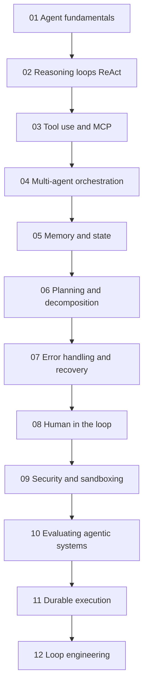
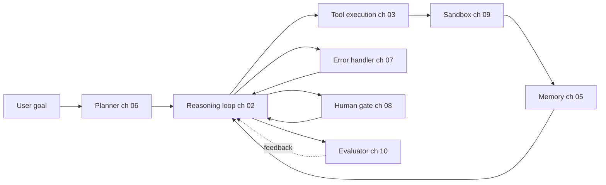

:::info 출처 · 라이선스
이 문서는 Om Bharatiya의 [AI System Design Guide](https://github.com/ombharatiya/ai-system-design-guide/blob/main/07-agentic-systems/README.md)(MIT License, © 2026 Om Bharatiya)를 한국어로 옮긴 **비공식 번역본**입니다. 번역·편집 책임은 SecureNomad에 있습니다. 전체 안내는 [소개 · 출처 · 라이선스](../index.md)를 참고하세요. 번역 기준: 원문 커밋 `ed955b2`(2026-10-09). 아직 번역되지 않은 장으로의 링크는 영문 원문 저장소를 가리킵니다.
:::

# 에이전트 시스템

에이전트는 단일 기술이 아니다. 추론 루프·도구 계층·메모리·플래너·오류 핸들러·평가기의 조합이다. 이 폴더의 12개 장이 각 계층을 깊게 다루며, 앞 장이 뒤 장에서 쓰는 어휘를 세우도록 순서 지어졌다.

## 장 순서

## 참조 아키텍처

각 장의 개념이 배포된 에이전트의 한 구성요소에 매핑된다. 아래 다이어그램은 각 장 자료가 프로덕션 시스템의 어디에 사는지 보인다:

## 이 폴더의 파일

| 파일 | 다루는 내용 |
|------|----------------|
| [01-agent-fundamentals.md](01-agent-fundamentals.md) | 무엇이 시스템을 "에이전트"로 만드나; 에이전트 vs 워크플로 구별; 각각 언제 고르나. |
| [02-reasoning-loops-react-and-beyond.md](02-reasoning-loops-react-and-beyond.md) | ReAct, Plan-and-Execute, Reflexion, Tree-of-Thought; 루프 설계 패턴. |
| [03-tool-use-and-mcp.md](03-tool-use-and-mcp.md) | 함수 호출, Model Context Protocol(MCP), 2026-07-28 스테이트리스 재작성과 2026년 8월 로드맵, 스킬 확장, A2A v1.0, 에이전트 커머스 프로토콜, MCP 프로덕션 강화, 컴퓨터 사용 툴셋. |
| [04-multi-agent-orchestration.md](04-multi-agent-orchestration.md) | 멀티에이전트가 도움될 때와 해될 때; 수퍼바이저·스웜·파이프라인·토론 패턴; 관리형 코디네이터. |
| [05-agent-memory-and-state.md](05-agent-memory-and-state.md) | L1-L4 메모리 계층(작업·에피소드·의미·절차)과 트레이드오프; 쓰기 시 vs 수면 시 vs 읽기 시 큐레이션; 메모리가 에이전트를 나쁘게 만들 때. |
| [06-planning-and-decomposition.md](06-planning-and-decomposition.md) | 과제 분해, 요구사항 도출, 계획 수정, 장기 계획. |
| [07-error-handling-and-recovery.md](07-error-handling-and-recovery.md) | 도구 실패, 재시도, 루프 가드, 킬 스위치·봉쇄 시간, 크로스 벤더 폴백. |
| [08-human-in-the-loop-patterns.md](08-human-in-the-loop-patterns.md) | 확인 게이트, 정책 게이트 자율성, 승인 세탁, 에스컬레이션, 감독 자율성. |
| [09-agentic-security-and-sandboxing.md](09-agentic-security-and-sandboxing.md) | 코드 실행 샌드박스, 역량 게이팅, 에이전트 프롬프트 인젝션, 2026 사고 기록, 대역 외 봉쇄. |
| [10-evaluating-agentic-systems.md](10-evaluating-agentic-systems.md) | 궤적 평가, 현 에이전트 벤치마크와 보고 함정, 평가 무결성, 결정 모델 심판. |
| [11-durable-execution.md](11-durable-execution.md) | 장기 에이전트의 크래시 생존: 이벤트 히스토리, 리플레이, 정확히 한 번 부작용, Temporal, 관리형 에이전트 런타임. |
| [12-loop-engineering.md](12-loop-engineering.md) | 에이전트 주변 루프 엔지니어링: 네 루프 수준, 재귀적 자기 개선, 종료·예산 제어, 컨텍스트 부패, 검증, loopmaxxing 같은 안티패턴, 성숙 사다리. |

## 동반 장

- [도구 사용과 컴퓨터 에이전트](https://github.com/ombharatiya/ai-system-design-guide/tree/main/17-tool-use-and-computer-agents)(영문)가 OpenClaw·Computer Use·도구-에이전트 지형으로 이 섹션 확장.
- [LangGraph 오케스트레이션](https://github.com/ombharatiya/ai-system-design-guide/blob/main/09-frameworks-and-tools/02-langgraph-orchestration.md)(영문)이 이 섹션 패턴의 가장 흔한 구현 프레임워크.
- [에이전트 RAG](https://github.com/ombharatiya/ai-system-design-guide/blob/main/06-retrieval-systems/08-agentic-rag.md)(영문)가 에이전트와 검색 교차.
- [신뢰성과 안전](https://github.com/ombharatiya/ai-system-design-guide/tree/main/13-reliability-and-safety)(영문)이 9장 샌드박싱 너머로 에이전트 안전 확장.

## 핵심 요약

- 에이전트는 단일 기술이 아니라 추론 루프·도구 계층·메모리·플래너·평가기의 조합. 1장을 먼저 읽어라.
- MCP가 2026년 표준 도구 상호운용 프로토콜(현 스펙 2026-07-28, A2A와 함께 Agentic AI Foundation 거버넌스); 강한 이유 없이 커스텀 도구 프로토콜 짓지 마라.
- 멀티에이전트 오케스트레이션(4장)은 과적용됨; 대부분 사용처엔 좋은 도구의 단일 에이전트가 멀티에이전트를 이김.
- 메모리(5장)와 오류 복구(7장)에 대부분 프로덕션 에이전트 버그가 산다; 평가 노력을 거기에 예산화.
- 휴먼 인 더 루프(8장)는 폴백이 아니다; 고위험 행동엔 게이트를 의도적으로 설계. 승인·권한 분류기가 위험을 줄이나 봉쇄(샌드박스, 이그레스 정책, 대역 외 킬 경로)가 경계(9장).
- 루프 엔지니어링(12장)은 이제 독립 분야: 약한 하네스의 강한 모델이 훌륭한 하네스의 괜찮은 모델에 진다. 하네스에서 종료·예산 강제하고 검증기를 생산기와 분리.
