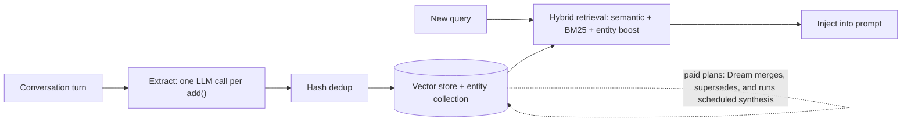

:::info 출처 · 라이선스
이 문서는 Om Bharatiya의 [AI System Design Guide](https://github.com/ombharatiya/ai-system-design-guide/blob/main/08-memory-and-state/04-agentic-memory-mem0.md)(MIT License, © 2026 Om Bharatiya)를 한국어로 옮긴 **비공식 번역본**입니다. 번역·편집 책임은 SecureNomad에 있습니다. 전체 안내는 [소개 · 출처 · 라이선스](../index.md)를 참고하세요. 번역 기준: 원문 커밋 `ed955b2`(2026-10-09).
:::

# Mem0로 보는 에이전트 메모리

**Mem0**(와 동류 Zep·Letta·Cognee)은 "수동 로그"에서 **능동 메모리(Active Memory)**로의 전환을 대표한다. 이 시스템들이 대화를 자동 소화해 모든 상호작용 걸쳐 개인화를 높이는 영속·진화 사용자 프로필을 만든다. 가장 넓은 독립 메모리 계층엔 Mem0; 시간 인식 프로덕션 파이프라인엔 Zep; 메모리가 인간 검토 가능 파일이어야 할 장기 에이전트엔 Letta(2026에 MemGPT 스타일 페이징서 git 기반 MemFS로 이동); 지식 그래프 우선 RAG엔 Cognee.

---

## Mem0 철학

전통 메모리는 *모든 걸* 저장.
Mem0는 **인사이트**를 저장.
"사용자가 파란 커피 머그 좋아한다 했으나 일할 때만" 저장 대신, Mem0는 "직장서 파란 커피 머그 선호" 같은 짧은 사실을 사용자 태깅하고 언급 엔티티에 연결해 저장.

---

## 작동 방식: 다이제스트 루프

Mem0 Python SDK가 v2.0.0(2026-04-16)에 쓰기 경로 변경; 현 릴리스는 v2.2.1(2026-09-25).



1. **관찰**: 에이전트가 대화 턴을 `add()`로 전송.
2. **추출**: 단일 LLM 호출이 기억할 사실 식별해 **추가**. v2는 ADD 전용: compare-and-update나 delete 패스 없고 해시 중복제거만.
3. **저장**: 사실이 기존 벡터 스토어로, 엔티티 링크는 병렬 `{collection}_entities` 컬렉션에.
4. **검색**: 의미 유사도·BM25·엔티티 부스팅이 한 점수로 융합.

**충돌 처리는 어디 갔나?** v1 루프가 각 새 사실을 기존 것과 비교해 충돌 레코드 업데이트·삭제. v2엔 그게 플랫폼 **Dream** 기능(2026-08-04 출시, Pro·Enterprise만)으로 이동, 추출 중 병합·대체하고 요청 경로 밖 스케줄 합성 실행. 오픈소스 SDK 실행 시 모순("베를린 거주", 나중 "리스본 이사")이 둘 다 지속, 읽기 시 해소(최신성 선호·둘 다 표시)하거나 자기 통합 작업 돌려야.

---

## 자기 갱신 메모리

현대 에이전트 메모리는 **재귀적**.
- 사용자가 과제 언급: "금요일까지 예산 끝내야."
- 목요일에 에이전트가 이를 회상하고 물어야: "예산 어떻게 돼가요?"
- 이것이 **주기 반성**으로 달성: 스케줄 작업이 활성 "목표 노드" 검토해 "선제 리마인더" 생성. 수면 시 통합이 이제 제품 카테고리: Mem0 Dream(유료 플랜), Anthropic Dreams 연구 프리뷰(Managed Agents 메모리 스토어용), 라이브 것 편집 대신 중복 병합·낡은 항목 교체한 재조직 스토어 작성.

---

## Mem0와 LangGraph 통합

상태 머신 아키텍처서 Mem0는 **외부 상태 제공자** 역할.

```python
# Conceptual LangGraph node (Mem0 OSS SDK)
from mem0 import Memory

memory = Memory()

def memory_node(state: AgentState):
    # Pull the facts relevant to this turn, scoped to the user
    hits = memory.search(
        query=state["last_user_message"],
        filters={"user_id": state["user_id"]},
        top_k=5,
    )
    # Inject into the global reasoning state
    return {"user_profile": hits}

def remember_node(state: AgentState):
    memory.add(
        [{"role": "user", "content": state["last_user_message"]}],
        user_id=state["user_id"],
    )
    return {}
```

---

## 규모의 개인화

엔터프라이즈 앱(수백만 사용자)에 Mem0가 관리:
- **일관성**: AI가 웹 앱·모바일 앱·Slack 봇 걸쳐 사용자 이름 "기억".
- **마찰 감소**: 같은 자격 질문을 두 번 안 함.

---

## 메모리 계층 선택

| 계층 | 기질 | 선택 시점 |
|-------|-----------|--------------|
| **Mem0 v2** | 당신 벡터 스토어의 사실 + 엔티티 인덱스 | 크로스 세션 개인화; 쓰기당 LLM 호출 하나·추가 DB 없음 원할 때 |
| **Zep / Graphiti** | 시간 지식 그래프(엣지별 `valid_at`/`invalid_at`) | 사실이 시간에 바뀌고 "그때 뭐가 참?" 쿼리 필요 |
| **Letta (MemFS)** | git 기반 Markdown 파일, 기본 벡터 인덱스 없음 | 인간이 메모리 검토·버전하는 장기 에이전트 |
| **Claude 메모리 도구 / Managed Agents 메모리 스토어** | 에이전트 작업공간 마운트 파일 | 이미 Claude Managed Agents나 Claude Code 스타일 하네스 실행 |
| **Cognee** | 문서서 구축한 지식 그래프 | 대화보다 수집 지식인 메모리 |

**벤더 표가 아니라 당신 과제로 평가.** Mem0 DolphinBench(2026-09-22; 페르소나당 약 500K 토큰 시뮬레이션 히스토리의 600 도구 사용 테스트)는 유용한 하네스나 결과가 벤더 보고: Mem0가 Hermes 하네스 GPT-5.6 Luna서 내장 메모리 65.67% 대비 70.67%, Claude Code Claude Sonnet 5서 26.33% 대비 32.33%, 여기선 Honcho가 35.83%로 더 높음. 항상 무메모리 암 포함: MemTrapBench가 테스트한 모든 메모리 전략이 무메모리 하회 발견.

---

## 면접 질문

### Q: Postgres에 쓰는 커스텀 Python 스크립트 대신 Mem0 같은 전용 서비스를 쓰는 이유는?

**좋은 답변:**
규모·**중복제거**, 플러스 검색 품질. 커스텀 스크립트가 흔히 중복 레코드 만들거나 **충돌 신원 해소**(예: 사용자가 Slack선 "Om", Discord선 "om.bharatiya")에 애씀. Mem0가 테스트된 추출 프롬프트·엔티티 링크·하이브리드 검색(의미·BM25·엔티티 부스팅 한 점수 융합)·사용자별 범위 제공. 내가 제기할 설계 질문은 **충돌 해소가 어디 사나**: Mem0 v2 오픈소스 경로가 ADD 전용, 병합·대체가 유료 Dream 기능으로 이동. 그래서 "Mem0 써"도 통합 지불·야간 작업 작성·읽기 시 최신성 규칙 모순 해소 중 선택을 남김.

### Q: 에이전트가 무관 과거 디테일을 너무 많이 꺼내는 "메모리 피로"를 어떻게 다루나?

**좋은 답변:**
**임계 관련성** 사용. Mem0가 모든 회상 사실에 관련 점수 반환, 자기 평가 세트에 보정한 임계 넘는 사실만 주입; 점수가 버전 간 비교 불가(v2 융합 점수가 v1 코사인 유사도 아님)니 업그레이드 시 재보정. 더해 **음성 검색** 사용: 에이전트가 잠재 환각과 직접 모순되거나 현 "미지"에 답할 때만 메모리 쓰라 지시. **메모리 가지치기**도 수행, "저가치" 메모리(예: "사용자가 비 온다 언급")가 24시간 후 자동 삭제. 끝으로 메모리 있고 없고 과제 성공 측정, MemTrapBench가 관련·올바른 메모리도 모델을 틀린 답으로 당길 수 있음 보였으니.

---

## 참고 문헌
- [Mem0: Building Production-Ready AI Agents with Scalable Long-Term Memory (arXiv 2504.19413)](https://arxiv.org/abs/2504.19413)
- [Mem0 v2.0.0 release notes](https://github.com/mem0ai/mem0/releases/tag/v2.0.0)
- [Mem0 releases (v2.2.1, September 25, 2026)](https://github.com/mem0ai/mem0/releases)
- [Letta repository (MemFS)](https://github.com/letta-ai/letta)
- [Zep: A Temporal Knowledge Graph Architecture for Agent Memory (arXiv 2501.13956)](https://arxiv.org/abs/2501.13956)
- [MemTrapBench (arXiv 2608.20202)](https://arxiv.org/abs/2608.20202)

---

*다음: [의미 캐싱](05-semantic-caching.md)*
