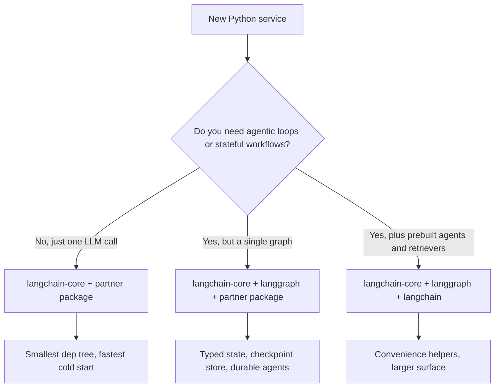

:::info 출처 · 라이선스
이 문서는 Om Bharatiya의 [AI System Design Guide](https://github.com/ombharatiya/ai-system-design-guide/blob/main/09-frameworks-and-tools/01-langchain-deep-dive.md)(MIT License, © 2026 Om Bharatiya)를 한국어로 옮긴 **비공식 번역본**입니다. 번역·편집 책임은 SecureNomad에 있습니다. 전체 안내는 [소개 · 출처 · 라이선스](../index.md)를 참고하세요. 번역 기준: 원문 커밋 `ed955b2`(2026-10-09).
:::

:::note 번역 주
원문은 외부 자료로, 기업명·제품명·패키지명·버전은 원문 표기를 충실히 유지합니다. 코드·머메이드 다이어그램은 원문 그대로 둡니다.
:::

# LangChain 심층 분석

LangChain은 더 이상 그저 "프롬프팅 라이브러리"가 아니다. 프로덕션급 LLM 애플리케이션 구축을 위한 **모듈러 생태계**로 성숙했다. LangGraph(2025-10 v1.0 졸업, 모든 LangChain 에이전트의 기본 런타임)가 상태 저장 오케스트레이션 처리. **LCEL(LangChain Expression Language)**이 조합 가능 체인 구축의 가장 빠른 길로 남음.

버전 스냅샷, 월 단위로 움직이니 릴리스 날짜와 함께: `langchain` 1.4.3(2026-09-28), `langchain-core` 1.6.6(2026-09-29), `langgraph` 1.2.12(2026-09-21). JS 측(2026-10-01 현재) `langchain` 1.5.15, `@langchain/core` 1.2.14, `@langchain/langgraph` 1.4.18.

---

## LangChain 스택

생태계가 이제 세 뚜렷한 계층으로 분리:
1. **LangChain Core**: 프롬프트·출력 파서·Runnable의 최소 추상화.(낮은 의존성 풋프린트)
2. **LangChain Community/Partner**: 500+ 데이터베이스·모델·도구 통합.
3. **LangGraph**: 상태 저장 오케스트레이션 계층(다음 장에서 다룸).

---

## LCEL: 파이프로 프로그래밍

LangChain Expression Language(LCEL)가 `|` 연산자로 실행의 **방향 비순환 그래프(DAG)** 생성.

```python
# Standard RAG chain
chain = (
    {"context": retriever, "question": RunnablePassthrough()}
    | prompt
    | model.with_structured_output(Schema) 
)
```

**왜 LCEL?**
- **기본 비동기**: 모든 체인이 `.ainvoke()`·`.astream()` 지원.
- **병렬성**: 여러 브랜치가 자동 병렬 실행.
- **관찰성**: **LangSmith**와 자동 통합해 전 트레이스 시각화.

---

## 표준 추상화

### 1. Runnable
LangChain 모든 것의 "기반 클래스". Runnable이 `.invoke`·`.batch`·`.stream`에 통합 인터페이스 제공.

### 2. 도구 · 도구 호출
LangChain이 **MCP(Model Context Protocol)** 일급 지원, `langchain` 1.4.0(2026-09-03)부터 별도 어댑터가 아니라 코어 패키지에 거주.
- `langchain.mcp` 네임스페이스·`MCPAdapter`가 어느 MCP 서버 도구나 LangChain 도구로 전환.
- MCP elicitation 요청이 서버가 협상한 프로토콜 시대(2025 시대 상태 저장 세션 vs 상태 비저장 2026-07-28 개정)에 따라 라우팅, 그래서 한 에이전트가 구·신 서버와 대화.
- MCP Python SDK 2.0(2026-07-28)이 `FastMCP`를 `MCPServer`로 개명. `from mcp.server.fastmcp import FastMCP` 튜토리얼이 fresh install에 깨짐; `mcp<2` 핀하거나 포팅.

### 3. 출력 파서와 구조화 출력
초기 시스템은 정규식을 썼으나, 현대 코드는 `.with_structured_output()` 사용, 점점 도구 호출이 아니라 제공자 **네이티브 JSON 스키마 구조화 출력**에 매핑. JSON 얻으려 단일 도구 호출 강제하던 옛 트릭이 은퇴 중:
- Claude Fable 5.1·Opus 5.5·Sonnet 5.5가 `any`·`tool` 유형 `tool_choice`에 HTTP 400 반환. `langchain-anthropic` 1.7.3(2026-09-22)이 Fable·Opus 5.5에 `with_structured_output`를 `method="json_schema"`로 라우팅, 1.7.5(9/29)가 Sonnet 5.5 추가.
- GPT-6 Astra가 커스텀 `temperature`·`top_p`·`logprobs` 거부, 도구 호출에 Responses API 필요. `langchain-openai` 1.6.3(9/21)이 그 제약 처리하고 추론된 Responses API 라우팅 노출.

교훈은 LangChain 특정이 아님: 샘플링 파라미터나 강제 도구 호출을 하드코딩하는 어느 래퍼나 최신 프런티어 모델에 깨지니, 모델 ID 업그레이드 전 파트너 패키지를 업그레이드.

---

## 복잡성 관리

:::tip
**프로덕션 베스트 프랙티스**: 중요 경로에 `langchain-community` 피하기. **파트너 패키지**(예: `langchain-openai`·`langchain-pinecone`) 써 의존성 지옥 줄이고 안정성 향상.
:::

---

## LangChain 모듈화 추진

생태계가 모놀리식 `langchain` import서 깨끗한 의존성 경계의 계층 구조로의 긴 마이그레이션 완료. 분리는 팀이 500+ 통합 끌어들이지 않고 필요한 표면적만 정확히 고르게 존재.

### 배송된 패키지 계층화

| 패키지 | 목적 | 직접 의존성 |
|---------|---------|---------------------|
| `langchain-core` | Runnable·프롬프트·출력 파서·도구 추상화 | Pydantic·`tenacity`·거의 그 외 없음 |
| `langchain` | `create_agent`·미들웨어·참조 리트리버·MCP 어댑터(`langchain.mcp`, 1.4.0부터) | `langchain-core` |
| `langgraph` | 상태 저장 그래프 오케스트레이션·체크포인팅·타임 트래블 | `langchain-core` |
| `langchain-openai`·`langchain-anthropic`·`langchain-google-vertexai` 등 | 제공자 파트너 패키지 | `langchain-core` + 제공자 SDK |
| `langchain-community` | 통합의 롱테일(가용 유지, 프로덕션 경로엔 더 이상 권장 안 함) | 많음 |
| `langchain-classic` | 레거시 v0 체인, 마이그레이션용 유지 | `langchain-core` |

`langchain-core`가 안정 표면과 하위 호환 보장 배송하는 유일 패키지, v1 릴리스 메시징에 따라([LangChain blog, Building with LangChain 1.0](https://blog.langchain.com/langchain-1-0/)).

### 검증 라이브러리 걸친 표준 JSON 스키마

애플리케이션 코드의 가장 큰 변화: `with_structured_output()`·`bind_tools()`·`@tool`이 이제 어느 [JSON Schema](https://json-schema.org/) 호환 객체나 수용. 포함:

- **Pydantic v2**(역사적 기본값)
- JavaScript/TypeScript LangChain에 직접 전달되는 **[Zod 4](https://zod.dev/v4)** 스키마(Zod 4가 내장 JSON Schema export)
- **[Valibot](https://valibot.dev/)**(함수형·tree-shakeable TS 검증)
- **[ArkType](https://arktype.io/)**(런타임 스키마로서 TypeScript 타입)
- Python의 평범한 dict/TypedDict
- 수제 JSON Schema 문서

[LangChain v1 structured-output guide](https://docs.langchain.com/oss/python/langchain/structured-output)·[JS structured-output guide](https://js.langchain.com/docs/how_to/structured_output)에 문서화. 실무 효과: 프레임워크 선택이 더 이상 검증기 선택을 몰지 않고, HTTP 계층에 Valibot·ArkType 표준화한 팀이 그 스키마를 LangChain 도구 정의로 재사용.

```python
# Python: TypedDict tool schema, no Pydantic in the path
# Needs langchain-anthropic >= 1.7.5 for Sonnet 5.5 (forced tool_choice returns 400)
from typing import TypedDict, Annotated
from langchain_anthropic import ChatAnthropic

class CreateInvoice(TypedDict):
    """Create an invoice for a customer."""
    customer_id: Annotated[str, ..., "Stripe customer id"]
    amount_cents: Annotated[int, ..., "Amount in cents, > 0"]

llm = ChatAnthropic(model="claude-sonnet-5-5")
structured = llm.with_structured_output(CreateInvoice)
```

```typescript
// TypeScript: Valibot schema reused for both HTTP and tool calling
import * as v from "valibot";
import { ChatAnthropic } from "@langchain/anthropic";
import { toJsonSchema } from "@valibot/to-json-schema";

const CreateInvoice = v.object({
  customer_id: v.pipe(v.string(), v.description("Stripe customer id")),
  amount_cents: v.pipe(v.number(), v.minValue(1)),
});

const llm = new ChatAnthropic({ model: "claude-sonnet-5-5" });
// @langchain/anthropic (1.5.12) still defaults to a forced tool call, which
// Fable 5.1, Opus 5.5 and Sonnet 5.5 reject with a 400: ask for native JSON-schema output.
const structured = llm.withStructuredOutput(toJsonSchema(CreateInvoice), {
  method: "jsonSchema",
});
```

### `langchain-core`만 vs 전체 LangChain을 쓸 때



권장 자세:

- **라이브러리/SDK 코드**: `langchain-core`에만 의존. 재사용 빌딩 블록(벡터 스토어·청커·커스텀 도구) 생산자는 `langchain`·파트너 패키지를 직접 의존성으로 절대 당기지 말 것. [LangChain integrations guide](https://docs.langchain.com/oss/python/integrations/providers)가 이를 `langchain-community` 기여자의 하드 룰로 기술.
- **애플리케이션 서비스**: `langchain-core` + 실제 호출하는 파트너 패키지 + 다단계 워크플로 있으면 `langgraph`. 내장 리트리버나 레거시 체인을 명시 쓰지 않는 한 `langchain`(브랜드 아닌 패키지) 건너뜀.
- **노트북·프로토타입**: `langchain`이 편의로 괜찮음.

버전 핀이 중요. `langchain-core >= 1.0`이 새 코드의 지원 플로어. LangChain 릴리스 정책 하 LangChain 0.3·LangGraph 0.4가 **2026-12까지** 유지보수 모드(보안 패치·치명 수정만), 1.x 라인이 2.0 배송까지 LTS. 프로덕션에 아직 0.3 실행하면 지금 1.x 마이그레이션 스케줄: 2026-12 후엔 보안 패치도 멈춤.

### 기존 코드 마이그레이션 노트

- `LLMChain`·`RetrievalQA`·`ConversationalRetrievalChain`·`AgentExecutor`가 `langchain-classic`에 살고 동결. 대체는 LCEL 파이프나 더 흔히 `langgraph` 그래프([LangChain v1 migration guide](https://docs.langchain.com/oss/python/migrate/langchain-v1)).
- 도구 데코레이터가 `langchain.tools`가 아니라 `langchain_core.tools`서 import.
- Pydantic v1 의존 출력 파서는 포팅해야. `langchain-core` v1.0이 v1 shim 떨굼([release notes](https://github.com/langchain-ai/langchain/releases/tag/langchain-core%3D%3D1.0.0)).
- `langchain-core` 1.6.4(2026-09-21)가 챗 메시지 히스토리 클래스 폐기. 대화 상태는 LangGraph 체크포인터에 속함.
- `langchain-mcp-adapters` import 코드가 1.4+에서 `langchain.mcp`로 이동 가능; 서버 대비 elicitation·인증 플로 테스트까지 어댑터 핀 유지.

---

## 면접 질문

### Q: 전통 Python "체인"(함수 호출 시퀀스) 대비 LCEL의 주 이점은?

**좋은 답변:**
LCEL이 **자동 스트리밍·병렬화** 제공. 전통 Python 체인에선 병렬 단계에 `asyncio.gather`, 스트리밍에 커스텀 제너레이터를 수동 처리해야. LCEL `Runnable` 아키텍처가 이를 내부 처리. `RunnableParallel` 블록 정의하면 LangChain이 동시 실행. 더 중요히 LCEL이 `RunnableBranch`로 **동적 라우팅** 제공, 깊게 중첩된 if/else 없이 복잡 로직 쉽게 생성.

### Q: LangChain이 흔히 "너무 비대"하다 비판받음. 이걸로 린한 프로덕션 시스템을 어떻게 설계하나?

**좋은 답변:**
핵심은 **Core만 import**. 추상화엔 `langchain-core`, 모델엔 특정 **파트너 패키지**(예: `langchain-anthropic`). `langchain-community`와 사실상 폐기된 레거시 `Chain` 클래스(`LLMChain`·`RetrievalQA` 등) 피함. **Runnable** 프리미티브로 로직 구축, 의존성 트리를 작고 실행 경로를 투명하게 유지.

### Q: 구조화 추출 체인이 Claude Opus 5서 작동했는데 팀이 모델 ID를 Opus 5.5로 바꾸자 HTTP 400으로 실패 시작. 무슨 일이고 수정은?

**좋은 답변:**
체인이 거의 확실히 **도구 호출 강제**(`tool`·`any` 유형 `tool_choice`)로 구조화 출력 얻던 중, 2년간 표준 프레임워크 트릭. Fable 5.1·Opus 5.5·Sonnet 5.5가 강제 도구 선택을 400으로 거부하고, Opus 5.5는 사고 끄기도 안 됨. 즉시 수정은 `langchain-anthropic` 업그레이드(1.7.3이 Fable·Opus 5.5에 `with_structured_output`를 네이티브 JSON 스키마 출력으로 재라우팅; 1.7.5가 Sonnet 5.5 추가)나 명시 `with_structured_output(..., method="json_schema")` 호출. 명시 형태가 안전한 습관, 모든 통합이 재라우팅 안 하니: JS `@langchain/anthropic`이 아직 강제 도구 호출 기본값이라 거기선 스스로 `method: "jsonSchema"` 전달. 프로세스 수정이 더 중요: 모델 ID가 의존성이라 모델 스왑이 패키지 업그레이드와 같은 평가 게이트 거치고, 파트너 패키지를 모델 ID 변경 전 업그레이드, 후가 아님. 코드베이스서 하드코딩 `temperature`·`tool_choice`도 grep, GPT-6 Astra·Anthropic Python SDK 1.x가 샘플링 파라미터도 거부·제거하니.

---

## 참고 문헌
- LangChain. `RunnableSequence` reference (LCEL composition with the `|` operator): https://reference.langchain.com/python/langchain-core/runnables/base/RunnableSequence
- LangChain. "Release policy" (LangChain 0.3 and LangGraph 0.4 maintenance until December 2026): https://docs.langchain.com/oss/python/release-policy
- LangChain. `langchain==1.4.0` release notes (MCP in core, Sep 3, 2026): https://github.com/langchain-ai/langchain/releases/tag/langchain%3D%3D1.4.0
- Anthropic. "What's new in Claude Sonnet 5.5" (forced `tool_choice` returns 400): https://platform.claude.com/docs/en/models/sonnet-5-5/whats-new-sonnet-5-5
- LangChain. "LangChain and LangGraph Agent Frameworks Reach v1.0 Milestones" (Oct 22, 2025): https://www.langchain.com/blog/langchain-langgraph-1dot0

---

*다음: [LangGraph 오케스트레이션](02-langgraph-orchestration.md)*
