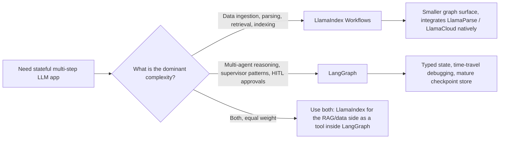

:::info 출처 · 라이선스
이 문서는 Om Bharatiya의 [AI System Design Guide](https://github.com/ombharatiya/ai-system-design-guide/blob/main/09-frameworks-and-tools/04-llamaindex.md)(MIT License, © 2026 Om Bharatiya)를 한국어로 옮긴 **비공식 번역본**입니다. 번역·편집 책임은 SecureNomad에 있습니다. 전체 안내는 [소개 · 출처 · 라이선스](../index.md)를 참고하세요. 번역 기준: 원문 커밋 `ed955b2`(2026-10-09).
:::

:::note 번역 주
원문은 외부 자료로, 기업명·제품명·버전은 원문 표기를 유지합니다. 코드·머메이드 다이어그램은 원문 그대로 둡니다.
:::

# LlamaIndex

LangChain이 "오케스트레이션"에 집중한다면, **LlamaIndex**는 **데이터 중심 AI(Data-Centric AI)**의 거장이다. RAG 라이브러리에서 **워크플로**·**에이전트 데이터 조작** 프레임워크로 진화했고, 그 배후 회사는 이후 상업 초점을 문서 파싱·추출로 좁혔다(아래 전략 신호 참고).

---

## 데이터 프레임워크 철학

LlamaIndex는 **데이터가 모델보다 중요하다**는 믿음 위에 구축.
- **노드**: 모든 데이터 청크가 풍부한 메타데이터(관계·요약·부모-자식 링크)의 "노드".
- **리트리버**: LlamaIndex가 가장 다양한 리트리버 세트(Summary·Knowledge Graph·Tree·Keyword) 제공.

---

## LlamaIndex Workflows

2024에 LlamaIndex가 LangGraph에 대한 답으로 **Workflows** 도입.
- **이벤트 주도 아키텍처**: 노드가 `Events` 방출로 통신.
- **동시성**: Workflows가 네이티브 비동기, 선형 체인보다 대규모 병렬 데이터 처리 더 잘 다룸.

```python
# Conceptual Workflow
class RAGWorkflow(Workflow):
    @step
    async def ingest(self, ev: StartEvent) -> RetrievalEvent:
        # Custom logic...
        return RetrievalEvent(results=nodes)
```

---

## 고급 인덱싱

1. **Property Graphs**: RAG 위해 벡터 청크를 그래프 노드에 링크.
2. **문맥 인식 스플리터**: "토큰 수"가 아니라 "의미"로 텍스트 묶음(작은 LLM으로 최적 분할점 찾음).
3. **동적 경로**: 리트리버가 질문 복잡도 기반 *어느* 인덱스 쿼리할지 결정.

---

## LlamaCloud와 관리형 수집

엔터프라이즈 규모엔 LlamaIndex가 **LlamaCloud**에 집중.
- **관리형 수집**: PDF 파싱·OCR·테이블 추출을 서비스로 처리.
- **모델로서 파싱**: 규칙 기반 파서 대신 비전-언어 모델로 레이아웃 "이해". LlamaParse와 신규 LiteParse가 회사 파싱 제품, Extract 제품이 파싱 문서를 타입 레코드로 전환.

### 전략 신호: 회사가 파싱에 베팅 중

2026-09-11 CEO Jerry Liu가 `llama_index` README에 노트 추가(PR #23020), 회사 주 초점이 LlamaParse·LiteParse와 ParseBench·ExtractBench 벤치로 이동했고 오픈소스 프레임워크는 오픈 툴킷으로 여전히 가용. 릴리스 케이던스 일치: `llama-index` 0.14.22(5/14)·0.14.23(6/24)·0.14.24(8/19)·0.14.25(2026-09-21, 통합 패키지 보안 경보 의존성 수정 지배), `llama-index-workflows`는 계속 움직임(2026-09-25 2.25.0). 8-9월 블로그 출력이 거의 전부 추출: ExtractBench(8/11)·베타 Turbo 추출 티어(9/3)·LiteParse 업데이트(9/22)·Extract v2.5(10/1).

설계 의미: LlamaIndex를 가장 강한 곳(수집·파싱·검색 프리미티브)에 쓰고 자기 검색 인터페이스 뒤에 유지. 수년 실행 기대 시스템의 범용 에이전트 런타임으로 만들지 말 것; 느려지는 오픈소스 케이던스가 의존 통합의 적은 수정을 의미.

---

## 도구로서 에이전트

LlamaIndex가 에이전트를 **고수준 리트리버**로 취급.
- 복잡 LlamaIndex 쿼리 엔진을 도구로 "래핑"해 LangGraph 에이전트에 줌.
- **이점**: 에이전트가 벡터 DB·그래프 스키마 기술 디테일 몰라도 "스마트 데이터 접근".

---

## LlamaIndex Workflows: 이벤트 주도 애플리케이션 프레임워크

2024 피치는 "Workflows는 우리 LangGraph". 오늘 피치는 다름: Workflows가 어느 AI 애플리케이션에나 범용 이벤트 주도 프레임워크, RAG가 한 가능 용도. Workflows가 이제 자기 `llama-index-workflows` 패키지에 거주, `llama-index-core`가 의존하고 `llama_index.core.workflow`로 re-export; 문서가 이를 주 애플리케이션 표면으로, 인덱스·리트리버를 스텝 내서 호출되는 빌딩 블록으로 제시([LlamaIndex workflows docs](https://developers.llamaindex.ai/python/framework/understanding/workflows/)). 핀할 명명 미묘: **Workflows** 패키지가 2025 중반 1.0 도달하고 이제 독립 패키지로 2.x 라인(`llama-index-workflows` 2.25.0, 2026-09-25), 코어 `llama-index` 프레임워크 자체는 0.x 라인 유지(0.14.25, 2026-09-21). 이런 버전 변동이 튜토리얼 깨고 생존법은 [프레임워크 변동 항해](12-navigating-framework-churn.md) 참고.

### 아키텍처적으로 바뀐 것

| 차원 | Workflows 이전 LlamaIndex | Workflows 우선 LlamaIndex |
|-----------|--------------------------|-----------------------------------|
| 주 추상화 | 쿼리 엔진·챗 엔진 | `@step` 메서드의 `Workflow` 클래스 |
| 제어 흐름 | 선형; 중첩 쿼리 엔진 | 스텝이 타입 `Event` 하위클래스 소비/방출 |
| 상태 | 엔진 인스턴스에 암묵 | 직렬화 상태의 명시 `Context` |
| 동시성 | 비동기 쿼리 엔진 통한 협력 | 일급: 여러 이벤트 방출·팬아웃·조인 |
| 지속 | 없음 | Context가 재개 위해 dict로 직렬화(`to_dict`/`from_dict`) |
| 스트리밍 | 엔진별 | 어느 스텝서나 `ctx.write_event_to_stream()` |
| Human-in-the-loop | 수동 | `InputRequiredEvent`/`HumanResponseEvent` 패턴 |

### 이벤트 주도 멘탈 모델

```python
from llama_index.core.workflow import (
    Workflow, step, Event, StartEvent, StopEvent, Context
)

class RetrievedEvent(Event):
    nodes: list

class JudgedEvent(Event):
    nodes: list
    keep: bool

class GraphRAG(Workflow):
    @step
    async def plan(self, ctx: Context, ev: StartEvent) -> RetrievedEvent:
        await ctx.store.set("query", ev.query)  # workflows 2.x: state lives on ctx.store
        nodes = await self.retriever.aretrieve(ev.query)
        return RetrievedEvent(nodes=nodes)

    @step
    async def judge(self, ctx: Context, ev: RetrievedEvent) -> JudgedEvent:
        keep = await self.relevance_judge(ev.nodes, await ctx.store.get("query"))
        return JudgedEvent(nodes=ev.nodes, keep=keep)

    @step
    async def answer(self, ctx: Context, ev: JudgedEvent) -> StopEvent:
        if not ev.keep:
            return StopEvent(result="No good evidence found.")
        return StopEvent(result=await self.llm.acomplete(...))
```

이 설계서 두 속성이 나옴:

1. 엔진이 순수 **이벤트 유형**으로 디스패치, 그래서 새 브랜치 추가가 새 `Event` 하위클래스와 소비 스텝 추가. 편집할 중앙 라우터 없음.
2. **동시성이 데이터 주도**: 세 `RetrievedEvent` 방출 스텝이 자동 세 하류 `judge` 호출 팬아웃, 조인 스텝이 `ctx.collect_events`로 모음.

### Workflows vs LangGraph



| 차원 | LlamaIndex Workflows (2.x) | LangGraph (1.x) |
|-----------|----------------------------|-----------------|
| 제어 흐름 프리미티브 | 이벤트 디스패치 | 그래프 노드·엣지, 플러스 타입 리듀서 상태 |
| 상태 모델 | 자유형 `Context`(dict 유사) | 리듀서의 Pydantic/TypedDict 상태 |
| 재개/타임 트래블 | 직렬화 컨텍스트, 기본 재개 | 일급 체크포인트, 어느 노드서나 분기([LangGraph persistence docs](https://docs.langchain.com/oss/python/langgraph/persistence)) |
| 네이티브 통합 | LlamaParse·LlamaCloud·모든 LlamaHub 로더 | LangSmith 평가·모든 LangChain 통합 |
| 최적합 복잡성 | 데이터형: 파싱·임베드·검색·정제 | 로직형: 계획·행동·반성·위임 |
| 멀티 에이전트 헬퍼 | `AgentWorkflow`·function-calling 에이전트([LlamaIndex AgentWorkflow](https://developers.llamaindex.ai/python/framework/understanding/agent/multi_agent/)) | `create_agent`(LangChain 1.x)·supervisor·swarm 패키지·커스텀 그래프 |
| 스트리밍 UI | `ctx.write_event_to_stream` + AG-UI 프로토콜 | `astream_events` v2·AG-UI 프로토콜 |

LangGraph보다 LlamaIndex Workflows에 손 뻗을 때:

- 어려운 부분이 추론이 아니라 **데이터 수집**. LlamaCloud·LlamaParse·property-graph 스택이 모두 네이티브, 어댑터 브릿지 아님([LlamaCloud overview](https://www.llamaindex.ai/llamacloud)).
- **문서 주도 병렬성** 원함: 1000 PDF 파싱, 청크당 임베딩 스텝 팬아웃, 한 인덱스 업데이트로 조인.
- LlamaIndex.TS의 **TypeScript** 생태계 내 구축(Python 코어 대비 기능 커버리지 먼저 확인; 대부분 투자가 Python과 호스팅 파싱 제품으로).

LangGraph가 이길 때:

- 어려운 부분이 **에이전트 제어 루프** 자체: 많은 에이전트·supervisor 패턴·내구 인터럽트·리플레이.
- 기본 제공 **타임 트래블 디버깅** 필요. LlamaIndex 재개는 크래시 복구엔 좋으나 LangGraph 체크포인트처럼 임의 역사 상태서 분기엔 아님.
- 이미 LangSmith 평가 스택에 있고 브릿지 없는 트레이스 수준 통합 원함.

### 현실 자세

많은 시니어 아키텍처가 둘 다 실행: 데이터 플레인(수집·인덱싱·하이브리드 검색·재순위)엔 도구로 래핑한 LlamaIndex Workflows, 위에 에이전트 제어 플레인엔 LangGraph. 이것이 [AIMultiple framework comparison](https://research.aimultiple.com/agentic-ai-frameworks/)과 LlamaIndex 자체 [하이브리드 통합 쿡북](https://developers.llamaindex.ai/python/framework/understanding/workflows/)이 짚은 패턴.

새 그린필드 앱에 하나만 고르면 질문이 축약됨: **팀이 데이터 배관에 시간 더 쓸까 에이전트 오케스트레이션에 쓸까?** 답이 프레임워크를 몲.

---

## 면접 질문

### Q: LangChain과 LlamaIndex 둘 다 "그래프/워크플로" 기능 가짐. 어떻게 선택하나?

**좋은 답변:**
주 복잡성이 수집·멀티모달 파싱·복잡 검색인 **데이터 집약** 과제엔 **LlamaIndex Workflows**. 이벤트 주도 아키텍처가 대규모 병렬 데이터 처리에 맞음. 복잡성이 "추론"·"human-in-the-loop" 로직인 **로직 집약** 멀티 에이전트 시스템엔 **LangGraph**. 많은 시니어 아키텍처서 **둘 다**: RAG 엔진엔 LlamaIndex, 전체 에이전트 supervisor엔 LangGraph. 벤더 방향도 저울질: LlamaIndex가 2026-09 초점이 파싱·추출이라 했으니, 제어 플레인을 거기 걸기보다 데이터 플레인에 자기 인터페이스 뒤로 유지.

### Q: LlamaIndex의 "Property Graph"란 뭐고 왜 기본 벡터 RAG보다 우수한가?

**좋은 답변:**
Property Graph가 벡터의 **의미 유연성**과 데이터베이스의 **구조 정밀성**을 결합. 기본 RAG선 "Project Alpha" 청크 찾으나 누가 소유하는지 모름. Property Graph선 벡터 청크가 `User` 노드·`Timeline` 노드에 링크된 노드. 이로 **전역 추론**(예: "지난달 Tom이 Project Alpha에 쓴 모든 문서 찾기") 가능. 기본 RAG는 정확 키워드 "Alpha" 안 담아 많은 관련 노드를 놓칠 가능성.

---

## 참고 문헌
- LlamaIndex. "Announcing Workflows 1.0: A Lightweight Framework for Agentic systems" (Jun 30, 2025): https://www.llamaindex.ai/blog/announcing-workflows-1-0-a-lightweight-framework-for-agentic-systems
- `llama_index` README focus note (PR #23020, Sep 11, 2026): https://github.com/run-llama/llama_index
- LlamaIndex. Integrations directory (LlamaHub has moved here): https://developers.llamaindex.ai/python/framework/community/integrations

---

*다음: [DSPy: 언어 모델 프로그래밍](05-dspy.md)*
