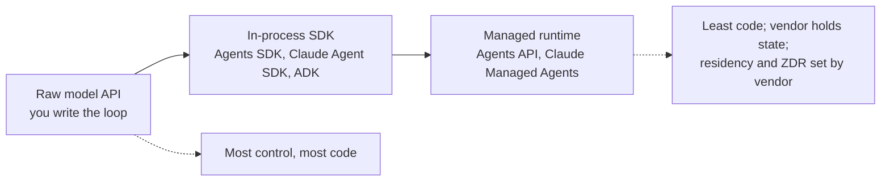

:::info 출처 · 라이선스
이 문서는 Om Bharatiya의 [AI System Design Guide](https://github.com/ombharatiya/ai-system-design-guide/blob/main/09-frameworks-and-tools/07-autogen-crewai.md)(MIT License, © 2026 Om Bharatiya)를 한국어로 옮긴 **비공식 번역본**입니다. 번역·편집 책임은 SecureNomad에 있습니다. 전체 안내는 [소개 · 출처 · 라이선스](../index.md)를 참고하세요. 번역 기준: 원문 커밋 `ed955b2`(2026-10-09).
:::

:::note 번역 주
원문은 외부 자료로, 기업명·제품명·버전·SDK명은 원문 표기를 유지합니다. 코드·머메이드 다이어그램은 원문 그대로 둡니다.
:::

# Microsoft Agent Framework, CrewAI, 에이전트 SDK 지형

멀티 에이전트 프레임워크 지형이 지난 1년간 통합됐다. Microsoft가 AutoGen·Semantic Kernel을 **Microsoft Agent Framework**로 접어넣어 2026-04-02 GA(1.0); AutoGen은 이제 유지보수 모드·커뮤니티 관리. CrewAI가 1.15.23(2026-09-28) 도달하고 체크포인팅·선언적 Flows 추가; Fortune 500 60%+ 사용 보고(벤더 주장). 모든 주요 랩이 자기 에이전트 SDK 배송: Anthropic Claude Agent SDK, OpenAI Agents SDK, Google ADK, AWS Strands Agents. 2026에 랩들이 루프 자체도 관리형 서비스로 임대 시작: Claude Managed Agents, OpenAI Agents API(2026-09-10 퍼블릭 베타), Bedrock Managed Agents(2026-09-29 프리뷰).

이 장 버전 번호는 이 SDK들이 매주나 격주 배송하니 릴리스 날짜 수반. 핀하라.

---

## CrewAI: 매니저 관점

CrewAI가 **프로세스** 개념 중심 구축.
- **역할 기반 에이전트**: "연구자"·"작가"·"매니저" 정의.
- **태스크**: 특정 출력의 명시 목표.
- **프로세스 오케스트레이션**: 순차나 위계(매니저 에이전트가 위임·검증). 합의 기반 프로세스가 오래 CrewAI 문서에 계획으로 나열됐으니 거기 설계하지 말 것.

### CrewAI Flows

CrewAI **Flows**가 고전 Crew 패턴 위에 **상태 머신 계층** 추가:

```python
from crewai.flow.flow import Flow, listen, start

class ContentFlow(Flow):
    @start()
    def research_topic(self):
        # Returns research output
        return research_crew.kickoff({"topic": self.state["topic"]})
    
    @listen(research_topic)
    def write_article(self, research):
        # Triggered after research completes
        return writing_crew.kickoff({"research": research})
    
    @listen(write_article)
    def publish(self, article):
        # Final step
        return publisher.publish(article)
```

### CrewAI 1.14·1.15: 내구성 경쟁

| 릴리스 | 날짜 | 바뀐 것 |
|---|---|---|
| 1.14.0 | 2026-04-07 | 런타임 상태 **체크포인팅**(`CheckpointConfig`·`SqliteProvider`), 이벤트 시스템·실행기 리팩터, RAG 도구의 SSRF 보호·경로/URL 검증. **파괴적**: `CodeInterpreterTool` 제거 |
| 1.15.0 | 2026-06-25 | **선언적 Flow 로딩**(crew 액션의 `FlowDefinition`), DMN 모드, 전 LLM 호출 토큰 사용 집계 |
| 1.15.22 / 1.15.23 | 9/16 / 2026-09-28 | 트레이싱의 인간 피드백·일시정지 이벤트, 연결 별칭, OpenRouter 임베딩, 네이티브 Gemini 3.8 Flash 지원 |

1.13 라인(2026 봄)이 여전히 중요한 엔터프라이즈 조각 추가: 문서화 SSO·RBAC 권한 매트릭스·A2A 태스크 위임·`stop` 파라미터 떨군 OpenAI 모델 수정.

**유스케이스**: CrewAI + Flows가 구조가 잘 정의된 **비즈니스 프로세스 자동화**(콘텐츠 파이프라인·데이터 분석 워크플로)에 적합. CrewAI가 대략 20억 에이전트 실행 구동 보고(벤더 수치). 체크포인팅·선언적 Flows로 옛 휴리스틱 "속도엔 CrewAI, 상태엔 LangGraph"가 전보다 약함; 남은 격차는 디버깅 깊이(체크포인트서 분기 타임 트래블)와 생태계 폭.

---

## Microsoft Agent Framework (AutoGen 후속)

### 합병: AutoGen + Semantic Kernel = Agent Framework

Microsoft가 같은 팀으로 **Microsoft Agent Framework(MAF)**를 AutoGen·Semantic Kernel 둘의 직접 후속으로 구축. MAF 1.0이 2026-04-02 .NET·Python GA(Microsoft 발표는 4/3 날짜), 장기 지원 안정 API로 선전. 대략 주 단위 배송: Python 1.19.0 9/18, .NET 1.23.0 2026-10-01. Go SDK가 퍼블릭 프리뷰.

**합병이 결합하는 것:**
- **AutoGen서**: 단일·멀티 에이전트 대화 패턴(group chat·round-robin·handoff)의 단순 추상화
- **Semantic Kernel서**: 엔터프라이즈급 세션 관리·타입 안전·필터·텔레메트리·광범위 모델/임베딩 지원

### 마이그레이션 경로

AutoGen README가 **유지보수 모드** 배너 보유: 새 기능 없음, "향후 커뮤니티 관리", 새 사용자는 MAF로. 마지막 `autogen-agentchat` 릴리스가 0.7.5(2025-09-30). Microsoft가 AutoGen·Semantic Kernel 둘의 마이그레이션 가이드 발행. 새 프로젝트 시작 시 MAF 직접 사용.

### 핵심 역량

```python
# Microsoft Agent Framework (Python 1.x): handoff workflow with an approval gate
import os
from typing import Annotated

from agent_framework import FileCheckpointStorage, tool
from agent_framework.foundry import FoundryChatClient
from agent_framework.orchestrations import HandoffBuilder
from azure.identity import AzureCliCredential

client = FoundryChatClient(
    project_endpoint=os.environ["FOUNDRY_PROJECT_ENDPOINT"],
    model=os.environ["FOUNDRY_MODEL"],
    credential=AzureCliCredential(),
)

@tool(approval_mode="always_require")  # the workflow pauses for a human before this runs
def process_refund(order_number: Annotated[str, "Order number"]) -> str:
    """Process a refund for an order."""
    return f"Refund queued for {order_number}"

triage = client.as_agent(name="triage_agent", instructions="Route the customer to a specialist.")
refunds = client.as_agent(name="refund_agent", instructions="Handle refunds.", tools=[process_refund])

workflow = (
    HandoffBuilder(
        name="support",
        participants=[triage, refunds],
        checkpoint_storage=FileCheckpointStorage(storage_path="./checkpoints"),  # resume after restarts
    )
    .with_start_agent(triage)
    .build()
)
```

**프레임워크 하이라이트:**
- **통합 .NET·Python**: 양 언어 걸쳐 같은 프로그래밍 모델(Go 프리뷰)
- **Workflows**: 순차·동시·handoff·group chat 오케스트레이션, 플러스 함수형·그래프 기반 워크플로, 체크포인팅·재연결 백그라운드 응답
- **Harness Agent**: 계획·todo 추적·문맥 컴팩션·파일 접근·메모리·도구 승인·관찰성 내장의 길고 다단계 과제용 의견적 에이전트
- **2026-09 추가**(Microsoft 9/24 업데이트): AG-UI 호스팅(Python 안정, .NET 프리뷰)·Foundry와 Cosmos DB 메모리 제공자(Python 프리뷰)·모델 작성 코드를 Hyperlight 마이크로 VM서 돌리는 `HyperlightCodeActProvider` 통한 CodeAct(Microsoft가 평가 워크로드서 약 50% 낮은 지연·60% 넘는 적은 토큰 보고)·OpenAI Responses와 Telegram·A2A·MCP 채널·Durable Azure Functions 확장
- **프로토콜**: MCP·A2A 상호운용 둘 다 1.x 배송
- **멀티 제공자**: Foundry·Azure OpenAI·OpenAI·Anthropic·Bedrock·Gemini·Ollama 일급 커넥터

---

## 에이전트 SDK 지형

모든 주요 AI 랩이 이제 자기 에이전트 프레임워크 배송. 2026 Q3 전반 패턴: 하네스 우선 API·내구 상태·내장 샌드박스 코드 실행.

### Claude Agent SDK (Anthropic)

Claude Agent SDK(Claude Code SDK서 개명)가 Claude Code 구동하는 같은 도구·에이전트 루프·문맥 관리를 Python(`claude-agent-sdk` 0.2.163)·TypeScript(`@anthropic-ai/claude-agent-sdk` 0.3.287) 라이브러리로 제공, 2026-10-01 버전.

- **내장 도구**: 파일 읽기·명령 실행·코드 편집, 그래서 에이전트가 커스텀 도구 구현 없이 작동
- **서브에이전트**: 자기 문맥·도구 허용목록의 명명 서브에이전트 정의
- **제어**: `max_turns`·`max_budget_usd`·`effort`·분류기 기반 `auto`·`dontAsk` 포함 권한 모드
- **배포**: Claude API·Amazon Bedrock·Google Cloud(Vertex AI)·Microsoft Foundry
- **함정**: SDK가 Claude Code CLI 번들, 그래서 CLI 릴리스가 기본 모델을 밑에서 바꿀 수 있음. Claude Code가 Opus 5.5(2.1.280, 9/22)·Sonnet 5.5(2.1.284, 9/28)를 기본값으로 만들자 SDK 자체 CI가 깨져 모델 핀해야 했음. 항상 `model=` 명시 전달.

### OpenAI Agents SDK

네이티브 Python/TypeScript 구문 쓰는 멀티 에이전트 워크플로용 OpenAI 경량 프레임워크. 9월 마지막 PyPI 릴리스가 `openai-agents` 0.22.3(2026-09-17); 0.23.1이 10/2 PyPI 도달. JS `@openai/agents`가 0.18.0(9/10).

- **Handoff 기반**: 에이전트가 handoff로 서로 위임, 중앙 supervisor 불필요
- **가드레일**: 입력·출력 가드레일; 0.22.1(9/8)이 MCP 서버 전역 가드레일 추가
- **MCP 통합**: 0.20.0이 MCP Python SDK v1·v2 지원(커스텀 MCP HTTP 인증 앱은 설치된 메이저 타입 쓰거나 `mcp<2` 핀)
- **Sandbox Agents**(0.14.0부터, 2026-04): `SandboxAgent`·매니페스트·스냅샷·호스팅 샌드박스 클라이언트
- **테스트 유틸**(0.21.0, 8/15): 제공자 중립 `agents.testing`, 플러스 realtime·voice 테스트 모듈; OpenAI Python SDK 3.0+ 필요
- **계획할 변동**: 0.20.0(8/11)이 `gpt-5.6-luna`를 암묵 기본 모델로, 0.22.0(8/19)이 명시 클라이언트와 `organization`·`project` 전달 앱 깸
- **Realtime 에이전트**: `gpt-realtime-2.1`이 0.18.0(2026-07-07)부터 realtime 에이전트 기본값. 0.22.3까지 풀 듀플렉스 `gpt-live-1`(GA 9/10) 지원 없음. 원 `gpt-realtime`·`gpt-realtime-mini` 모델이 2027-01-20 종료, 그래서 2.1 계열 모델 핀

### OpenAI AgentKit (부분 축소 중)

AgentKit(2025-10)이 비주얼 **Agent Builder**·**ChatKit**(임베드·테마 챗 UI)·**Connector Registry**(OpenAI 제품 걸쳐 데이터 소스·도구 연결법 중앙 거버넌스)·Responses API와 Agents SDK 중심 **Evals** 번들. 두 조각이 사라짐:

- **Agent Builder**가 2026-11-30 종료(2026-06-03 폐기 발표). OpenAI가 사용자를 Agents SDK나 ChatGPT Workspace Agents로.
- **Evals** 플랫폼이 10/31 읽기 전용, 2026-11-30 종료, Promptfoo 마이그레이션 가이드와. OpenAI가 2026-03 Promptfoo 인수 합의; MIT 라이선스 유지하고 다른 제공자 지원. Reusable Prompts도 2026-11-30 종료.

**의미**: OpenAI가 스펙트럼 양 끝, 코드 우선(Agents SDK)·완전 관리(Agents API, 아래)에 통합 중. 비주얼 빌더 중간이 출시 8개월 후 폐기. 에이전트 정의를 자기 소유 코드에 유지; 캔버스 export는 내구 진실 소스 아님.

### OpenAI Apps SDK

Apps SDK가 **Model Context Protocol**을 확장해 MCP 서버가 도구 옆에 UI 배송. 개발자가 로직과 대화형 인터페이스 둘 다 정의, 앱이 ChatGPT 같은 클라이언트 안에 렌더. MCP 프로젝트가 같은 아이디어를 **MCP Apps** 확장으로 표준화; SDK가 2026-09-08 2.0.0 도달, 와이어 프로토콜 불변인 채 v2 TypeScript SDK 패키지로 이동, 그래서 2.x view가 1.x 호스트서 여전히 렌더. [도구 사용과 MCP](../07-agentic-systems/03-tool-use-and-mcp.md) 참고.

### Google Agent Development Kit (ADK)

Google 생태계 최적화되나 모델 불가지론 프레임워크:

- **버전**: Python 2.0이 2026-05-19 GA하고 9/25 2.10.0 도달(2.11.0이 10/2 PyPI); Go 2.0이 6/30 배송(`google.golang.org/adk/v2`), 이제 v2.5.0(9/30); TypeScript 2.0.0이 8/21 GA, 이제 2.2.0(9/30), Workflow API는 아직 실험적; Java는 1.x 유지(1.10.1, 9/18). Python 1.x 라인 여전히 패치.
- **그래프 워크플로(2.0)**: 정적·동적 그래프·팬아웃과 팬인(`JoinNode`)·노드별 재시도와 타임아웃·스키마 검증·human-in-the-loop 일시정지와 재개. ADK-TS 2.0이 `SequentialAgent`·`ParallelAgent`·`LoopAgent` 폐기(경고와 여전히 실행).
- **A2A 네이티브**: 벤더 간 오케스트레이션용 내장 Agent-to-Agent 프로토콜 지원
- **Vertex AI 통합**: 관리형 호스팅 위해 Agent Engine Runtime 배포

ADK 2.0으로 Google이 Microsoft(MAF 워크플로)·LangGraph와 함께 에이전트를 노드로 하는 그래프 워크플로 제공, 옛 "그래프엔 LangGraph, 단순 루프엔 랩 SDK" 분리 좁힘. Claude Agent SDK·OpenAI Agents SDK는 여전히 서브에이전트·handoff의 단일 에이전트 루프 중심.

### 기타 에이전트 SDK

AWS **Strands Agents**가 PyPI서 가장 많이 다운로드된 랩 SDK(2026-10-01까지 한 달 약 36.5M 다운로드, 모든 그런 카운트처럼 CI 부풀림); 새 하네스 패키지가 9/22 기본 모델을 Claude Opus 5로 옮김, 또 다른 조용한 기본값 변경. **Vercel AI SDK 7**(2026-06-25)이 내구 `WorkflowAgent`와 Claude Code·Codex·기타 하네스를 한 API 뒤 돌리는 실험적 `HarnessAgent` 추가. Pydantic AI·Mastra는 [Pydantic AI와 Mastra](11-pydantic-ai-and-mastra.md), Haystack 3·Agno 3는 [프레임워크 선택 가이드](08-framework-selection-guide.md) 참고.

---

## 관리형 에이전트 런타임

에이전트 루프의 자체 구축 대 임대 스펙트럼이 이제 세 정거장. 원시 모델 API로는 루프를 작성. 인프로세스 SDK로는 루프가 당신 서비스서 돎. 관리형 런타임으로는 루프·상태·흔히 샌드박스가 벤더서 돎.



| 런타임 | 상태 | 넘기는 것 | 과금 | 확인할 제약 |
|---|---|---|---|---|
| **Claude Managed Agents** | 배송 중; 2026-09까지 기능 추가 | 세션; Anthropic 호스팅·자체 호스팅 샌드박스; 메모리 스토어; cron 배포(6/9); 서버 평가 `auto` 권한 정책(9/10); `ant apply`와 커밋 `claude-lock.json` 통한 에이전트 코드(ant CLI 1.30.0, 9/3) | 토큰 플러스 실행 세션시당 $0.08(유휴 무료); 하드 세션 예산이 `budget_reached`로 정지(8/7); Batch 할인 없음 | Claude 모델만 |
| **OpenAI Agents API** | 퍼블릭 베타, 2026-09-10 | Codex 하네스: 내구 세션·컴팩션·복구·서브에이전트(`max_concurrent_subagents` 기본 6); OpenAI 호스팅·자체 호스팅 샌드박스; 호스팅 브라우저 컴퓨터 사용(9/29) | API 수수료 없음; 모델·도구·컨테이너 요율(샌드박스 1·4·16 GB에 20분 세션당 $0.03·$0.12·$0.48) | 베타 중 US 데이터 거주만·Zero Data Retention 없음 |
| **Bedrock Managed Agents**(OpenAI 구동) | 프리뷰, 2026-09-29 | AWS 내 실행 커스텀 Agents API, 에이전트별 IAM 역할·CloudTrail 로깅·결과 중대 액션 전 승인 | 프리뷰 중 추가 요금 없음 | us-east-1·us-east-2·us-west-2만 |
| **Foundry Agent Service** | Routines 2026-09-24 GA | 반복·타이머·이벤트 트리거의 호스팅 에이전트 | Azure 소비 | 네트워크 egress 제어 아직 프리뷰 |

관리형 런타임이 토큰 위에 **둘째 비용 미터**(세션·샌드박스 시간) 추가, 그래서 과제당 비용 모델이 런타임·유휴 동작 포함해야. 위험도 집중: OpenAI 9/29 사건이 Agents API를 Responses·ChatGPT·Codex와 함께 약 5시간 20분 저하, 그래서 폴백이 모델뿐 아니라 벤더를 넘어야.

자체 실행과 임대 사이 중간 옵션: **자기 루프의 관리형 호스팅**. AWS AgentCore Runtime V2(2026-09-18 발표, `platformVersion V2`로 활성)가 각 새 인스턴스를 초기화 에이전트 스냅샷서 복원; AWS가 원 런타임 대략 5.4-30초 대비 약 2초 P75 콜드 스타트 보고, 훨씬 적은 GB시간에 높은 요율 과금(벤더 보고). 당신 프레임워크·당신 루프·그들 서버.

---

## 스웜과 P2P

양 프레임워크(와 더 넓은 SDK 지형)가 **스웜 패턴** 채택.
- **Handoff**: 중앙 supervisor 대신 에이전트가 가장 관련된 전문가에 대화 "넘김". MAF가 handoff를 각 에이전트가 주입 handoff 도구 받는 메시로 구현; OpenAI Agents SDK가 handoff 프리미티브로 같음.
- **예시**: "영업 에이전트"가 사용자가 기술 질문함 깨닫고 스레드를 "지원 에이전트"에 넘김.
- **함정**: handoff가 도구 호출이라 받는 에이전트가 프레임워크가 전달 선택한 문맥 상속. MAF는 예로 사용자·에이전트 메시지 전달하나 도구 호출·결과 필터, 그래서 다음 에이전트가 이전 에이전트 도구 출력 봤다 가정 말 것.

---

## 프레임워크 비교 매트릭스

| 특성 | CrewAI | MS Agent Framework | LangGraph | Claude Agent SDK | OpenAI Agents SDK | Google ADK |
|---------|--------|-------------------|-----------|-----------------|-------------------|------------|
| **현 릴리스** | 1.15.23 (9/28) | py 1.19.0 (9/18), .NET 1.23.0 (10/1) | 1.2.12 (9/21) | py 0.2.163, TS 0.3.287 | py 0.22.3 (9/17), JS 0.18.0 | py 2.10.0 (9/25), TS 2.2.0 (9/30), Go 2.5.0 (9/30), Java 1.10.1 |
| **핵심 추상화** | Task/Process/Flow | Workflow/Agent | State/Graph | 에이전트 루프 + 서브에이전트 | Handoff/Agent | Agent + 그래프 워크플로 |
| **아키텍처** | 선언적 + 상태 머신 | 그래프 워크플로 | 순환 상태 그래프 | 위계 트리 | 스웜 Handoff | 방향 그래프 |
| **사용 용이성** | 높음 | 중간 | 낮음 | 중간 | 높음 | 중간 |
| **제어** | 낮음-중간 | 중간-높음 | 높음 | 중간 | 낮음-중간 | 중간-높음 |
| **내구 상태** | 체크포인팅(1.14+) | 워크플로 체크포인트 | 체크포인터·타임 트래블 | 세션 재개·fork | 세션·직렬화 실행 상태 | 세션·그래프 일시정지/재개(2.0) |
| **최적합** | 비즈니스 자동화 | 엔터프라이즈 .NET/Python | 복잡 오케스트레이션 | 코딩/도구 에이전트 | 빠른 멀티 에이전트 | Google Cloud AI |
| **다중 언어** | Python | .NET + Python(Go 프리뷰) | Python + TS | Python + TS | Python + TS | Python·TS·Go·Java |
| **MCP 지원** | 예 | 예 | 예(1.4.0부터 `langchain` 코어) | 네이티브 | 예(MCP SDK v1·v2) | 예 |
| **A2A 지원** | 예(1.13+) | 예 | 도구 통해 | 아니오(직접) | 아니오(직접) | 네이티브 |

---

## 면접 질문

### Q: LangGraph 대신 CrewAI를 언제 쓰나?

**좋은 답변:**
**속도 vs 정밀성**, 1년 전보다 좁은 격차. 표준 프로세스(콘텐츠 생성·데이터 분석)의 에이전트 팀을 빠르게 세워야 할 때 **CrewAI**; 역할·태스크 추상화와 Flows가 적은 코드로 도달, 1.14부터 상태 체크포인트·1.15부터 선언적 Flow 로딩. 모든 상태 전이의 **세밀 제어**·어느 체크포인트서나 분기 디버깅·멀티턴 human-in-the-loop 인터럽트·"역할극 팀" 은유에 안 맞는 복잡 오류 복구 로직 필요 시 **LangGraph**로 전환. 채택도엔 올바른 지표 인용: CrewAI가 GitHub 스타 더 많고(약 59.3K 대 42.6K), LangGraph가 대략 18배 월 PyPI 다운로드(43.7M 대 2.4M), 그래서 LangGraph가 실제 더 많은 팀이 의존하는 쪽.

### Q: Microsoft가 Agent Framework 위해 AutoGen을 유지보수 모드로 옮김. 기존 AutoGen 배포에 어떤 영향?

**좋은 답변:**
기존 배포는 계속 돌지만 AutoGen이 이제 새 기능 없는 커뮤니티 관리, 마지막 `autogen-agentchat` 릴리스가 2025-09 0.7.5. 그게 기능 질문만큼 보안 패치 질문: 자격증명·도구 접근 쥔 비유지 프레임워크를 오래 두고 싶지 않음. MAF가 2026-04-02부터 장기 지원 GA, Microsoft가 마이그레이션 가이드 발행: AutoGen `AssistantAgent`이 MAF `Agent`에, `GroupChat`이 워크플로 오케스트레이션에, Semantic Kernel 엔터프라이즈 기능(세션·텔레메트리·필터)이 네이티브로 따라옴. 전후 과제 성공·도구 호출 트레이스 비교하는 평가 하네스 뒤에서, 가장 넓은 권한의 에이전트부터 마이그레이션.

### Q: 에이전트들이 과제 안 풀고 계속 서로 대화하는 "무한 루프"를 어떻게 막나?

**좋은 답변:**
**종료 조건**·**최대 대화 턴** 사용. 대화 정체 탐지만 하는 "비평가 에이전트"도 구현. 비평가가 순환 탐지하면 사용자 프록시 트리거해 인터럽트하거나 group chat 매니저를 다른 추론 경로로 강제 전환. **토큰 속도**도 모니터: 에이전트 쌍이 진전 없이 2분에 100K 토큰 쓰면 세션 자동 kill. 플랫폼이 이제 지출 상한을 일급 제어로: Claude Managed Agents 세션 예산이 `budget_reached`로 세션 정지, Claude Agent SDK가 `max_budget_usd` 받음, MAF handoff 자율 모드가 에이전트별 턴 한계, LangGraph가 재귀 한계·체크포인팅, 그래서 kill된 루프를 잃지 않고 검사·재개.

### Q: OpenAI Agents API나 Claude Managed Agents 같은 관리형 런타임에 에이전트 루프를 언제 넘기나?

**좋은 답변:**
그렇지 않으면 내가 구축할 어려운 부분(내구 세션·문맥 컴팩션·크래시 복구·샌드박스 수명주기·호출별 권한 평가)이 락인보다 비싸고, 런타임 데이터 조건이 워크로드에 맞을 때. 둘째 조건이 흔히 결정: OpenAI Agents API 베타가 US 거주만·Zero Data Retention 없음, 많은 규제 워크로드를 기능 관계없이 배제. 둘째 비용 미터(토큰 위 세션시·샌드박스 분)와 폭발 반경도 모델링, 벤더 장애가 이제 모델·하네스·샌드박스를 함께 내리니. 내 통상 형태는 자기 소유 벤더 중립 오케스트레이터, 인터페이스 뒤 리프 에이전트로 관리형 런타임, 에이전트 정의를 레포에 코드로 유지(`ant apply`에 커밋 lockfile이 올바른 본능)해 런타임 교체 가능.

---

## 참고 문헌
- CrewAI. Changelog and releases (1.14.0, 1.15.x): https://github.com/crewAIInc/crewAI/releases
- Microsoft. "Agent Framework Overview" (2026): https://learn.microsoft.com/en-us/agent-framework/overview/
- Microsoft. "Microsoft Agent Framework Version 1.0" (Apr 2026): https://devblogs.microsoft.com/agent-framework/microsoft-agent-framework-version-1-0/
- Microsoft Learn. "AutoGen to Microsoft Agent Framework Migration Guide": https://learn.microsoft.com/en-us/agent-framework/migration-guide/from-autogen/
- Anthropic. "Claude Agent SDK" (2026): https://code.claude.com/docs/en/agent-sdk/python
- OpenAI. "Agents SDK" releases: https://github.com/openai/openai-agents-python/releases
- OpenAI. "Agents API overview" (beta, Sep 2026): https://developers.openai.com/api/docs/guides/agents-api/overview
- OpenAI. Deprecations (Agent Builder, Evals, Reusable Prompts): https://developers.openai.com/api/docs/deprecations
- [OpenAI. "Introducing AgentKit" (2025)](https://openai.com/index/introducing-agentkit/)
- [OpenAI. "Apps SDK" (2025)](https://developers.openai.com/apps-sdk)
- Google. "Agent Development Kit" (2026): https://google.github.io/adk-docs
- OpenAI. Swarm (educational multi-agent repo, now replaced by the Agents SDK): https://github.com/openai/swarm

---

*다음: [프레임워크 선택 가이드](08-framework-selection-guide.md)*
