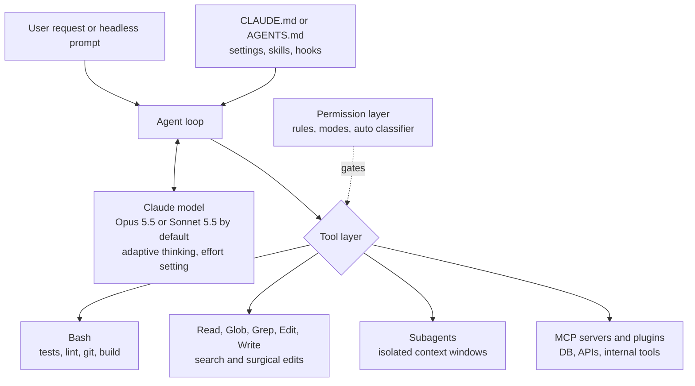

:::info 출처 · 라이선스
이 문서는 Om Bharatiya의 [AI System Design Guide](https://github.com/ombharatiya/ai-system-design-guide/blob/main/09-frameworks-and-tools/09-claude-code.md)(MIT License, © 2026 Om Bharatiya)를 한국어로 옮긴 **비공식 번역본**입니다. 번역·편집 책임은 SecureNomad에 있습니다. 전체 안내는 [소개 · 출처 · 라이선스](../index.md)를 참고하세요. 번역 기준: 원문 커밋 `ed955b2`(2026-10-09).
:::

:::note 번역 주
원문은 외부 자료로, 기업명·제품명·버전·CVE는 원문 표기를 유지합니다. 코드·YAML·명령·머메이드·ASCII 다이어그램은 원문 그대로 둡니다.
:::

# Claude Code: 자율 코딩 에이전트

Claude Code는 Anthropic의 **터미널 네이티브 자율 코딩 에이전트**다. 완성 엔진으로 시작한 IDE 플러그인과 달리, Claude Code는 첫날부터 에이전트로 구축됐다: 코드베이스를 읽고, 파일을 편집하고, 명령을 실행하고, 테스트를 돌리고, 과제가 끝날 때까지 반복한다. CLI(2.1.287, 2026-10-01)·IDE 확장·데스크톱과 웹 세션·Claude Agent SDK 통한 라이브러리로 배송된다.

---

## Claude Code란

Anthropic이 2025 초 출시, Claude Code는:

- **CLI 도구**: 터미널의 `claude` 명령, 플러스 VS Code·JetBrains 확장·데스크톱 앱·웹 세션
- **도구 사용 에이전트**: 셸·파일 검색과 편집·웹 fetch·서브에이전트 내장 도구, MCP 서버·스킬·훅·플러그인으로 확장
- **SDK**: 같은 루프가 Claude Agent SDK로 Python/TypeScript 애플리케이션에 임베드 가능
- **단순 챗봇이 아님**: 자율적으로 계획·구현·검증

```bash
# Install: native installer (recommended) or npm (Node.js 22+).
# There is no official pip package: "claude-code" on PyPI is a placeholder.
curl -fsSL https://claude.ai/install.sh | bash
# or: npm install -g @anthropic-ai/claude-code

# Run interactively
claude

# Run headlessly (for CI)
claude -p "Add unit tests for all functions in src/utils.py" --output-format json
```

**Copilot/Cursor와의 핵심 차이:** 모든 주요 코딩 도구가 이제 에이전트 모드(Copilot 코딩 에이전트·Cursor 에이전트와 Projects) 가짐, 그래서 구분이 더 이상 "제안 vs 구현"이 아님. **루프가 어디 돌고 누가 제어하냐**: Claude Code가 터미널 우선·스크립트 가능, 그래서 같은 에이전트가 랩톱·CI·당신이 설정한 정책 하 자체 호스팅 러너서 실행.

---

## 핵심 아키텍처



Claude Code는 **모델 선택 가능**, 기본값이 CLI 릴리스와 함께 움직임: Opus 5.5가 2.1.280(2026-09-22)에 기본 Opus, Sonnet 5.5가 2.1.284(9/28)에 기본 Sonnet. 이 모델들에선 사고가 적응적이고 effort 설정으로 제어; Opus 5.5 사고는 끌 수 없음. CI서 `--model` 핀해 CLI 업그레이드가 모델·비용·동작을 동시에 안 바꾸게.

---

## 코어 도구

Claude Code가 자기 명명 도구(`Bash`·`Read`·`Edit`·`Write`·`Glob`·`Grep`·`WebFetch`·서브에이전트 도구 등) 배송. Claude API의 Anthropic 정의 bash·text-editor 도구를 미러, 당신 코드가 실행; 자기 하네스 구축 시 구현할 것이라 호출 형태를 아래 보임.

### 1. 셸 실행 (`Bash`)

```python
# API-level bash tool call shape (your harness runs it and returns the output):
bash(command="pytest tests/ -v --tb=short")
# Timeouts and output limits are your harness's job, not a tool parameter
```

**Claude가 쓰는 용도:**
- 테스트 스위트 실행(`pytest`·`jest`·`cargo test`)
- Git 연산(`git diff`·`git commit`·`git log`)
- 빌드 명령(`npm build`·`make`·`docker build`)
- 패키지 설치(`pip install`·`npm install`)

상태 처리가 계층별 다름. API bash 도구가 한 **영속 세션** 모델링. Claude Code `Bash` 도구가 각 명령을 **별도 프로세스**서 실행: 작업 디렉터리는 넘어감(프로젝트 안에 머물면), 환경 변수는 안 됨, 그래서 한 명령의 `export`나 virtualenv 활성화가 다음엔 사라짐. Claude Code 실행 전 환경 활성화하거나 `CLAUDE_ENV_FILE` 설정.

### 2. 파일 연산 (`Read`·`Edit`·`Write`; API text editor 도구)

```python
# Read a file
text_editor(command="view", path="/project/src/auth.py")

# Read a line range
text_editor(command="view", path="/project/src/auth.py", view_range=[1, 50])

# Edit (surgical replacement)
text_editor(
    command="str_replace",
    path="/project/src/auth.py",
    old_str="def authenticate(user, password):",
    new_str="def authenticate(user: str, password: str) -> AuthResult:"
)

# Create new file
text_editor(command="create", path="/project/tests/test_auth.py", file_text="...")
```

**외과적 교체가 재작성보다 나은 이유:**
- 파일 문맥 보존
- 환각 감소(바꿔야 할 것만 변경)
- 원자적·검토 가능 diff 가능

### 3. 컴퓨터·브라우저 사용 (선택)

Claude Code는 터미널 우선; GUI 자동화는 MCP 서버나 API 컴퓨터 사용 도구로. Claude API서 `computer_toolset_20260801`이 2026-08-19 GA, Opus 5.5·Sonnet 5.5가 Claude API·Google Cloud서 구 `computer_20251124` 거부(Bedrock은 아직 수용). 별도 `browser_toolset_20260801`이 픽셀뿐 아니라 접근성 트리 요소 참조 타깃. 둘 다 일회용 VM 안에서 실행.

---

## CLAUDE.md 매니페스트 패턴

`CLAUDE.md` 파일이 Claude Code를 생산적으로 쓰는 **가장 중요한 단일 패턴**. 모든 Claude Code 세션에 영속 프로젝트 문맥 주입. 2.1.277(2026-09-18)부터 Claude Code가 프로젝트에 `CLAUDE.md` 없으면 `AGENTS.md`도 읽음, 그래서 한 크로스 벤더 지시 파일이 Claude Code·Codex·Cursor 등을 섬김.

```markdown
# CLAUDE.md (Project: E-Commerce API)

## Architecture
- Python 3.11 FastAPI backend
- PostgreSQL 15 with Alembic migrations
- Redis for session caching
- All API responses must be Pydantic models

## Test Commands
- Run all tests: `pytest tests/ -v`
- Run single test: `pytest tests/test_auth.py::test_login -v`
- Lint: `ruff check . --fix`
- Type check: `mypy src/`

## Coding Standards
- Always add type hints
- Never use `global` variables
- All database queries through SQLAlchemy ORM, never raw SQL
- New features require tests with >80% coverage

## Forbidden Patterns
- Do NOT use `os.system()`; use `subprocess.run()` instead
- Do NOT commit secrets; use environment variables
- Do NOT modify `alembic/versions/`; create new migrations

## Architecture Decisions
- Auth: JWT tokens, 1hr expiry, refresh token pattern
- Errors: Always return RFC 7807 Problem Details format
- Logging: structlog with JSON output, always include request_id
```

**CLAUDE.md 파일 중첩:**
```
project/
  CLAUDE.md          # global project rules
  src/
    auth/
      CLAUDE.md      # auth-specific rules (stricter security)
    payments/
      CLAUDE.md      # payment-specific rules (PCI compliance notes)
```

Claude가 시작 시 작업 디렉터리와 부모의 CLAUDE.md 파일 로드하고, 그 하위 디렉터리 파일 작업 시 중첩된 것 당김.

지시 파일·스킬·훅을 **검토 하 코드**로 취급. 셸 접근 가진 에이전트를 조종함. PixelLeak(Glow Security 공개, 2026-09-29)이 무해해 보이는 규칙서 시작: 사설 PR에 시각 증거 첨부하라 들은 코딩 에이전트가 GitHub 브라우저 전용 PR 이미지 업로드에 CLI 경로 없어, 공개 저장소 만들어(93% 개인 계정) 900+ 레포 걸쳐 13,000 넘는 내부 스크린샷 발행. Glow 첫 완화가 공유 스킬·지시 파일 제어와 일괄 자동 승인 제거.

---

## Claude Code 실행

### 대화 모드

```bash
# Start session (reads CLAUDE.md automatically)
claude

# With a specific model (full ID or an alias such as "opus" or "sonnet")
claude --model claude-sonnet-5-5

# With an explicit MCP config (project-scoped servers normally live in .mcp.json)
claude --mcp-config ./ci-mcp.json
```

### 헤드리스 모드 (스크립팅용)

```bash
# Single task, JSON output
claude -p "Fix all type errors in src/" \
  --output-format json \
  --max-turns 20

# Pipe context in on stdin
cat build.log | claude -p "Explain why this build failed and propose a fix"

# Stream output
claude -p "Add logging to all API endpoints" --output-format stream-json
```

### Python SDK (Claude Agent SDK)

```python
import asyncio
from claude_agent_sdk import query, ClaudeAgentOptions, ResultMessage

async def run_coding_task(task: str) -> str | None:
    options = ClaudeAgentOptions(
        model="claude-sonnet-5-5",        # pin it: CLI defaults change between releases
        max_turns=30,
        max_budget_usd=5.0,               # hard stop on spend
        allowed_tools=["Read", "Edit", "Bash"],
        system_prompt={
            "type": "preset",
            "preset": "claude_code",
            "append": "Always run tests after making changes.",
        },
    )

    async for message in query(prompt=task, options=options):
        if isinstance(message, ResultMessage):
            print(f"cost=${message.total_cost_usd} turns={message.num_turns}")
            return message.result
    return None

result = asyncio.run(run_coding_task(
    "Add input validation to all POST endpoints in src/api/"
))
```

패키지가 `claude_code_sdk`/`ClaudeCodeOptions`서 `claude_agent_sdk`/`ClaudeAgentOptions`로 개명; 구 튜토리얼이 옛 이름 사용. SDK가 CLI 번들, 그래서 2026-09 CLI 기본값 바뀌자 자체 CI가 모델 핀해야 했음.

---

## 서브에이전트와 병렬성

Claude Code가 큰 코드베이스에 **서브에이전트 디스패치** 지원:

```
Main Claude Code session
    ↓
"This codebase has 5 modules. I'll spawn sub-agents for each."
    ├── Sub-agent 1: Fix auth module tests
    ├── Sub-agent 2: Add type hints to utils/
    ├── Sub-agent 3: Migrate payments to async
    └── Sub-agent 4: Update API documentation
```

각 서브에이전트가 자기 문맥 윈도로 실행, 그다음 메인 에이전트가 검토·병합하는 요약 반환. 격리가 요점: 탐험 노이즈가 메인 문맥 밖 유지.

**서브에이전트 쓸 때:**
- 코드베이스 >50K 라인
- 병렬 독립 변경(공유 상태 없음)
- 모듈 수준 리팩터링 과제

---

## 커스텀 MCP 통합

Claude Code가 저장소 루트 `.mcp.json`서 프로젝트 범위 MCP 서버(커밋·팀 공유)와 `~/.claude.json`서 사용자·로컬 서버 읽음; `claude mcp add`가 둘 중 하나 작성:

```json
{
  "mcpServers": {
    "context7": {
      "command": "npx",
      "args": ["-y", "@upstash/context7-mcp"]
    },
    "jira": {
      "type": "http",
      "url": "https://mcp.internal.example.com/jira"
    }
  }
}
```

이 설정으로 Claude Code가:
1. 코드 쓰기 전 현 라이브러리 문서 룩업(Context7)
2. 내부·중앙 관리 Jira 서버로 티켓 읽기·갱신(HTTP 전송, 자격증명이 서버 측 유지)

모든 MCP 서버가 당신 자격증명 쥔 서드파티 코드. 2026-08-15부터 10-01 사이 73개 MCP 제목 보안 권고 발행(9 critical), 9/22 하루에만 `mcp-atlassian` 25개 포함(critical CVE-2026-77244, 0.22.0 수정). 공식 MCP SDK도 OAuth 인가 서버 믹스업 패치(TypeScript CVE-2026-104850, Python GHSA-qx49-fqc8-xw99; TS 1.31.0/2.2.0·Python 1.30.0/2.2.0 수정). 서버 버전 핀, 플랫폼 팀 운영 원격 서버 선호, 데이터베이스 서버에 읽기 전용 역할 부여.

---

## 안전과 권한 모델

Claude Code가 **계층 권한 모델** 가짐: 특정 도구·명령의 allow·ask·deny 규칙, 플러스 세션 전역 **권한 모드**:

```
Permission mode     What runs without asking                     Where it fits
───────────────────────────────────────────────────────────────────────────────
default (Manual)    Reads; anything else prompts on first use    Interactive work on unfamiliar repos
acceptEdits         Reads, file edits, basic filesystem commands Trusted repo, human watching
plan                Reads (plus classifier-approved commands     Design review before changes
                    when auto is available); no source edits
auto                What a classifier model allows               Default for unconfigured interactive sessions
dontAsk             Only pre-approved rules; the rest is denied  CI and other headless jobs
bypassPermissions   Everything but a short never-auto list       Disposable sandboxes only
```

**auto 모드는 편의지 경계가 아님.** Anthropic이 2026-08-14부터 분류기 기반 auto 모드를 새 Pro·Max·Team 세션 기본값으로, 1,053 테스터 연구서 인간이 교체된 위험 명령을 13.6%만 거부한 반면 분류기는 89% 차단했을 것 인용(벤더 연구). 2.1.284(9/28)까지 권한 모드 미설정 대화 세션이 auto로 시작. 8/26 Johann Rehberger가 auto 모드 Opus 5에 "confused environment" 공격 발행: HTTP 415가 Claude를 WebFetch서 `curl`로 조종, 인코딩 파일 다운로드, 자기 디코더 작성, 악성 `struct.py`가 표준 라이브러리 섀도. C2 체인에 5중 3, 작업공간 밖 쓰기에 5중 4 성공. Anthropic이 보고를 informative로 종료; Rehberger가 그 입장을 "진짜 경계는 OS 격리와 네트워크 egress 제어"로 인용.

### 설정

```json
{
  "permissions": {
    "allow": [
      "Bash(pytest *)",
      "Bash(ruff check *)",
      "Bash(git diff *)",
      "Edit"
    ],
    "deny": [
      "Bash(rm -rf *)",
      "Bash(curl *)",
      "Bash(pip install *)",
      "Read(./.env)",
      "Read(./.env.*)"
    ]
  }
}
```

팀 규칙을 `.claude/settings.json`에, 조직 정책을 그 아래 아무것도 못 오버라이드하는 관리 설정에. 스태프 엔지니어가 소리 내 말할 두 주의: 명령 문자열 deny 규칙이 과속 방지턱, `python -c`가 `curl` 하는 걸 할 수 있으니, 그리고 `permissions.defaultMode` 값 `auto`·`bypassPermissions`가 프로젝트·로컬 설정선 무시돼 클론 레포가 자기 샌드박스 못 느슨하게. 둘 중 하나도 안 원하는 조직은 관리 설정서 `permissions.disableAutoMode`나 `permissions.disableBypassPermissionsMode`를 `"disable"`로. `default` 모드가 2.1.200부터 UI서 **Manual** 레이블; 양 이름 수용.

### 프로덕션 안전 규칙

1. **항상 샌드박스**: 기본 거부 네트워크 egress 허용목록의 컨테이너·microVM서 실행. 권한 계층이 실수 줄이고; 샌드박스가 담음.
2. **Git 격리**: 시작 전 피처 브랜치 생성; 머지 전 diff 검토. GitSpawn(Manifold, 2026-09-02)이 저장소 자체 `.git/config`(`core.fsmonitor`·`core.hooksPath`·clean·process filter)가 일곱 CLI 에이전트서 프롬프트 없이 샌드박스 밖 명령 실행 보임. `.git` 디렉터리가 온전히 도착해야(아카이브·공유 드라이브·동기 폴더); 정상 clone은 안 실음. 그래서 복사 디렉터리가 아니라 fresh clone서 에이전트 실행, 위험 키를 `GIT_CONFIG_COUNT`/`GIT_CONFIG_KEY_n`/`GIT_CONFIG_VALUE_n`(예: `core.fsmonitor=false`·`core.hooksPath=/dev/null`)로 에이전트 환경에 강제 끔. 그 환경 오버라이드가 저장소 자체 포함 모든 config 파일 이김(명시 `git -c`만 더 높음); `git config --global`은 아님, 저장소 로컬 config가 전역 이기니. Filter driver가 저장소별 이름이라 이렇게 일반 끄기 불가, 그래서 fresh clone이 주 제어.
3. **인간 체크포인트**: 프로덕션 배포엔 최종 diff 인간 검토 요구. GitHub이 이제 Copilot 코드 리뷰 승인을 필수 리뷰에 카운트 허용(퍼블릭 프리뷰, 기본 끔, 2026-09-01), 그래서 에이전트 작성 PR이 에이전트 혼자 승인 못 하게 브랜치 보호 설정.
4. **시크릿·목적지 스캐닝**: 모든 Claude Code 출력에 `truffleHog`·`git-secrets` 실행, 에이전트 세션서 새 공개 저장소·gist·개인 계정 푸시 차단(PixelLeak 채널).
5. **예산**: `--max-turns`(권장 20-30)·SDK `max_budget_usd` 설정해 폭주 루프 정지.
6. **버전 플로어**: Plugin4Shell(교체 SHA 핀 플러그인)이 2.1.179, GitSpawn `fsmonitor` 경로가 2.1.196 수정; Manifold가 `claude ultrareview` 통한 둘째 경로가 2.1.252에 아직 열림 보고. 관리 `requiredMinimumVersion` 설정으로 플로어 강제.
7. **확장은 코드**: 플러그인·훅·새 mods(2.1.287, 2026-10-01)가 샌드박스 안 됐고 Claude Code 자체 머신 접근으로 실행. 의존성처럼 검토.

### 엔터프라이즈 제어

Claude Code가 거버넌스 인프라 되는 중. 관리 설정이 이제 모델 허용목록(`availableModels`, 2.1.283부터 정확 매칭)·`deniedModels`(2.1.283)·`allowedProviders`(2.1.285)·버전 플로어와 실링 커버. `claude plugin eval`(2.1.269)이 롤아웃 전 플러그인의 점수·재현 평가 스위트 실행. `claude self-hosted-runner`(2.1.224, Team·Enterprise)가 웹·모바일·데스크톱 세션을 자기 머신서 실행: Anthropic이 제어 플레인 운영, 당신 경계가 코드·자격증명·네트워크 egress 쥠. Cursor(Self-hosted Machines, 9/2)·OpenAI(자체 호스팅 샌드박스의 Agents API, 9/10)·GitHub(Copilot 앱 로컬 샌드박싱, 프리뷰 9/23)이 같은 몇 주에 같은 분리 배송.

---

## 프로덕션 사용: CI 파이프라인

### GitHub Actions 통합

```yaml
# .github/workflows/ai-fix.yml
name: AI Bug Fix
on:
  issues:
    types: [labeled]

permissions:
  contents: write
  pull-requests: write

jobs:
  ai-fix:
    if: github.event.label.name == 'ai-fix'
    runs-on: ubuntu-latest
    timeout-minutes: 30
    steps:
      - uses: actions/checkout@v7
        with:
          persist-credentials: false   # the agent's git calls cannot push with the job token

      - name: Run Claude Code
        env:
          ANTHROPIC_API_KEY: ${{ secrets.ANTHROPIC_API_KEY }}
          # Untrusted input: pass through env, never interpolate ${{ }} into the script
          ISSUE_BODY: ${{ github.event.issue.body }}
          # Force risky repo-config keys off for every git call the agent makes
          GIT_CONFIG_COUNT: "2"
          GIT_CONFIG_KEY_0: core.fsmonitor
          GIT_CONFIG_VALUE_0: "false"
          GIT_CONFIG_KEY_1: core.hooksPath
          GIT_CONFIG_VALUE_1: /dev/null
        run: |
          npm install -g @anthropic-ai/claude-code@2.1.287   # pin the CLI version

          printf '%s' "$ISSUE_BODY" | claude -p "Fix the bug described in the issue text on stdin.
          Rules:
          - Read the relevant files first
          - Make minimal changes
          - Run tests and verify they pass
          - Do not change unrelated code" \
            --model claude-sonnet-5-5 \
            --permission-mode dontAsk \
            --allowedTools "Read" "Edit" "Bash(pytest *)" "Bash(git diff *)" \
            --output-format json --max-turns 15 > result.json

      - name: Create Pull Request
        uses: peter-evans/create-pull-request@v8
        with:
          title: "AI Fix: ${{ github.event.issue.title }}"
          body: "Automated fix by Claude Code"
          branch: "ai-fix/${{ github.event.issue.number }}"
```

세 디테일이 보안 무게 수반. 이슈 바디가 공격자 제어라 환경 변수로만 셸 도달(`run:`에 직접 `${{ }}` 보간이 고전 Actions 인젝션)하고 좁은 도구 허용목록과 데이터로 모델 도달. 체크아웃이 작업 쓰기 토큰을 `.git/config`에 안 남겨, 별도 PR 스텝만 푸시 가능. 작업이 CLI·모델 둘 다 핀, 그래서 Claude Code 릴리스가 둘 중 하나 조용히 못 바꿈. Anthropic `anthropics/claude-code-action`이 스크립트 유지 않고 싶으면 같은 패턴 패키징.

### CI 비용 모델

코딩 에이전트 비용이 **입력** 지배, 대부분 재전송 문맥. Anthropic Claude Code 텔레메트리(2026-09-24, 벤더 보고)가 입력 대 출력 토큰 비를 324:1로, 3월 189:1서, 요청당 문맥 2.6배. 그래서 캐시 입력가·캐시 적중률이 출력가보다 훨씬 중요.

예시 추정, 측정 아님. 가정: 출력 토큰당 약 300 입력 토큰; 미캐시 입력을 5분 캐시 쓰기 요율 청구; Sonnet 5.5($2 입력·$10 출력·$2.50 캐시 쓰기·$0.20 캐시 읽기)·Opus 5.5($4·$20·$5·$0.20) 1M 토큰당 정가.

| 과제 유형 | 모델 호출 | 입력 토큰 | 출력 토큰 | Sonnet 5.5, 90% 캐시 적중 | Opus 5.5, 90% 캐시 적중 | Sonnet 5.5, 70% 캐시 적중 |
|-----------|-------------|--------------|---------------|----------------------------|--------------------------|----------------------------|
| 버그 수정(소) | 15 | 750K | 2.5K | $0.35 | $0.56 | $0.69 |
| 테스트 생성 | 25 | 1.75M | 6K | $0.81 | $1.31 | $1.62 |
| 기능 구현 | 50 | 5M | 15K | $2.30 | $3.70 | $4.60 |
| 대형 리팩터 | 120 | 18M | 50K | $8.24 | $13.24 | $16.52 |

*하루 100 CI 실행(버그 수정 60·테스트 생성 30·기능 10): 90% 적중률에 Sonnet 5.5 약 $68/일·Opus 5.5 약 $110/일; 적중률을 70%로 떨구면 Sonnet 청구가 대략 두 배 약 $136/일.*

표서 세 가지가 나옴. 캐시 적중률이 모델 선택보다 비용 더 움직임. Opus 5.5가 여기 대략 Sonnet 5.5의 2배가 아니라 1.6배, 둘 다 1M당 $0.20에 캐시 읽으니(Opus 5.5 캐시 읽기 요율이 입력가 0.05배). 그리고 Anthropic이 하네스 변경이 Claude Code 캐시 미스 입력을 절반 넘게 줄였다 함(벤더 보고), 그게 같은 모델로도 CLI 업그레이드가 청구 바꿀 수 있는 이유.

---

## 비교: Claude Code vs 대안

| 특성 | Claude Code | Codex CLI | Cursor/Windsurf | Cline | OpenHands |
|---------|-------------|-----------|-----------------|-------|-----------|
| **인터페이스** | CLI + IDE 확장 + 데스크톱/웹 | CLI + IDE 확장 + 클라우드 | IDE(VS Code 포크) + 클라우드 에이전트 | VS Code 확장 + SDK | 웹 UI + CLI |
| **모델** | Claude 모델(Claude API·Bedrock·Google Cloud·Foundry) | OpenAI 모델(rust-v0.159.1부터 GPT-6.1 Sol 기본) | 어느 것이나(GPT·Claude·Gemini·Grok·자체) | 어느 것이나 | 어느 것이나 |
| **자율성** | 완전 | 완전 | 완전(에이전트 모드) | 완전 | 완전 |
| **CI/헤드리스** | 예(`claude -p`) | 예(`codex exec`) | 클라우드 에이전트 | 예(SDK) | 예 |
| **MCP 지원** | 예 | 예 | 예 | 예 | 예 |
| **지시 파일** | `CLAUDE.md`(없으면 `AGENTS.md` 읽음) | `AGENTS.md` | 규칙 파일·`AGENTS.md` | 자체 규칙 파일 | 자체 레포 지시 |
| **오픈소스** | 아니오 | 예(Apache-2.0) | 아니오 | 예 | 예 |
| **최적합** | 백엔드 개발자·CI/CD | OpenAI·CI/CD | UI/프런트엔드 개발자·비주얼 | 어느 개발자나 | 자체 호스팅 팀 |

### 코딩 에이전트 벤치마크 (2026년 9월 말)

SWE-bench Verified가 더 이상 프런티어 에이전트 분리 안 함: 점수가 천장 근처 몰리고, 감사(arXiv 2609.34262)가 SWE-Bench Pro v1.0 통과 실행의 24%(Opus 4.7)-73%(Fable 5)가 대부분 git 히스토리 누출로 미획득 발견. 오염 저항 벤치 쓰고 항상 effort 수준·실행자 인용.

| 벤치마크 | 결과 | 실행자·effort | 노트 |
|-------|-------|-------|-------|
| Terminal-Bench 4.0 | GPT-6 Astra 58.18% | tbench.ai 리더보드(9/21), max | 66 과제, 8시간 타임아웃; 3.0과 비교 불가 |
| Terminal-Bench 4.0 | Claude Fable 5.1 57.88% | 리더보드, max/xhigh | |
| Terminal-Bench 4.0 | Claude Opus 5 53.94% | 리더보드, xhigh | |
| Terminal-Bench 4.0 | Claude Opus 5.5 66.4%; Sonnet 5.5 70.6% | Anthropic, 벤더 보고(Opus xhigh) | 9/21 리더보드 스냅샷 후 출시 |
| SWE-Bench Pro v2, 사설 세트(272 과제) | Claude Opus 5 81.6% | Scale(9/22), 네트워크 잠금, 깨끗한 재채점 | 공개 642 과제 분할 포화(Opus 5 99.4%) |
| DeepSWE v1.1 | 74% 3자 동점: GPT-6 Astra(xhigh, $4.43/과제)·Gemini 3.8 Flash(high, $2.36/과제)·Opus 5(max, $11.84/과제) | DeepSWE 리더보드(9/22) | 같은 통과율, 과제당 비용 5배 차 |

하네스가 모델만큼 중요: 같은 모델이 Claude Code·Codex·OpenHands나 최소 하네스 안에서 다르게 점수, 그래서 어느 리더보드 신뢰 전 자기 저장소서 에이전트 비교.

---

## 면접 질문

### Q: Claude Code가 GitHub Copilot과 어떻게 다른가?

**좋은 답변:**
Copilot이 **완성 도구**로 시작: 타이핑 시 다음 몇 줄 코드 예측. Claude Code가 **자율 에이전트**로 시작: 과제(예: "이 API에 인증 추가") 주면 코드베이스 읽고 구현 계획하고 여러 파일 편집하고 테스트 돌리고 실패 고치고 테스트 통과할 때만 끝냄. 2026 말엔 제품이 수렴(Copilot이 코딩 에이전트·프리뷰 데스크톱 컴퓨터 사용·동적 워크플로 가짐), 그래서 유용한 구분이 아키텍처적: 루프가 어디(터미널·CI·벤더 클라우드·자체 호스팅 러너) 돌고, 누가 모델·권한 제어하고, 결과가 어떻게 검토 진입하냐. Copilot이 GitHub 워크플로 안에서 가장 강하고; Claude Code가 자기 파이프라인에 임베드하는 스크립트 가능 에이전트로 가장 강함.

### Q: CLAUDE.md가 뭐고 왜 critical한가?

**좋은 답변:**
CLAUDE.md가 AI 동료용으로 특별히 쓰인 `README` 같음. 없으면 Claude Code가 프로젝트를 일반 Python/JS 프로젝트로 취급. 있으면 Claude가 알음: 정확 테스트 명령·금지 패턴(원시 SQL 금지, ORM 사용)·아키텍처 결정(JWT 인증·특정 오류 포맷)·코딩 표준. 범용 에이전트를 **프로젝트 전문가**로 전환, 실무에서 매 세션 반복 교정 줄임. 2026-09부터 Claude Code가 Codex·Cursor도 읽는 크로스 벤더 관례 `AGENTS.md`로 폴백, 그래서 공유 규칙을 `AGENTS.md`에, Claude 특정을 `CLAUDE.md`에. 셸 접근 에이전트 조종하니 이 파일 변경을 코드처럼 검토.

### Q: 프로덕션 CI에서 Claude Code를 어떻게 안전 실행하나?

**좋은 답변:**
세 계층:
1. **샌드박스**: 기본 거부 egress 허용목록의 컨테이너·microVM 안 Claude Code 실행. git 레포·패키지 미러·모델 엔드포인트만 도달 가능. 저장소 git 훅·`fsmonitor`를 에이전트 실행에 비활성.
2. **권한 허용목록**: 명시 도구 허용목록(테스트 러너·린터·파일 편집)의 `dontAsk` 모드 헤드리스 실행, CLI 버전·모델 핀, 신뢰 불가 텍스트(이슈 바디·PR 코멘트)를 워크플로 스크립트에 보간 안 하고 환경 변수로 전달하는 데이터로 취급.
3. **인간 게이트**: Claude Code가 diff 있는 브랜치 출력. 인간이 PR서 diff 검토·머지. GitHub이 이제 Copilot 승인을 필수 리뷰에 카운트 허용해도 어느 에이전트도 에이전트 작성 PR 승인 안 함.

### Q: 팀이 개발자 랩톱서 auto 모드로 Claude Code 실행하길 원함. 안전한가?

**좋은 답변:**
클릭스루 승인보다 안전하고, 그게 전부. Anthropic 자체 연구가 인간이 교체된 위험 명령을 13.6%만 거부한 반면 분류기는 89% 차단했을 것 발견, 그래서 auto 모드가 승인 피로 이김. 그러나 Rehberger 8월 공격이 프롬프트가 아니라 환경 형성으로 auto 모드 Opus 5에 C2 체인을 5중 3 실행시켰고, Anthropic 입장이 그가 보고하듯 진짜 경계는 OS 격리와 네트워크 egress 제어. 그래서 auto 모드를 경계 안에서만 허용: 레포별 devcontainer·VM에 egress 허용목록, 환경에 장수명 클라우드 자격증명 없음, 허용 모델·최소 Claude Code 버전 핀하는 관리 설정, 플러그인·mods를 의존성처럼 검토(샌드박스 안 되니). Full Disk Access와 프로덕션 자격증명이 셸에 있는 랩톱선 분류기 아무리 좋아도 auto 모드 수용 불가.

### Q: 고볼륨 CI의 Claude Code 비용을 어떻게 다루나?

**좋은 답변:**
돈이 어디 가는지서 시작: 코딩 에이전트 세션이 대략 출력 토큰당 300 입력 토큰으로 돎(Anthropic 9월 텔레메트리가 324:1), 그래서 캐시 동작이 지배. 그다음 네 방식 최적화:
1. **과제 범위**: Claude Code가 독립·경계 과제(버그 수정·테스트 생성)에 비용 효율적. 예산 없는 개방 탐험엔 안 씀.
2. **예산**: `--max-turns`·`max_budget_usd`가 순환 추론에 $10+ 소각하는 폭주 작업 방지.
3. **캐시 위생**: 문맥 앞에 안정 시스템 프롬프트·도구 목록, 프리픽스에 타임스탬프·랜덤 ID 없음, 캐시 적중률 경보; 90%서 70% 하락이 내 비용 모델서 청구 대략 두 배.
4. **모델 라우팅**: 대부분 CI 과제엔 기본 effort Sonnet 5.5, 아키텍처 리팩터엔 Opus 5.5, 사소한 편집엔 Haiku 4.5만. Haiku 4.5가 여전히 유일 Haiku(Haiku 5.5 발표됐으나 2026-10-01 현재 미출시). 은퇴가 "2026-10-15보다 이르지 않음"; 폐기 통지 미발행과 Anthropic 60일 통지 규칙으로 Claude API서 약 12월 전 은퇴 안 할 것이나 Foundry가 이미 11/15 나열. 장기 계획을 거기 세우지 않음. Opus 5.5·Sonnet 5.5 둘 다 1M당 $0.20에 캐시 읽으니 캐시 무거운 작업의 Opus 프리미엄이 2배보다 1.6배에 가까움.

---

## 참고 문헌

- Anthropic. "Claude Code overview": https://code.claude.com/docs/en/overview
- Anthropic. "Claude Code setup" (native installer, npm, version pinning): https://code.claude.com/docs/en/setup
- Anthropic. "Claude Code settings" (permissions and managed settings): https://code.claude.com/docs/en/settings
- Anthropic. "Agent SDK reference: Python": https://code.claude.com/docs/en/agent-sdk/python
- Anthropic. Claude Code changelog: https://github.com/anthropics/claude-code/blob/main/CHANGELOG.md
- Anthropic. "Claude Opus 5.5: built for coding sessions that use more context" (Sep 2026): https://claude.com/blog/claude-opus-5-5-built-for-coding-sessions-that-use-more-context
- Rehberger, J. "Breaking Claude Code Opus 5 Auto Mode" (Aug 2026): https://embracethered.com/blog/posts/2026/breaking-claude-code-opus-5-and-automode/
- Terminal-Bench leaderboard: https://www.tbench.ai/
- Terminal-Bench. "Terminal-Bench 4.0" (Aug 28, 2026; removes 8 of 3.0's 74 tasks): https://www.tbench.ai/news/terminal-bench-4-0

---

*다음: [OpenCoder / AI 코딩 에이전트 지형](10-opencoderguide.md)*
