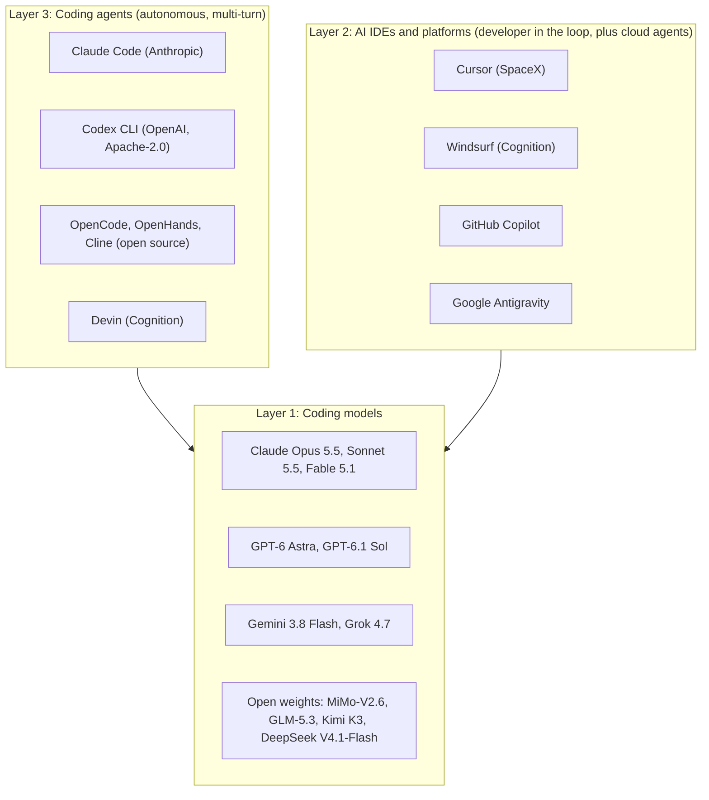

:::info 출처 · 라이선스
이 문서는 Om Bharatiya의 [AI System Design Guide](https://github.com/ombharatiya/ai-system-design-guide/blob/main/09-frameworks-and-tools/10-opencoderguide.md)(MIT License, © 2026 Om Bharatiya)를 한국어로 옮긴 **비공식 번역본**입니다. 번역·편집 책임은 SecureNomad에 있습니다. 전체 안내는 [소개 · 출처 · 라이선스](../index.md)를 참고하세요. 번역 기준: 원문 커밋 `ed955b2`(2026-10-09).
:::

:::note 번역 주
원문은 외부 자료로, 기업명·제품명·모델명·버전·라이선스명·CVE는 원문 표기를 유지합니다. 코드·명령·머메이드·ASCII 다이어그램은 원문 그대로 둡니다.
:::

# OpenCoder: AI 코딩 에이전트 지형

AI 코딩 에이전트 지형이 폭발 후 통합됐다. 2026-10까지 세 명확한 형태: 랩이나 큰 커뮤니티가 뒷받침하는 터미널 에이전트(Claude Code·Codex CLI·OpenCode·Gemini CLI), 모델도 만드는 회사가 소유한 IDE 에이전트(Cursor가 2026-08부터 SpaceX 일부; Windsurf가 2025-07부터 Cognition 일부), 벤더가 제어 플레인 돌리고 당신 인프라가 코드 돌리는 분리 아키텍처. 이 가이드가 오픈 웨이트 코딩 모델·에이전트 IDE·오픈소스 에이전트와 엔지니어링 워크플로에 맞는 도구 선택법을 다룬다.

---

## AI 코딩 지형 (2026)

코딩 AI 지형이 세 뚜렷한 계층:



계층이 흐려지는 중. IDE 벤더가 자기 모델 학습(Cursor Composer, Cognition이 Kimi K3서 포스트 트레인했다는 SWE-2), 랩 에이전트가 IDE 확장 배송, Vercel AI SDK 7의 실험적 `HarnessAgent`이 전 코딩 하네스를 플러그 가능 의존성으로 취급.

---

## 오픈 웨이트 코딩 모델

이 모델들은 API 의존 없이 자체 호스팅·파인튜닝·배포 가능. 모델 카드 전에 라이선스 읽기: 2026에 여러 "오픈" 코딩 가능 모델이 상업 게이트 수반.

### 현 오픈 웨이트 프런티어 (2026년 10월)

| 모델 | 출시 | 전체/활성 파라미터 | 라이선스 | 코딩 관련 노트 |
|-------|----------|-----------------------|---------|-----------------------|
| Xiaomi MiMo-V2.6-Pro / -Flash | 2026-09-21 | 1.02T / 42B; 309B / 15B | MIT | 1M 문맥; Artificial Analysis Intelligence Index v4.3.2 최고 오픈 모델(46) |
| Z.ai GLM-5.3 | 가중치 2026-08-28 | 744B / 40B | MIT, 플러스 12개월 매출 US$10B 넘는 MaaS 제공자 보안 검토 | AA 45; API 1M당 $1.40/$4.40; SWE-Bench Pro v2 사설 세트 211/272 |
| Moonshot Kimi K3 | 2026-07 | 2.8T / 104B 활성 | 커스텀: MaaS 비즈니스 운영하고 (계열사 포함) 12개월 총매출 US$20M 넘는 기업엔 별도 계약 | AA 44; SWE-Bench Pro v2 사설 214/272; Cognition SWE-2·Fireworks Ember-1 베이스 |
| Z.ai GLM-5.3-Flash | 2026-08-26 | 320B / 18B | MIT | AA 42; API 1M당 $0.15/$0.50 |
| DeepSeek V4.1-Flash | 2026-09-10 | 552B 백본; prefill 8B·decode 16B 활성 | MIT | AA 39; 벤더 보고 DeepSWE v1.1 74.2 max effort |
| Qwen3.8-Flash-Next | 2026-08-26 | 125B / 6B 플러스 51B n-gram 테이블 | Qwen Community License 1.0 | 어느 MaaS나 AI 코딩 어시스턴트 **비즈니스**든 Qwen 별도 라이선스 필요, 매출 플로어 없음; 순수 내부 사용은 면제 |
| Qwen3.8-27B | 2026 | 27B dense | Apache 2.0 | 단일 GPU 급; Ternary Bonsai 2 27B(가중치당 1.72비트·5.95 GB) 베이스도 |
| IBM Granite 4.2 | 2026-08-25 | 3B / 8B / 30B dense | Apache 2.0 | 128K 문맥(512K 확장 가능); 30B 벤더 보고 SWE-bench Verified 57 |
| MiMo-V2.6-Distill-Qwen-9B | 2026-09-21 | 9B | MIT | 벤더 보고 SWE-bench Verified 61.1%·SWE-bench Pro 44.6% |

**라이선스 함정**: Qwen Community License 1.0 하 Qwen3.8-Flash-Next에 코딩 에이전트 구축하는 스타트업이 첫날부터 Alibaba 허가 필요, Qwen 자체 2.4T 플래그십 라이선스(매출 US$50M 넘는 게이트)보다 엄격. Mistral Medium 3.5 Modified MIT 라이선스가 월매출 US$20M 넘으면 권리 안 부여. 모델 선택 체크리스트에 라이선스 검토를 평가 옆에 둠.

### 완성용으로 여전히 쓰이는 구 소형 모델

2024 시대 코더 모델이 에이전트 역량이 중요 않은 소박한 하드웨어의 저지연 fill-in-the-middle(FIM) 완성에 여전히 인기. 아래 HumanEval+ 수치는 Qwen2.5-Coder 기술 보고서(arXiv 2409.12186, 표 5·16) 보고대로, StarCoder2만 Hugging Face 모델 카드서. 에이전트 과제선 현 프런티어 모델에 한참 뒤처짐.

| 모델 | 파라미터 | 문맥 | HumanEval+ | 라이선스 |
|-------|------------|---------|------------|---------|
| Qwen2.5-Coder-32B-Instruct | 32B | 128K | 87.2% | Apache 2.0 |
| Qwen2.5-Coder-7B-Instruct | 7B | 128K | 84.1% | Apache 2.0 |
| Qwen2.5-Coder-1.5B-Instruct | 1.5B | 32K | 66.5% | Apache 2.0 |
| DeepSeek-Coder-V2-Lite-Instruct | 16B MoE(2.4B 활성) | 128K | 75.6% | DeepSeek model license |
| StarCoder2-15B / 7B / 3B | 15B / 7B / 3B | 16K | 37.8%(15B base; StarCoder2-15B-Instruct-v0.1은 63.4%) | BigCode OpenRAIL-M |

```python
# Self-hosted with vLLM (use vLLM >= 0.30.0: earlier releases have
# published RCE and engine-kill advisories)
from vllm import LLM

model = LLM(
    model="Qwen/Qwen2.5-Coder-32B-Instruct",
    tensor_parallel_size=2,  # 2× A100 80GB
)
response = model.generate("def fibonacci(n: int) -> list[int]:")
```

### 오픈 모델 선택 가이드

```
Low-latency completions (< 100ms) on a laptop or single GPU?
  → Qwen2.5-Coder-1.5B/7B or StarCoder2-3B (FIM-trained, mature tooling)

Agentic coding, single GPU, permissive license?
  → Qwen3.8-27B (Apache 2.0) or Granite 4.2 30B

Agentic coding on one 8-GPU node?
  → GLM-5.3-Flash or MiMo-V2.6-Flash (MIT); DeepSeek V4.1-Flash needs H200/B200-class memory

Best self-hosted quality, multi-node budget?
  → MiMo-V2.6-Pro, GLM-5.3 or Kimi K3 (check each license gate)

Building a coding-assistant product to sell?
  → Read the license first: Qwen Community License 1.0 requires a separate license
```

---

## AI 네이티브 IDE

### Cursor

**웹사이트:** cursor.com | **베이스:** VS Code 포크 | **가격:** Pro $20/월부터·Teams와 Enterprise 플랜

Cursor가 선도 AI 네이티브 IDE, 2026-08-14~15부터 **SpaceX 일부**(약 $60B SpaceX 주식 보고). Grok 4.6·4.7이 Cursor 자체 블로그서 출시. 인수 발표가 서드파티 모델 지속 접근이나 데이터 사용 약속에 침묵, 2주 후 모델 질문이 구체 답: 2026-08-28 OpenAI가 SpaceX에 Cursor에 OpenAI 모델 공급 계약 축소를 **2026-11-12** 제안 차단과 함께 통보, Cursor가 SpaceX 소유인 동안 미래 모델(GPT-6 Astra 포함) 공급 안 함. 통지가 OpenAI 모델만 커버; 나머지 지속 접근과 데이터 사용을 가정이 아니라 계약 질문으로 취급. Cursor가 2026-08-13 AIUC-1 에이전트 인증 획득.

| 기능 | 설명 |
|---------|-------------|
| **Agent** | 멀티 파일 에이전트 편집; Composer가 이제 Cursor 자체 코딩 모델 이름 |
| **Tab** | 예측 완성 |
| **Cloud agents** | Cursor 인프라나, 2026-09-02부터 **Self-hosted Machines**(자기 머신이나 AWS Lambda·Coder·Cloudflare·Daytona·Modal·Namespace·Vercel·E2B의 팀 풀)서 실행 |
| **Projects**(베타, 2026-09-10) | 코디네이터 에이전트가 작업 계획하고 병렬 서브에이전트에 위임, 최대 수천; Cursor가 새 Projects 사용자가 30% 더 많은 PR 머지 보고(벤더 보고) |
| **Rollouts와 Security Review**(2026-09-23) | 배포 시 환경별 변경 건강 추적하는 모든 PR 모니터, 익스플로잇 가능 버그 PR 스캐너(Teams·Enterprise) |
| **Rules** | `.cursor/rules`의 프로젝트 수준 AI 지시, `AGENTS.md` |
| **모델 선택** | Anthropic·Google·xAI Grok·Cursor 자체 모델; 제안 2026-11-12 차단까지 OpenAI 모델(OpenAI가 GPT-6 Astra 이후 모델 공급 안 함) |

**최적합**: 친숙한 GUI 안 에이전트 편집 원하는 프런트엔드/풀스택 개발자, 오케스트레이션 자체 실행 않고 클라우드 에이전트 원하는 팀.

**한계**: 클로즈드 소스; Privacy Mode·자체 호스팅 머신 안 쓰면 코드가 Cursor 서버로; 프런티어 모델 회사 소유가 일부 구매자에 모델 중립성·데이터 거버넌스 질문 제기.

### Windsurf (Cognition)

**웹사이트:** windsurf.com | **베이스:** VS Code 포크 | **가격:** 무료 티어 플러스 유료 플랜

Windsurf가 Codeium이 구축, 2025-07부터 Devin 제작사 **Cognition** 소유. Cognition이 $48B 밸류에 $2B 넘게 조달(2026-09-08), $1B 넘는 연간 매출 런레이트 보고(벤더 보고), Devin 안에서만 가용한 자체 플래그십 코딩 모델 SWE-2 배송.

| 기능 | 설명 |
|---------|-------------|
| **Cascade** | Windsurf 에이전트 편집 모드 |
| **Flows** | Cascade가 당신 편집·액션을 문맥으로 추적하는 공유 에이전트·개발자 세션; CrewAI Flows와 혼동 말 것 |
| **모델 선택** | 여러 벤더 프런티어 모델 플러스 Cognition 자체 |
| **무료 티어** | 개인용 무료 크레딧 |

**최적합**: 무료 티어와 모델 유연성의 Cursor 유사 경험 원하는 팀, 이미 Devin 구매하는 곳.

### GitHub Copilot (Microsoft/OpenAI)

| 기능 | 상태(2026년 10월) |
|---------|---------------------|
| 완성 | 설치 기반으로 여전히 시장 선두 |
| 코딩 에이전트 | 이슈 할당하면 PR 받음(Copilot Workspace 프리뷰가 2025 종료) |
| 코드 리뷰 승인 | Copilot 리뷰가 필수 승인에 카운트 가능(퍼블릭 프리뷰, 기본 끔, 2026-09-01); 관리자가 승인 가능 경로 선택; 새 커밋에 승인 기각 |
| 컴퓨터 사용·동적 워크플로 | Copilot CLI와 앱서 2026-10-01 퍼블릭 프리뷰; 워크플로가 인간 검토 체크포인트의 코드 정의 단계 |
| HydraFusion | 연구 프리뷰(2026-09-30): 캐스케이드(싼 모델 초안·품질 게이트 에스컬레이트)·크로스 계열 비평 모드 |
| 로컬 샌드박싱 | Copilot 앱의 프로젝트별 파일시스템·네트워크·자격증명 한계(퍼블릭 프리뷰, 2026-09-23, 기본 끔) |
| 모델 | 효율·균형·지능 티어의 자동 모델 선택; OpenAI·Anthropic·Google 모델 가용 |
| 엔터프라이즈 기능 | IP 보호·조직 정책·코드 참조 제어 |

**최적합**: 이미 Microsoft/GitHub 생태계인 엔터프라이즈 팀.

**2026 현실**: 많은 개발자가 에이전트 작업에 Cursor·Claude Code 선호하나, Copilot 엔터프라이즈 제어·GitHub 통합이 대규모 조직서 지배 유지. 두 거버넌스 노트: Copilot이 공개 시(2026-09-17) Plugin4Shell 미패치였고, 2026-10-01부터 신용카드·PayPal 고객이 할당 좌석 선불.

### Google Antigravity

Antigravity가 Google 에이전트 개발 플랫폼, 텍스트 에디터가 아니라 **에이전트 우선 작업공간**. Antigravity 2.0(2026-05-19)이 제품 패밀리로: 여러 로컬 에이전트 조율 데스크톱 앱·IDE·**Antigravity CLI**·SDK.

| 기능 | 디테일 |
|---------|--------|
| **Agent Manager** | 파일 하나씩 편집 대신 여러 비동기 코딩 에이전트 론치·감시·조종하는 전용 뷰 |
| **계획 + 아티팩트** | 에이전트가 실행 전·중 계획과 검토 가능 아티팩트(diff·태스크 목록·라이브 브라우저 세션) 생성 |
| **내장 브라우저** | 에이전트가 빌드한 UI 실행·시각 테스트 |
| **모델 선택성** | 기본 Gemini 모델, Anthropic Claude·오픈 모델 지원 |
| **엔터프라이즈** | 2026-08-20부터 적격 Gemini Enterprise Standard·Plus 구독 포함, 브라우저·MCP 권한 샌드박스와 정책 한계·예산 상한·중앙 감사 로깅·Workforce Identity Federation·VS Code·Visual Studio·JetBrains·Zed·Xcode 확장 |
| **API 에이전트** | `antigravity-preview-09-2026`이 9/17 `antigravity-preview-05-2026` 대체(5월 버전 2026-10-05 종료) 파괴적 도구 변경과: PascalCase 파라미터·전체 재작성 대신 라인 범위 편집·새 `find_by_name`과 `grep_search` 도구 |

Google이 Antigravity CLI를 Gemini CLI 후속으로 포지셔닝; 2026-06 무료·Google AI Pro·Ultra 사용자의 Gemini CLI 대체. Gemini CLI가 Gemini Code Assist Standard·Enterprise와 유료 API 키용으로 여전히 유지(v0.62.0, 2026-09-29).

**최적합**: "편집" 수준보다 "과제" 수준(목표 위임·계획과 결과 검토) 작동 원하는 개발자, IDE·CLI·SDK 걸쳐 한 라이선스 하네스 원하는 Google Cloud.

---

## 오픈소스 코딩 에이전트

### OpenCode

**GitHub:** github.com/anomalyco/opencode | **라이선스:** MIT

가장 많이 별 받은 오픈소스 코딩 에이전트(211.3K 스타, 2026-10-01; 9/30 v1.18.34; 전월 약 9.6M npm 다운로드). 로컬 모델 포함 어느 제공자와도 작동하고 MCP 지원하는 TUI 터미널 에이전트. "모델 선택의 오픈소스 Claude Code"의 기본 답.

### Codex CLI (OpenAI)

**GitHub:** github.com/openai/codex | **라이선스:** Apache-2.0

OpenAI 오픈소스 터미널 에이전트(127.5K 스타; 2026-09-30 rust-v0.159.3; 전월 약 88.8M npm 다운로드). 핵심 2026 사실:

- **기본 모델**: rust-v0.159.1(9/29)부터 GPT-6.1 Sol, Amazon Bedrock 카탈로그 포함. CLI 업그레이드가 핀 안 한 모두의 모델 스왑.
- **DevDay(9/29)**: 재사용 클라우드 환경·병렬 과제 `/agents` 뷰·GitHub PR과 GitLab MR용 Code Review·Codex Security Cloud·**Ultrafast** 티어(GPT-6 Astra 가용, Sol 예정; OpenAI가 Codex서 최대 8배 빠른 생성 보고; 글로벌 처리나 US 거주만·EU 엔드포인트 없음).
- **보안 수정**: GitSpawn 0.131.0, Plugin4Shell 0.146.0.
- **헤드리스**: CI용 `codex exec`.

### OpenHands (구 OpenDevin)

**GitHub:** github.com/OpenHands/OpenHands(`All-Hands-AI/OpenHands`서 이동) | **라이선스:** MIT

OpenHands가 이제 **Agent Canvas**(v1.24.0, 2026-09-25, 대략 주 단위 배송)로 배송: 오픈소스 OpenHands 에이전트나 Agent Client Protocol 말하는 어느 에이전트(Claude Code·Codex·Gemini)를 교체 가능 백엔드 대비 돌리는 자체 호스팅 제어 센터. Docker 소켓을 `docker.all-hands.dev/all-hands-ai/openhands`에 마운트하는 구 튜토리얼이 이전 아키텍처 기술.

```bash
# Docker sandbox option from the upstream README (pin the tag you tested)
export PROJECTS_PATH="$HOME/projects"   # only these folders are visible to the agent
mkdir -p "$PROJECTS_PATH" "$HOME/.openhands"
docker run -it --rm \
  -p 127.0.0.1:8000:8000 \
  -e AGENT_CANVAS_ALLOW_LAN_SESSION_KEY=true \
  -v "$HOME/.openhands:/home/openhands/.openhands" \
  -v "${PROJECTS_PATH}:/projects" \
  ghcr.io/openhands/agent-canvas:1.24.0
# UI at http://localhost:8000/canvas; models are configured as LLM profiles in the UI.
# Publish only on 127.0.0.1: on a LAN or public interface, drop the session-key
# injection flag and follow the upstream self-hosting hardening guide.
```

**아키텍처:**
```
Agent Canvas (web UI, automations: schedules, webhooks, Slack, GitHub, Linear)
    ↓
Agent Server (OpenHands SDK)
    ├── OpenHands agent, or an ACP agent (Claude Code, Codex, Gemini)
    └── Backend: local process, Docker (one container per conversation),
        a VM, or OpenHands Cloud / Enterprise
```

**핵심 기능:**
- **어느 LLM이나**: LLM 프로파일이 OpenAI 호환 엔드포인트 통해 Claude·GPT·Gemini·오픈 웨이트 모델 커버
- **교체 가능 실행 백엔드**: 같은 UI가 랩톱·대화별 Docker 컨테이너·공유 팀 서버의 에이전트 구동
- **자동화**: 스케줄·웹훅 트리거 에이전트 실행, CI 통합 스토리
- **하네스 중립**: ACP 통해 Claude Code·Codex 구동 가능하니 에이전트뿐 아니라 오케스트레이션 계층으로 경쟁

### Aider (레거시)

**GitHub:** github.com/Aider-AI/aider | **라이선스:** Apache 2.0

Aider가 터미널 우선·git 네이티브 코딩 에이전트 개척: 진행하며 변경 커밋, 문맥 밖 파일의 저장소 맵 유지, 아키텍트 모드를 편집 모델서 분리. **조용해짐**: 마지막 PyPI 릴리스가 0.86.2(2026-02-12), 마지막 커밋이 2026-05-22. 비유지 하네스가 최신 모델 API 제약(예: 최근 Claude·GPT-6 모델이 커스텀 샘플링 파라미터 거부) 못 배우거나 보안 수정 안 배송, 그래서 새 작업엔 OpenCode나 Codex CLI 선호.

```bash
# 2025-era usage, shown for its git-native workflow; claude-3-7-sonnet-20250219
# was retired Feb 19, 2026, and current Claude models may reject the sampling
# parameters Aider sends
pip install aider-chat
aider --model claude-3-7-sonnet-20250219
/add src/auth.py src/models.py
> Add JWT authentication to the User model
```

### Cline (VS Code 확장)

**GitHub:** github.com/cline/cline | **라이선스:** Apache 2.0

자율 코딩용 오픈소스 VS Code 확장, 이제 v4.1.22, 다른 곳 임베드용 SDK와:

```
VS Code
  └── Cline Extension
        ├── Any model (Claude, GPT, Gemini, Ollama)
        ├── File system access (read/write any file)
        ├── Terminal (bash commands)
        ├── Browser (playwright)
        └── MCP servers (any MCP tool)
```

**핵심 차별점:**
- **MCP 네이티브**: 기본 완전 MCP 지원
- **액션별 권한**: 셸 명령·파일 편집이 기본 승인 요청, 구성 가능 자동 승인
- **모델 유연성**: 어느 OpenAI 호환 API 엔드포인트나(로컬 Ollama 포함) 지원
- **무료**: 오픈소스·구독 없음(모델 API는 지불)

**최적합**: 완전 모델 유연성의 무료 Cursor 유사 경험 원하는 개발자.

---

## 벤치마크 심층 분석

### 현 코딩 벤치마크

SWE-bench Verified가 프런티어 에이전트 분리 멈춤: 점수가 천장 근처 몰리고, 2026-09 감사(arXiv 2609.34262)가 SWE-Bench Pro v1.0 통과 실행의 24%(Opus 4.7)-73%(Fable 5)가 대부분 git 히스토리 참조 솔루션 접근으로 미획득 발견. 동반 연구(arXiv 2609.27891)가 SWE-bench 저장소를 동작 보존 방식 재작성 시 성능 하락 발견, 암기 저장소 단서 신호. 인용할 현 수치, 항상 effort 수준·실행자와:

| 벤치마크 | 결과 | 실행자 | 왜 중요 |
|-----------|---------|--------|----------------|
| SWE-Bench Pro v2, 사설 세트(272 과제) | Claude Opus 5 222(81.6%)·Kimi K3 214(78.7%)·GLM-5.3 211·Gemini 3.8 Flash 211·Inkling 184 | Scale, 2026-09-22; 네트워크 잠금 샌드박스·깨끗한 재채점 | 깨끗한 측정; 오픈 웨이트 Kimi K3·GLM-5.3이 Opus 5서 약 3-4점 내. 공개 642 과제 분할 포화(Opus 5 99.4%) |
| Terminal-Bench 4.0 | GPT-6 Astra 58.18%(max)·Claude Fable 5.1 57.88%(max/xhigh)·Claude Opus 5 53.94%(xhigh) | tbench.ai 리더보드, 9/21 | 그 스냅샷 후 출시, 벤더 보고만: Opus 5.5 66.4%(xhigh)·Sonnet 5.5 70.6%(Anthropic) |
| DeepSWE v1.1(113 위탁 과제) | 74% 3자 동점: GPT-6 Astra(xhigh, $4.43/과제)·Gemini 3.8 Flash(high, $2.36/과제)·Opus 5(max, $11.84/과제) | DeepSWE 리더보드, 9/22 | 같은 통과율, 과제당 비용 5배 차 |

:::note
점수가 백엔드 모델·effort 수준·하네스에 매우 민감. 같은 모델이 Claude Code·Codex·OpenHands·최소 하네스 간 몇 점 움직일 수 있음, 그래서 SWE-Bench Pro v2 규율로 자기 저장소서 에이전트 평가: 모델 엔드포인트 외 네트워크 없음, 모든 diff를 깨끗한 이미지서 재채점.
:::

### 역사: HumanEval+와 LiveCodeBench (2025 스냅샷)

둘 다 프런티어 신호로 은퇴: HumanEval 포화, Artificial Analysis가 이제 LiveCodeBench를 레거시 평가로 나열. 표는 2025 최첨단 기록으로 유지. GPT-4o·Qwen·DeepSeek HumanEval+ 행은 Qwen2.5-Coder 기술 보고서서; StarCoder2-15B는 베이스 모델, 모델 카드서.

| 모델 | HumanEval+ 점수 |
|-------|-----------------|
| Claude 3.7 Sonnet | 93.6% |
| GPT-4o (2024-08-06) | 86.0% |
| Qwen2.5-Coder-32B-Instruct | 87.2% |
| DeepSeek-Coder-V2-Instruct | 82.3% |
| StarCoder2-15B | 37.8% |

| 모델 | LiveCodeBench 점수 |
|-------|---------------------|
| o3 (high) | 68.1% |
| Claude 3.7 Sonnet | 54.2% |
| GPT-4.5 | 38.7% |
| Qwen2.5-Coder-32B | 43.2% |
| DeepSeek-R1 | 57.0% |

---

## 비용 비교

### 클로즈드 API vs. 오픈 자체 호스팅

**시나리오: 하루 1,000 에이전트 버그 수정 과제.** 과제당: 약 15 모델 호출·750K 입력 토큰(대부분 재전송 문맥, 90% 캐시 제공, 미캐시 10%를 캐시 쓰기 요율 있는 곳 청구)·2.5K 출력 토큰. 정가 기반 예시 추정이지 측정 아님; 품질은 Artificial Analysis Intelligence Index v4.3.2.

| 접근 | 과제당 비용 | 월(30일) | AA Index | 노트 |
|----------|---------------|-------------------|----------|-------|
| Claude Sonnet 5.5 (API) | ~$0.35 | ~$10,500 | 56 | 캐시 읽기 1M당 $0.20 |
| Claude Opus 5.5 (API) | ~$0.56 | ~$16,800 | 58 | 같은 $0.20 캐시 읽기, 그래서 여기 Sonnet의 ~1.6배만 |
| GPT-6.1 Sol (API) | ~$0.28 | ~$8,400 | 52 | 캐시 읽기 1M당 $0.10(0.05배) |
| GPT-6 Astra (API) | ~$1.74 | ~$52,000 | 53 | 캐시 읽기 1M당 $1; 가장 어려운 과제에 예약 |
| DeepSeek V4.1-Flash (API, 피크 정가, 캐시 할인 미가정) | ~$0.23 | ~$6,900 | 39 | 오프피크 시간 반값; 제공자 캐시 적중률 확인 |
| 자체 호스팅 GLM-5.3-Flash (8×H100 노드 하나, 24/7) | 활용도 의존 | ~$16,000 인프라 | 42 | $2.77/GPU시(Silicon Data H100 인덱스, 2026-10-01), 엔지니어링·온콜 시간 전 |

**핵심 통찰**:
- 에이전트 코딩엔 **입력 지배**(Anthropic 텔레메트리가 Claude Code를 324:1 입력 대 출력으로), 그래서 캐시 읽기 가격·적중률이 헤드라인 입력가보다 청구 더 움직임.
- 자체 호스팅은 지속 고활용서만 이기고, 비교가 이제 2025 정가가 아니라 싸고 캐시 친화 API 대비. 자체 호스팅의 강한 이유는 데이터 제어·내부 코드 파인튜닝·벤더 모델 스왑 독립.
- 구축 전 라이선스 확인: Qwen3.8-Flash-Next가 별도 라이선스 없이 상업 코딩 어시스턴트 못 받침.

---

## 선택 가이드

### 빠른 결정 트리

```
What is your primary need?

├─ IDE coding assistance (completions + chat + agent)?
│  ├─ Microsoft ecosystem / enterprise? → GitHub Copilot
│  ├─ Want best quality and cloud agents? → Cursor
│  └─ Want free + model choice? → Windsurf or Cline
│
├─ Autonomous agent for standalone coding tasks?
│  ├─ Best quality, Claude models acceptable? → Claude Code
│  ├─ OpenAI shop, or want an open-source CLI from a lab? → Codex CLI
│  ├─ Need open source with any model? → OpenCode (terminal) or OpenHands (web UI)
│  └─ VS Code embedded, MCP-native? → Cline
│
├─ Self-hosted model for custom deployment?
│  ├─ Best quality? → MiMo-V2.6-Pro, GLM-5.3 or Kimi K3 (check licenses)
│  ├─ One node? → GLM-5.3-Flash or MiMo-V2.6-Flash
│  ├─ Single GPU, Apache 2.0? → Qwen3.8-27B or Granite 4.2 30B
│  └─ Fast completions / edge? → Qwen2.5-Coder-1.5B/7B or StarCoder2-3B
│
└─ CI/CD pipeline integration?
   ├─ Best results? → Claude Agent SDK or `claude -p` (headless), `codex exec`
   ├─ Open-source? → OpenHands automations (webhook-triggered) or OpenCode
   └─ Managed loop? → OpenAI Agents API or Claude Managed Agents (check residency and ZDR)
```

### 비교 매트릭스

| 차원 | Claude Code | Codex CLI | Cursor | OpenCode | OpenHands | Cline |
|-----------|-------------|-----------|--------|----------|-----------|-------|
| 자율성 | 완전 | 완전 | 완전(에이전트) | 완전 | 완전 | 완전 |
| 모델 잠금 | Claude | 기본 OpenAI | 어느 것이나 | 어느 것이나 | 어느 것이나 | 어느 것이나 |
| 오픈소스 | 아니오 | 예 | 아니오 | 예 | 예 | 예 |
| CI/헤드리스 | 예 | 예 | 클라우드 에이전트 | 예 | 예 | 예(SDK) |
| GUI | CLI·IDE·데스크톱 | CLI·IDE·클라우드 | 전체 IDE | 터미널 | 웹 UI | VS Code |
| MCP | 예 | 예 | 예 | 예 | 예 | 예 |
| 자체 호스팅 실행 | 예(자체 호스팅 러너) | 예 | 예(Self-hosted Machines) | 예 | 예 | 예 |
| 가격 | 구독·API | 구독·API | $20/월부터 | 무료+API | 무료+API | 무료+API |

---

## 프로덕션 아키텍처

### 엔터프라이즈 코딩 에이전트 플랫폼

내부 AI 코딩 플랫폼 구축법. 2026 형태가 **분리 플레인**: 에이전트 벤더(나 자기 오케스트레이터)가 계획·모델 호출 돌리고, 실행·자격증명·네트워크 egress가 당신 경계 안 유지. Claude Code 자체 호스팅 러너·Cursor Self-hosted Machines·OpenAI Agents API 자체 호스팅 샌드박스·Copilot 로컬 샌드박싱이 모두 2026-08~09 배송.

```
┌────────────────────────────────────────────────────────────┐
│             ENTERPRISE CODING AGENT PLATFORM               │
├────────────────────────────────────────────────────────────┤
│                                                            │
│  Developer                                                 │
│     ↓ (Jira ticket / PR description)                       │
│  ┌──────────────────────────────────┐                      │
│  │        TASK INTAKE LAYER         │                      │
│  │  • Parse task from Jira/GitHub   │                      │
│  │  • Classify: simple/complex      │                      │
│  │  • Route to model tier + budget  │                      │
│  └──────────────┬───────────────────┘                      │
│                 │                                          │
│    Simple fix   │   Complex feature                        │
│        ↓        │        ↓                                 │
│  ┌──────────┐   │  ┌──────────────────┐                    │
│  │ Mid-tier │   │  │ Frontier model,  │                    │
│  │  model   │   └→ │ same harness     │                    │
│  └────┬─────┘      └────────┬─────────┘                    │
│       │                     │                              │
│       └──────────┬──────────┘                              │
│                  ↓                                         │
│  ┌──────────────────────────────────┐                      │
│  │   EXECUTION PLANE (your infra)   │                      │
│  │  • Container/microVM per task    │                      │
│  │  • Egress allowlist, no prod keys│                      │
│  └──────────────┬───────────────────┘                      │
│                 ↓                                          │
│  ┌──────────────────────────────────┐                      │
│  │         REVIEW LAYER             │                      │
│  │  • Git diff → PR creation        │                      │
│  │  • Auto-run CI tests             │                      │
│  │  • Human review (required)       │                      │
│  └──────────────────────────────────┘                      │
│                 ↓                                          │
│         Merge to main (human approved)                     │
│                                                            │
└────────────────────────────────────────────────────────────┘
```

### 핵심 프로덕션 결정

| 결정 | 옵션 | 권장 |
|----------|---------|----------------|
| 에이전트 모델 | Claude Opus 5.5/Sonnet 5.5·GPT-6.1 Sol·GPT-6 Astra·오픈 웨이트(GLM-5.3·Kimi K3·MiMo-V2.6) | 과제 클래스별 모델 핀(예: 기본 Sonnet 5.5나 GPT-6.1 Sol·어려운 과제엔 프런티어)하고 모든 릴리스에 평가 세트 재실행 |
| 과제 인테이크 | 수동·Jira 웹훅·GitHub 레이블 | GitHub 레이블이 Actions 워크플로 트리거 |
| 코드 실행 | 로컬·Docker·microVM·자체 호스팅 러너 | egress 허용목록의 당신 경계 안 컨테이너·microVM |
| 인간 검토 | PR·Slack 승인·자동 | 필수 인간 PR 검토·자동 머지 안 함; 에이전트 승인이 필수 리뷰에 안 카운트 |
| 비용 제어 | 최대 턴·예산·모델 라우팅·캐싱 | 과제별 턴·지출 예산·캐시 적중률 경보·단순 과제엔 싼 모델 |
| 버전 정책 | 플로트·핀·플로어 핀 | 보안 플로어의 에이전트 CLI 버전 핀(GitSpawn·Plugin4Shell 수정에 Claude Code >= 2.1.196·Codex >= 0.146.0) |

---

## 면접 질문

### Q: Claude Code·Cursor·OpenHands 중 어떻게 선택하나?

**좋은 답변:**
세 축에 달림:

1. **인터페이스 필요**: 개발자가 GUI(문맥서 변경 봄) 원하면 Cursor나 Windsurf. 과제가 스크립트/헤드리스(버그 수정·CI 테스트 생성)면 Claude Code·Codex CLI·OpenHands.

2. **모델 제어**: 어느 모델(나 자기 파인튜닝 모델)이나 써야 하면 OpenCode나 OpenHands. Claude만 괜찮고 최고급 결과 원하면 Claude Code; Codex CLI가 OpenAI의 동등.

3. **오픈소스·벤더 요구**: 엔터프라이즈 보안 팀이 흔히 감사 가능 오픈소스 도구 요구. OpenCode(MIT)·OpenHands(MIT)·Codex CLI(Apache-2.0)가 답. 소유권도 이제 검토 일부: Cursor가 SpaceX, Windsurf가 Cognition 일부, 둘 다 자기 모델 구축. 그 위험이 더 이상 가설 아님: OpenAI가 SpaceX 딜 후 Cursor 모델 공급 축소(제안 차단 2026-11-12). 서드파티 모델 접근·데이터 사용 계약 약속 요구하고, 배치·CI 작업 모델 라우팅을 우리 제어 계층에 유지.

전형 스타트업엔 권장: 일상 개발엔 Cursor, 배치 과제(GitHub 이슈서 PR)엔 Claude Code나 Codex, 자체 호스팅 CI 파이프라인엔 OpenHands나 OpenCode.

### Q: 오픈 웨이트 코딩 모델이 엔터프라이즈에 왜 중요?

**좋은 답변:**
세 이유:

1. **데이터 제어**: 엔터프라이즈 API가 무학습 조건·제로 데이터 보존 제공하나, 일부 헬스케어(HIPAA)·금융(SOX)·정부 팀이 여전히 독점 코드를 네트워크 밖 못 보냄. 온프렘 오픈 웨이트 모델이 해결.

2. **커스터마이제이션**: 오픈 웨이트가 내부 DSL·코드베이스에 도메인 특화 가능. OpenAI가 셀프서브 파인튜닝 축소(활성 고객이 2027-01-06 새 작업 상실)하는 지금 그 경로가 더 중요; LangSmith Fine-Tuning 같은 트레이스-파인튜닝 파이프라인이 Fireworks·Baseten의 오픈 웨이트 모델 타깃.

3. **독립**: 남의 릴리스 일정의 조용한 모델 스왑 없음, 플랫폼별 은퇴 달력 없음.

품질 격차가 날카롭게 좁아짐: Scale 깨끗한 SWE-Bench Pro v2 사설 세트서 Kimi K3(78.7%)·GLM-5.3(77.6%)이 Claude Opus 5(81.6%)서 약 3-4점 내. 비용 논거가 전보다 약함, 캐시 무거운 에이전트 워크로드가 API서 싸니, 라이선스 읽어야: Qwen3.8-Flash-Next가 별도 라이선스 없이 상업 코딩 어시스턴트 못 받침.

### Q: CI의 AI 코딩 에이전트 테스트 전략을 어떻게 설계하나?

**좋은 답변:**
3티어 평가:

**1. 기능 테스트**(자동, 매 실행):
```
Agent output → Run pytest → Pass rate metric
```

**2. 그라운드 트루스 비교**(주간):
```
Known bug → Agent fix → Compare to expert fix
Metric: Semantic similarity of diff (not byte-exact)
```

**3. 인간 평가**(에이전트 PR 5% 샘플):
```
Senior engineer rates: Correctness, Style, Safety, 1-5 scale
```

**회귀율**도 추적: 에이전트 수정이 새 실패 테스트 도입하면 하드 실패. 에이전트가 전 테스트 스위트 돌리고 통과율 개선·유지할 때만 성공해야. 그리고 SWE-Bench Pro v2처럼 하네스 하드닝: 샌드박스가 모델 엔드포인트만 도달, 수정 담은 git 히스토리 벗김, 모든 diff를 깨끗한 이미지서 재채점, 답 찾을 수 있는 에이전트가 찾으니.

### Q: GitHub이 이제 Copilot 코드 리뷰 승인을 필수 리뷰에 카운트 허용. 켜겠나?

**좋은 답변:**
좁게만. 기능(2026-09-01부터 퍼블릭 프리뷰, 기본 끔)이 관리자가 Copilot 승인 가능 경로 선택하게 하고, 승인이 인간처럼 새 커밋에 기각. 실제 검토 노역 제거하는 저위험 경로(문서·생성 클라이언트·테스트 전용 변경)엔 허용하고, 인프라·인증·결제·CI 설정·에이전트 지시 파일 자체는 제외. 하드 룰이 직무 분리: 에이전트 작성 PR이 에이전트 혼자 승인 안 돼야, 버그 낸 같은 맹점이 승인하는 경향이니. 모든 에이전트 승인을 감사 위해 로그하고 인간 재검토 샘플, 승인 경로의 머지 후 사건 증가를 범위 좁힐 신호로 취급.

---

## 참고 문헌

- Scale. SWE-Bench Pro v2 (Sep 2026): https://scale.com/leaderboard
- Terminal-Bench leaderboard: https://www.tbench.ai/
- arXiv 2609.34262. "Maintaining Benchmarks Against Increasingly Capable Agents: Detection and Remediation of Unearned Passes" (Sep 2026): https://arxiv.org/abs/2609.34262
- OpenCode: https://github.com/anomalyco/opencode
- Codex CLI: https://github.com/openai/codex
- Gemini CLI: https://github.com/google-gemini/gemini-cli
- Google. "Introducing Google Antigravity CLI": https://antigravity.google/blog/introducing-google-antigravity-cli
- Cursor. "Joining SpaceX" (Aug 2026): https://cursor.com/blog/joining-spacex
- OpenAI. "Our decision on Cursor following its acquisition by SpaceX" (Aug 28, 2026): https://openai.com/index/our-decision-on-cursor-following-its-acquisition-by-spacex/
- GitHub. "Copilot code review can now approve pull requests" (Sep 1, 2026): https://github.blog/changelog/2026-09-01-copilot-code-review-can-now-approve-pull-requests/
- Cognition blog: https://cognition.com/blog
- Qwen2.5-Coder: https://qwenlm.github.io/blog/qwen2.5-coder/
- DeepSeek-Coder-V2: https://github.com/deepseek-ai/DeepSeek-Coder-V2
- StarCoder2: https://huggingface.co/blog/starcoder2
- OpenHands: https://github.com/OpenHands/OpenHands
- Aider: https://aider.chat/
- Cline: https://github.com/cline/cline
- Cursor: https://cursor.com/
- Windsurf: https://windsurf.com/
- Google Antigravity: https://developers.googleblog.com/build-with-google-antigravity-our-new-agentic-development-platform/
- LiveCodeBench: https://livecodebench.github.io/

---

*이전: [Claude Code](09-claude-code.md) | 다음: [프레임워크 선택 가이드](08-framework-selection-guide.md)*
