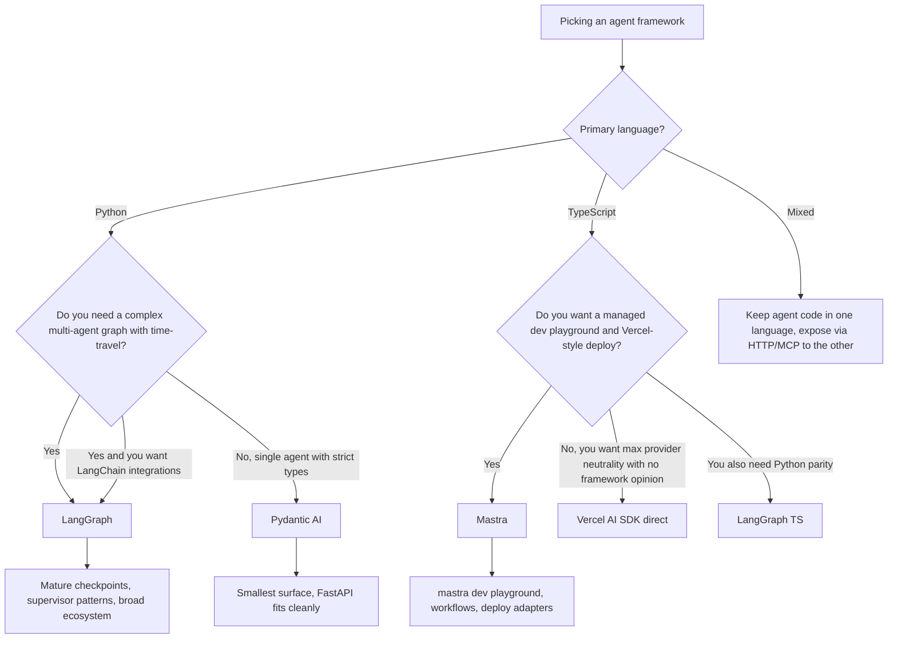

:::info 출처 · 라이선스
이 문서는 Om Bharatiya의 [AI System Design Guide](https://github.com/ombharatiya/ai-system-design-guide/blob/main/09-frameworks-and-tools/11-pydantic-ai-and-mastra.md)(MIT License, © 2026 Om Bharatiya)를 한국어로 옮긴 **비공식 번역본**입니다. 번역·편집 책임은 SecureNomad에 있습니다. 전체 안내는 [소개 · 출처 · 라이선스](../index.md)를 참고하세요. 번역 기준: 원문 커밋 `ed955b2`(2026-10-09).
:::

:::note 번역 주
원문은 외부 자료로, 기업명·제품명·버전·라이선스명은 원문 표기를 유지합니다. 코드·머메이드 다이어그램은 원문 그대로 둡니다.
:::

# Pydantic AI와 Mastra: 타입 에이전트 프레임워크 (2026)

에이전트 프레임워크 논쟁이 "LangGraph냐 LlamaIndex냐"이길 멈췄다. 두 신규 진입자가 이제 폭보다 타입 안전을 우선하는 팀에 의미 있는 프로덕션 점유를 소유: Python 세계의 **Pydantic AI**(2026-10-01까지 한 달 약 5.3M PyPI 다운로드)와 TypeScript 세계의 **Mastra**(`@mastra/core`가 2026-08-31부터 9-29 약 6.9M npm 다운로드). 둘 다 구 프레임워크가 수용한 "문자열 입력, 문자열 출력" 표면을 거부하고, 완전 타입 에이전트가 영리하나 미타입인 것보다 테스트·평가·운영이 쉽다 베팅.

---

## 이 프레임워크들은 무엇인가

Pydantic AI·Mastra 둘 다 프레임워크 락인과 미타입 프롬프트 스티칭 좌절서 자람. 같은 아이디어 세트에 집중:

- 에이전트 루프가 YAML/JSON 그래프가 아니라 **코드로 정의**.
- 도구 호출·구조화 출력·human-in-the-loop 체크포인트가 모두 **함수 시그니처서 타입**.
- 제공자 이식성이 하드 요구: 한 줄 바꿔 Anthropic을 OpenAI로, Google로 스왑.
- 평가·트레이싱·배포가 볼트온이 아니라 일급.

차이가 대부분 스택 모양: 하나는 이미 HTTP 검증에 Pydantic 쓰는 Python 서비스 타깃; 다른 하나는 Vercel 스타일 개발자 경험 원하는 Next.js/Node 팀 타깃.

---

## Pydantic AI: Python의 타입 에이전트

### 현황

[Pydantic AI](https://ai.pydantic.dev/)가 2025-09 v1.0 배송하고 일곱 베타 후 **2026-06-23 v2.0.0 안정**(v2 베타가 v1.100.0서 포크); **2026-09-30 2.52.0** 도달, 1.x 패치 릴리스 계속(같은 날 1.107.7)([PyPI release history](https://pypi.org/project/pydantic-ai/#history)). Pydantic 자체 배후 팀이 구축, [Pydantic Logfire](https://pydantic.dev/logfire)도 운영. MIT 오픈소스.

V2는 **하네스 우선**: *capability*가 도구·수명주기 훅·지시·모델 설정 번들하는 조합 가능 단위, 일급 Pydantic AI Harness 라이브러리가 저장·재개의 `StepPersistence` 포함 더 많이 공급. 1.x서 업그레이드 시 확인할 파괴·동작 변경:

- `openai:` 모델 문자열이 이제 **Responses API** 사용; Chat Completions 유지엔 `openai-chat:`.
- `end_strategy` 기본값이 `'graceful'`, bare install이 적은 제공자 extras 배송.
- `builtin_tools`가 `native_tools`로 개명, `grok:` 프리픽스가 `xai:`로.
- Outlines 통합·FastMCP 백컴팻 shim 제거, `vertexai` extra 사라짐(Vertex AI가 `google` extra 통해), A2A 지원이 `fasta2a` 패키지로 상류 이동.
- 기본 계측이 v5, `gen_ai.aggregated_usage` 속성, 그래서 구 속성명 기반 대시보드 갱신 필요.

핵심 표면:

- 출력 타입과 타입 도구 목록으로 파라미터화된 `Agent` 클래스.
- Anthropic·OpenAI·Google·xAI·Mistral·Groq·Cohere·Ollama·어느 OpenAI 호환 엔드포인트 제공자 어댑터.
- Logfire나 어느 OTLP 컬렉터로 export하는 네이티브 OpenTelemetry 트레이싱.
- LLM 심판·코드 채점 스코어러의 선언적 평가 스위트용 `pydantic_evals`.
- 단순 `Agent` 루프가 불충분할 때 명시 상태 머신용 `Graph` API.

### 팀이 고르는 이유

```python
from dataclasses import dataclass
from pydantic import BaseModel, Field
from pydantic_ai import Agent, RunContext

class RefundDecision(BaseModel):
    approved: bool
    amount_cents: int = Field(ge=0)
    reason: str

@dataclass
class Deps:
    orders: OrdersRepo  # your data-access layer

agent = Agent(
    "anthropic:claude-sonnet-5-5",
    deps_type=Deps,
    output_type=RefundDecision,
    instructions="You are a refund analyst. Approve only if policy allows.",
)

@agent.tool
async def lookup_order(ctx: RunContext[Deps], order_id: str) -> dict:
    """Look up an order by id."""
    return await ctx.deps.orders.get(order_id)

result = await agent.run("Refund order 1234", deps=Deps(orders=db))
assert isinstance(result.output, RefundDecision)
```

세 속성이 프로덕션에 매력적:

1. **반환 타입이 강제.** `result.output`이 `RefundDecision`이거나 호출 실패. 조용한 문자열 드리프트 없음.
2. **도구가 dict가 아니라 함수.** 등록 시 Python 시그니처·독스트링서 스키마 생성, 그래서 LLM 대면 스키마를 구현서 우연히 드리프트 불가.
3. **의존성 주입이 명시.** `ctx.deps`가 타입 컨테이너, 목으로 에이전트 유닛 테스트가 사소.

[Pydantic AI evals docs](https://ai.pydantic.dev/evals/)가 프로덕션 스키마에 쓴 같은 Pydantic 모델을 LLM 출력 타입과 평가 스코어러 `expected_output` 둘 다에 쓰는 전형 루프 기술.

**최신 모델의 구조화 출력**: Claude Fable 5.1·Opus 5.5·Sonnet 5.5가 강제 도구 선택 거부, GPT-6 Astra가 도구에 Responses API 필요. 강제 도구 호출 기반 어느 프레임워크 출력 모드나 적응해야, 그래서 모델 업그레이드 후 당신 버전이 쓰는 출력 모드 확인. Pydantic AI 2.52.0이 그 Claude 모델들을 `supports_forced_tool_choice=False`로 표시: 출력 도구에 추론하는 강제(위 샘플처럼)가 `auto`로 폴백, 명시 `tool_choice='required'`가 `UserError` 발생. Pydantic AI `NativeOutput` 마커가 도구 호출 대신 제공자 네이티브 JSON 스키마 출력 요청.

### Pydantic AI가 올바른 선택일 때

- 서비스가 **Python**이고 이미 HTTP 검증에 Pydantic 사용(FastAPI가 정준 사례).
- 종단 **엄격 스키마** 원함: HTTP 경계·LLM 도구 호출·LLM 출력·데이터베이스 행.
- 자기 어댑터 계층 작성 없이 **제공자 이식성** 원함.
- 에이전트 루프를 그래프 정의가 아니라 명령형 Python으로 작성 기쁨.

### 아닐 때

- supervisor 패턴의 멀티 에이전트 조율에 **선언적 그래프** 원함. `Graph` API 있으나 LangGraph보다 기본적.(장기 단일 에이전트엔 v2 `StepPersistence`가 격차 좁힘)
- 어느 노드서나 분기 의미의 **타임 트래블 디버깅** 원함.
- LangChain 통합 생태계(벡터 스토어·문서 로더 등) 폭 필요.

---

## Mastra: TypeScript 우선 에이전트

### 현황

[Mastra](https://mastra.ai/)가 Gatsby 배후 팀이 설립(YC W25 졸업), 2025-10-08 Y Combinator·Paul Graham·Gradient과 120+ 투자자서 **$13M 시드** 발표([Mastra announcement](https://mastra.ai/blog/seed-round)), **2026-01-20 v1.0 배송**. `@mastra/core`가 **2026-10-01 1.74.0** 도달, 약 **28.5K GitHub 스타**·2026-08-31부터 9-29 약 **6.9M npm 다운로드**([mastra-ai/mastra](https://github.com/mastra-ai/mastra)).

**라이선스**: Mastra가 2025-07-09 Elastic License v2서 **Apache 2.0**으로 이동. `ee/` 디렉터리 밖 모든 게 Apache 2.0; `ee/` 디렉터리 코드가 소스 가용 Mastra Enterprise Edition License. 상업 제품에 Mastra 임베드 전 어느 패키지 import하는지 확인.

핵심 표면:

- 모두 전 추론의 TypeScript로 정의된 `Agent`·`Workflow`·`Tool` 프리미티브.
- 플레이그라운드 UI·평가 러너·트레이스 뷰어의 내장 **로컬 개발 서버**(`mastra dev`).
- 스트리밍·다단계 도구 호출·제공자 전환용 Vercel **AI SDK** 긴밀 통합.
- `libsql`/`pgvector` 어댑터의 기본 제공 메모리·RAG.
- **Mastra Cloud**·Vercel·Cloudflare Workers·Node 서버로 원커맨드 배포.

### 팀이 고르는 이유

```typescript
import { Agent } from "@mastra/core/agent";
import { createTool } from "@mastra/core/tools";
import { anthropic } from "@ai-sdk/anthropic";
import { z } from "zod";

const lookupOrder = createTool({
  id: "lookup-order",
  description: "Look up an order by id",
  inputSchema: z.object({ orderId: z.string() }),
  outputSchema: z.object({ status: z.string(), totalCents: z.number() }),
  execute: async ({ orderId }) => ordersDb.get(orderId),
});

export const refundAgent = new Agent({
  name: "refund-agent",
  model: anthropic("claude-sonnet-5-5"),
  instructions: "You are a refund analyst. Approve only if policy allows.",
  tools: { lookupOrder },
});
```

세 속성이 매력적:

1. **종단 추론 타입.** Zod 스키마가 도구 런타임 검증·LLM 대면 JSON Schema·`execute`가 받는 입력의 TypeScript 타입 구동. 단일 진실 소스.(Mastra 1.x가 검증 입력을 첫 인자로 전달; 0.x 튜토리얼이 대신 `{ context }` 구조분해, 흔한 복붙 깨짐)
2. **`mastra dev`가 킬러 기능.** 프런트엔드 작성 없이 어느 에이전트나 호출·어느 트레이스나 리플레이·어느 평가나 실행·어느 도구 입출력이나 검사하는 로컬 UI 부팅.
3. **일급 워크플로.** `createWorkflow`가 스텝(각 Mastra 도구나 에이전트) 타입 그래프 정의, 분기·suspend/resume·human-in-the-loop 모두 타입 검사.

[Generative.inc Mastra guide](https://generative.inc/blog/mastra-typescript-agent-framework)가 스택 나머지가 이미 TypeScript일 때 팀이 Python 오케스트레이션을 Mastra로 완전 교체하는 법 설명.

### Mastra가 올바른 선택일 때

- 팀이 **TypeScript 우선**이고 앱 나머지가 Next.js/Node/Bun/Cloudflare Workers.
- **Vercel 스타일 DX** 원함: 단일 CLI·로컬 플레이그라운드·의견적 배포.
- 스트리밍 UI가 중요하고 AI SDK `useChat`·`streamText` 프리미티브에 기대고 싶음.
- 인간 승인 스텝이 기본 연결된 **suspend/resume 워크플로** 원함.

### 아닐 때

- **큰 사전 구축 에이전트 라이브러리**나 커뮤니티 통합 필요. 생태계가 LangChain보다 작음.
- 팀과 대부분 AI 툴링이 **Python**. HTTP 계층 걸쳐 TS를 Python 서비스에 브릿지는 괜찮으나 지연 추가.
- **학술 스타일** 커스텀 추론 동작(커스텀 디코딩 등) 필요. Python에 머물기.

---

## LangGraph와 비교

| 차원 | Pydantic AI 2.x | Mastra 1.x | LangGraph 1.x |
|-----------|-------------------|---------------------|----------------|
| 언어 | Python | TypeScript | Python·TypeScript |
| 라이선스 | MIT | Apache 2.0(`ee/` 디렉터리 소스 가용) | MIT |
| 주 단위 | capabilities로 구성된 `output_type`의 타입 `Agent` | 타입 `Agent`·`Workflow` | 타입 상태 위 노드 그래프 |
| 스키마 소스 | Pydantic v2 | Zod | JSON Schema(Pydantic·Zod·Valibot·ArkType) |
| 제공자 중립 | 내장 어댑터 | Vercel AI SDK 통해 | LangChain 파트너 패키지 통해 |
| 멀티 에이전트 | 수동이나 `Graph` API | `Workflow` + 도구로서 에이전트 | `create_supervisor`·swarm·커스텀 그래프 |
| 상태 지속 | `pydantic_graph` 체크포인트; Harness `StepPersistence`(v2) | 워크플로 스냅샷 + 스토리지 어댑터 | 일급 체크포인트 스토어(Postgres·Redis·SQLite·인메모리) |
| 타임 트래블 디버깅 | 아니오 | 로컬 플레이그라운드 리플레이 | 예, 어느 체크포인트서나 분기 |
| 평가 프레임워크 | `pydantic_evals` | Mastra evals(내장) | LangSmith나 외부 |
| 트레이싱 | OTLP/Logfire | OTLP/Mastra Cloud | LangSmith나 OTLP |
| 결합 | LangChain에 없음 | LangChain에 없음 | LangChain 생태계에 긴밀 |
| 생태계 크기 | 작으나 성장 | 작으나 성장 | 큼(LangChain 통합) |



---

## 프레임워크 선택

세 결정 동인, 무게 순:

1. **기존 서비스 언어.** Python 서비스엔 Pydantic AI·LangGraph(Python). TypeScript 서비스엔 Mastra·LangGraph TS. 경계 넘기가 거의 항상 올바른 쪽 고르기보다 나쁜 거래.
2. **복잡성 모양.** 에이전트가 본질상 "LLM + 몇 도구 + 엄격 출력 타입"이면 Pydantic AI나 Mastra가 충분하고 운영 더 쌈. 분기·재시도·승인의 여러 협력 에이전트면 LangGraph 그래프+체크포인트 모델이 앞섬.
3. **생태계 결합.** LangGraph가 LangChain 통합·LangSmith 평가·나머지 표면 사줌. Pydantic AI·Mastra가 더 깨끗한 타입 보장·빠른 콜드 경로 사주나 자기 통합 배선.

유용한 휴리스틱: 페이지서 가장 긴 게 도구 목록이면 Pydantic AI나 Mastra. 가장 긴 게 상태 머신이면 LangGraph.

---

## 프로덕션 레퍼런스

2026-10 초 채택 신호, 플러스 공개 사례 연구:

- **Pydantic AI**
  - 2026-10-01까지 한 달 약 5.3M PyPI 다운로드, 대략 DSPy와 동등·CrewAI 카운트 약 두 배(다운로드 카운트가 CI·전이 설치로 부풀려짐; 상대 신호로 읽음).
  - 흔한 채택 경로가 FastAPI, 같은 Pydantic 모델이 HTTP 경계와 LLM 출력 타입 섬기니.
- **Mastra**
  - `@mastra/core`가 2026-08-31부터 9-29 약 6.9M npm 다운로드, `@openai/agents`(7.3M)에 가깝고 Mastra가 구축하는 Vercel AI SDK 자체(`ai`, 104.6M)엔 한참 뒤.
- **LangGraph**(참조용)
  - [LinkedIn SQL Bot](https://www.linkedin.com/blog/engineering/ai/practical-text-to-sql-for-data-analytics)·[Uber 코딩 어시스턴트](https://www.uber.com/en-IN/blog/genie-uber-genai-on-call-copilot/)·[Klarna](https://www.klarna.com/)·[Elastic](https://www.elastic.co/) AI Assistant·[Replit](https://replit.com/), 그 외 수십 [LangChain 고객 페이지](https://www.langchain.com/built-with-langgraph).

---

## 면접 질문

### Q: Python 서비스에 LangGraph보다 Pydantic AI를 언제 고르나?

**좋은 답변:**
에이전트가 본질상 타입 출력과 몇 도구의 한 LLM이고 서비스 나머지가 이미 Pydantic 모양(FastAPI·SQLModel 등)일 때 Pydantic AI. 이점이 같은 Pydantic 모델이 HTTP 응답·LLM 출력·평가 스코어러 기대 모양 정의, 그래서 스키마 드리프트 없음. 체크포인트 기반 타임 트래블의 진짜 멀티 에이전트 그래프·supervisor 패턴·LangChain 통합 생태계 필요할 때 LangGraph가 더 무거운 표면 값함. 내가 묻는 결정 질문이 설계의 가장 복잡한 부분이 도구 목록이냐 상태 머신이냐. 도구 목록이면 Pydantic AI. 상태 머신이면 LangGraph.

### Q: Mastra가 Vercel AI SDK 대체인가?

**좋은 답변:**
아니, 겹침이 커졌지만. Mastra가 실제 제공자 호출·스트리밍에 Vercel AI SDK 위 구축. AI SDK 자체가 이제 에이전트 가짐: AI SDK 6이 `ToolLoopAgent`·도구 승인 추가, AI SDK 7(2026-06-25)이 재시작·배포·지연 승인 생존하는 내구 `WorkflowAgent`와 Claude Code·Codex를 한 API 뒤 돌리는 실험적 `HarnessAgent` 추가. Mastra가 여전히 더하는 게 **메모리**·**RAG**·**평가**·suspend/resume의 타입 **워크플로**·**`mastra dev` 플레이그라운드**. Next.js 앱에 내구 도구 루프 필요하면 AI SDK만으로 이제 충분. 그 배터리들과 로컬 플레이그라운드를 스스로 작성 않고 원하면 Mastra가 더하는 계층.

### Q: Pydantic AI 2.0이 `openai:` 모델 프리픽스 의미를 바꿈. 스태프 엔지니어가 그런 한 줄 기본값에 왜 신경 써야?

**좋은 답변:**
내 코드서 아무것도 안 바뀌고 와이어 프로토콜이 바뀌었으니. v2에서 `openai:gpt-6.1-sol`이 Chat Completions가 아니라 Responses API 통함(`openai-chat:`이 옛 경로 유지). 그게 도구 호출 포맷팅·추론 항목과 캐싱 동작·수용 파라미터·트레이스 기록을 바꿀 수 있고, v2가 기본 계측도 새 `gen_ai` 속성으로 옮겨 대시보드가 조용히 빌 수 있음. SDK가 기본 모델 바꾸는 것과 같은 부류 깨짐. 방어도 같음: 프레임워크 버전 핀, 모든 업그레이드에 평가 스위트·트레이스 모양 검사, 동작 정의 옵션을 기본값 상속 대신 명시 설정.

### Q: "타입 에이전트 프레임워크"가 프로덕션서 실제 사주는 게 뭔가?

**좋은 답변:**
셋. 첫째 **나쁜 입력이 덜 샘.** LLM 대면 스키마가 런타임 페이로드 검증하는 같은 Pydantic/Zod 정의서 파생, 그래서 LLM이 필드 환각하면 하류 코드 돌기 전 파스 단계가 거부. 둘째 **깨끗한 유닛 테스트.** 타입 도구가 Pydantic/Zod 경계의 함수일 뿐, 그래서 루프에 LLM 없이 테스트. 셋째 **스키마 인식 평가.** 평가 프레임워크가 문자열 diff가 아니라 두 타입 객체를 필드별 비교, 필드가 선택 되거나 enum이 새 값 얻는 미묘 회귀 포착.

---

## 참고 문헌

- Pydantic AI v2.0.0 release notes (Jun 23, 2026): https://github.com/pydantic/pydantic-ai/releases/tag/v2.0.0
- Pydantic AI documentation: https://ai.pydantic.dev/
- Pydantic AI evals: https://ai.pydantic.dev/evals/
- Mastra repository: https://github.com/mastra-ai/mastra
- Mastra blog, license change from ELv2 to Apache 2.0 (Jul 2025): https://mastra.ai/blog/apache-license
- Mastra documentation: https://mastra.ai/
- Mastra. "Announcing our $13m seed round from YC, pg, Gradient, Amjad, Guillermo, Balaji, and 120+ others" (Oct 8, 2025): https://mastra.ai/blog/seed-round
- Generative.inc Mastra guide: https://generative.inc/blog/mastra-typescript-agent-framework
- LangGraph 1.x docs: https://docs.langchain.com/oss/python/langgraph/
- LangChain "Built with LangGraph" customer list: https://www.langchain.com/built-with-langgraph
- Vercel AI SDK: https://ai-sdk.dev/
- Vercel. "AI SDK 7" (Jun 2026): https://vercel.com/blog/ai-sdk-7
- AIMultiple "Agentic AI frameworks compared" (2026): https://research.aimultiple.com/agentic-ai-frameworks/

---

*다음: 크로스 프레임워크 선택 기준은 [프레임워크 선택 가이드](08-framework-selection-guide.md) 참고.*
