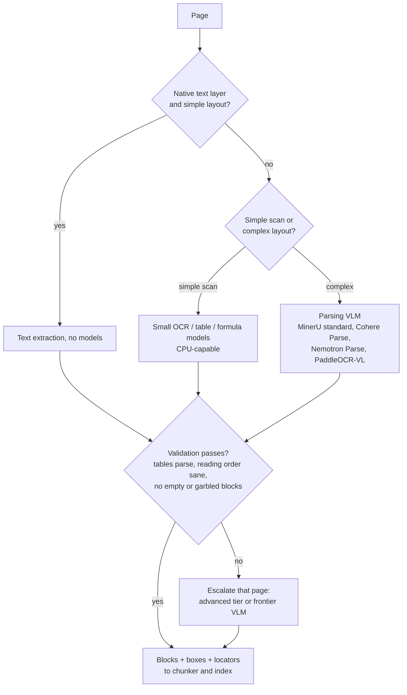

:::info 출처 · 라이선스
이 문서는 Om Bharatiya의 [AI System Design Guide](https://github.com/ombharatiya/ai-system-design-guide/blob/main/10-document-processing/01-ocr-and-layout.md)(MIT License, © 2026 Om Bharatiya)를 한국어로 옮긴 **비공식 번역본**입니다. 번역·편집 책임은 SecureNomad에 있습니다. 전체 안내는 [소개 · 출처 · 라이선스](../index.md)를 참고하세요. 번역 기준: 원문 커밋 `ed955b2`(2026-10-09).
:::

:::note 번역 주
원문은 외부 자료로, 기업명·제품명·모델명·버전·라이선스명은 원문 표기를 유지합니다. 코드·머메이드 다이어그램은 원문 그대로 둡니다.
:::

# OCR과 레이아웃 분석

문서 파싱이 더 이상 고전 OCR 엔진과 프런티어 멀티모달 LLM 간 양자택일이 아니다. **전문 문서 파싱 VLM**(페이지를 구조로 바꾸게 학습된 소형 비전-언어 모델) 중간 티어가 이제 프런티어 페이지당 비용의 일부로 Markdown·테이블·바운딩 박스·읽기 순서를 반환한다. 설계 질문이 "어느 모델이 가장 잘 읽나?"서 "각 페이지가 어느 티어 필요하고, 내 볼륨서 페이지가 얼마냐?"로 옮겼다.

---

## 세 티어: OCR 엔진, 파싱 VLM, 프런티어 VLM

| 특성 | 고전 OCR 엔진(Tesseract·AWS Textract·Azure AI Document Intelligence·Google Document AI) | 문서 파싱 VLM(Cohere Parse·MinerU·PaddleOCR-VL·Nemotron Parse 2.0·DeepSeek-OCR 2) | 프런티어 VLM(Claude Opus 5.5/Sonnet 5.5·GPT-6 Sol·Gemini 3.8 Flash) |
|---------|-------------------------------------------|----------------------------------------|--------------------------------------------------------|
| **주 메커니즘** | 문자 인식 플러스 레이아웃 규칙이나 모델 | 페이지를 구조로 전사하게 학습된 소형 VLM | 일반 비주얼 토큰 이해 |
| **읽기 순서** | 단순; 복잡 레이아웃서 깨짐 | 명시 예측 | 암묵; 보통 맞으나 감사 불가 |
| **기하** | 신뢰도의 단어별 박스 | 읽기 순서의 블록별 박스(텍스트·테이블·그림) | 단어별 감사 계층 아님 |
| **테이블** | 별도 테이블 API; 병합 셀에 약함 | 인라인 HTML이나 Markdown | 요청 시 Markdown이나 HTML |
| **실패 모드** | 문자 오독; 텍스트 날조 안 함 | 저하 페이지서 환각 가능 | 유창·그럴듯·틀린 텍스트 생성 가능 |
| **비용 동인** | CPU나 페이지당 API 요금 | GPU당 초당 페이지, 또는 API 통해 1,000페이지당 ~$1.50 | 토큰: 2026-10 정가로 1,000페이지당 대략 $4(Gemini 3.8 Flash 인트로)-$23(Claude Opus 5.5) |

**품질 격차가 얼마나 큰가?** Cohere가 자기 출시 위해 돌린 문서 파싱 벤치 ParseBench(벤더 실행, 2026-08)서 평균: GPT-5.5 84.4·Claude Opus 4.8 84.3·Gemini 3.5 Flash 81.8·Cohere Parse 79.2·LlamaParse(비용 효율 모드) 78.3·Google Document AI 57.3·AWS Textract 53.3. 이렇게 읽음: 최상위 프런티어 모델이 Cohere Parse를 약 5점 앞서고, 고전 OCR 서비스가 둘 다 20점 넘게 뒤처짐. 마지막 격차가 원시 문자 정확성보다 파싱 벤치가 보상하는 것(테이블·읽기 순서·구조화 출력)을 반영할 가능성, 그래서 "Textract가 못 읽는다"로 읽지 말 것.

**파싱 VLM이 2026에 빠르게 움직임.** 대부분 오픈 웨이트; Cohere Parse는 API나 단일 테넌트만. 아래 점수가 다른 벤치·다른 실행자서, 그래서 행 간 비교 말 것:

| 모델 | 출시 | 노트 |
|-------|----------|-------|
| DeepSeek-OCR 2 | 2026-01-27 | Apache 2.0 |
| PaddleOCR-VL | 2026-01-29 1.5 | Jina 비교가 버전 1.6을 OmniDocBench v1.6서 96.34; Apache 2.0 |
| Chandra OCR 2 | 2026-03-18 | olmOCR-Bench 85.8; 코드 Apache 2.0, 다만 가중치는 Datalab 수정 OpenRAIL-M: 연구·개인 사용과 $2M 미만 펀딩이나 매출 스타트업 무료, Datalab API 경쟁 사용 불가; 그 외 유료 라이선스 |
| Surya OCR 2 | 2026-05-27 | 코드 Apache 2.0; 가중치는 수정 OpenRAIL-M: 연구·개인 사용과 $5M 미만 펀딩이나 매출 스타트업 무료; 그 외 유료 라이선스 |
| NVIDIA Nemotron Parse 2.0 | 2026-08-03 | 10억 파라미터 미만; 레이아웃 클래스·바운딩 박스·읽기 순서·차트→테이블; OpenMDW-1.1 |
| Cohere Parse (`parse-v5.0`) | 2026-08-27 | 클로즈드 가중치; 2.3B 파라미터 VLM, 1,000페이지당 $1.50 API; HTML 테이블의 Markdown, 또는 바운딩 박스의 순서 블록 |
| jina-ocr-v1 | 2026-09-14 | DeepSeek-OCR 기반(3.4B 전체·~570M 활성 MoE); OmniDocBench v1.6 91.14·olmOCR-Bench 83.4; **CC BY-NC 4.0, 그래서 라이선스 없이 상업 사용 불가** |
| MinerU 4.0 | 2026-09-16 | 품질 티어와 에이전트 지향 CLI의 툴킷(아래); MinerU Open Source License(Apache 2.0 플러스 조건): 상업 사용 허용, 월간 1억 활성 사용자나 월매출 $20M 넘으면 별도 라이선스, 온라인 서비스는 MinerU 크레딧 필요 |

벤치 전에 라이선스 확인. 배송 못 할 파서가 후보 아니고, "오픈 웨이트"가 Apache 2.0부터 비상업·성장 기업이 넘어설 매출 상한 조건까지 다 커버.

---

## 비전-LLM 레이아웃 추출

베이스라인 워크플로가 여전히 **스크린샷→Markdown**:
1. **래스터화**: PDF 페이지를 이미지로 변환(쓸 만한 네이티브 텍스트 레이어 페이지는 전혀 필요 없을 수도).
2. **비주얼 프롬프팅**: 모델에 "다음 페이지를 테이블·헤더 보존해 GitHub 플레이버 Markdown으로 전사" 요청.
3. **구조 복구**: 모델 공간 인식으로 논리 위계 재구축.

RAG엔 **Markdown뿐 아니라 블록** 요청. 페이지 번호·바운딩 박스·읽기 순서 인덱스의 타입 블록 목록(heading·paragraph·table·figure·caption)이 실제 경계서 청킹하고 테이블을 원자 유지하고 전 문서 대신 페이지 영역 인용하게 함. 파싱 VLM이 이를 네이티브 반환(Cohere Parse `blocks` 출력·Nemotron Parse 2.0 레이아웃 클래스와 박스); 프런티어 VLM엔 structured outputs로 요청하고 검증해야.

---

## 계층 파싱과 블록 수준 로케이터

실제 코퍼스 대부분 페이지가 쉬움. 깨끗한 텍스트 레이어의 born-digital PDF에 프런티어 VLM 가격 지불이 낭비, 그래서 각 페이지를 검증 통과하는 가장 싼 티어로 라우팅.

MinerU 4.0(2026-09-16)이 이를 도구에 내장. 백엔드 선택을 네 품질 티어로 대체: **flash**(모델 없음; 네이티브 PDF 텍스트·디지털 문서)·**basic**(소형 OCR·수식·테이블 모델; CPU서 실행)·**standard**(소형 모델 플러스 VLM; 기본값)·**advanced**(어려운 문서에 더 많은 추론). DOCX·PPTX·XLSX·EPUB·OFD·HTML·CSV도 PDF 변환 없이 네이티브 파싱.

**로케이터가 인용을 검증 가능케.** MinerU 4.0 `mineru` CLI(parse·read·find·search·watch)가 `doc:{id}/tier:{tier}/page:{page}/block:{block}` 같은 안정 로케이터 반환하고 긴 문서를 점진 읽음(첫 10페이지 플러스 연속 요청), 그래서 에이전트가 블록 인용하고 검토자가 정확히 그 영역 열 수 있음. `--remote` 전달 않으면 파싱이 로컬. Docling이 플러그 가능 VLM 백엔드로 같은 방향 따름: v2.128.0(9/16)의 NVIDIA Nemotron Parse 2.0·v2.130.0(9/22)의 MinerU 2.5 Pro.

모든 블록에 파서 이름·버전·티어 저장. Docling이 v2.132.0(2026-10-01)에 읽기 순서 알고리즘 변경; 파서 업그레이드가 텍스트 재순서하고 청크 경계 옮겨 검색을 조용히 바꿈. 프로덕션 업그레이드 전 샘플 재파싱·diff.

---

## 읽기 순서와 논리 구조

:::info
순진한 RAG의 흔한 실패가 단락을 열 걸쳐 깸.
비전 모델이 열 거터를 "봐" 텍스트를 올바로 시퀀싱해 이를 피함, 양 열 가로질러 쭉 읽을 수 있는 규칙 기반 파서와 달리.
:::

파싱 VLM이 읽기 순서를 명시 출력으로 예측, 검사 가능(예: 예측 순서가 열 간 한 번 넘게 점프하는 페이지 플래그). 프런티어 VLM이 보통 맞추나 감사할 게 없음, 그래서 다열 법률·과학 문서엔 순서 인덱스 방출하는 파서 선호.

---

## 저품질 스캔과 손글씨 처리

현대 비전 모델이 다음에 문자 수준 OCR보다 훨씬 견고:
- **기울기와 회전**: 보통 deskew 패스 없이 처리, 다만 싼 deskew가 소형 파싱 모델엔 여전히 도움.
- **배접 투과(bleed-through)**: 의미 문맥이 모델이 페이지 뒷면 텍스트 무시하게 도움.
- **손글씨 주석**: 별도 `annotations` 필드로 추출 가능.

견고가 신뢰와 같지 않음. 저하 페이지서 위험한 실패가 없는 텍스트의 유창·그럴듯한 전사. 고위험 필드(금액·날짜·ID)엔 고전 OCR 패스를 교차 검사로 돌려 VLM이 생성했으나 OCR이 페이지서 못 찾는 토큰 플래그, 저신뢰 손글씨를 어느 단일 모델 신뢰 대신 인간 검토로 라우팅.

---

## 비용과 지연 트레이드오프

프런티어 행이 2026-10-01 정가로 페이지당 약 1.7K 입력 토큰(페이지 이미지 플러스 프롬프트)·800 출력 토큰, 추론 토큰 전 가정; Batch API가 반감.

| 옵션 | 유스케이스 | 처리량 | 비용(1K 페이지) |
|--------|----------|------------|-----------------|
| **자체 호스팅 파싱 VLM**(MinerU·PaddleOCR-VL·Nemotron Parse 2.0·DeepSeek-OCR 2) | PII 민감·온프렘·고볼륨 | 모델별 상이; 규모엔 jina-ocr-v1이 A100 하나 동시성 32서 2.57 페이지/초 보고(벤더 보고) | GPU $/시 ÷ (페이지/초 x 3.6); $2/GPU시·2.5 페이지/초서 약 $0.22, 완전 활용 시 |
| **Cohere Parse API** | 관리형 전문 파서 | GPU당 4.5 페이지/초; 8xH100 노드당 36 페이지/초(벤더 보고) | $1.50 |
| **Gemini 3.8 Flash** | 고볼륨 프런티어 폴백 | 1-2초/페이지 | 인트로 가격 ~$4; 2027-01-01부터 ~$9 |
| **Claude Sonnet 5.5 / GPT-6 Sol** | 어려운 페이지·법률 정밀 | 3-5초/페이지 | ~$11 |
| **Claude Opus 5.5** | 가장 어려운 페이지만 | 3-5초/페이지 | ~$23 |

Cohere가 단일 테넌트 배포(Model Vault)도 판매, 50% GPU 활용서 API 대비 추론 비용 23%·완전 활용서 최대 61% 절감 주장(벤더 보고). 활용도 주의가 모든 자체 호스팅 행에 적용: 피크 수집에 맞추고 하루 나머지 유휴인 GPU 풀이 완전 활용 수치의 몇 배 비용.

---

## 면접 질문

### Q: 비전 LLM 있는데 왜 여전히 AWS Textract나 Azure AI Document Intelligence 쓰나?

**좋은 답변:**
세 이유 생존, 하나는 아님.

1. **신뢰도의 단어 수준 기하.** 편집 도구·폼 필드 매핑·인간 검토 UI가 모든 단어에 박스와 신뢰도 필요. 파싱 VLM이 이제 블록 수준 박스·읽기 순서 주니 "OCR만 박스 준다" 논거가 단어 수준 작업으로 좁아짐.
2. **실패 모드.** OCR이 문자 오독하나 유창 텍스트 날조 안 함. 컴플라이언스 워크로드엔 OCR 출력을 VLM 검사로 사용: OCR이 페이지서 못 찾는 어느 VLM 토큰이나 플래그.
3. **조달과 컴플라이언스.** 기존 클라우드 계약 내 관리형·인증 서비스가 때로 규제 구매자가 빨리 승인 가능한 유일한 것.

더 이상 유효 않은 게 "OCR 서비스가 구조에 더 낫다". Cohere 벤더 실행 ParseBench서 Textract가 평균 53.3·Google Document AI 57.3, 전문 파서·프런티어 모델 대략 78-84 대비. 그래서 패턴이 하이브리드: 단어·기하엔 OCR, 구조엔 VLM, 둘 간 교차 검사.

### Q: 500페이지 PDF를 비전 모델로 효율적으로 어떻게 처리?

**좋은 답변:**
**라우팅·병렬 map-reduce** 패턴 사용.
1. **라우팅**: 깨끗한 네이티브 텍스트 레이어 페이지가 비전 모델 완전 건너뜀; 나머지가 파싱 VLM으로, 검증 실패 페이지만 프런티어로 에스컬레이트.
2. **Map**: 각 10페이지 처리하는 병렬 워커(AWS Lambda·Modal·GPU 풀) 스핀업. 페이지당 1-2초의 50 워커로 각 워커가 10-20초 완료, 그래서 벽시계 시간이 순차 8-17분서 1분 훨씬 아래로, 제공자 레이트 리밋이 50 동시 요청 허용하는 한.
3. **통합**: 최종 패스가 페이지 경계 걸쳐 블록 꿰매고 두 페이지 쪼개진 테이블 수리하고 헤더 연속성 검사.
4. **인덱싱**: 모든 청크가 소스 영역 인용하게 페이지·박스·로케이터 메타데이터의 블록 저장.

### Q: RAG 수집에 월 5백만 페이지 파싱 필요. 프런티어 VLM·전문 API·자체 호스팅?

**좋은 답변:**
셋 다 가격 매기고 하나 고르기 대신 라우팅.

- **전부 프런티어 VLM**: 정가로 Claude Sonnet 5.5나 GPT-6 Sol 월 약 $57K(Batch API로 대략 반값), Gemini 3.8 Flash 인트로 가격 약 $21K, 인트로 가격이 2027-01-01 끝나면 약 $43K 두 배.
- **전문 API**: Cohere Parse $1.50/1,000의 5M 페이지가 월 $7,500.
- **자체 호스팅 파싱 VLM**: GPU당 초당 2.5 페이지로 5M 페이지가 약 556 GPU시, $2.77/H100시 Silicon Data 인덱스(2026-10-01)로 월 대략 $1,500, 완전 활용 가정. 풀을 피크에 맞추고 누군가 소유하면 실제 비용 더 높고, 라이선스가 상업 사용 허용해야(jina-ocr-v1 CC BY-NC 4.0은 안 됨).

설계: 대부분을 자체 호스팅이나 전문 API로, 모든 페이지 검증, 실패하는 몇 퍼센트(차트·손글씨·밀집 테이블)를 프런티어로 에스컬레이트. 5% 에스컬레이션이면 약 250K 프런티어 페이지, 월 $3K 미만. 전념 전 자기 페이지 500개를 각 옵션에 돌림, 위 인용 프런티어 대 전문 비교(ParseBench)가 벤더 실행이고 우리 문서선 나타날 수도 안 날 수도 있는 5점 프런티어 우위 보이니.

---

## 참고 문헌
- Cohere. "Introducing Cohere Parse" and changelog (August 2026)
- Jina AI. "jina-ocr-v1: Faster Document Parsing on Low-Budget GPUs" and model card (September 2026)
- OpenDataLab. MinerU 4.0 release notes (September 2026)
- NVIDIA. Nemotron Parse 2.0 model card (August 2026)
- Docling. Release notes, v2.128.0 to v2.132.0 (September to October 2026)
- OpenDataLab. OmniDocBench (v1.6)
- Allen Institute for AI. olmOCR-Bench

---

*관련: [멀티모달 RAG](../06-retrieval-systems/12-multimodal-rag.md) | [사례 연구: 문서 인텔리전스](https://github.com/ombharatiya/ai-system-design-guide/blob/main/16-case-studies/10-document-intelligence.md)(영문)*
