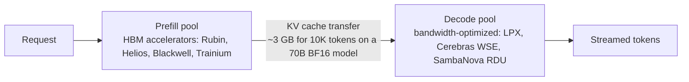
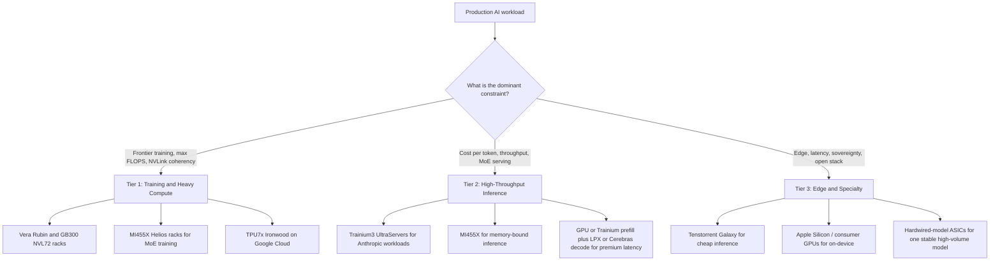

:::info 출처 · 라이선스
이 문서는 Om Bharatiya의 [AI System Design Guide](https://github.com/ombharatiya/ai-system-design-guide/blob/main/11-infrastructure-and-mlops/01-llm-infrastructure.md)(MIT License, © 2026 Om Bharatiya)를 한국어로 옮긴 **비공식 번역본**입니다. 번역·편집 책임은 SecureNomad에 있습니다. 전체 안내는 [소개 · 출처 · 라이선스](../index.md)를 참고하세요. 번역 기준: 원문 커밋 `ed955b2`(2026-10-09).
:::

:::note 번역 주
원문은 외부 자료로, 기업명·제품명·모델명·버전·라이선스명은 원문 표기를 유지합니다. 코드·머메이드 다이어그램은 원문 그대로 둡니다.
:::

# LLM 인프라

프로덕션 LLM 시스템을 구축하려면 배포 옵션, 스케일링 패턴, 운영 관심사를 이해해야 한다. 이 장은 인프라 계층을 다룬다.

---

## 배포 옵션

### API vs 자체 호스팅

| 요소 | API 제공자 | 자체 호스팅 |
|--------|---------------|-------------|
| 셋업 시간 | 몇 분 | 며칠\~몇 주 |
| 운영 부담 | 없음 | 상당함 |
| 저볼륨 비용 | 낮음 | 높음(고정비) |
| 고볼륨 비용 | 높음 | 낮음(규모 경제) |
| 지연 제어 | 제한적 | 완전 제어 |
| 데이터 프라이버시 | 데이터가 내 인프라를 떠남 | 데이터가 로컬에 머묾 |
| 모델 선택 | 제공자의 모델 | 어떤 오픈 모델이든 |
| 커스터마이징 | API 통한 파인튜닝 | 완전 제어 |

### API 제공자를 쓸 때

```python
# Decision framework
def should_use_api(requirements: dict) -> bool:
    # Strong signals for API
    if requirements["time_to_market"] == "urgent":
        return True
    if requirements["query_volume"] < 100_000_per_month:
        return True
    if requirements["team_ml_expertise"] == "low":
        return True
    
    # Strong signals for self-hosted
    if requirements["data_residency"] == "strict":
        return False
    if requirements["latency_p99_ms"] < 100:
        return False
    if requirements["query_volume"] > 10_000_000_per_month:
        return False
    
    # Default to API for simplicity
    return True
```

### 자체 호스팅 옵션

| 옵션 | 복잡도 | 성능 | 유스케이스 |
|--------|------------|-------------|----------|
| vLLM | 중 | 탁월 | 기본 오픈소스 프로덕션 엔진 |
| SGLang | 중 | 탁월 | 접두사 많은·에이전트 트래픽(radix 캐시), 구조화 출력 |
| TensorRT-LLM | 중상 | 최고(NVIDIA) | 피크 NVIDIA 처리량; 1.0부터 PyTorch 백엔드가 기본이라 모델별 엔진 빌드 불필요 |
| NVIDIA Dynamo / llm-d | 상 | 플릿 수준 | 엔진 위 오케스트레이션: KV 인지 라우팅, prefill·decode 분리 |
| TGI (Hugging Face) | 중 | 매우 좋음 | 유지보수 모드(저장소 2026-03 아카이브); Hugging Face는 신규 배포에 vLLM·SGLang 권장 |
| Ollama | 하 | 좋음 | 개발, 소규모 |
| llama.cpp | 하 | 좋음 | CPU 추론, 엣지 |

**엔진을 핀하고 패치하라.** 서빙 엔진이 이제 CVE 밀도 높은 의존성이다. vLLM은 2026-08-11\~09-28에 20건 넘는 권고를 냈는데, `trust_remote_code=False`에서도 악성 저장소의 프로세서 코드를 실행한 모델 로드 RCE(CVE-2026-90553)와, 인증 없는 단일 요청으로 모든 테넌트의 엔진을 죽이는 결함(CVE-2026-93592)이 포함됐고 둘 다 0.28.0에서 고쳐졌다. vLLM 0.30.0 이상을 베이스라인으로. SGLang의 심각 권고 CVE-2026-7301·7302·7304는 영향 버전이 0.5.12까지인데 패치 버전이 기록돼 있지 않으니, 0.5.13 이상 핀 + 권고 대조 + ZMQ 소켓을 파드 안에 가두기. 버전·기능 상세는 [서빙 인프라](../04-inference-optimization/06-serving-infrastructure.md), 보안 관점은 [LLM 보안](https://github.com/ombharatiya/ai-system-design-guide/blob/main/12-security-and-access/01-llm-security.md)(영문).

**서빙하는 가중치를 미러링하라.** 대부분의 오픈웨이트 파이프라인이 Hugging Face에서 체크포인트를 당겨오는데, NVIDIA가 2026-09-03 $12.93B에 인수한다고 밝혔다(종료일 미공개). 그 거래가 어떻게 끝나든, 미러링·검토된 내부 레지스트리에서 서빙하면 공급망·가용성 의존성이 사라지고, CVE-2026-90553 같은 악성 저장소 공격을 무디게 하는 통제책이 된다.

---

## 서빙 아키텍처

### 단일 모델 서빙

```
┌─────────────┐     ┌─────────────┐     ┌─────────────┐
│   Client    │────▶│   Gateway   │────▶│  LLM Server │
└─────────────┘     └─────────────┘     └─────────────┘
                           │
                           ▼
                    ┌─────────────┐
                    │    Cache    │
                    └─────────────┘
```

### 다중 모델 서빙

```
                    ┌────────────────────────────────┐
                    │         Load Balancer          │
                    └───────────────┬────────────────┘
                                    │
            ┌───────────────────────┼───────────────────────┐
            │                       │                       │
            ▼                       ▼                       ▼
    ┌───────────────┐       ┌───────────────┐       ┌───────────────┐
    │  OpenAI Pool  │       │  Claude Pool  │       │  Open-weight  │
    │  (API calls)  │       │  (API calls)  │       │ (self-hosted) │
    └───────────────┘       └───────────────┘       └───────────────┘
```

### 모델 라우터 패턴

```python
class ModelRouter:
    def __init__(self):
        self.models = {
            "simple": GPT6Luna(),
            "complex": ClaudeOpus55(),
            "code": ClaudeSonnet55(),
            "long_context": Gemini38Flash(),
            "vision": GPT6Sol()
        }
        self.classifier = QueryClassifier()
    
    async def route(self, request: Request) -> Response:
        # Classify request type
        request_type = self.classifier.classify(request)
        
        # Route to appropriate model
        model = self.models[request_type]
        
        # Execute with fallback
        try:
            return await model.generate(request)
        except RateLimitError:
            return await self.fallback(request, request_type)
    
    async def fallback(self, request: Request, original_type: str) -> Response:
        # Define fallback order
        fallbacks = {
            "simple": ["complex", "long_context"],
            "complex": ["simple"],
            "code": ["complex"]
        }
        
        for fallback_type in fallbacks.get(original_type, []):
            try:
                return await self.models[fallback_type].generate(request)
            except Exception:
                continue
        
        raise ServiceUnavailableError("All models unavailable")
```

---

## 스케일링 패턴

### 수평 스케일링

```python
# Kubernetes HPA config for LLM service
hpa_config = """
apiVersion: autoscaling/v2
kind: HorizontalPodAutoscaler
metadata:
  name: llm-service-hpa
spec:
  scaleTargetRef:
    apiVersion: apps/v1
    kind: Deployment
    name: llm-service
  minReplicas: 2
  maxReplicas: 20
  metrics:
  - type: Resource
    resource:
      name: cpu
      target:
        type: Utilization
        averageUtilization: 70
  - type: Pods
    pods:
      metric:
        name: requests_per_second
      target:
        type: AverageValue
        averageValue: 100
"""
```

CPU 사용률은 무상태 API 프록시엔 괜찮은 신호지만 GPU 서빙 파드엔 나쁜 신호다. GPU가 포화해도 CPU는 놀기 때문. GPU 파드는 큐 깊이·KV 캐시 사용률·SLO 대비 TTFT로 스케일하고, 무한정 큐잉 대신 엔진이 부하를 떨구게 하라. vLLM 0.29가 바로 이를 위해 `--max-num-queued-reqs`·`--max-num-queued-tokens` 입장 제어를 추가했다.

**콜드 스타트가 스케일 속도를 제한한다.** 가중치 로드에 몇 분 쓰는 GPU 파드는 스케일 신호가 아무리 좋아도 스파이크를 흡수 못 한다. 엔진들이 로드 시간을 직접 공략 중: vLLM 0.30이 Fast Start(`--load-format ipc_cache`)를 추가했는데, 양자화·텐서 병렬 샤딩된 가중치를 상주시키는 GPU별 데몬이 재시작된 엔진에 CUDA IPC로 매핑한다. 관리형 에이전트 런타임은 스냅샷을 쓴다: AWS AgentCore Runtime V2(2026-09-18 발표)가 초기화된 에이전트 스냅샷에서 각 인스턴스를 복원해, 원래 런타임의 약 5.4초\~30초 대비 P75 콜드 스타트 약 2초(벤더 보고), 훨씬 적은 GB-시간에 더 높은 요율로 과금. time-to-schedule이 아니라 time-to-ready를 측정하고, 그 격차를 메울 워밍 용량을 유지하라.

### 자체 호스팅 GPU 스케일링

| 규모 | GPU | 권장 구성 |
|-------|------|-----------------|
| 개발/테스트 | 1 | 단일 L4·L40S |
| 소형 프로덕션 | 2-4 | H100·H200 텐서 병렬 |
| 중형 프로덕션 | 4-8 | 8x H200·B200 텐서 병렬 |
| 대형 프로덕션 | 8+ | 멀티노드, 또는 대형 MoE 모델엔 랙 스케일 NVL72(GB300·Vera Rubin) |

FLOPS가 아니라 메모리로 사이징하라: 목표 동시성·컨텍스트 길이에서의 가중치 + KV 캐시가 GPU 수를 정하고, MoE 모델은 모든 전문가가 상주해야 한다.

### 큐 기반 아키텍처

고처리량 비동기 워크로드용:

```
┌─────────────┐     ┌─────────────┐     ┌─────────────┐
│  Producers  │────▶│    Queue    │────▶│  Consumers  │
└─────────────┘     │  (Redis/    │     │  (LLM       │
                    │   SQS)      │     │   Workers)  │
                    └─────────────┘     └─────────────┘
                                               │
                                               ▼
                                        ┌─────────────┐
                                        │  Results    │
                                        │  Store      │
                                        └─────────────┘
```

```python
class AsyncLLMProcessor:
    def __init__(self):
        self.queue = RedisQueue("llm_requests")
        self.results = RedisResults("llm_results")
    
    async def submit(self, request: Request) -> str:
        request_id = generate_id()
        await self.queue.enqueue({
            "id": request_id,
            "request": request.to_dict()
        })
        return request_id
    
    async def get_result(self, request_id: str, timeout: int = 300) -> Response:
        return await self.results.wait_for(request_id, timeout)
    
    # Worker process
    async def worker_loop(self):
        while True:
            job = await self.queue.dequeue()
            try:
                result = await self.llm.generate(job["request"])
                await self.results.store(job["id"], result)
            except Exception as e:
                await self.results.store_error(job["id"], str(e))
```

---

## 비용 관리

### 비용 추적

```python
class CostTracker:
    # USD per 1M tokens, standard-tier list prices as of October 2026.
    # Load these from config in production: rates, cache multipliers and tiers change often.
    PRICING = {
        "claude-opus-5-5": {"input": 4.00, "cached_input": 0.20, "output": 20.00},
        "claude-sonnet-5-5": {"input": 2.00, "cached_input": 0.20, "output": 10.00},
        "gpt-6-sol": {"input": 2.00, "cached_input": 0.20, "output": 10.00},
        "gpt-6-luna": {"input": 0.10, "cached_input": 0.01, "output": 0.50},
    }
    
    def calculate_cost(
        self,
        model: str,
        uncached_tokens: int,
        output_tokens: int,
        cached_tokens: int = 0
    ) -> float:
        # Expects disjoint counts from normalize_usage, never a raw provider total.
        # Omitted for brevity: cache-write premiums, service-tier multipliers, and
        # long-context rates (OpenAI bills the whole request higher above 272K input)
        pricing = self.PRICING[model]
        input_cost = (
            uncached_tokens * pricing["input"] + cached_tokens * pricing["cached_input"]
        ) / 1_000_000
        output_cost = (output_tokens / 1_000_000) * pricing["output"]
        return input_cost + output_cost
    
    @staticmethod
    def normalize_usage(provider: str, usage: dict) -> dict:
        # Providers disagree on whether cached tokens sit inside the input count;
        # subtracting them from an Anthropic total undercounts spend, even below zero.
        if provider == "anthropic":
            # input_tokens already excludes cache reads and cache writes.
            # Writes are priced at the base input rate here (premium omitted above).
            return {
                "uncached": usage["input_tokens"]
                + usage.get("cache_creation_input_tokens", 0),
                "cached": usage.get("cache_read_input_tokens", 0),
                "output": usage["output_tokens"],
            }
        if provider == "openai":
            # input_tokens includes cached tokens, so subtract them
            cached = usage.get("input_tokens_details", {}).get("cached_tokens", 0)
            return {
                "uncached": usage["input_tokens"] - cached,
                "cached": cached,
                "output": usage["output_tokens"],
            }
        raise ValueError(f"No usage normalizer for provider {provider!r}")
    
    def track(self, request_id: str, provider: str, model: str, usage: dict):
        tokens = self.normalize_usage(provider, usage)
        cost = self.calculate_cost(
            model,
            tokens["uncached"],
            tokens["output"],
            tokens["cached"]
        )
        
        self.metrics.record(
            "llm_cost",
            cost,
            tags={"model": model, "request_id": request_id}
        )
        
        return cost
```

### 비용 최적화 전략

| 전략 | 절감 | 구현 |
|----------|---------|----------------|
| 모델 라우팅 | 50-80% | 단순 쿼리를 싼 모델로 |
| 프롬프트 캐싱 | 캐시된 접두사에서 75-98%(대부분 모델 90%) | 안정적 접두사; 제공자 캐시 읽기가 입력의 약 0.1배, 0.02배(DeepSeek V4.1-Flash)\~0.25배(xAI Grok 4.7) |
| 응답 캐싱 | 반복 많은 트래픽서 30-70% | 정확 매치·시맨틱 캐시 |
| 프롬프트 최적화 | 10-30% | 짧은 프롬프트, 구조화 출력 |
| Batch·Flex 티어 | 50% | 비동기 작업엔 Batch 엔드포인트·Flex 티어 |
| 자체 호스팅 | 가변 | 규모서 더 쌀 수 있음; GPU 대여가는 2026 상승 |

이 레버 뒤의 가격 구조(캐시 쓰기 프리미엄, 장문 절벽, 서비스 티어, 레지던시 추가금)는 [FinOps와 토큰 경제학](04-finops-and-token-economics.md)에서 다룬다.

### 예산 알림

```python
class BudgetManager:
    def __init__(self, daily_budget: float, alert_threshold: float = 0.8):
        self.daily_budget = daily_budget
        self.alert_threshold = alert_threshold
    
    async def check_and_alert(self):
        today_cost = await self.get_today_cost()
        utilization = today_cost / self.daily_budget
        
        if utilization >= 1.0:
            await self.alert("CRITICAL: Daily budget exceeded", today_cost)
            # Consider enabling cost controls
            await self.enable_rate_limiting()
        elif utilization >= self.alert_threshold:
            await self.alert("WARNING: Approaching daily budget", today_cost)
    
    async def enable_rate_limiting(self):
        # Reduce throughput to stay within budget
        self.rate_limiter.set_rate(
            requests_per_minute=self.calculate_safe_rate()
        )
```

자체 예산을 제공자 측 상한보다 훨씬 아래로 두라. 제공자 상한은 조직 전체에 대해 fail-closed된다. Anthropic 사용 티어엔 월 지출 하드 캡이 있고, 걸리면 `enforced_spend_limit_reached`와 함께 HTTP 429가 반환되며 다음 달 1일(UTC)까지 `retry-after`가 없다. 알림은 제공자 컷오프가 모든 기능을 한 번에 내리기 훨씬 전에 울려야 한다.

---

## 모니터링과 알림

### 핵심 지표

```python
LLM_METRICS = {
    # Latency
    "ttft_seconds": "Time to first token",
    "total_latency_seconds": "Total request time",
    
    # Throughput
    "requests_per_second": "Request rate",
    "tokens_per_second": "Token generation rate",
    
    # Resources
    "gpu_utilization": "GPU compute usage",
    "gpu_memory_utilization": "GPU memory usage",
    "kv_cache_utilization": "KV cache usage",
    
    # Quality (sampled)
    "quality_score": "LLM-as-judge score",
    "faithfulness_score": "RAG faithfulness",
    
    # Errors
    "error_rate": "Failed requests percentage",
    "rate_limit_hits": "Rate limit rejections",
    "refusal_rate": "Safety refusals by category (some are billed)",
    
    # Caching
    "cache_hit_rate": "Share of input tokens read from the prompt cache",
    
    # Cost
    "cost_per_request": "Average cost per request",
    "daily_cost": "Total daily spend"
}
```

### 알림 구성

```yaml
alerts:
  - name: high_error_rate
    condition: error_rate > 0.05
    for: 5m
    severity: critical
    
  - name: high_latency
    condition: p99_latency > 10s
    for: 5m
    severity: warning
    
  - name: cost_spike
    condition: hourly_cost > 2 * avg_hourly_cost
    for: 1h
    severity: warning
    
  - name: quality_degradation
    condition: avg_quality_score < 3.5
    for: 30m
    severity: warning
    
  - name: gpu_memory_pressure
    condition: gpu_memory_utilization > 0.95
    for: 5m
    severity: warning
```

---

## 재해 복구

### 다중 제공자 장애 조치

```python
class MultiProviderClient:
    def __init__(self):
        self.providers = [
            OpenAIClient(),
            AnthropicClient(),
            GoogleClient()
        ]
        self.primary = 0
    
    async def generate(self, request: Request) -> Response:
        # Try primary provider first
        try:
            return await self.providers[self.primary].generate(request)
        except (RateLimitError, ServiceError) as e:
            return await self.failover(request, e)
    
    async def failover(self, request: Request, original_error: Exception) -> Response:
        for i, provider in enumerate(self.providers):
            if i == self.primary:
                continue
            try:
                response = await provider.generate(request)
                # Log failover for monitoring
                self.log_failover(self.primary, i, original_error)
                return response
            except Exception:
                continue
        
        raise AllProvidersUnavailable("All LLM providers failed")
```

장애 조치 대상은 반드시 다른 벤더여야 한다. 장애는 한 벤더의 표면 전체를 한 번에 내리기 때문. OpenAI의 2026-09-29 사고는 API(Agents API 포함)·ChatGPT·Codex를 약 5시간 20분 저하시켰고, Anthropic 상태 피드엔 2026-08-16\~09-29에 주요·심각 사고가 최소 12건 기록됐다. 오류 분류·스트리밍 장애 조치·대화 상태 함정은 [AI 게이트웨이와 모델 라우팅](03-ai-gateways-and-model-routing.md)에서 다룬다.

### 모델 수명주기도 DR 관심사다

정해진 일정에 사라지는 모델은 예고된 장애이고, 그 캘린더가 이제 플랫폼마다 촘촘하고 일관성이 없다:

| 위험 | 2026 예시 | 통제 |
|------|--------------|------|
| 같은 모델, 플랫폼마다 다른 폐기일 | Claude Sonnet 4가 Claude API에서 6/15 폐기됐으나 Bedrock EOL은 10/14; Claude Opus 4.1은 Claude API에서 8/5 폐기됐으나 Bedrock에선 2027-01-08까지, 10/8부터 확장 접근 고가 | 모델 레지스트리를 (모델, 플랫폼)으로 키잉, 모델 단독 아님 |
| 유휴 스탠바이가 접근 잃음 | Bedrock Legacy 모델은 신규 고객 차단, 기존 고객도 15일 비활성 후 접근 잃을 수 있음 | DR·계절 모델을 사고 중이 아니라 일정에 따라 가동 |
| 짧은 통지 창 | 2026-09-07 이후 출시된 Bedrock 모델은 6개월·45일 Legacy 통지; Anthropic 60일; OpenAI는 GA 6개월·특수 변형 3개월·프리뷰 최소 2주라면서도 `gpt-5.4-cyber`를 10/1에 20일 통지로 폐기 | 모델별 통지 등급 추적; 명시 최소치에 의존 말 것; 검증된 폴백 준비 |
| 오픈웨이트 호스트가 모델 내림 | Groq가 무료·개발자 티어의 Llama 3.3 70B·Llama 3.1 8B를 8/16 60일 통지로 폐기 | 오픈웨이트 모델을 최소 두 호스트에 분산 |
| 별칭 리라우팅 | DeepSeek이 9/10에 `deepseek-v4-pro`를 9/14부터 V4.1-Flash로 라우팅한다 했다가 하루 뒤 번복 | 날짜 스냅샷 핀; 응답의 모델 ID 변하면 알림 |

### 우아한 저하(Graceful Degradation)

```python
class GracefulDegradation:
    def __init__(self):
        self.cache = ResponseCache()
        self.fallback_responses = FallbackResponses()
    
    async def handle_outage(self, request: Request) -> Response:
        # Level 1: Try cache
        cached = await self.cache.get_similar(request.query)
        if cached and cached.similarity > 0.9:
            return Response(
                content=cached.response,
                metadata={"source": "cache", "degraded": True}
            )
        
        # Level 2: Try fallback responses
        fallback = self.fallback_responses.get(request.intent)
        if fallback:
            return Response(
                content=fallback,
                metadata={"source": "fallback", "degraded": True}
            )
        
        # Level 3: Graceful error
        return Response(
            content="I am currently experiencing issues. Please try again later or contact support.",
            metadata={"source": "error", "degraded": True}
        )
```

---

## AI 가속기 지형

2026년 하드웨어 그림은 AI 빌드아웃의 그 어느 때보다 빠르게 움직였다. 용량 발표를 합치면 **1조 달러 넘는 확정 클라우드 지출**, 공급망은 더 이상 단일 벤더가 아니고, 최대 구매자들이 추론 전용 실리콘을 만들고, 10월 기준 구속 제약은 칩 설계가 아니라 메모리와 전력이다. 이 절은 시니어 아키텍트가 용량 계획 대화에 들고 갈 스냅샷이다. 날짜가 중요한데, 이 시장은 분기마다 재가격된다.

### NVIDIA: Vera Rubin NVL72와 Blackwell Ultra

**Vera Rubin NVL72**가 새 플래그십이다. NVIDIA가 2026-05-31 풀 프로덕션 램프를 발표했고, 8/26 실적 보고 시점엔 CoreWeave·Google Cloud·Microsoft Azure·OCI·Nebius에서 Rubin 랙이 돌고 있었다([NVIDIA Vera Rubin NVL72](https://www.nvidia.com/en-us/data-center/vera-rubin-nvl72/)). **B300**("Blackwell Ultra")은 2025-03 발표, 2025년 하반기부터 파트너 시스템([NVIDIA newsroom](https://nvidianews.nvidia.com/news/nvidia-blackwell-ultra-ai-factory-platform-paves-way-for-age-of-ai-reasoning)), NVIDIA는 2025-10-26 종료 분기에 전 고객 범주에서 선도 아키텍처라 불렀다([Q3 FY2026 CFO commentary](https://s201.q4cdn.com/141608511/files/doc_financials/2026/Q326/Q3FY26-CFO-Commentary.pdf)). 지금은 볼륨 주력이다.

| 스펙 | Vera Rubin NVL72 | B300 / GB300 NVL72 |
|------|------------------|---------------------|
| GPU당 HBM | 288 GB HBM4, 19.2 TB/s | 288 GB HBM3e, 약 8 TB/s |
| 랙 | 72 Rubin GPU + 36 Vera CPU | 72 Blackwell Ultra GPU + 36 Grace CPU |
| 랙당 총 HBM | 20.7 TB, 약 1,400 TB/s | 약 20 TB, 최대 576 TB/s |
| 랙당 NVLink 총 대역폭 | 216 TB/s | 약 130 TB/s |
| 랙당 피크 FP4 | 3,600 PFLOPS NVFP4 추론(GPU당 50) | 1,440 PFLOPS sparse, 1,080 dense(GPU당 약 15 dense) |
| 상태 | 2026-05-31부터 풀 프로덕션 램프; 첫 클라우드 가동 | 2025 하반기부터 출하; NVIDIA의 2025-10 분기 선도 아키텍처 |

GPU당 같은 288 GB, 훨씬 큰 대역폭: Rubin의 이득은 모델 용량보다 decode 많고 장문인 서빙에서 나타난다.

전략 포지셔닝은 "AI 팩토리"다. NVL72는 개별 카드가 아니라 일관된 NVLink 도메인 추론·학습 셀의 최소 단위로 팔린다. 프런티어 모델 학습과 최대 추론 모델 추론 워크로드엔 NVL72급 랙(오늘은 GB300, 램프 중인 Rubin)이 기본값이다.

비용 주장은 운영점을 붙여 읽어라. NVIDIA는 Rubin이 GB200 NVL72의 100만 토큰당 비용의 1/10이라 주장한다(벤더 수치). SemiAnalysis의 DeepSeek V4 Pro AgentX 벤치가 답이 SLO·소유 모델에 얼마나 달렸는지 보여준다: 소유 비용·사용자당 170 tok/s에선 GB300 대비 TCO당 처리량 약 67배, 그러나 80 tok/s P90 목표의 3년 대여 동일 비용에선 GB300보다 토큰 약 62% 더 많을 뿐(분석가 수치). 가속기는 batch-1 헤드라인이 아니라 내 SLO에서의 처리량-상호작용성 파레토 곡선으로 비교하라.

트레이드오프는 그대로다: 최고 절대 성능, 최고 절대 가격, 가장 깊은 소프트웨어 락인. CUDA·NCCL·TensorRT-LLM 모두 NVIDIA를 가정한다. 이들 중심으로 설계하면 이미 약정한 것이다.

### 교차 칩 prefill·decode

2026년 프리미엄 지연 패턴은 한 요청을 두 종류 실리콘에 쪼갠다: 컴퓨트 바운드 prefill엔 HBM 풍부한 GPU·가속기, decode엔 대역폭 최적화 부품.

- **NVIDIA Groq 3 LPX**: 2026-08-24 풀 프로덕션. 랙당 256 LPU·128 GB SRAM, Nebius가 첫 클라우드. Vera Rubin과 짝지어 Rubin-prefill + LPX-decode, 어텐션-FFN 분할, LPX를 speculative drafter로 지원. 함정은 용량: The Register 추정으로 100K 토큰 입력에서 SRAM이 작아 LPX 랙 하나가 약 batch 12에서 한계, 그래서 프리미엄 지연 티어가 별도 가격. 기술은 NVIDIA가 Groq와 맺은 비독점 라이선스에서 왔다(2025-12-24; 조건 미공개, 약 $17-20B로 보도, DOJ 조사 보도). GroqCloud는 독립 지속, 2026-08-17 $3.5B 밸류에이션에 $350M 시리즈 A.
- **AWS Trainium + Cerebras**(2026-03-13 발표): prefill엔 Trainium 서버, decode엔 Cerebras CS-3, EFA로 연결, Amazon Bedrock으로만 판매.
- **AMD Helios + Cerebras**(2026-07-23 발표): prefill엔 Helios 랙, decode엔 웨이퍼 스케일 엔진, 2026 하반기 Cerebras Cloud로 먼저(발표).
- **Intel + SambaNova**(2026-04-08 청사진): prefill엔 GPU, decode엔 SambaNova RDU, 에이전트 도구 실행엔 Xeon 6. SambaNova는 인수 안 됨; 2026-07-08 $11B 밸류에이션에 $1B 1차 클로즈.



설계 질문은 KV 전송이 이득을 지우느냐다. Llama-3.1-70B BF16이 토큰당 320 KiB KV를 저장하니 10K 토큰 프롬프트가 decode에 약 3 GB를 넘겨, 400 Gb/s에서 약 65 ms가 TTFT에 더해진다. 분리는 피크 처리량이 아니라 **goodput**(TTFT·토큰간 지연 SLO를 둘 다 만족하는 요청률)을 올릴 때 이득이다.

### AMD MI455X와 Helios 랙

[AMD MI400 시리즈](https://www.amd.com/en/products/accelerators/instinct/mi400.html)가 신뢰할 2차 공급원이고, 볼륨 부품은 72-GPU **Helios** 랙에 들어가는 **MI455X**다.

| 스펙 | MI455X / Helios |
|------|-----------------|
| 메모리 | HBM4, GPU당 **432 GB** |
| 메모리 대역폭 | GPU당 23.3 TB/s |
| 피크 FP4 | GPU당 약 40 PFLOPS MXFP4; Helios 랙당 2.9 exaFLOPS |
| 랙 솔루션 | **Helios**: 72 MI455X GPU, 18 EPYC Venice CPU, Pensando 네트워킹 |
| 소프트웨어 | ROCm 7.x, PyTorch·vLLM·SGLang 일급 지원 |

GPU당 432 GB가 헤드라인: B300·Rubin의 288 GB보다 50% 많으면서 대역폭·FP4 컴퓨트는 Rubin 근접. MoE 서빙(전문가 가중치 상주가 제약)과 KV 캐시 많은 장문 워크로드엔 그 메모리 우위가 실질적이다. AMD는 소프트웨어 격차도 대부분 메웠다. ROCm 7.x는 2023년의 결격 사유가 아니고, 양자화 체크포인트가 이제 벤더 간 이식된다(SGLang이 AMD서 로드 시 NVFP4 체크포인트를 MXFP4로 재양자화).

프런티어 랩들이 약정했다. AMD는 Helios 프로덕션이라 밝혔고(2026-07-23); OpenAI는 2026 4분기부터 Helios 가동 예상, Anthropic은 7/22 최대 2 GW MI450 시리즈 GPU 배포 합의, 첫 기가와트는 2027 상반기. 함정은 **대규모 배포 성숙도**: 그 배포가 2026 말\~2027에 내려오니, AMD는 오늘의 대량이 아니라 2027 2차 공급원 용량으로 계획하라. 하이퍼스케일러(Meta·Microsoft·Oracle Cloud)는 혼합 플릿을 돌린다.

### Google TPU와 커스텀 추론 실리콘

Google·OpenAI·Meta가 이제 학습 실리콘과 추론 실리콘을 나누고, AMD는 고정 모델 추론에 돈으로 들어온다:

| 소유자 | 부품 | 상태 | 노트 |
|-------|------|--------|-------|
| Google | TPU7x (Ironwood) | 2026-03-31 GA | TPU 8t(학습)·8i(추론) 2026-04 발표, 가용일 없음 |
| OpenAI (Broadcom과) | Jalapeño | 2026 말 출하, 2027 볼륨(발표) | 추론 전용; 칩당 13.4 PFLOPS MXFP4·216 GB HBM4(The Register, Hot Chips) |
| Meta | MTIA 400 | Hot Chips 2026-08 공개 | 학습 우선; 12 PFLOPS MXFP4, 288 GB HBM3e(The Register); 추론 중심 MTIA 450은 2027 예상 |
| AMD (Taalas) | 하드와이어드 모델 ASIC | 2026-08-06 인수 발표; 승인 조건 4분기 종료 예상 | 가중치를 실리콘에 식각: Taalas HC1이 Llama 3.1 8B를 약 17,000 tok/s 서빙(벤더 수치); LoRA 규모 넘는 변경은 칩 재설계 필요 |

Taalas는 유연성-효율 트레이드오프의 극단이다: 안정적이고 초고볼륨인 단일 모델에만 말이 된다.

### AWS Trainium3와 Anthropic $100B+ 거래

2026-04-20, Anthropic과 Amazon이 Claude 학습·서빙에 **최대 5 기가와트** 용량 거래를 발표, Trainium 중심: Anthropic이 AWS에 **10년간 $100B 이상** 약정, Amazon이 $5B 투자에 최대 $20B 추가. Anthropic은 2026 말까지 Trainium2·Trainium3 용량 거의 1 GW가 가동된다고 밝혔다([Anthropic 발표](https://www.anthropic.com/news/anthropic-amazon-compute)).

핵심 수치:

| 스펙 | Trainium3 |
|------|-----------|
| 공정 노드 | 3nm |
| 구성 | 시스템당 **144 칩**의 **Trn3 UltraServer** |
| T2 대비 피크 | 목표 워크로드서 **약 4.4배** |
| 메모리 | HBM3e |
| 네트워킹 | UltraServer 내 NeuronLink; 클러스터 간 EFA |

전략적 함의: AWS가 이제 신뢰할 수직 통합 AI 패브릭(Trainium 실리콘 + Annapurna 네트워킹 + EC2 + Bedrock)을 가졌다. Anthropic 모델의 추론 많은 워크로드엔 H200급 하드웨어의 NVIDIA와 가격 대 성능이 경쟁력 있다.

제약: Trainium은 CUDA가 아니라 **AWS Neuron SDK**를 돌린다. 스택 이식은 커널 재구축·수치 재검증·배칭 재튜닝. 규모서 가치, 소규모서 고통.

### Cerebras IPO (2026-05)

Cerebras가 2026-05-13 IPO를 **주당 $185**로 가격, 약 **$5.5B** 조달. 5/14 $350에 개장해 잠시 $100B 넘는 밸류, 첫날 $311.07 마감으로 약 **$67B**([SiliconANGLE](https://siliconangle.com/2026/05/13/cerebras-stock-almost-doubles-initial-offering-price-biggest-tech-ipo-years-raised-55b/)).

주변 시장 변화:

- **AWS가 IPO 두 달 전 Cerebras와 제휴**([Amazon 발표](https://press.aboutamazon.com/aws/2026/3/aws-and-cerebras-collaboration-aims-to-set-a-new-standard-for-ai-inference-speed-and-performance-in-the-cloud)). 발표된 상품은 Bedrock으로 파는 교차 칩 분할(Trainium prefill, CS-3 decode), "다음 두어 달 내" 약속, AWS는 오픈웨이트 모델·Amazon Nova가 2026 후반 Cerebras 하드웨어에 올 거라 했다. 설계 전 현재 Bedrock 가용성 확인.
- Cerebras Cloud API는 주 스택이 GPU 기반이면서 이식 없이 지연 우위를 원하는 팀의 빠른 2차 공급원으로 쓰였다.

IPO 이후 웨이퍼 스케일이 극단적 사용자당 속도의 유일 경로이길 멈췄다. OpenAI가 Cerebras에서 **GPT-5.6 Sol Ultrafast**를 일부 고객에 최대 750 출력 tok/s 프리뷰(CS-3 시스템에 레이어 경계로 파이프라인)하지만, NVIDIA는 GPT-6 Astra의 Ultrafast 티어가 Blackwell GPU서 돈다 하고, Artificial Analysis 실행에서 NVIDIA LPX가 Gemma 4 31B를 100K 컨텍스트서 약 3,400 출력 tok/s로 Cerebras의 882 tok/s 대비 서빙(The Register). Cerebras는 2026-08-18 **CS-4**(시스템당 WSE-3 Turbo 3개) 소개, 첫 출하 2026 3분기 시작이라 했고 2027 CS-5도 발표. 둘 다 계획 전 실제 납품 확인. "사용자당 가장 빠른 토큰"은 단일 벤더 틈새가 아니라 다툼 있는 별도 가격 티어로 다뤄라.

IPO가 구조적으로 중요한 건 금융 명제를 바꾸기 때문: 이제 비NVIDIA 추론 벤더의 공개 시장 경로가 생겨, 다음 진입자의 자금 조달이 싸진다.

### Tenstorrent Galaxy Blackhole

[Tenstorrent Galaxy](https://tenstorrent.com/hardware/galaxy)가 **2026-04-28** GA([Tenstorrent 발표](https://tenstorrent.com/newsroom/tenstorrent-enables-ai-at-scale-with-industry-leading-performance)).

| 스펙 | Galaxy Blackhole |
|------|------------------|
| 서버당 | **32 Blackhole 칩** |
| 칩당 | RISC-V 코어와 Tensix 타일 |
| 피크 BlockFP8 | 서버당 **약 23 PFLOPS** |
| 메모리 | 1 TB GDDR6, 16 TB/s, 온칩 SRAM 6.2 GB |
| 정가 | 2026-10 Tenstorrent 제품 페이지서 32칩 서버당 **$160,000**부터; 4월 출시 발표는 동일 32칩·23 PFLOPS 구성을 $110,000부터로 표기 |
| 아키텍처 | 완전 개방 RISC-V 컨트롤 플레인, 개방 펌웨어, 개방 컴파일러 |

오픈소스 RISC-V 스토리가 두 청중에 중요:

- 펌웨어·툴체인 완전 가시성의 비CUDA 스택을 원하는 **하이퍼스케일러·소버린 클라우드**.
- CUDA 폐쇄 부분에서 벽에 부딪히는 커스텀 커널 구축 **연구 랩**.

$160K라도 Galaxy 서버는 NVL72급 랙의 작은 일부 비용. 프런티어 학습 경쟁자가 아니다. 메모리에 맞는 모델에서 하드웨어 비용으로 이기는 추론·소형 파인튜닝 경쟁자다.

### Stargate와 클라우드 약정 규모

용량 스토리는 더 이상 칩만이 아니라 그 주변 건물에 관한 것이다.

- **Stargate**(OpenAI의 Oracle·SoftBank 인프라 플랫폼)가 2025-09 Abilene 플래그십에 미국 신규 5개 사이트가 합류하며 계획 용량 거의 **7 GW**·계획 투자 **$400B** 초과, **$500B·10 GW** 목표 대비([OpenAI 발표](https://openai.com/index/five-new-stargate-sites/)).
- 전 파트너 합산, Sam Altman이 OpenAI 데이터센터 약정을 8년간 약 **$1.4조**로 제시(2025-11, [TechCrunch](https://techcrunch.com/2025/11/06/sam-altman-says-openai-has-20b-arr-and-about-1-4-trillion-in-data-center-commitments/)).

시니어 엔지니어용 함의: **발표된 기가와트는 납품 가능 기가와트가 아니다.** Jefferies 추정(The Register, 2026-09-30)은 2026 미국 데이터센터 배치를 약 16-18 GW, 2027 실용 상한을 20 GW 초반으로 보며, 고급 패키징과 전력이 제약. Micron은 HBM·DRAM 수요가 2028까지 공급 초과라 하니(The Register), 로직이 아니라 메모리가 가속기 공급을 좌우하고 호스트-DRAM KV 오프로드 티어를 더 비싸게 한다.

압박은 대여가에 드러난다. Silicon Data의 B200 지수가 9월 진입 시 연초 대비 27.6% 상승, 2026-10-01 GPU시당 $5.86(H100: $2.77). 토큰당 API 가격은 같은 기간 계속 하락(GPT-6 Sol이 9/22 100만 토큰당 $2/$10로 출시, GPT-5.6 Sol 정가 $5/$30 대비), 그래서 2026년엔 GPU를 대여하는 팀의 자체 호스팅 손익분기가 API 쪽으로 이동했다. GPU가 매 분기 싸지던 때보다 멀티 벤더·멀티 리전 용량 계약이 더 중요하다.

### 3티어 플릿 전략



| 티어 | 서비스 대상 | 기본 하드웨어 | 이유 |
|------|----------------|-------------------|-----|
| **티어 1: 학습·헤비 컴퓨트** | 프런티어 학습, 추론 많은 추론, 수조 파라미터 MoE | **Vera Rubin NVL72**·**GB300 NVL72**·**MI455X Helios**·**TPU7x** | NVLink급 일관성과 가용 최대 HBM 풀 필요 |
| **티어 2: 고처리량 추론** | API 제품, RAG 백엔드, 에이전트 플랫폼 | **Trainium3**·**MI455X**·**B300**, 프리미엄 지연 구간엔 교차 칩 prefill/decode(**Rubin + LPX**, 발표된 **Trainium + Cerebras**·**Helios + Cerebras**) | SLO서 goodput·예측 가능 P99 최적화, 흔히 MoE 인지 |
| **티어 3: 엣지·특수** | 지연 임계·소버린·오픈 펌웨어 의무·저지출 | **Tenstorrent Galaxy**·**Apple Silicon**·소비자 GPU·하드와이어드 모델 ASIC | $/성능, 개방 스택, 규제 로컬리티 |

2026년에 중요한 프레이밍: **어떤 시니어 아키텍트도 진지한 AI 제품을 더는 단일 벤더 중심으로 설계하지 않는다.** 용량이 너무 다투어지고, 가격이 너무 빠르게 움직이고, 단일 벤더 스택 내 실패 모드가 너무 상관된다. 멀티 벤더가 새 기본값이다.

### 용량 계획 테이크어웨이

- **가속기당 메모리**를 FLOPS만큼 계획하라. MoE 서빙은 전문가 상주에 병목이고, 메모리가 이제 공급 제약이기도 하다.
- **CUDA 락인을 실제 비용으로** 다뤄라. ROCm 7.x는 대부분 프로덕션 서빙에 충분. Neuron은 Anthropic과 이식 작업 감수할 팀에 충분. 개방 RISC-V는 비용 민감 추론에 충분.
- 하이퍼스케일러 선택이 이제 칩 선택을 이끈다(역도 성립). AWS = Trainium + NVIDIA, Cerebras 발표. Microsoft = NVIDIA + Maia. Google = TPU7x + NVIDIA(첫 Vera Rubin 클라우드 중). Oracle = NVIDIA 대규모. 랩들은 자체 구축: OpenAI는 NVIDIA 운영, 2026 4분기부터 AMD Helios 가동 예상, 2026 말부터 자체 Jalapeño 계획(발표).
- **API $/토큰은 계속 하락**(일정 능력 기준, a16z [LLMflation 분석](https://a16z.com/llmflation-llm-inference-cost/)이 2024까지 연 약 10배 측정)하지만 **GPU시는 2026에 비싸졌다.** 9/7 12개월 B200 약정이 GPU시당 $5.39, 3개월 $5.73(Silicon Data)이라 긴 약정이 더 싼 대여 방식이 됐고, 이는 옛 "스팟 하락 기다리기" 가정의 반대다.
- **에이전트 트래픽(멀티턴·장문·높은 접두사 재사용) 하에서 파레토 곡선으로 하드웨어를 평가**하라, 내 상호작용성 SLO에서. MLPerf Inference v6.1(2026-09-16)이 같은 이유로 엔드투엔드 RAG·엣지 에이전트 벤치를 추가했다.

---

## 면접 질문

### Q: 하루 100만 LLM 쿼리 인프라를 어떻게 설계하나?

**좋은 답변:**

"하루 100만 쿼리면 평균 초당 약 12 쿼리, 피크가 3-5배 높을 수 있습니다. 접근은:

**아키텍처:**
- 여러 API 엔드포인트에 분산하는 로드 밸런서
- 비용 최적화용 모델 라우터(단순 쿼리를 싼 모델로)
- 빈번 쿼리용 Redis 캐시
- 비동기 워크로드용 큐 기반 처리

**이 규모선 비용 최적화가 핵심:**
- 단순 쿼리의 60-70%를 소형 모델(GPT-6 Luna·Claude Haiku 4.5)로
- 제공자 프롬프트 캐싱 위해 정적 접두사 안정 유지 + 시맨틱 캐싱(30%+ 적중 목표)
- 비긴급 요청엔 Batch·Flex 티어(50% 할인)
- 이 볼륨선 고볼륨 좁은 작업에 자체 호스팅이 비용 경쟁력

**신뢰성:**
- 모델만이 아니라 벤더 간 자동 장애 조치의 멀티 제공자
- 남용 방지 사용자별 레이트 리밋
- 스파이크 처리용 큐 기반 아키텍처
- 제공자 불가 시 우아한 저하

**모니터링:**
- 예산 알림 있는 실시간 비용 추적
- 지연 백분위(p50·p95·p99)
- 지속 샘플링되는 품질 지표
- 오류율·레이트 리밋 적중 추적

100만 쿼리에 입력·출력 각 2K 토큰이면, $2/$10 중간 티어 모델(GPT-6 Sol·Claude Sonnet 5.5 정가)이 하루 약 $24K: 입력 $4K·출력 $20K. 트래픽의 65%를 GPT-6 Luna($0.10/$0.50)로 라우팅하면 약 하루 $9K, 정적 접두사 캐싱이 입력 몫을 더 줄입니다. 여기선 출력이 요금을 지배하니 출력 길이 상한이 다음 레버입니다."

### Q: 언제 자체 호스팅 vs API 제공자인가?

**좋은 답변:**

"판단 틀은 여러 요소를 봅니다:

**API 제공자를 쓸 때:**
- 볼륨이 월 100만 쿼리 미만(비용 교차점)
- time-to-market이 임계
- 팀에 GPU 인프라 전문성 없음
- 최신 모델을 즉시 원함
- 워크로드가 가변·예측 어려움

**자체 호스팅할 때:**
- 데이터가 인프라를 떠날 수 없음(컴플라이언스·보안)
- 볼륨이 월 1천만 쿼리 초과(상당 절감)
- P99 100ms 미만 지연 필요
- 커스텀 가중치·파인튜닝 필요
- 모델 동작 완전 제어 원함

**하이브리드가 흔히 최선:**
- 고볼륨 예측 가능 워크로드는 자체 호스팅
- 스파이크·특수 모델은 API
- 자체 호스팅 실패 폴백으로 API

자체 호스팅의 숨은 비용: GPU 조달·대여, 운영 엔지니어링 시간, 모델 업데이트, 모니터링 인프라, 그리고 이제 몇 주마다 보안 권고를 내는 서빙 엔진 패치. 인프라에 전담 엔지니어 최소 1-2명 산입. 2026 시장도 대여자에 불리하게 움직였다: GPU시 가격이 오르는 동안 소형 API 모델이 100만 토큰당 $0.10/$0.50(GPT-6 Luna)로 떨어져 라우팅·분류용 자체 호스팅 오픈웨이트 서빙 대부분을 밑돈다. 오늘 자체 호스팅 명분은 가격보다 데이터 제어·지연·커스터마이징에 더 자주 기댄다."

### Q: 플릿에 새 가속기·서빙 플랫폼을 어떻게 평가하나?

**좋은 답변:**

"벤더 헤드라인 초당 토큰(보통 프로덕션엔 없는 batch-1 수치)에서 시작 안 합니다. 저는:

1. **내 트래픽 형태를 리플레이한다.** 에이전트 워크로드는 멀티턴·장문·접두사 많으니, 합성 단일턴 부하 대신 트레이스 리플레이나 SemiAnalysis AgentX 같은 에이전트 벤치 사용.
2. **파레토 곡선을 그린다** — 총 처리량 대 사용자당 상호작용성, 내 SLO에서 읽기. 같은 Rubin 대 GB300 비교가 소유 비용·사용자당 170 tok/s서 TCO당 약 67배, 80 tok/s P90 3년 대여서 약 1.6배로 나왔다(분석가 수치). 운영점이 답을 정한다.
3. **메모리를 먼저 확인:** 내 동시성에서 가중치 + KV 캐시, MoE 전문가 상주, 분리 구성이면 풀 간 KV 전송 비용(70B BF16 모델서 10K 토큰 프롬프트당 약 3 GB).
4. **소프트웨어 경로를 가격 매긴다.** 커널 성숙도가 결과를 뒤집을 수 있다: NVIDIA 자체 Dynamo 레시피에서 한 모델이 Marlin 커널의 NVFP4보다 BF16이 80% 빨랐다. 실제 돌릴 엔진 버전으로 테스트.
5. **공급·락인 평가:** 납품일, 대여 약정 구조, 2차 공급원 옵션, 약정할 CUDA 특화 코드량.

그다음 어떤 용량 약정 전에도 프로덕션 섀도 슬라이스를 돌립니다."

---

## 참고 문헌

- vLLM: https://docs.vllm.ai/
- SGLang: https://github.com/sgl-project/sglang
- TensorRT-LLM: https://github.com/NVIDIA/TensorRT-LLM
- NVIDIA Dynamo: https://github.com/ai-dynamo/dynamo
- Text Generation Inference (maintenance mode): https://github.com/huggingface/text-generation-inference
- NVIDIA Vera Rubin NVL72: https://www.nvidia.com/en-us/data-center/vera-rubin-nvl72/
- NVIDIA Groq 3 LPX: https://nvidianews.nvidia.com/news/nvidia-groq-3-lpx-now-in-full-production-with-world-class-speed-for-agentic-ai
- SemiAnalysis, Vera Rubin NVL72 agentic inference: https://newsletter.semianalysis.com/p/vera-rubin-nvl72-agentic-inference
- Amazon Bedrock model lifecycle: https://docs.aws.amazon.com/bedrock/latest/userguide/model-lifecycle.html
- Silicon Data B200 rental index: https://www.silicondata.com/products/silicon-index/b200
- OpenAI Pricing: https://developers.openai.com/api/docs/pricing
- Anthropic Pricing: https://platform.claude.com/docs/en/about-claude/pricing

---

*다음: [LLM 애플리케이션 CI/CD](02-cicd.md)*
