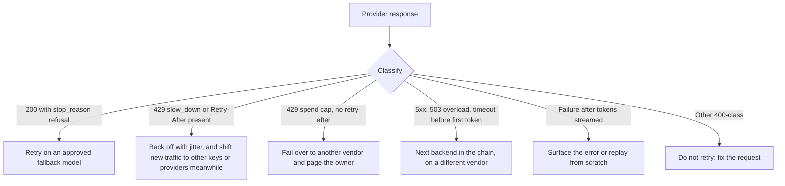

:::info 출처 · 라이선스
이 문서는 Om Bharatiya의 [AI System Design Guide](https://github.com/ombharatiya/ai-system-design-guide/blob/main/11-infrastructure-and-mlops/03-ai-gateways-and-model-routing.md)(MIT License, © 2026 Om Bharatiya)를 한국어로 옮긴 **비공식 번역본**입니다. 번역·편집 책임은 SecureNomad에 있습니다. 전체 안내는 [소개 · 출처 · 라이선스](../index.md)를 참고하세요. 번역 기준: 원문 커밋 `ed955b2`(2026-10-09).
:::

:::note 번역 주
원문은 외부 자료로, 기업명·제품명·모델명·버전·라이선스명은 원문 표기를 유지합니다. 코드·머메이드 다이어그램은 원문 그대로 둡니다.
:::

# AI 게이트웨이와 모델 라우팅

라우팅 계층의 근거는 이제 열망이 아니라 경험적이다. Datadog의 2026 State of AI Engineering에 따르면 **69% 기업이 프로덕션에 모델 3개 이상을 돌리고**, **레이트 리밋·용량 오류가 단일 최대 프로덕션 실패 모드**다(약 5% 요청 실패, 그중 약 60%가 용량 주도). Datadog 자체 프레이밍: 이제 안정적 대규모 AI의 1차 장벽은 모델 지능이 아니라 운영 복잡도다.

여러 모델에 의존하고 트래픽이 사소하지 않게 되면, 단일 제공자가 단일 장애점이 되고, 새벽 2시에 호출기를 울리는 건 모델 품질이 아니라 레이트 리밋이다. **AI 게이트웨이**가 표준 완화책이다. 이 장은 그것이 하는 일, 라우팅·폴백 작동, 2026 도구 지형, 그리고 언제 실제로 필요한지를 다룬다.

---

## AI 게이트웨이란

AI 게이트웨이(LLM 게이트웨이·LLM 프록시·LLM 라우터)는 **애플리케이션과 모델 제공자 사이의 컨트롤 플레인**으로, 하나의 일관된(거의 항상 OpenAI 호환) API를 노출하고, 안 그러면 모든 서비스에 번져 있을 횡단 관심사를 중앙화한다.

| 역할 | 하는 일 |
|-----|--------------|
| 통합 API | 제공자 전반에 하나의 OpenAI 형태 인터페이스; 제공자별 글루 불필요 |
| 모델 라우팅 | 각 요청을 어느 모델·배포가 서빙할지 선택 |
| 폴백 체인 | 재시도 가능 실패 시 순서 목록의 다음 제공자·모델 시도 |
| 로드 밸런싱 | 키·리전·배포·제공자에 트래픽 분산 |
| 백오프 재시도 | 지수 백오프 + 지터, `Retry-After` 존중 |
| 레이트 리밋 처리 | 429 탐지, 스로틀된 배포 쿨다운, 재라우팅 |
| 가상 키 + 예산 | 키·팀별 키에 달러 예산·하드 캡 |
| 지출 추적 | 키·팀·모델별 토큰·달러 단위 귀속 |
| 관측성 | 중앙 트레이스: 누가 호출, 무엇을 시도, 왜 실패, 무엇이 이김 |
| 캐싱 | 비용·지연 절감 위한 정확 매치·시맨틱 캐싱 |
| 가드레일 / PII | 초크 포인트서 프롬프트·응답 필터링·레드액션 |

멘탈 모델: 게이트웨이가 애플리케이션 코드의 `N 제공자 x M 관심사` 글루 문제를 정책 강제 단일 초크 포인트로 전환한다. 비용은 네트워크 홉 하나와 고가용으로 유지해야 할 컴포넌트 하나이고, 이게 아래의 중심 긴장이다.

---

## 라우팅 전략

라우팅 전략은 복잡도·오버헤드가 증가하는 사다리다. 규모 감각(벤더·실무자 수치, 자릿수 수준): 규칙 기반 라우팅 약 1ms 미만, 임베딩·시맨틱 라우팅 약 5ms, 무거운 ML 분류기·LLM-as-router 약 50-100ms, 전형 모델 지연 500-2000ms 대비.

| 전략 | 판단 기준 | 적합 | 오버헤드 | 실패 모드 |
|----------|-----------|----------|----------|---------------|
| 정적/수동 | 경로별 하드코딩 모델 | 단순·예측 가능 워크로드 | 약 0ms | 취약; 장애·가격 변화 미적응 |
| 작업 기반 | 작업 유형→모델 매핑 | 알려진 작업 분류 | 1ms 미만 | 오분류; 분류 체계 노후 |
| 비용 기반 | 제약 만족 최저가 모델 | 비용 상한·배치 | 1ms 미만 | 품질 고갈 가능; 최저가가 레이트 리밋 걸릴 수 |
| 지연 기반 | 최저 관측·예상 지연 | 실시간 UX | 약 1-5ms | 한 빠른 엔드포인트로 몰림; 콜드스타트 왜곡 |
| 능력 기반 | 필요 능력(장문·비전·도구) | 이질적 요구 | 1-5ms | "최고" 모델 과프로비저닝 |
| 시맨틱 | 요청 임베딩→경로 매치 | 의도 디스패치·혼합 난이도 | 약 5-50ms | 임베딩 드리프트; 모호 꼬리; 임계값 튜닝 |
| LLM-as-router | 소형 LLM이 분류·선택 | 임베딩이 놓치는 모호 꼬리 | 약 50-100ms | 자체 비용·실패면 있는 LLM 호출 추가 |
| 캐스케이드 | 싼 모델 먼저, 저신뢰 시 에스컬레이트 | 규모서 비용-품질 | 순차 | 에스컬레이트 쿼리 이중 지출; 노이즈 신뢰도 |
| KV 캐시 인지(자체 호스팅) | 프롬프트 접두사를 KV 캐시에 이미 가진 레플리카 | 공유 접두사·멀티턴 에이전트의 자체 호스팅 플릿 | 낮음 | 인기 접두사 핫스팟; 캐시 인덱스 노후 |

실무에서 중요한 세 가지. **시맨틱 라우팅**은 LLM 호출 없이 임베딩 유사도로 경로를 고른다. 흔한 프로덕션 패턴은 확신 다수를 시맨틱으로 처리하고 모호 꼬리를 LLM-as-router로 보내는 2단계 하이브리드다(vLLM Semantic Router, 2026-09-27부터 v0.4.0, 오픈소스 구현).

**캐스케이드**가 최고 레버리지 비용 플레이다: RouteLLM(UC Berkeley/LMSYS, ICLR 2025)이 프런티어 모델 품질의 약 95%에 도달하면서 일부 호출만 그쪽으로 라우팅, 비용 45-85% 절감을 보고. 그 범위를 보장이 아니라 벤치 특화 천장으로 읽어라. 에스컬레이션 비율이 라이브 비용 변수이고, 트래픽 대부분을 에스컬레이트하는 캐스케이드는 거의 절감 못 한다. 티어 격차는 크다: OpenAI가 GPT-6 Terra를 안 냈으니 GPT-6 패밀리 안에서 Luna($0.10/$0.50)→Sol($2/$10) 스텝이 20배이고, 에스컬레이트 요청은 두 호출을 다 지불해 Luna 단독의 약 21배. 캐스케이드는 이제 출시 제품 패턴이기도: GitHub HydraFusion(리서치 프리뷰, 2026-09-30)이 효율 드래프터·품질 게이트·필요 시 강한 모델 에스컬레이션을 돌리거나, 다른 모델 패밀리의 크리틱이 단일 수정 전 초안을 검토한다.

**KV 캐시 인지 라우팅**은 자체 호스팅 플릿에서 결정을 제공자 계층 아래로 옮긴다: Kubernetes Gateway API Inference Extension의 엔드포인트 피커(2026-08 llm-d 프로젝트로 이동)와 NVIDIA Dynamo 라우터가 각 요청을 접두사를 이미 캐시에 가진 레플리카로 보내고, Google은 멀티클러스터 GKE Inference Gateway의 라우팅 오버헤드가 1% 미만이라 보고한다.

라우팅과 폴백은 조합된다: 해피 패스엔 비용·품질·지연으로 라우팅, 언해피 패스엔 신뢰성 위해 제공자 간 폴백. 캐스케이드는 본질적으로 신뢰성 폴백이 내장된 품질 주도 라우팅이다.

---

## 폴백과 신뢰성

Datadog 데이터에 직접 답하는 절이다: 레이트 리밋이 대부분 프로덕션 실패의 원인이고, 폴백 장치가 해독제다.

**폴백 체인**은 주 제공자가 *재시도 가능* 실패(429 레이트 리밋·5xx·타임아웃·모델 없음)를 반환할 때마다 다음 제공자·모델로 재시도한다. 429·5xx 계열만 분류 후 재시도하고, 400 계열 클라이언트 오류는 재시도 말 것(쿼터 낭비).

**제대로 된 재시도**는 세 규칙을 따른다: 지수 백오프(실패마다 더 길게 대기), 지터(대기를 랜덤화해 클라이언트가 동시에 재시도해 사태를 악화시키는 썬더링 허드 방지), `Retry-After` 존중(OpenAI·Anthropic이 보통 레이트 리밋 429에 보냄; `max(retry_after, computed_backoff)` 사용). `Retry-After` 무시가 가장 흔한 백오프 버그다.

**상태가 아니라 오류 코드로 분기.** 모든 429가 "곧 재시도"는 아니다. 2026-09-02부터 OpenAI는 트래픽이 너무 빨리 램프하면 429 코드 `slow_down`(점진 램프 + `Retry-After` 존중), 일시 모델 과부하엔 503을 반환. Anthropic 월 지출 캡은 429 `error_code: enforced_spend_limit_reached`에 `retry-after` 없음: 다음 달 1일 전엔 어떤 재시도도 성공 못 하니 페일오버하고 담당자 호출. Claude Fable 5.1·Fable 5·Opus 5.5·Opus 5·Sonnet 5.5서 안전 분류기 거부는 HTTP 200에 `stop_reason: "refusal"`과 `stop_details` 카테고리로 온다. 성공이 아니라 라우팅 신호로 다뤄라; Anthropic 베타 서버측 `fallbacks: "default"`가 그 카테고리에 권장하는 모델로 재시도(Fable 5.1 허용 대상은 Claude Opus 4.8·Opus 5).

**모델만이 아니라 벤더 간 페일오버.** 장애는 벤더 표면 전체를 한 번에 내린다. OpenAI 2026-09-29 사고가 API(Agents API 포함)·ChatGPT·Codex를 약 5시간 20분 저하시켰고, Anthropic 상태 피드엔 2026-08-16\~09-29 주요·심각 사고 최소 12건. 같은 제공자의 형제 모델로만 넘어가는 체인은 그걸 못 견딘다.

**스트리밍 페일오버엔 창이 있다.** 첫 토큰 전에만 깨끗하게 페일오버 가능. Envoy AI Gateway 1.1(2026-08-21)이 `streamIdleTimeout`을 추가해 제때 토큰이 없으면 다음 백엔드로 이동. 토큰이 흐른 뒤엔 처음부터 리플레이(클라이언트가 버려야 할 중복 출력)하거나 오류를 드러내는 선택.

**대화 상태가 늘 이전되진 않는다.** Claude Fable 5.1·Opus 5.5·Sonnet 5.5가 thinking 블록을 모델·대화에 묶는다: 폴백 모델이 못 읽는 블록은 조용히 삭제, 2026-08-31 이후 생성 계정서 thinking 블록 앞 접두사 변경은 400. Sonnet 5.5 블록은 생성 계정에도 묶인다. 멀티턴 에이전트를 대화 중간에 다른 모델·계정으로 옮기거나 리마인더 주입 위해 히스토리를 고쳐 쓰는 게이트웨이는 추론을 잃거나 하드 페일한다. 턴 경계서 페일오버하고, 대화를 append-only로, 폴백 경로를 일급 설정으로 평가하라. 같은 모델들이 강제 `tool_choice`(`any`·`tool`)에 400을 내니, 제공자 간 요청을 번역하는 게이트웨이는 그걸 그대로 전달하면 안 된다.

**수명주기가 플랫폼마다 갈린다.** Claude Opus 4.1이 Claude API서 2026-08-05 폐기됐으나 Bedrock서 2027-01-08까지(10/8부터 확장 접근 고가); Grok 4가 xAI API서 5/15 폐기, `grok-4` 슬러그는 이제 조용히 `grok-4.3`으로 해소되고 그 요율로 과금, 그런데 Azure Foundry는 Grok 4를 여전히 GA로 표기. 게이트웨이 모델 레지스트리를 (모델, 플랫폼)으로 키잉하라, 안 그러면 멀티클라우드 폴백이 폐기·재가격·다른 버전 모델에 착지할 수 있다. 고정 ID 뒤 모델도 바뀔 수 있다: OpenAI가 2026-09-25 `gpt-6-sol`·`gpt-6-luna` 이미지 인코딩 버그를 ID 변경 없이 수정. 각 응답이 보고하는 모델 ID를 로깅하고 바뀌면 알림(별칭 리라우팅 포착), 라우팅 대상 ID에 평가를 일정대로 재실행(동일 ID 변경 포착).

**서킷 브레이커**는 엔드포인트 건강을 전역 추적해 실패율이 임계 넘으면 열려, 죽거나 스로틀된 제공자를 매 요청 두드리지 않게 한다. 실패 배포를 자동 복구 전 고정 창 동안 세워두는 쿨다운과 짝지어라.

**로드 밸런싱**을 여러 키·리전·제공자에 걸치면 실효 레이트 리밋 여유가 배가되고, 이게 용량 실패의 가장 직접적 구조 수정이다.

내재화할 주의: **맹목 재시도는 장애를 증폭**한다, 실패 순간에 부하를 더해. 백오프·지터·서킷 브레이커·오류 코드 분류·`Retry-After`가 레이트 리밋을 고치는 게이트웨이와 악화시키는 게이트웨이를 가른다. [신뢰성 패턴](https://github.com/ombharatiya/ai-system-design-guide/blob/main/13-reliability-and-safety/03-reliability-patterns.md)(영문) 참고.

---

## 2026 도구 지형

버전과 정확한 기능 주장은 시점 기준으로 다루고, 아래 비교 수치 몇은 벤더 마케팅에서 온 것임에 유의.

- **LiteLLM**(오픈소스, 자체 호스팅 프록시 + SDK)이 사실상 표준: OpenAI 포맷 API 뒤 100+ 제공자, 라우팅 전략(지연·사용량·비용·least-busy), 순서 폴백, 달러 예산 가상 키, 네이티브 OpenTelemetry. 흔한 비판은 YAML 설정이 엔터프라이즈 거버넌스 규모서 버거운 점. 인기 탓에 주 표적이기도; 게이트웨이 보안 절 참고.
- **OpenRouter**(관리형 애그리게이터)가 400+ 모델에 가장 빠른 폭·제로 운영을 주고, 패스스루 제공자 가격(문서화된 BYOK 수수료 적용). Stripe가 인수 합의(2026-08-19 발표; OpenRouter는 라우팅이 제공자 중립 유지라 함). US 인리전 라우팅(us.openrouter.ai, 9/9), Business·Enterprise용 EU 라우팅, 70+ 모델 일반 50% 할인 Batch API(9/22), 최근 7일 마켓플레이스 지출로 라우팅하는 Auto Router 추가. 트레이드오프는 외부 홉·내 경계 밖 데이터·이제 벤더 리스크 검토에 결제 회사.
- **Portkey**(관리형, 자체 호스팅 티어 있음)가 풀 컨트롤 플레인으로 포지션: 라우팅·폴백·토큰 단위 관측성·시맨틱 캐싱·가드레일.
- **Cloudflare AI Gateway**(관리형, 엣지)가 관측성·캐싱에 강하고 순차 제공자 폴백, 라우팅 로직·예산 강제는 약함. Cloudflare 관리형 검색 서비스 AI Search가 2026-10-01 GA, 게이트웨이가 검색·그라운딩을 흡수하는 한 신호.
- **Kong AI Gateway**(API 관리 플랫폼)가 LLM 라우팅(시맨틱 포함)·재시도/폴백·시맨틱 캐싱·PII 새니타이저를 성숙한 게이트웨이에 통합; 이미 Kong 운영 시 최선.
- **Envoy AI Gateway**(오픈소스, 쿠버네티스 네이티브)가 안정 1.x API 도달(v1.0.0 6/23, v1.1.0 2026-08-21): 제공자 간 토큰 카운팅, 요청별 업스트림 자격증명(`credentialOverride`), 첫 토큰 전 스트림 유휴 페일오버, 기본 거부 백엔드 선택의 MCP 라우팅, OpenTelemetry GenAI 시맨틱 컨벤션. 2026-09 Agentic AI Foundation에 Agent Router 이름으로 합류, 에이전트(MCP·A2A) 트래픽 프록시 agentgateway 옆.
- 자체 호스팅 모델용 **쿠버네티스 추론 게이트웨이**: Gateway API Inference Extension + llm-d(KV 캐시 인지·지연 예측 엔드포인트 선택)와 NVIDIA Dynamo 라우터. 이들은 제공자가 아니라 레플리카를 고르고 제공자 수준 게이트웨이 아래 위치.
- **클라우드 네이티브** 라우터(AWS Bedrock intelligent prompt routing·Google Vertex)가 자기 클라우드에 긴밀 통합; 엄격한 계정별 레이트 리밋이 여전히 멀티 제공자 계층을 유용하게.

**자체 호스팅 vs 관리형** 핵심 트레이드오프: 자체 호스팅(LiteLLM·Kong·Envoy)은 데이터를 내 경계에 두고 완전 제어, 엄격 컴플라이언스엔 필수지만, 프록시를 *내가* 고가용으로 만들어야 하고 아니면 단일 장애점이 됨. 관리형(OpenRouter·Portkey·Cloudflare)은 거의 제로 운영·빠른 채택이지만 데이터가 제3자를 거치고 그 가용성을 하드 의존성으로 상속.

---

## 아키텍처 패턴

- **어디 위치하나:** 애플리케이션 서비스와 제공자 사이, 수평 확장 서비스나 사이드카로. 모든 LLM 트래픽이 통과하니 임계 경로 인프라의 신뢰성 요건을 상속.
- **네트워크 홉 세금:** 게이트웨이가 홉 하나 추가. 앱과 코로케이션(같은 리전·VPC·클러스터)해 홉을 1ms 미만으로, 프록시를 얇게, 공격적 캐싱으로 적중이 제공자를 건너뛰게 완화. 500-2000ms 모델 지연 대비 홉은 작지만 부하 시 실질적.
- **게이트웨이가 SPOF 되지 않게:** 이게 중심 아키텍처 위험. 로드 밸런서 뒤 무상태 레플리카 여럿, 공유 상태 외부화(레이트 리밋·사용량 카운터엔 Redis, 키·지출엔 DB), 레플리카 헬스 체크. 모든 걸 중앙화하면서 단일 인스턴스로 도는 게이트웨이는 단일 장애점을 *옮겼을* 뿐.
- **멀티 리전:** 리전별 레플리카 배포, 리전 로컬 라우팅, 리전 장애가 다른 곳으로 페일오버하게 교차 리전·교차 제공자 폴백.
- **레지던시 라우팅:** 인리전 처리가 이제 요청·엔드포인트별 선택 가능(Anthropic `inference_geo`, OpenAI 레지던시 엔드포인트와 `us.`/`eu.` 리전 API 도메인, Bedrock·Google Cloud 리전 엔드포인트, us.·eu.openrouter.ai), 레지던시는 보통 약 10% 가격 프리미엄(OpenRouter는 추가금 없음 명시). 게이트웨이가 테넌트별 레지던시 핀의 적소라, 레지던시 바운드 트래픽만 프리미엄 지불하게 하고 폴백 체인이 필요 지역을 벗어나지 않게.
- **캐싱과 관측성:** 동일 프롬프트엔 정확 매치, 근접 중복엔 시맨틱 캐싱, 사용자·키·시도 모델·실패 이유·이긴 폴백·단계별 지연·정확 비용을 담은 OpenTelemetry 스팬. 이게 레이트 리밋 실패 모드를 미스터리 대신 가시화한다. [관측성](https://github.com/ombharatiya/ai-system-design-guide/blob/main/14-evaluation-and-observability/02-observability.md)(영문) 참고.

---

## 게이트웨이 보안

게이트웨이가 모든 제공자 키·모든 프롬프트·응답을 한 프로세스에 집중시켜, AI 스택서 최고가 표적이 된다. LiteLLM의 2026 권고가 패턴을 보여준다:

| 권고 | 무슨 일 | 수정 |
|----------|---------------|----------|
| CVE-2026-37004(심각, CVSS 9.8) | `/prompts/test` 엔드포인트의 인증 없는 템플릿 주입으로 OS 명령 실행 | 1.83.7 |
| CVE-2026-49468(심각) | Host 헤더 인증 우회 | 1.84.0 |
| CVE-2026-84377(중, CVSS 6.5) | 인증된 프록시 사용자가 `api_base`·`base_url`·`model_list`·폴백을 자기 호스트로 지정해, 프록시가 운영자 저장 제공자 키를 거기로 전송(+ SSRF) | 1.88.6\~1.96.2 라인별 패치; 우회책 `general_settings.allow_client_side_credentials=false` |
| GHSA-92x9-889m-jgmw | PyPI의 litellm 1.82.7·1.82.8 릴리스 침해 | 그 버전 설치 금지; 해시로 핀 |

따라오는 설계 규칙:

- **호출자가 자격증명 목적지를 고르게 하지 말 것.** 업스트림 호스트 allowlist, 클라이언트 제공 라우팅 파라미터(`api_base`·폴백)를 엣지서 제거. [접근 제어](https://github.com/ombharatiya/ai-system-design-guide/blob/main/12-security-and-access/02-access-control.md)(영문)의 MCP OAuth mix-up 수정과 같은 발급자 바인딩 규칙.
- **장기 비밀을 가능한 한 프록시 밖에.** 볼트에서 요청별 자격증명 주입(Envoy `credentialOverride`), 정적 제공자 키 대신 워크로드 ID(OpenAI가 2026-08-29 mTLS·X.509 워크로드 ID 페더레이션 GA), 남은 키는 단기 수명(OpenAI가 9/10 키 만료 추가).
- **게이트웨이를 공급망으로 다뤄라.** 버전·해시 핀, 미러 인덱스서 설치, 권고 구독, admin·test 엔드포인트를 인터넷에 절대 노출 안 함.
- **침해를 가정하고 폭발 반경 제한:** 신뢰 영역별 게이트웨이 분리, 게이트웨이별 스코프 제공자 키, 키별 지출 캡으로 탈취 자격증명에 천장.

---

## 아직 게이트웨이가 필요한가?

**아마 아니다**(얇은 인앱 추상화 사용) — 단일 제공자, 프로토타입, 또는 아직 머리에 들어오는 작은 래퍼 뒤 제공자 한둘일 때. 직접 SDK 호출이 움직이는 부품 적어 더 단순. [프레임워크 churn 다루기](../09-frameworks-and-tools/12-navigating-framework-churn.md)의 같은 얇은 계층 아이디어.

**필요하다** — 다음 중 여럿이 참일 때: 모델 3+·여러 제공자(69% 다수); 가상 키·예산·지출 귀속 필요한 여러 팀의 모델 접근 공유; 레이트 리밋 오류가 실제로 때림; 재시도/폴백/키 관리 로직이 이미 코드베이스에 흩어짐(채택이 때 이르지 않게 된 냄새); 또는 "이 요청을 어느 제공자가 서빙했나"·"각 팀이 얼마 썼나"를 사이드 프로젝트 없이 답 못 함.

**빌드 vs 바이:** 제공자 1-2개엔 얇은 인앱 추상화가 최선; 데이터 레지던시·깊은 제어가 필요하고 플랫폼 팀 여력 있으면 오픈소스 게이트웨이 자체 호스팅(LiteLLM 먼저); 인프라 소유 없이 능력을 원하고 외부 의존성 수용 가능하면 관리형 구매.

**롤아웃** 순서: 섀도/관찰 모드로 시작, 비임계 워크로드 먼저, 강제 전 귀속 위해 가상 키·예산 추가, 최악 레이트 리밋 상습범 겨냥 폴백 체인 추가, 신뢰성이 탄탄해지면 캐싱·라우팅 레이어, 로드 베어링 되기 전 게이트웨이를 고가용으로.

---

## 면접 질문

### Q: 레이트 리밋 오류가 최대 프로덕션 실패다. 게이트웨이가 어떻게 돕고, 어떻게 악화시킬 수 있나?

**좋은 답변:**
게이트웨이는 여러 키·리전·제공자 로드 밸런싱(레이트 리밋 여유 배가)과 429 시 순서 폴백 체인으로 대체 제공자 페일오버로 돕고, 단일 제공자 스로틀링이 하드 장애가 안 되게 합니다. 실패도 가시화: 중앙 트레이스가 어느 제공자를 시도하고 왜 실패했는지 보여줍니다. 악화시키는 경우는 재시도가 순진할 때: 맹목·즉시 재시도가 제공자 과부하 바로 그 순간 부하를 더해 장애를 깊게 하는 썬더링 허드. 수정은 지터 있는 지수 백오프, 제공자 `Retry-After` 존중, 죽은 엔드포인트를 요청별이 아니라 전역으로 두드리길 멈추는 서킷 브레이커. 상태가 아니라 오류 코드로 분류도: OpenAI `slow_down` 429는 더 부드럽게 램프, Anthropic 지출 캡 429는 다음 달까지 안 풀리니 재시도가 아니라 페일오버·호출. 폴백은 벤더를 교차해야, 제공자 장애가 보통 그 제공자 모든 모델을 내리니. 그리고 게이트웨이 자체가 외부화 상태로 고가용이어야, 안 그러면 단일 장애점을 재배치할 뿐.

### Q: 언제 풀 게이트웨이가 과하고, 대신 뭘 하나?

**좋은 답변:**
단일 제공자나 프로토타입엔 과합니다; 아직 필요 없는 능력에 네트워크 홉·HA 부담을 더하니까요. 얇은 인앱 추상화를 씁니다: 제공자 SDK를 내 작은 인터페이스 뒤에 두고 기본 폴백 체인·백오프. 여러 제공자, 예산·지출 귀속 필요한 여러 팀, 또는 반복 레이트 리밋 고통으로 넘어가면 — 대략 재시도·키 관리 로직이 서비스 간 복붙되기 시작할 때 — 실제 게이트웨이를 채택합니다. 그때도 섀도 모드로 먼저 롤아웃하고 로드 베어링 되기 전 고가용으로 만듭니다.

### Q: 게이트웨이가 모든 제공자 키를 쥔다. 어떻게 보안하나?

**좋은 답변:**
크라운 주얼 서비스로 다룹니다, 버그 하나가 모든 키를 한 번에 노출하니. LiteLLM엔 인증 없는 RCE(CVE-2026-37004, CVSS 9.8)와 인증 사용자가 운영자 저장 키로 호출을 자기 호스트로 리다이렉트하게 한 결함(CVE-2026-84377)이 있었습니다. 첫째, 호출자가 목적지를 안 고름: 업스트림 호스트 allowlist, 엣지서 `api_base` 류 파라미터 제거. 둘째, 상주 비밀 최소화: 지원되는 곳엔 워크로드 ID·mTLS, 아니면 볼트 주입 요청별 자격증명, 단기 키 수명, 게이트웨이 배포별 별도 키·지출 캡으로 누출에 천장. 셋째, 공급망: 미러 인덱스서 핀 버전·해시(PyPI LiteLLM 릴리스 둘이 악성이었음), 패치 SLA 있는 권고 추적, admin 엔드포인트는 사설망. 끝으로 모든 업스트림 목적지를 로깅하고 allowlist 밖 호스트에 알림, 리다이렉트 공격이 드러나는 방식.

### Q: 장시간 에이전트 대화를 다른 제공자로 어떻게 페일오버하나?

**좋은 답변:**
조심스럽게, 에이전트 상태가 단일 요청처럼 이식 가능하지 않으니. 중간이 아니라 턴 경계서 페일오버: 첫 토큰 전엔 스트림 유휴 타임아웃이 다음 백엔드로 깨끗이 이동하지만, 토큰이 흐른 뒤엔 처음부터 리플레이하거나 오류를 드러냅니다. 추론 상태는 최신 Claude서 모델 바운드: 다른 모델이 못 읽는 thinking 블록은 삭제, 변경된 접두사는 신규 계정서 400일 수 있어, 폴백 모델엔 숨은 추론이 아니라 보이는 트랜스크립트·도구 결과를 주고 대화를 append-only로. 요청 형태도 다르니(최신 Claude가 강제 `tool_choice` 거부) 게이트웨이가 파라미터를 통과시키지 않고 대상별 번역. 폴백 경로를 자체 설정으로 평가하고, 단일 장애가 두 다리를 다 못 내리게 벤더 교차, 모델 레지스트리를 모델·플랫폼 키로 유지해 페일오버가 폐기·재가격 배포에 착지 안 하게.

---

## 참고 문헌

- Datadog, [State of AI Engineering 2026](https://www.datadoghq.com/state-of-ai-engineering/)와 [보도자료](https://www.datadoghq.com/about/latest-news/press-releases/datadog-state-of-ai-engineering-report-2026/)
- [LiteLLM routing docs](https://docs.litellm.ai/docs/routing)와 [load balancing](https://docs.litellm.ai/docs/proxy/load_balancing)
- RouteLLM, [LMSYS blog](https://www.lmsys.org/blog/2024-07-01-routellm/)와 [GitHub](https://github.com/lm-sys/routellm)
- [Envoy AI Gateway v1.1.0 release notes](https://github.com/envoyproxy/ai-gateway/releases/tag/v1.1.0)
- [Kong AI Gateway docs](https://developer.konghq.com/ai-gateway/)
- [OpenRouter BYOK docs](https://openrouter.ai/docs/guides/overview/auth/byok)와 [OpenRouter joining Stripe](https://openrouter.ai/blog/announcements/openrouter-is-joining-stripe/)
- LiteLLM 권고 [GHSA-6wvf-77m9-58rm](https://github.com/advisories/GHSA-6wvf-77m9-58rm)(CVE-2026-37004), [GHSA-3cv6-jpf6-8222](https://github.com/advisories/GHSA-3cv6-jpf6-8222)(CVE-2026-84377)
- [Gateway API Inference Extension v1.6.0](https://github.com/kubernetes-sigs/gateway-api-inference-extension/releases/tag/v1.6.0)
- Anthropic, [refusals and fallback](https://platform.claude.com/docs/en/build-with-claude/refusals-and-fallback), [rate limits](https://platform.claude.com/docs/en/api/rate-limits)
- OpenAI, [API changelog](https://developers.openai.com/api/docs/changelog)

---

*이전: [LLM 애플리케이션 CI/CD](02-cicd.md) · 다음: [FinOps와 토큰 경제학](04-finops-and-token-economics.md)*
