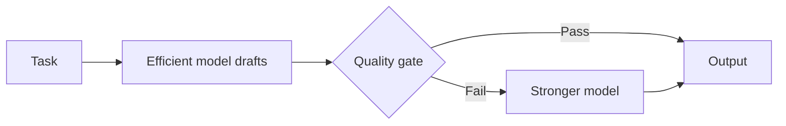

:::info 출처 · 라이선스
이 문서는 Om Bharatiya의 [AI System Design Guide](https://github.com/ombharatiya/ai-system-design-guide/blob/main/13-reliability-and-safety/02-ensemble-methods.md)(MIT License, © 2026 Om Bharatiya)를 한국어로 옮긴 **비공식 번역본**입니다. 번역·편집 책임은 SecureNomad에 있습니다. 전체 안내는 [소개 · 출처 · 라이선스](../index.md)를 참고하세요. 번역 기준: 원문 커밋 `ed955b2`(2026-10-09).
:::

:::note 번역 주
원문은 외부 자료로, 기업명·제품명·모델명·버전·논문·라이선스명은 원문 표기를 유지합니다. 코드·다이어그램은 원문 그대로 둡니다.
:::

# LLM 신뢰성을 위한 앙상블 기법

앙상블 기법은 프로덕션 신뢰성에 핵심이다. 이 장은 정확도를 높이고 환각을 줄이는 멀티모델 조율 패턴을 다룬다.

## 왜 앙상블이 중요한가

고위험 애플리케이션엔 단일 모델 출력이 신뢰하기 어렵다:
- 모델이 사실을 환각
- 추론이 결함일 수 있음
- 출력이 샘플마다 달라짐
- 단일 판정자 평가는 편향

앙상블은 중복성·다양성으로 신뢰성을 높인다.

### 앙상블 기법 분류

| 범주 | 목적 | 기법 |
|----------|---------|---------|
| 평가 | 판정자 편향 감소 | Panel of Judges, Pairwise Comparison |
| 생성 | 출력 품질 향상 | Self-Consistency, Best-of-N |
| 검증 | 환각 감소 | Multi-Agent Debate, Fact Checking |
| 종합 | 관점 결합 | Mixture of Agents |
| 에스컬레이션 | 강한 모델 컴퓨트를 필요한 곳에만 | Cascade, Cross-Family Critique |

---

## 평가 앙상블

### LLM 판정자 패널(PoLL)

다양한 모델 여럿이 같은 출력을 채점:

```python
class PanelOfJudges:
    """
    Production implementation of PoLL pattern.
    Key insight: Diversity of judges matters more than individual judge quality.
    """
    def __init__(self, judges: list, aggregation: str = "mean"):
        # Use diverse model families, not just different sizes
        # Good: [Claude Sonnet 5.5, GPT-6.1 Sol, Gemini 3.8 Flash, GLM-5.3]
        # Bad: [GPT-6 Astra, GPT-6.1 Sol, GPT-6 Luna] - same family bias
        self.judges = judges
        self.aggregation = aggregation
    
    async def evaluate(self, question: str, answer: str, rubric: str) -> dict:
        # Parallel evaluation for latency
        judgments = await asyncio.gather(*[
            judge.score(question, answer, rubric) 
            for judge in self.judges
        ])
        
        scores = [j["score"] for j in judgments]
        
        # Track inter-judge agreement for confidence
        agreement = 1 - (np.std(scores) / max(np.mean(scores), 0.01))
        
        if self.aggregation == "mean":
            final_score = np.mean(scores)
        elif self.aggregation == "median":  # More robust to outliers
            final_score = np.median(scores)
        elif self.aggregation == "trimmed_mean":  # Drop highest and lowest
            final_score = np.mean(sorted(scores)[1:-1])
        
        return {
            "score": final_score,
            "confidence": agreement,
            "individual_scores": scores,
            "needs_review": agreement < 0.7  # Flag for human review
        }
```

**언제 쓰나:** 고위험 평가, 벤치마크 제작, 단일 판정자 편향이 용납 안 될 때.

**일치는 정확도가 아니다.** 판정자는 상관된 방식으로 실패하니, 일치하는 패널이 함께 자신만만하게 틀릴 수 있다. 2026-09 연구(arXiv 2609.29769)는 텍스트 대신 타입 점수를 반환하는 결정 모델 Jev를 LLM 루브릭 판정자와 비교: LLM 판정자는 16\~325배 비싸고 28\~350배 느렸는데, Jev의 가장 자신만만한 오류에서 LLM 판정의 약 96%가 같은 오답을 반복했고, 어떤 캐스케이드도 최고 단일 판정자를 2.7점 넘게 못 이겼다. 패널은 분산을 줄이고 캐스케이드는 비용을 깎지만, 둘 다 판정자가 공유하는 맹점은 믿을 만하게 못 잡는다. 사람이 라벨링한 골드셋을 두고 패널을 자신이 아니라 그에 대고 측정하라.

### 위치 디바이싱 쌍대 비교

LLM 판정자는 위치 편향을 보여 흔히 먼저 나온 답을 선호하고, 그 크기는 판정자·작업마다 다르다(Zheng et al., 2023; Wang et al., 2023). 항상 두 순서를 모두 돌려라:

```python
async def pairwise_compare_debiased(model, response_a: str, response_b: str, criteria: str) -> dict:
    """
    Critical: Models have significant positional bias.
    Always run both orderings and aggregate.
    """
    # Run both orderings in parallel
    result_ab, result_ba = await asyncio.gather(
        model.compare(first=response_a, second=response_b, criteria=criteria),
        model.compare(first=response_b, second=response_a, criteria=criteria)
    )
    
    # If A wins in both positions -> Strong signal for A
    if result_ab["winner"] == "first" and result_ba["winner"] == "second":
        return {"winner": "A", "confidence": "high"}
    
    # If B wins in both positions -> Strong signal for B
    elif result_ab["winner"] == "second" and result_ba["winner"] == "first":
        return {"winner": "B", "confidence": "high"}
    
    # Winner depends on position -> Positional bias detected
    else:
        return {
            "winner": "tie",
            "confidence": "low",
            "note": "Positional bias detected"
        }
```

---

## 생성 앙상블

### 자기 일관성(다수결)

여러 추론 경로를 생성하고 최종 답에 투표:

```python
class SelfConsistencyDecoder:
    """
    Key parameters:
    - k (sample count): 5-10 for most tasks, 15-20 for hard math
    - temperature: 0.5-0.8 for reasoning tasks, where the API still accepts it
    
    Too low temperature = not enough diversity
    Too high temperature = too much noise
    """
    
    def __init__(self, model, k: int = 7, temperature: float | None = 0.7):
        self.model = model
        self.k = k
        self.temperature = temperature  # None for models with fixed sampling
    
    async def generate_with_consistency(self, prompt: str) -> dict:
        # Pass temperature only if the target model accepts it
        sampling = {} if self.temperature is None else {"temperature": self.temperature}
        
        # Generate k reasoning paths in parallel
        responses = await asyncio.gather(*[
            self.model.generate(prompt, **sampling)
            for _ in range(self.k)
        ])
        
        # Extract final answers (task-specific)
        answers = [self.extract_answer(r) for r in responses]
        
        # Majority voting
        answer_counts = Counter(answers)
        majority_answer, majority_count = answer_counts.most_common(1)[0]
        
        # Confidence = proportion of votes for winner
        confidence = majority_count / self.k
        
        # Get best reasoning path that led to majority answer
        best_reasoning = self.select_best_reasoning(
            responses, answers, majority_answer
        )
        
        return {
            "answer": majority_answer,
            "confidence": confidence,
            "num_paths": self.k,
            "reasoning": best_reasoning,
            "vote_distribution": dict(answer_counts)
        }
    
    def extract_answer(self, response: str) -> str:
        # Task-specific answer extraction
        # For math: extract the final number
        # For code: extract the function
        # Implement based on your task
        pass
```

**적합:** 검증 가능한 답이 있는 수학·논리·코딩. 원 논문(Wang et al.)의 greedy chain-of-thought 대비 헤드라인 향상은 +3.9점(ARC-challenge)\~+17.9(GSM8K)인데, 내장 추론이 없던 2022년대 모델 측정치다. 그 수치를 현 추론 모델에 그대로 가져가지 말고, k배 비용을 치르기 전 내 평가셋에서 향상을 측정하라.

### 샘플링 통제가 사라지고 있다

고전 레시피는 다양성을 위해 temperature를 튜닝한다. 프런티어 API에서 그 노브가 사라지고 있다:

| 플랫폼 | 상태 (2026년 10월) |
|----------|-----------------------|
| Claude API | Opus 4.7 이상·Sonnet 5 이상에서 비기본 샘플링 값에 400 반환; Anthropic Python SDK 1.0(2026-08-20)이 Messages 메서드에서 `temperature`·`top_p`·`top_k` 제거, 넘기면 `TypeError` |
| Gemini API | `temperature`·`top_p`·`top_k` 2026-07-21 폐기; Gemini 3.8 Flash는 `thinking_budget` 대신 `thinking_level`로 추론 통제 |
| OpenAI GPT-6 Astra | 커스텀 `temperature`·`top_p` 없음, `logprobs` 없음 |

이것이 앙상블에 바꾸는 것:

- **다양성은 다른 데서 온다.** 이 모델들의 기본 샘플링이 이미 확률적이라 k 샘플은 여전히 불일치한다. 충분히 불일치하지 않으면 temperature 대신 프롬프트·추론 노력·모델 패밀리를 바꿔라.
- **신뢰도는 logprob이 아니라 투표에서.** Astra에 logprob이 없으니 샘플 간 득표율(또는 판정자 점수)이 신뢰 신호.
- **최신 Claude 모델에 추론을 쓰라고 하지 말 것.** `<thinking>` 섹션이나 JSON `reasoning` 필드를 요구하는 프롬프트가 `reasoning_extraction` 범주로 거부될 수 있고, 그 거부는 2026-09-24부터 과금됐다. 최종 답에 투표하고, 경로가 필요하면 짧은 설명을 요구하거나 `thinking: {type: "adaptive", display: "summarized"}`로 요약된 thinking을 읽어라(기본 `display: "omitted"`에선 빈 thinking 블록 반환).

### Best-of-N with Reward Model

N개 후보 생성, 보상 모델로 채점, 최고 반환:

```python
class BestOfNSampler:
    """
    Key considerations:
    1. N selection: N=4-8 for interactive, N=16-64 for batch
    2. Reward model ensemble reduces (does not prevent) reward hacking
    3. Monitor sample diversity - if too similar, BoN is wasted compute
    """
    
    def __init__(self, generator, reward_models: list, n: int = 8):
        self.generator = generator
        self.reward_models = reward_models  # Ensemble for robustness
        self.n = n
    
    async def generate_best(self, prompt: str) -> dict:
        # Generate N candidates in parallel
        candidates = await asyncio.gather(*[
            self.generator.generate(prompt, temperature=0.8)  # drop on fixed-sampling models
            for _ in range(self.n)
        ])
        
        # Score with reward model ensemble
        scored_candidates = []
        for candidate in candidates:
            rm_scores = await asyncio.gather(*[
                rm.score(prompt, candidate) for rm in self.reward_models
            ])
            
            # Conservative aggregation makes reward hacking harder
            # Use 25th percentile instead of mean
            conservative_score = np.percentile(rm_scores, 25)
            
            scored_candidates.append({
                "response": candidate,
                "score": conservative_score,
                "rm_agreement": 1 - np.std(rm_scores) / np.mean(rm_scores)
            })
        
        # Select best by conservative score
        best = max(scored_candidates, key=lambda x: x["score"])
        
        # Compute diversity metric
        diversity = self.compute_diversity(candidates)
        
        return {
            "response": best["response"],
            "score": best["score"],
            "n_sampled": self.n,
            "diversity_score": diversity,
            "low_diversity_warning": diversity < 0.3
        }
    
    def compute_diversity(self, candidates: list) -> float:
        # Embed candidates and compute average pairwise distance
        embeddings = [embed(c) for c in candidates]
        similarities = []
        for i in range(len(embeddings)):
            for j in range(i + 1, len(embeddings)):
                similarities.append(cosine_similarity(embeddings[i], embeddings[j]))
        return 1 - np.mean(similarities)  # Higher = more diverse
```

**적합:** 개방형 생성, 창작 작업. 이득은 채점기에 묶인다: 프록시 보상 모델에 대해 best-of-n은 처음엔 진짜 품질을 높이다 n이 커지면 떨어뜨릴 수 있으니(Gao et al., 2022), 선택을 인간 평점에 대조하고 N을 적당히 유지하라.

---

## 멀티에이전트 패턴

### 멀티에이전트 토론

여러 모델이 반복적으로 서로 비평:

```python
class MultiAgentDebate:
    """
    Pattern: Multiple models debate to reduce hallucinations.
    
    Most effective when:
    1. Models have different biases (diverse model families)
    2. 2-3 rounds is optimal (more = diminishing returns)
    3. Explicit "devil's advocate" prompting improves results
    """
    
    def __init__(self, debaters: list, rounds: int = 2):
        self.debaters = debaters
        self.rounds = rounds
    
    async def debate(self, question: str) -> dict:
        # Round 0: Initial positions
        positions = await asyncio.gather(*[
            debater.generate(f"Answer this question with reasoning: {question}")
            for debater in self.debaters
        ])
        
        debate_history = [{"round": 0, "positions": positions}]
        
        # Debate rounds
        for round_num in range(1, self.rounds + 1):
            new_positions = []
            
            for i, debater in enumerate(self.debaters):
                other_positions = [p for j, p in enumerate(positions) if j != i]
                
                critique_prompt = f"""
Question: {question}

Your previous answer: {positions[i]}

Other perspectives:
{self.format_positions(other_positions)}

Consider the other perspectives. If they raise valid points, update your answer.
If you still disagree, explain why with specific reasoning.
Provide your final answer.
"""
                new_position = await debater.generate(critique_prompt)
                new_positions.append(new_position)
            
            positions = new_positions
            debate_history.append({"round": round_num, "positions": positions})
        
        # Final synthesis
        final_answer = await self.synthesize(question, debate_history)
        
        return {
            "answer": final_answer,
            "rounds": self.rounds,
            "consensus_reached": self.check_consensus(positions),
            "debate_history": debate_history
        }
```

**적합:** 사실 검증, 복잡한 답변의 환각 감소.

### Mixture of Agents (MoA)

여러 모델이 집계기로 들어가는 계층형 아키텍처:

```
┌─────────────────────────────────────────────────────────────────┐
│                    MIXTURE OF AGENTS (MoA)                       │
├─────────────────────────────────────────────────────────────────┤
│                                                                  │
│  Layer 1 (Proposers):                                           │
│  ┌─────────┐  ┌─────────┐  ┌─────────┐  ┌─────────┐            │
│  │ Claude  │  │  GPT-6  │  │ Gemini  │  │ Llama   │            │
│  └────┬────┘  └────┬────┘  └────┬────┘  └────┬────┘            │
│       │            │            │            │                   │
│       └────────────┴─────┬──────┴────────────┘                  │
│                          │                                       │
│  Layer 2 (Aggregator):   ▼                                      │
│  ┌──────────────────────────────────────────────────┐           │
│  │  "Given these perspectives: [R1, R2, R3, R4]    │           │
│  │   Synthesize the best answer..."                │           │
│  └────────────────────────┬─────────────────────────┘           │
│                           │                                      │
│                           ▼                                      │
│                    [Final Output]                                │
└─────────────────────────────────────────────────────────────────┘
```

```python
class MixtureOfAgents:
    def __init__(self, proposers: list, aggregator):
        self.proposers = proposers
        self.aggregator = aggregator
    
    async def generate(self, prompt: str) -> str:
        # Layer 1: Get diverse proposals
        proposals = await asyncio.gather(*[
            proposer.generate(prompt) for proposer in self.proposers
        ])
        
        # Layer 2: Aggregate
        aggregation_prompt = f"""
Given the following question and multiple expert responses, 
synthesize the best possible answer.

Question: {prompt}

Expert responses:
{self.format_proposals(proposals)}

Synthesize the best answer, combining the strongest elements from each response.
"""
        
        final_answer = await self.aggregator.generate(aggregation_prompt)
        return final_answer
```

**적합:** 복잡한 종합, 리포트 생성, 다분야 문제.

### 캐스케이드와 교차 패밀리 비평

더 싼 두 패턴이 이제 개발자 도구에 나타난다. GitHub의 HydraFusion(2026-09-30부터 VS Code·Copilot 앱의 연구 프리뷰)은 세 모드 중 하나로 여러 모델을 조율한다:

- **Single:** 모델 하나, 베이스라인.
- **Cascade:** 효율 모델이 초안을 쓰고, 품질 게이트가 판단하며, 게이트를 통과 못 할 때만 더 강한 모델로 에스컬레이트. 비용은 강한 모델 가격이 아니라 에스컬레이션 비율을 따른다.
- **Critique:** 다른 모델 패밀리의 비평자가 초안을 검토하고 초안 작성자가 한 번 수정. 1라운드가 비용을 묶고, 다른 패밀리 비평자는 작성자의 맹점을 공유할 가능성이 낮다.



캐스케이드는 게이트만큼만 좋다. 게이트가 작성자와 같은 패밀리의 판정자면 작성자의 특징적 실수를 통과시킬 것(위의 상관 오류 결과)이니, 검증 가능한 것을 확인하는 게이트를 선호하라: 테스트 통과, 스키마 검증, 인용 해소.

---

## 앙상블 vs 중재(Arbitration)

### 개념 구분

| 측면 | 앙상블 학습 | 모델 중재 |
|--------|------------------|-------------------|
| **목표** | 모든 출력 결합 | 단일 최고 출력 선택 |
| **메커니즘** | 집계(투표·평균) | 선택(채점·랭킹) |
| **관계** | 협력적 | 경쟁적 |
| **최종 출력** | 전 모델의 합성물 | 단일 승자의 출력 |
| **언제** | 견고성·분산 감소 원할 때 | 최고 품질 원할 때 |

### 결정 프레임워크

```
Is there a single "correct" answer format?
├── Yes (classification, math)
│   └── Use Ensemble (voting/averaging)
│
└── No (creative writing, open QA)
    └── Use Arbitration (best-of-N)
        └── Do you have reliable scoring?
            ├── Yes → Reward model selection
            └── No → LLM-as-judge or human
```

---

## 비용-정확도 트레이드오프

### 앙상블 비용 행렬

| 기법 | 비용 배수 | 지연 | 기대 효과 | 언제 |
|--------|-----------------|---------|---------------|-------------|
| 단일 모델 | 1x | 1x | 베이스라인 | 저위험·대량 |
| 자기 일관성 k=3 | 3x | 1x(병렬) | 미미; 3자 분할은 다수가 없음 | 추론, 지연 민감 |
| 자기 일관성 k=10 | 10x | 1x(병렬) | 검증 가능 답에 더 큼, k 증가 시 수확 체감 | 수학, 정확도 중요 |
| Best-of-N (N=8) | 8x + 채점 | 1x(병렬) | 채점기에 묶임; 해킹 가능 보상 모델엔 저하 가능 | 창작 생성 |
| 판정자 패널(3) | 3x 평가 | 1x(병렬) | 편향 감소 | 평가 작업 |
| 멀티에이전트 토론 | 6x | 3x | 환각 ↓ | 사실 중요 |
| Mixture of Agents | 5-8x | 2x | 더 나은 종합 | 복잡한 리포트 |
| 품질 게이트 캐스케이드 | 1x + 게이트 + (에스컬레이션 비율 x 강한 모델) | 1x, 에스컬레이션 시 2x | 게이트가 믿을 만하면 강한 모델 품질에 근접 | 검증 가능 게이트의 대량 |
| 교차 패밀리 비평(1라운드) | 약 3x | 약 3x(순차) | 패밀리 특정 오류 포착 | 코드 리뷰, 사실 중요 초안 |

효과 열은 일부러 방향성만 준다. 효과 크기는 모델·작업에 달렸으니, 배수를 치르기 전 각 기법을 내 평가셋에서 단일 모델 베이스라인에 대고 측정하라.

### 앙상블을 쓰지 말아야 할 때

| 상황 | 이유 | 대안 |
|-----------|---------|-------------|
| 단순 사실 조회 | 다양성 이득 없음 | 단일 RAG 호출 |
| 지연 500ms 미만 요구 | 앙상블이 지연 추가 | 단일 모델 + 캐싱 |
| 비용이 주 제약 | 앙상블이 비용 배수 | 모델 증류 |
| 모델이 고도로 상관 | 다양성 없음 = 이득 없음 | 먼저 다양한 모델 확보 |

---

## 면접 질문

### Q: 자기 일관성과 Best-of-N을 각각 언제 쓰나?

**좋은 답변:**

"둘은 목적이 다르다:

**자기 일관성**은 추출·검증 가능한 답이 있는 작업용:
- 수학 문제: 최종 숫자 추출, 다수결
- 분류: 라벨 투표
- 단답 QA: 답 투표

핵심은 답을 동등성으로 비교할 수 있다는 것. API가 temperature를 노출하는 곳에선 0.5-0.8이 일관성을 유지하며 다양성을 주고; 고정 샘플링 모델(최신 Claude·GPT-6 Astra)이나 폐기된 샘플링 파라미터(Gemini, 2026-07부터)에선 기본 샘플링에 의존하고 샘플이 너무 쉽게 일치하면 프롬프트·모델 변화를 더한다. 대부분 작업에 k=5-10.

**Best-of-N**은 단일 정답이 없는 개방형 생성용:
- 창작
- 설명
- 여러 방식으로 쓸 수 있는 코드

여기선 동등성 비교를 못 하니 후보 채점에 보상 모델·판정자가 필요. 보통 N=8-16. 과제는 보상 해킹 회피라, 보수적 집계의 보상 모델 앙상블을 쓴다.

창작에 자기 일관성(추출 가능 답 없음)이나 수학에 Best-of-N(그냥 투표가 더 단순)은 안 쓴다."

### Q: Best-of-N에서 보상 해킹을 어떻게 막나?

**좋은 답변:**

"보상 해킹은 모델이 진짜 품질을 높이는 대신 보상 모델의 약점을 악용하는 것.

**내 완화책:**

1. **보상 모델 앙상블**: 다양한 보상 모델 3개 이상. 하나를 해킹하는 샘플이 전부를 해킹하긴 어렵다.

2. **보수적 집계**: 평균 대신 25퍼센타일·최솟값. 하나가 아니라 모든 RM에서 잘 나오는 샘플을 선택.

3. **다양성 모니터링**: 샘플 다양성 추적. 너무 낮아지면 모델이 좁은 보상 해킹을 악용 중일 수 있다. 프롬프트·추론 노력, 또는 API가 아직 받는 곳의 temperature를 변화시킨다.

4. **인간 보정**: RM 선택 샘플이 실제 인간 선호와 맞는지 주기적 검증.

5. **다차원**: 여러 기준(품질·안전·관련성)에 채점하고 합성 점수만이 아니라 전부에 좋은 점수 요구. 합산 루브릭은 강한 기준이 실패하는 기준을 가린다: 2026-09 루브릭-RL 연구(arXiv 2609.38847)는 루브릭 커버리지는 오르는데 홀드아웃 의사 기준의 적절성이 미학습 모델 아래로 떨어지는 걸 봤고, 한 차원을 그 모든 기준이 통과할 때만 세면 커버리지 손실 없이 적절성이 10.8점 올랐다. 같은 게이트가 N개 샘플 선택에도 작동.

핵심 통찰은 어떤 단일 보상 신호도 게이밍될 수 있다는 것. 앙상블이 게이밍을 훨씬 어렵게 한다."

### Q: LLM 판정자 3인 패널이 판정의 95%에 일치한다. 좋은 소식인가?

**좋은 답변:**

"그 자체로는 아니다. 높은 일치는 패널이 일관적이란 것이지 옳다는 게 아니다. 판정자는 학습 데이터·맹점을 공유하니 오류가 상관된다. 2026-09 싼 결정 모델 판정자 대 LLM 루브릭 판정자 비교(arXiv 2609.29769)는 싼 판정자의 가장 자신만만한 오류에서 LLM 판정의 약 96%가 같은 오답을 반복하고, 캐스케이드가 최고 단일 판정자에 최대 2.7점만 더했음을 발견.

**내가 확인할 것:**
1. **사람이 라벨링한 골드셋 대비 정확도**, 중요한 기준으로 층화. 판정자 간 일치는 대체물이 아니다.
2. **패널이 사람과 함께 틀리는 곳.** 그 사례들이 공유 맹점을 드러내고, 그게 골드셋에 추가할 것.
3. **진짜 다양성.** 다른 모델 패밀리, 그리고 이진 체크리스트 기준엔 다른 판정자 유형(또 다른 LLM이 아니라 타입 결정 모델). 한 패밀리 3인은 3배 비용의 1인이다.
4. **위치·길이 편향**, 순서 교환·길이 통제로.

패널이 골드셋에서 정확하면 95% 일치는 아마 1\~2인으로 줄여 돈을 아낄 수 있다는 뜻. 아니면 그 일치가 문제를 숨기고 있던 것."

---

## 참고 문헌

- Verga et al. "Replacing Judges with Juries: Evaluating LLM Generations with a Panel of Diverse Models" (2024)
- Wang et al. "Self-Consistency Improves Chain of Thought Reasoning in Language Models" (ICLR 2023): https://arxiv.org/abs/2203.11171
- Gao, Schulman, and Hilton. "Scaling Laws for Reward Model Overoptimization" (2022): https://arxiv.org/abs/2210.10760
- Du et al. "Improving Factuality and Reasoning in Language Models through Multiagent Debate" (2023)
- Wang et al. "Mixture-of-Agents Enhances Large Language Model Capabilities" (2024)
- Zheng et al. "Judging LLM-as-a-Judge with MT-Bench and Chatbot Arena" (2023)
- Wang et al. "Large Language Models are not Fair Evaluators" (2023)
- Rao and Callison-Burch. "JEV vs. LLMs as Rubric Judges: Cheaper, Faster, and Wrong in the Same Places" (arXiv 2609.29769, 2026): https://arxiv.org/abs/2609.29769
- GitHub changelog, HydraFusion in VS Code and the GitHub Copilot app (September 30, 2026): https://github.blog/changelog/2026-09-30-hydrafusion-in-vs-code-and-the-github-copilot-app
- Liu et al. "Scoring Higher, Answering Worse: Mitigating Reward Hacking in Rubric-Based RL via Protocol-Level Rubrics" (arXiv 2609.38847, 2026): https://arxiv.org/abs/2609.38847

---

*이전: [가드레일과 안전](01-guardrails.md) · 다음: [신뢰성 패턴](03-reliability-patterns.md)*
