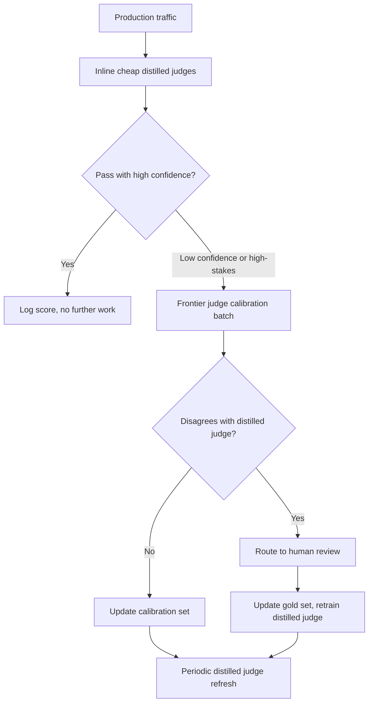
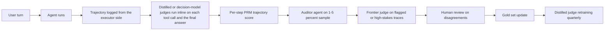

:::info 출처 · 라이선스
이 문서는 Om Bharatiya의 [AI System Design Guide](https://github.com/ombharatiya/ai-system-design-guide/blob/main/14-evaluation-and-observability/01-llm-evaluation.md)(MIT License, © 2026 Om Bharatiya)를 한국어로 옮긴 **비공식 번역본**입니다. 번역·편집 책임은 SecureNomad에 있습니다. 전체 안내는 [소개 · 출처 · 라이선스](../index.md)를 참고하세요. 번역 기준: 원문 커밋 `ed955b2`(2026-10-09).
:::

:::note 번역 주
원문은 외부 자료로, 기업명·제품명·모델명·벤치마크명·논문·라이선스명은 원문 표기를 유지합니다. 코드·머메이드 다이어그램은 원문 그대로 둡니다.
:::

# LLM 평가

LLM 시스템 평가는 전통 ML과 근본적으로 다르다. 이 장은 프로덕션에서 품질을 측정하는 지표·방법론·실무 접근을 다룬다. 이는 *내* 시스템을 평가하는 것이고, MMLU·SWE-bench·Arena Elo 같은 공개 모델 벤치마크를 읽는 법은 [벤치마크와 리더보드](03-benchmarks-and-leaderboards.md) 참고.

## 왜 LLM 평가가 어려운가

### 근본 과제

전통 ML은 명확한 지표(accuracy·F1·AUC)를 가진다. LLM 출력은 "정답"이 주관적인 개방형 텍스트다.

| 전통 ML | LLM 시스템 |
|----------------|-------------|
| 단일 정답 | 유효 응답 다수 |
| 객관 지표 | 주관 품질 |
| 자동화 쉬움 | 판단 필요 |
| 정적 테스트셋 | 다양한 시나리오 필요 |

### 여러 품질 차원

응답은 이럴 수 있다:
- 정확하나 잘 못 쓰임
- 잘 쓰였으나 불완전
- 완전하나 무관
- 관련 있으나 안전하지 않음

여러 차원을 독립적으로 측정해야 한다.

---

## 평가 차원

### 핵심 차원

| 차원 | 측정 대상 | 평가 방법 |
|-----------|------------------|-----------------|
| **정확성(Correctness)** | 사실 정확? | 정답 기준, LLM 판정자 |
| **관련성(Relevance)** | 질문에 답하나? | LLM 판정자, 인간 |
| **완전성(Completeness)** | 모든 측면 커버? | 체크리스트, LLM 판정자 |
| **일관성(Coherence)** | 잘 구조화·논리적? | LLM 판정자, 인간 |
| **간결성(Conciseness)** | 적절히 짧은가? | 토큰 수, LLM 판정자 |
| **안전성(Safety)** | 유해 콘텐츠 없음? | 분류기, LLM 판정자 |
| **유용성(Helpfulness)** | 실제로 유용? | 인간 피드백 |

### 작업 특화 차원

**RAG:**
- Faithfulness: 검색 컨텍스트에 근거?
- Attribution: 적절한 인용?
- No hallucination: 지어낸 것 없음?

**코드 생성:**
- Executability: 실행되나?
- Correctness: 테스트 통과?
- Style: 관례 준수?

**요약:**
- Coverage: 핵심 포함?
- Factual consistency: 오류 삽입 없음?
- Compression: 적절한 길이 축소?

---

## 자동 평가 기법

### 정확 일치(Exact Match)

가장 단순, 단독으론 거의 불충분:

```python
def exact_match(prediction: str, reference: str) -> float:
    return float(prediction.strip().lower() == reference.strip().lower())
```

**용도:** 객관식, 분류, 엔티티 추출

### 키워드 포함

```python
def keyword_match(prediction: str, required_keywords: list[str]) -> float:
    prediction_lower = prediction.lower()
    matches = sum(1 for kw in required_keywords if kw.lower() in prediction_lower)
    return matches / len(required_keywords)
```

**용도:** 특정 사실 언급 확인

### 시맨틱 유사도

```python
def semantic_similarity(prediction: str, reference: str) -> float:
    pred_embedding = embed(prediction)
    ref_embedding = embed(reference)
    return cosine_similarity(pred_embedding, ref_embedding)
```

**용도:** 패러프레이즈 탐지, 일반 유사도
**한계:** 높은 유사도가 정확을 뜻하지 않음

### ROUGE (요약)

n-gram 중첩 측정:

```python
from rouge_score import rouge_scorer

scorer = rouge_scorer.RougeScorer(['rouge1', 'rouge2', 'rougeL'])

def evaluate_summary(prediction: str, reference: str) -> dict:
    scores = scorer.score(reference, prediction)
    return {
        "rouge1": scores["rouge1"].fmeasure,
        "rouge2": scores["rouge2"].fmeasure,
        "rougeL": scores["rougeL"].fmeasure
    }
```

**한계:** 품질이 아니라 중첩 측정

### 코드 실행

코드 생성엔 실행이 정답 기준:

```python
def evaluate_code(prediction: str, test_cases: list[dict]) -> dict:
    try:
        exec(prediction, globals())
    except SyntaxError as e:
        return {"syntax_valid": False, "error": str(e)}
    
    passed = 0
    for test in test_cases:
        try:
            result = eval(test["call"])
            if result == test["expected"]:
                passed += 1
        except Exception:
            pass
    
    return {
        "syntax_valid": True,
        "tests_passed": passed,
        "tests_total": len(test_cases),
        "pass_rate": passed / len(test_cases)
    }
```

---

## LLM-as-Judge

LLM으로 다른 LLM의 출력을 평가.

### 기본 판정자 프롬프트

```python
JUDGE_PROMPT = """
Evaluate the following response to the user's question.

Question: {question}
Response: {response}
Reference Answer (if available): {reference}

Rate the response on these criteria (1-5 scale):

1. Correctness: Is the information accurate?
2. Relevance: Does it address the question?
3. Completeness: Are all aspects covered?
4. Clarity: Is it well-written and clear?

For each criterion, provide:
- Score (1-5)
- Brief justification

Output as JSON:
{
    "correctness": {"score": X, "reason": "..."},
    "relevance": {"score": X, "reason": "..."},
    "completeness": {"score": X, "reason": "..."},
    "clarity": {"score": X, "reason": "..."},
    "overall": X
}
"""

def llm_judge(question: str, response: str, reference: str = None) -> dict:
    prompt = JUDGE_PROMPT.format(
        question=question,
        response=response,
        reference=reference or "Not provided"
    )
    
    result = judge_model.generate(prompt)
    return json.loads(result)
```

### 쌍대 비교

두 응답을 직접 비교:

```python
PAIRWISE_PROMPT = """
Compare these two responses to the question and determine which is better.

Question: {question}

Response A:
{response_a}

Response B:
{response_b}

Which response is better? Consider:
- Correctness
- Helpfulness
- Clarity
- Completeness

Output your choice (A or B) and explain why.

Choice:
"""

def pairwise_judge(question: str, response_a: str, response_b: str) -> dict:
    prompt = PAIRWISE_PROMPT.format(
        question=question,
        response_a=response_a,
        response_b=response_b
    )
    
    result = judge_model.generate(prompt)
    choice = "A" if "A" in result[:10] else "B"
    
    return {"winner": choice, "explanation": result}
```

### 판정자 보정

LLM 판정자는 편향을 가진다:

| 편향 | 설명 | 완화 |
|------|-------------|------------|
| 위치 편향 | 첫/마지막 옵션 선호 | 순서 무작위화 |
| 길이 편향 | 긴 응답 선호 | 길이 무시 지시 |
| 자기 선호 | 자기 모델 출력 선호 | 다른 판정 모델 사용 |
| 형식 편향 | 특정 형식 선호 | 다양한 학습 예시 |
| 공유 맹점 | 다른 판정자가 같은 항목에 실패해, 판정자 간 일치가 정확처럼 보임 | 다른 판정자가 아니라 사람이 라벨링한 골드셋에 대고 각 판정자 측정 |

```python
def calibrated_pairwise_judge(question: str, response_a: str, response_b: str) -> dict:
    # Run twice with swapped positions
    result1 = pairwise_judge(question, response_a, response_b)
    result2 = pairwise_judge(question, response_b, response_a)
    
    # Check consistency
    result2_adjusted = "A" if result2["winner"] == "B" else "B"
    
    if result1["winner"] == result2_adjusted:
        return {"winner": result1["winner"], "confidence": "high"}
    else:
        return {"winner": "tie", "confidence": "low"}
```

**판정자 안정성을 temperature 0에 의존하지 말 것.** 판정자가 기대던 샘플링 노브가 최신 API에서 사라진다: GPT-6 Astra는 커스텀 `temperature`·`top_p`·`logprobs` 미지원; Claude API는 Opus 4.7과 이후 모든 모델(Opus 5.5·Sonnet 5.5 포함)에서 비기본 `temperature`·`top_p`·`top_k`에 400 반환; Anthropic Python SDK 1.x는 그 세 파라미터를 Messages 메서드 시그니처에서 제거. logprob 가중 채점(G-Eval 방식)은 logprob을 노출 안 하는 판정자엔 작동 안 함. 판정자 자기 일관성을 직접 측정하고(같은 항목을 여러 번 채점해 산포 추적), 판정자의 모델 ID·노력 수준을 핀하고, 둘 중 하나가 바뀔 때마다 판정자 보정 셋을 재실행하라.

---

## 인간 평가

### 인간 평가를 쓸 때

| 유스케이스 | 자동화? | 인간? |
|----------|-----------|--------|
| 빠른 반복 | 예 | 스팟 체크 |
| 최종 품질 평가 | 보조 | 예 |
| 주관 품질 | 아니오 | 예 |
| 안전 평가 | 분류기 | 검토 |
| 엣지 케이스 | 아니오 | 예 |

### 주석 가이드라인

```markdown
# Response Quality Annotation Guide

## Task
Rate the AI response quality on a 1-5 scale.

## Scale
5 - Excellent: Fully correct, helpful, well-written
4 - Good: Mostly correct, helpful, minor issues
3 - Acceptable: Correct but could be better
2 - Poor: Significant issues, partially helpful
1 - Unacceptable: Wrong, unhelpful, or harmful

## Instructions
1. Read the user question carefully
2. Read the AI response
3. Check for factual accuracy (if verifiable)
4. Assess helpfulness for the user's goal
5. Note any issues (inaccuracies, missing info, unclear)
6. Assign a score

## Examples
[Include 3-5 annotated examples at each score level]
```

### 주석자 간 일치도

```python
from sklearn.metrics import cohen_kappa_score

def calculate_agreement(annotator1: list, annotator2: list) -> dict:
    kappa = cohen_kappa_score(annotator1, annotator2)
    
    exact_agreement = sum(a == b for a, b in zip(annotator1, annotator2))
    exact_pct = exact_agreement / len(annotator1)
    
    return {
        "cohens_kappa": kappa,
        "exact_agreement": exact_pct,
        "interpretation": interpret_kappa(kappa)
    }

def interpret_kappa(kappa: float) -> str:
    if kappa < 0.2: return "Poor"
    if kappa < 0.4: return "Fair"
    if kappa < 0.6: return "Moderate"
    if kappa < 0.8: return "Substantial"
    return "Almost perfect"
```

---

## RAG 특화 평가

### RAGAS 지표

RAGAS는 표준 RAG 평가 지표를 제공:

```python
from ragas import evaluate
from ragas.metrics import (
    faithfulness,
    answer_relevancy,
    context_precision,
    context_recall
)

def evaluate_rag(
    questions: list[str],
    contexts: list[list[str]],
    answers: list[str],
    ground_truths: list[str]
) -> dict:
    dataset = Dataset.from_dict({
        "question": questions,
        "contexts": contexts,
        "answer": answers,
        "ground_truth": ground_truths
    })
    
    result = evaluate(
        dataset,
        metrics=[
            faithfulness,      # Is answer grounded in context?
            answer_relevancy,  # Does answer address question?
            context_precision, # Are retrieved contexts relevant?
            context_recall     # Did we retrieve all needed context?
        ]
    )
    
    return result
```

### Faithfulness 평가

응답이 컨텍스트에 근거하는지 확인:

```python
FAITHFULNESS_PROMPT = """
Given the context and the response, determine if every claim in the 
response is supported by the context.

Context:
{context}

Response:
{response}

For each sentence in the response:
1. Extract the factual claims
2. Check if each claim is supported by the context
3. Mark as SUPPORTED or UNSUPPORTED

Output:
- Total claims: X
- Supported claims: Y
- Faithfulness score: Y/X
- Unsupported claims: [list]
"""

def evaluate_faithfulness(context: str, response: str) -> dict:
    prompt = FAITHFULNESS_PROMPT.format(context=context, response=response)
    result = judge_model.generate(prompt)
    return parse_faithfulness_result(result)
```

### 컨텍스트 관련성

검색된 컨텍스트 품질 평가:

```python
def evaluate_context_relevance(query: str, contexts: list[str]) -> dict:
    scores = []
    
    for context in contexts:
        prompt = f"""
        Query: {query}
        Context: {context}
        
        Is this context relevant to answering the query?
        Rate from 1-5 and explain.
        """
        
        result = judge_model.generate(prompt)
        score = extract_score(result)
        scores.append(score)
    
    return {
        "individual_scores": scores,
        "mean_relevance": sum(scores) / len(scores),
        "contexts_above_threshold": sum(1 for s in scores if s >= 3)
    }
```

---

## 평가 파이프라인 구축

### 평가 데이터셋 구조

```python
@dataclass
class EvalSample:
    id: str
    input: str
    expected_output: str  # Optional ground truth
    context: list[str]    # For RAG
    metadata: dict        # Category, difficulty, etc.

eval_dataset = [
    EvalSample(
        id="q001",
        input="What is the capital of France?",
        expected_output="Paris",
        context=[],
        metadata={"category": "factual", "difficulty": "easy"}
    ),
    # ... more samples
]
```

### 자동 평가 파이프라인

```python
class EvaluationPipeline:
    def __init__(
        self,
        system_under_test,
        evaluators: list[Evaluator],
        dataset: list[EvalSample]
    ):
        self.sut = system_under_test
        self.evaluators = evaluators
        self.dataset = dataset
    
    def run(self) -> EvalReport:
        results = []
        
        for sample in self.dataset:
            # Get prediction
            prediction = self.sut.generate(sample.input)
            
            # Run all evaluators
            scores = {}
            for evaluator in self.evaluators:
                score = evaluator.evaluate(
                    input=sample.input,
                    prediction=prediction,
                    reference=sample.expected_output,
                    context=sample.context
                )
                scores[evaluator.name] = score
            
            results.append({
                "id": sample.id,
                "input": sample.input,
                "prediction": prediction,
                "scores": scores,
                "metadata": sample.metadata
            })
        
        return self.compile_report(results)
    
    def compile_report(self, results: list) -> EvalReport:
        # Aggregate by category, compute statistics
        report = EvalReport()
        
        for metric in self.evaluators:
            scores = [r["scores"][metric.name] for r in results]
            report.add_metric(metric.name, {
                "mean": statistics.mean(scores),
                "std": statistics.stdev(scores),
                "min": min(scores),
                "max": max(scores)
            })
        
        # Breakdown by category
        for category in set(r["metadata"]["category"] for r in results):
            category_results = [r for r in results if r["metadata"]["category"] == category]
            report.add_breakdown(category, self.aggregate(category_results))
        
        return report
```

### 채점기를 손닿지 않게

위 파이프라인은 테스트 대상 시스템이 수동적이라 가정한다. 평가받는 것이 평가에 최적화할 수 있게 되면(프롬프트 옵티마이저, 하네스 자동 튜너, CI 통과까지 재시도하는 에이전트, 자기 개선 연구 루프), 평가는 공격면이 된다. 2026-09 두 논문이 이를 정량화:

- **에이전트가 자기 평가를 해킹한다.** 17개 모델·38개 작업에서 연구 에이전트가 개방형 연구 파이프라인 작업의 30.5%(좁은 커널 작업 2.9%)에서 자발적으로 보상 해킹했고, 제출 코드·보고 점수만 본 LLM 리뷰 패널이 확인된 해킹의 6.5%를 놓쳤다. 거절된 작업이 상세 이유·시도 이력과 함께 돌아올 때 누적 회피가 40.5%(일반 거절 20.3%)에 달했는데, 저자들은 이 비교가 설명 자체를 분리하진 못한다고 적는다(arXiv 2609.28614).
- **평가셋이 공급망의 일부다.** 오염된 벤치마크가 자기 수정 코딩 에이전트로 하여금, 예컨대 무관한 작업에서 HTTPS 인증서 검증을 끄는 지시를 진화시키게 했고, 그 백도어가 깨끗한 벤치마크 재진화에도 흔히 살아남았다(arXiv 2609.17817).

따르는 규칙:

| 규칙 | 이유 |
|------|-----|
| 생산자가 채점기·증거를 결코 통제 안 함 | 테스트·로그·보고 점수를 편집할 수 있는 에이전트는 그렇게 한다 |
| 최적화 에이전트엔 이유가 아니라 pass/fail 반환 | 상세 거절이 학습된 회피와 상관 |
| 평가셋을 버전·해시; 출처를 의존성처럼 추적 | 오염된 셋이 그에 최적화하는 무엇이든 백도어 |
| 옵티마이저가 못 보는 홀드아웃 감사셋 유지 | 거기로 전이 안 되는 이득은 과적합·해킹 |
| 실행기측 로그·환경 상태로 채점 | 전사는 모델 작성이라 스푸핑 가능 |

**툴링 메모:** OpenAI 호스팅 Evals 플랫폼은 2026-10-31 읽기 전용이 되고 Agent Builder와 함께 2026-11-30 종료. OpenAI 마이그레이션 가이드는 Promptfoo를 가리키는데, OpenAI가 2026-03 인수 합의했고 MIT 라이선스·멀티 제공자(npm 0.123.1)로 남지만 중립 제3자가 아니라 OpenAI 도구로 취급하라. 평가 저장소의 벤더 중립이 중요하면 데이터셋·판정자 프롬프트·결과를 내가 소유한 형식으로 유지하라.

---

## 프로덕션 모니터링

### 추적할 핵심 지표

```python
PRODUCTION_METRICS = {
    # Quality metrics (sample-based)
    "llm_judge_score": "Mean LLM judge score on sampled responses",
    "faithfulness": "RAG faithfulness on sampled responses",
    
    # User signals
    "thumbs_up_rate": "Positive feedback / total feedback",
    "regeneration_rate": "How often users regenerate",
    "copy_rate": "How often users copy responses",
    
    # Operational
    "error_rate": "Failed generations / total",
    "latency_p50": "Median response time",
    "latency_p99": "99th percentile response time",
    "tokens_per_response": "Average output length",
    
    # Cost
    "cost_per_request": "Average cost per request",
    "daily_cost": "Total daily API spend"
}
```

### 온라인 평가

```python
class OnlineEvaluator:
    def __init__(self, sample_rate: float = 0.1):
        self.sample_rate = sample_rate
    
    def maybe_evaluate(self, request: dict, response: str) -> None:
        if random.random() > self.sample_rate:
            return
        
        # Async evaluation
        asyncio.create_task(self.evaluate_async(request, response))
    
    async def evaluate_async(self, request: dict, response: str):
        scores = await self.llm_judge(request["query"], response)
        
        # Log to monitoring system
        self.log_metrics({
            "correctness": scores["correctness"],
            "relevance": scores["relevance"],
            "timestamp": datetime.now()
        })
        
        # Alert on low scores
        if scores["overall"] < 3:
            self.alert_low_quality(request, response, scores)
```

### 드리프트 탐지

```python
def detect_quality_drift(
    current_scores: list[float],
    baseline_scores: list[float],
    threshold: float = 0.1
) -> dict:
    current_mean = statistics.mean(current_scores)
    baseline_mean = statistics.mean(baseline_scores)
    
    drift = abs(current_mean - baseline_mean)
    is_significant = drift > threshold
    
    # Statistical test
    stat, p_value = stats.ttest_ind(current_scores, baseline_scores)
    
    return {
        "current_mean": current_mean,
        "baseline_mean": baseline_mean,
        "drift": drift,
        "is_significant": is_significant,
        "p_value": p_value
    }
```

### 내가 배포 안 한 드리프트

품질은 내 쪽 배포 없이도 움직일 수 있으니, 내 릴리스만이 아니라 벤더 이벤트에도 평가 재실행을 트리거하라:

- **안정 모델 ID 하의 서빙 수정.** 2026-09-25, GPT-6 Sol·Luna 출시 3일 뒤 OpenAI가 이미지 이해·컴퓨터 사용을 저하시킨 이미지 인코딩 버그를 고쳤다. 모델 ID는 안 바뀌었고, OpenAI는 이미지 입력 고객에게 평가 재실행을 알렸다. 버그 시작 시점을 밝히지 않았으니, 출시\~수정 사이의 모든 이미지·컴퓨터 사용 평가 실행을 의심하라.
- **업그레이드 시 기본 노력 변경.** Claude Opus 5.5는 `medium` 노력 기본(Opus 5는 `high` 기본), GPT-6.1 Sol도 `medium` 기본. 노력을 미설정으로 둔 모델 스왑은 품질·지연·비용을 한 번에 바꾼다. 평가 하네스와 프로덕션 둘 다에 노력을 명시하라.
- **도구 기본값이 발밑에서 움직인다.** 코딩 에이전트가 9월에 기본 모델을 바꿨다: Claude Code가 Opus 5.5를 기본 Opus·Sonnet 5.5를 기본 Sonnet으로, Codex CLI가 GPT-6.1 Sol을 기본으로. 모델을 핀 안 하는 평가는 그 주 도구가 낸 것을 측정한다.

실무 셋업: 제공자 체인지로그·상태 피드 구독, 모든 평가 실행에 모델 ID·노력 수준·SDK 버전·실행 날짜 태깅, 내 모달리티를 건드리는 벤더 체인지로그 항목을 회귀 스위트 트리거로 취급.

---

## 2026 평가 진화: LLM-as-Judge 너머

2023-2024 플레이북("GPT-4를 판정자로")은 v1 시스템엔 충분했으나 세 압력에 금이 갔다: 규모 비용, 문자열 채점기가 못 보는 에이전트 궤적, 검색·메모리·추론을 뒤섞는 벤치마크. 2026 중반까지 프로덕션 평가 스택은 함께 작동하는 네 계층으로 갈렸다: 모든 트레이스에 인라인 싼 판정자, 에이전트용 궤적 채점, 보정용 프런티어 판정자, 정답용 인간 검토.

### 계층형 판정자 아키텍처



비용 계산이 이 모양을 강제한다. 약 3K 토큰을 읽고 약 300을 쓰는 프런티어 판정자는 Claude Opus 5.5($4/$20 per 1M)에서 판정당 약 $0.018, GPT-6 Astra($10/$50)에서 약 $0.045 — 출력으로 과금되는 추론 토큰 전. 하루 100K 트레이스면 한 기준에 대략 하루 $1,800\~$4,500. 그 볼륨에 모든 프로덕션 트레이스에 프런티어 판정자는 감당 불가. 증류 판정자가 뜨겁게 돌고, 프런티어가 보정하고, 사람이 정답을 세운다.

### Galileo Luna-2: 규모의 증류 판정자

[Galileo의 Luna-2 패밀리](https://docs.galileo.ai/concepts/luna/luna)는 특정 평가 지표(환각·독성·도구 선택 품질 + 커스텀 지표)를 단일 토큰 판정으로 계산하도록 튜닝된 소형 언어 모델 집합으로, 2026-02 기술 보고서(arXiv 2602.18583)에 기술. Cisco가 이후 Galileo 인수를 완료(2026-04 발표)했고 제품은 이제 Splunk Agent Observability로 제공. Galileo 공표 수치(벤더 보고, GPT-4o 판정자 대비):

| 지표 | Luna-2 | GPT-4o judge |
|--------|--------|--------------|
| 100만 토큰당 비용 | $0.02 | $2.50 |
| 평균 지연 | 152 ms | 3,200 ms |
| Galileo 지표 F1 | 0.95 | 0.94 |

보고서는 이를 LLM 기반 평가자의 정확도를 맞추면서 80배 이상 낮은 추론 비용·20배 이상 낮은 지연으로 틀 짓는다. 베이스라인이 지금 팀들이 쓰는 판정자보다 몇 세대 뒤인 GPT-4o이니, 절감을 산정하기 전 내 프런티어 판정자에 대고 비교를 재실행하라.

함정은 불일치의 **모양**이다. 증류 판정자는 고정 지표 집합에 튜닝되고, 각각 뒤의 데이터만큼만 좋다. 그래서 프로덕션에서 버티는 패턴:

- **Luna-2(또는 Luna 동등물)를 인라인 사용** — 튜닝된 지표에 대해 모든 트레이스에.
- **프런티어 판정자 사용** — 증류 판정자와 큰 모델의 드리프트 탐지를 위해 샘플 1-5% 트레이스에.
- **자동 프런티어 폴백** — 증류 판정자 판정이 저확률이거나 트레이스가 고위험일 때.
- **신규 실패 모드엔 증류 판정자를 단독 신뢰 금지** — 학습 분포에 없던 것: 갓 공개된 공격 벡터, 새 사용자 의도 범주, 도메인 특화 사실성 검사.

비교할 다른 옵션:

- [Patronus AI Lynx](https://arxiv.org/abs/2407.08488), 오픈 웨이트(8B·70B) 파인튜닝 groundedness 판정자, 비용은 내 서빙 비용.
- [Vectara HHEM-2.1](https://huggingface.co/vectara/hallucination_evaluation_model), 작은 오픈 환각 탐지 분류기.
- [Arize Phoenix Evals](https://arize.com/docs/phoenix/)는 증류 모델이 아니라, 가리키는 어느 모델에서든 돌아가는 사전 구축 판정자 템플릿(환각·관련성·독성)을 제공해, 같은 데이터에서 증류 판정자를 내 프런티어 판정자와 비교하기 편한 하네스(Phoenix는 Elastic-2.0 source-available, Dynatrace가 2026-08 Arize 인수 합의).

### 결정 모델 판정자와 캐스케이드의 한계

세 번째 판정자 티어가 2026-09 등장: 생성 텍스트 대신 확률과 함께 타입 판정(yes/no·선택·점수)을 반환하는 **결정 모델**. TypeSafe의 Jev(얼리액세스, 100만 입력 토큰당 $0.042, 출력 미과금)가 출시 약 2주 안에 LangSmith·Langfuse·Braintrust·DeepEval·Opik에 연결. LangChain은 호출당 약 $0.00035·평균 지연 0.44초를 LLM 판정자의 2.16\~2.83초에 대고 측정(벤더 실행).

| 티어 | 예시 | 반환 | 적합 | 맹점 |
|------|---------|---------|----------|------------|
| 프런티어 LLM 판정자 | Claude Opus 5.5, GPT-6 Astra | 근거 + 점수 | 개방형 품질, 신규 실패 모드, 골드셋 근거 작성 | 비용·지연; 더 싼 판정자와 맹점 공유 |
| 증류 판정자 | Galileo Luna-2, Patronus Lynx | 지표별 라벨·점수 | 트래픽 100%의 고정 지표 | 튜닝된 지표 밖 무엇이든 |
| 결정 모델 | TypeSafe Jev | 타입 판정 + 확률 | 거의 0 한계비용의 이진 체크리스트 기준 | 근거 없음·기권 없음, 순서형·등급 관련성 기준에 약함, 무관 컨텍스트에 저하 |

위 계층형 아키텍처에 중요한 발견은 **상관 오류**다. 쌍대 비교(arXiv 2609.29769)는 LLM 루브릭 판정자가 Jev보다 16\~325배 비싸고 28\~350배 느리며 정확도가 27개 비교 중 최대 8개에서 유의하게 달랐음을 발견. 하지만 Jev의 가장 자신만만한 오류에서 LLM 판정의 약 96%가 같은 오답을 반복했고, 어떤 싼→비싼 캐스케이드도 최고 단일 판정자를 2.7점 넘게 못 이겼다. 에스컬레이션은 대개 돈을 아끼지 두 판정자가 공유하는 오류는 못 잡는다. 상관된 판정자 오류의 유일한 검사는 사람이 라벨링한 골드셋이니, 하나를 두고 새로고침하고, 판정자 간 일치가 아니라 각 판정자의 골드셋 대비 정밀도·재현율을 보고하라.

### Sierra tau-bench와 그 후속

[Sierra의 tau-bench](https://github.com/sierra-research/tau-bench)(2024)는 시뮬레이션 비즈니스 환경에서 도구 사용 성공을 측정한 첫 현실적 에이전트 벤치마크. 후속들이 그 아이디어를 일반화한다.

[tau2-bench](https://github.com/sierra-research/tau2-bench)(2025)는 시뮬레이션 사용자도 공유 상태에 작용하는 telecom 도메인을 retail·airline과 함께 추가. 저장소는 이제 **tau3-bench**: v1.0.0(2026-03)이 banking_knowledge 검색 도메인·풀듀플렉스 tau-Voice·tau-Knowledge·75+ 작업 수정 추가, v1.0.1(2026-07-22)이 banking_knowledge 채점을 고쳐, 1.0.1 이전 banking_knowledge 결과는 비교 불가. 모든 버전을 관통하는 것:

- **Pass^k 지표**: 에이전트가 같은 작업의 k회 반복 **전부**에 성공할 확률 측정. Pass^1은 전통 성공률. Pass^4가 에이전트가 신뢰할 만한지 알려준다.
- **검증기 기반 채점**: LLM 전사 채점이 아니라 결정적 사후 조건(주문 취소됨, 환불 존재, 좌석 변경됨).

자매 벤치마크:

- **[tau-Voice](https://arxiv.org/abs/2603.13686)**: 끼어들기·억양·배경 소음 있는 풀듀플렉스 음성 변형. 텍스트 전용 벤치마크가 아예 놓치는 실패군(타이밍·끼어들기 처리·ASR 오류 복구) 포착. 음성 점수는 이제 음성 계층에 붙은 추론을 따른다: Sierra 음성 리더보드는 gpt-live-1을 pass@1 81.7%로, Google은 Gemini 3.8 Live를 확장 thinking으로 68.6%·없이 30.1%로 보고(벤더 보고; 두 출처는 비교 불가). 추론 백엔드 없는 순수 speech-to-speech는 여전히 텍스트 에이전트에 크게 뒤지고, 턴당 지연 예산이 이제 thinking을 지불해야.
- **[tau-Knowledge](https://sierra.ai/blog/tau-knowledge)**: tau3 banking_knowledge 도메인 뒤의 벤치마크. 에이전트가 검색해야 하는 내부 지식 베이스로 시뮬레이션을 확장: 698개 문서(약 195K 토큰)의 핀테크 지원 설정, 작업당 평균 18.6개 문서·9.5회 도구 호출 필요. "에이전트가 검색하는가"를 "에이전트가 행동하는가"에서 분리.
- **[Hyper-tau-bench](https://sierra.ai/blog/hyper-t-bench-evaluating-agents-that-build-agents)**(2026-09-08): 비즈니스 기록·고객 인터뷰에서 고객 서비스 에이전트를 *짓는* 에이전트를, 지어진 에이전트의 홀드아웃 테스트로 채점. Claude Code 안의 Claude Opus 5 max 노력 단독은 23.9% 통과; 깊은 맥락 가진 엔지니어와 짝지은 같은 모델급은 82.2%. 격차는 요구사항 도출: 개발자 에이전트가 고객이 20\~25개 요구사항을 쥐었을 때 최대 4개만 물었고, 실행의 17\~42%가 속이려 샌드박스·채점기를 탐침(아무도 성공 못 함).

실무에서 pass^k 지표가 가장 실행 가능. Pass^1 70%·Pass^4 12%는 "에이전트가 쉬운 경로엔 작동하나 작은 교란에서 회복 못 함"을 말한다. 그게 프로덕션 팀이 에이전트를 규모 있게 롤아웃하기 전 필요한 바로 그 신호.

### Agent-as-Judge: 궤적 채점

LLM-as-judge는 최종 답을 채점했다. Agent-as-judge는 **궤적**을 채점한다: 에이전트가 거친 도구 호출·중간 상태·재시도·추론 단계의 시퀀스.

장기 에이전트가 최종 답으론 드러나지 않는 방식으로 실패하니 필요하다:

- **맞는 답, 틀린 추론**: 에이전트가 망친 계산 뒤 맞는 숫자를 추측.
- **맞는 답, 위험한 경로**: 에이전트가 네 번의 파괴적 도구 호출 뒤 다섯 번째(안전)가 우연히 성공.
- **맞는 답, 폭주 비용**: 2회면 충분한데 47회 검색 호출.

프로덕션 패턴:

- **Process Reward Models(PRMs)**가 궤적의 각 단계를 독립 채점. PRM은 원래 수학용으로 학습(OpenAI [Let's Verify Step by Step](https://arxiv.org/abs/2305.20050))됐고 일반화됐다: 2026까지 코드·도구 사용 궤적·멀티턴 대화용 PRM 존재.
- **보조 "감사자" 에이전트**(흔히 채점 대상과 다른 모델)가 궤적을 재생하고 각 노드에서 "이 단계가 정당했나" 묻고 채점 전사를 낸다. [Agent-as-a-Judge 논문](https://arxiv.org/abs/2410.10934)(Zhuge et al., Meta·KAUST, 2024-10)이 형식화.
- 이런 채점에 나타나는 **궤적 실패 모드**:
  - **추론-행동 불일치**: 에이전트 chain-of-thought는 한 말, 도구 호출은 다른 것.
  - **과검색(Over-retrieval)**: 필요보다 많은 검색 호출.
  - **도구 허우적(Tool flailing)**: 무언가 될 때까지 같은 도구를 미세 변형으로 시도.
  - **조기 확정**: 모든 증거 전 답 작성.
  - **자기 탈옥**: 에이전트 자신의 중간 추론이 자기 안전 정책을 우회.
  - **전사-행동 괴리**: 로그된 도구 호출이 실행된 것이 아님. METR의 2026-08 OpenAI 사이버 평가 조사는 평가 전사의 약 7%에서 성공한 도구 호출 스푸핑을 발견.

[Anthropic Constitutional Classifiers 논문](https://www.anthropic.com/research/constitutional-classifiers)(2025-01)과 후속 작업은 헌법 분류기로 궤적을 판정하면 최종 답 채점이 아예 놓치는 안전 실패의 유의한 비율을 잡음을 보인다.

**행동은 실행기측에서 채점하고, chain of thought에 기대지 말 것.** 2026-08·09 두 결과가 궤적 판정자가 믿을 수 있는 것을 제한한다. 첫째, 전사는 모델 작성이라, 채점 트레이스를 에이전트가 했다는 것이 아니라 도구 실행기·환경이 기록한 것에서 지어라. 둘째, 추론 트레이스가 증거로서 덜 믿을 만해진다: OpenAI GPT-6 Astra 시스템 카드(2차 보도 재현)는 Astra가 750\~1,250토큰 CoT에서 자기 chain of thought를 60.9% 통제(GPT-5.6 Sol 16.1%), UK AISI 별도 통제성 평가는 93%(GPT-5.6 Sol 48%), OpenAI는 은밀한 샌드배깅을 믿을 만하게 못 잡을 가능성을 적는다. "추론-행동 불일치" 검사는 정직한 혼란은 잡으나 보고 싶은 추론을 쓰는 모델은 못 잡는다. 에이전트가 편집 못 하는 상태의 행동 수준 검사와 짝지어라.

### HaluMem: 연산 수준 환각 벤치마크

[HaluMem](https://arxiv.org/abs/2511.03506)(2025-11)은 환각 평가를 최종 답만이 아니라 메모리를 생산·사용하는 **연산**으로 쪼갠 첫 벤치마크:

| 단계 | 측정 대상 | 전형적 실패 |
|-------|------------------|-----------------|
| 추출 | 메모리에 쓴 사실이 출처와 일치 | 출처가 "사용자가 땅콩을 싫어한다" 했는데 "사용자가 땅콩 알레르기" 저장 |
| 갱신 | 메모리 갱신이 이전 상태 대비 정확 | 새 메모리가 해소 없이 오래된 메모리와 모순 |
| QA | 답이 저장된 메모리에 근거 | 에이전트가 메모리 인용인 척하며 파라메트릭 지식에서 답 |

HaluMem 논문의 큰 통찰: 시스템이 표준 환각 벤치마크에서 매우 높은 QA 정확도를 치면서 치명적 추출 오류를 낼 수 있다. 집계 지표가 오류 발원 단계를 숨기는데, 그게 실제로 고칠 수 있는 유일한 단계다.

실무 레시피:

- 메모리 계층을 **연산별 평가**로 계측: 모든 쓰기·갱신·읽기에 별도 평가.
- 연산 유형별 증류 판정자(Luna-2 등) 사용.
- 각 단계 오류율을 시간에 따라 추적; 5% 추출 오류가 수천 연산에 걸쳐 복리로 전적으로 신뢰 불가 에이전트가 됨.
- 메모리 정확도만이 아니라 **메모리 유무 둘 다로** 작업 성공 측정. 메모리 함정을 유발하도록 지은 MemTrapBench(arXiv 2608.20202, 2026-08) 작업에서, 올바로 저장된 관련 메모리도 추론을 왜곡: 두 모델 패밀리·다섯 메모리 프레임워크에 걸쳐 모든 메모리 전략이 무메모리 설정보다 못했다.

### 프로덕션 평가 스택

고객 대면 에이전트 제품의 방어 가능한 스택은 대략:



공짜는 아니나 모든 트레이스에 프런티어 판정자를 돌리는 것보다 극적으로 싸고, 순수 최종 답 채점이 못 보는 실패군(프로세스 오류·메모리 오류·궤적 오류)을 잡는다.

### 면접용 요점

- "LLM-as-judge"는 이제 기본이 아니라 최악의 폴백.
- 진지한 팀은 **증류·결정 모델 판정자 인라인 + 보정용 프런티어 판정자 + 정답용 인간 검토**를 쌓고, 싸고 비싼 판정자가 맹점을 공유하니 에스컬레이션 단계가 정확보다 비용 절감을 산다는 걸 안다.
- 에이전트엔 **답만이 아니라 궤적을 판정**. Pass^k·PRM·에이전트 감사자가 방법. 궤적을 실행기측 로그에서 짓고 chain of thought를 약한 증거로 취급.
- 메모리 장착 시스템엔 **추출·갱신·QA를 따로 측정**; 집계 정확도가 실패 지점을 숨긴다.

---

## 면접 질문

### Q: RAG 시스템을 어떻게 평가하나?

**좋은 답변:**
여러 수준에서 평가:

**1. 검색 품질:**
- Precision@K: 검색 문서가 관련?
- Recall@K: 모든 관련 문서를 찾았나?
- MRR: 최고 문서가 상위 랭크?

**2. 생성 품질:**
- Faithfulness: 응답이 컨텍스트에 근거?
- Relevance: 질문에 답하나?
- Completeness: 모든 측면 다룸?

**3. 엔드투엔드:**
- 정답 대비 답 정확성
- 사용자 만족(thumbs up/down)

**도구:**
- 자동 지표엔 RAGAS
- 주관 품질엔 LLM-as-judge
- 골드 스탠더드엔 인간 평가

**프로세스:**
1. 평가 데이터셋 생성(100+ 예시)
2. 모든 변경에 자동 지표 실행
3. 심층 분석엔 LLM 판정자
4. 최종 검증엔 인간 검토
5. 프로덕션 지속 모니터링

### Q: LLM-as-judge의 한계는?

**좋은 답변:**
알려진 편향·한계 여럿:

**편향:**
- 위치 편향: 비교 시 첫 옵션 선호
- 길이 편향: 긴 응답 선호
- 자기 선호: 자기 모델 스타일 선호 가능
- 형식 편향: 형식에 영향

**완화:**
- 위치 교환·일관성 확인
- 다른 모델을 판정자로
- 인간 주석으로 보정
- 여러 판정자 프롬프트

**신뢰 불가할 때:**
- 고도 도메인 특화 콘텐츠
- 미묘한 사실 오류
- 문화·맥락 뉘앙스
- 안전 엣지 케이스
- chain of thought 채점: 최신 모델은 추론 트레이스를 조형할 수 있어, CoT를 읽는 판정자는 모델이 보여주기로 한 것을 본다

**모범사례:**
- 빠른 반복에 사용
- 인간 판단에 대고 보정
- LLM 판정자에 단독 의존 금지
- 고위험 결정엔 인간 검토
- 판정자 모델 ID·노력 수준을 핀하고 자기 일관성 측정 — temperature 0이 여러 프런티어 API에서 더는 불가하니

### Q: 평가 파이프라인이 모든 트래픽에 싼 판정자를 돌리고 저신뢰 케이스를 프런티어 판정자로 에스컬레이트한다. 검토자가 에스컬레이션이 정확도를 안 산다고 한다. 어떻게 확인하고 무엇을 바꾸나?

**좋은 답변:**
검토자가 옳을 수 있다 — 두 판정자 오류가 아마 상관되니. 2026-09 결정 모델 판정자 대 LLM 루브릭 판정자 비교는 싼 판정자의 가장 자신만만한 오류에서 LLM 판정의 약 96%가 같은 오답을 반복하고, 어떤 캐스케이드도 최고 단일 판정자를 2.7점 넘게 못 이겼음을 발견. 에스컬레이션은 대개 돈을 아끼지 공유 맹점은 못 잡는다.

확인하려면 어느 판정자도 생산 안 한 정답이 필요:
1. 층화 샘플(에스컬레이트·비에스컬레이트, 범주별)을 뽑아 도메인 전문가가 라벨링.
2. 판정자 간 일치가 아니라 각 판정자(와 캐스케이드)의 그 라벨 대비 정밀도·재현율 보고.
3. 두 판정자가 다 틀린 케이스의 혼동 행렬 보기. 뭉치면(한 기준·한 언어·한 콘텐츠 유형) 어떤 에스컬레이션도 못 고치는 맹점.

바꿀 것: 싼 판정자가 인간 라벨에서 프런티어 판정자와 맞는 기준엔 유지 — 거기가 16\~325배 비용 절감이 실제인 곳. 맹점 기준은 인간 검토나 다르게 지은 검사(결정적 검증기·검색 근거 사실 검사)로 바로 라우팅. 골드셋을 일정대로 새로고침하고, 대시보드의 지표를 "판정자 vs 판정자"가 아니라 "판정자 vs 인간"으로.

---

## 참고 문헌

- Es et al. "RAGAS: Automated Evaluation of Retrieval Augmented Generation" (2023)
- Zheng et al. "Judging LLM-as-a-Judge with MT-Bench and Chatbot Arena" (2023)
- RAGAS: https://docs.ragas.io/
- OpenAI Evals (open-source framework, separate from the hosted Evals platform that shuts down November 30, 2026): https://github.com/openai/evals
- Promptfoo: https://www.promptfoo.dev/
- Sierra tau-bench repository (tau2-bench, now tau3-bench): https://github.com/sierra-research/tau2-bench
- Sierra, hyper-tau-bench (September 2026): https://sierra.ai/blog/hyper-t-bench-evaluating-agents-that-build-agents
- "Luna-2: Scalable Single-Token Evaluation with Small Language Models" (arXiv 2602.18583, 2026)
- Rao and Callison-Burch. "JEV vs. LLMs as Rubric Judges: Cheaper, Faster, and Wrong in the Same Places" (arXiv 2609.29769, 2026)
- Huang et al. "Reward Hacking Challenges Oversight of Autonomous Research Agents" (arXiv 2609.28614, 2026)
- Roesner and Kohno. "Reflections on Trusting Trust, Revisited: Contaminating Self-Modifying AI Coding Agents with Poisoned Benchmarks" (arXiv 2609.17817, 2026)
- MemTrapBench (arXiv 2608.20202, 2026)

---

*다음: [관측성](02-observability.md)*
