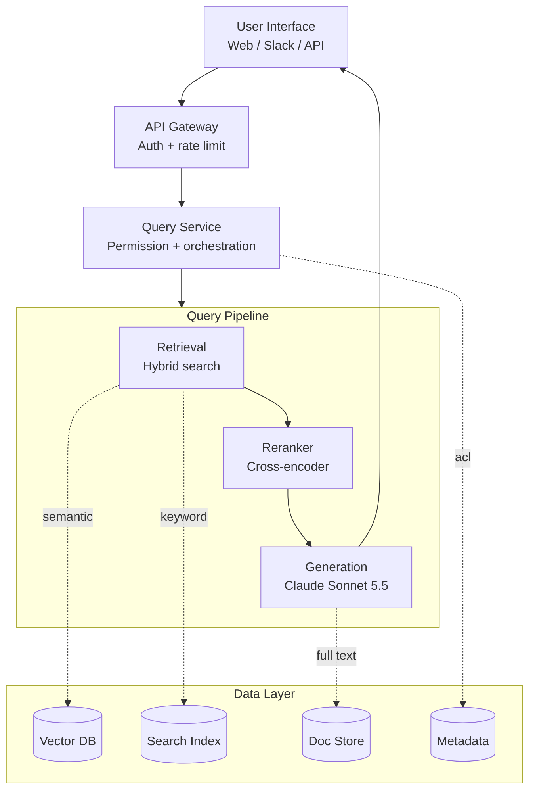
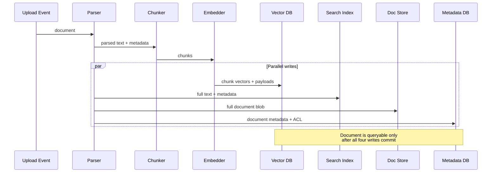
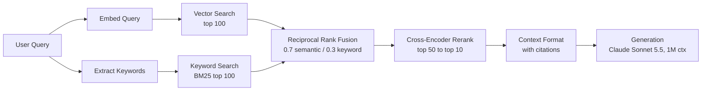

:::info 출처 · 라이선스
이 문서는 Om Bharatiya의 [AI System Design Guide](https://github.com/ombharatiya/ai-system-design-guide/blob/main/16-case-studies/01-enterprise-rag.md)(MIT License, © 2026 Om Bharatiya)를 한국어로 옮긴 **비공식 번역본**입니다. 번역·편집 책임은 SecureNomad에 있습니다. 전체 안내는 [소개 · 출처 · 라이선스](../index.md)를 참고하세요. 번역 기준: 원문 커밋 `ed955b2`(2026-10-09).
:::

:::note 번역 주
원문은 외부 자료로, 제품명·모델명·버전·가격은 원문 표기를 유지합니다. 코드·머메이드·다이어그램은 원문 그대로 둡니다. GitHub 콜아웃은 Docusaurus admonition으로 변환했습니다.
:::

# 사례 연구: 엔터프라이즈 RAG 시스템

이 사례 연구는 엔터프라이즈 문서 검색용 프로덕션 RAG 시스템 설계를 따라간다. 요구사항 수집·아키텍처 결정·구현 세부를 다룬다.

## 문제 정의

### 시나리오

한 금융 서비스 회사가 내부 문서용 AI 검색 시스템을 짓고자 한다:
- 500,000 문서(정책·절차·연구 보고서)
- 여러 부서 5,000 직원
- 매일 갱신되는 문서
- 엄격한 컴플라이언스·감사 요건
- 인용 출처와 함께 질문에 답해야 함

### 현재 고충

- 직원이 정보 검색에 하루 2시간 이상 소비
- 키워드 검색이 무관 결과 너무 많이 반환
- 지식이 부서별로 사일로화
- 신입이 생산적이 되는 데 몇 달

---

## 요구사항 분석

### 기능 요구사항

| 요구사항 | 우선순위 | 비고 |
|-------------|----------|-------|
| 자연어 Q&A | P0 | 핵심 기능 |
| 출처 인용 | P0 | 컴플라이언스 요건 |
| 다문서 추론 | P1 | 문서 간 정보 연결 |
| 후속 질문 | P1 | 대화 컨텍스트 |
| 문서 요약 | P2 | 긴 문서 빠른 개요 |

### 비기능 요구사항

| 요구사항 | 목표 | 근거 |
|-------------|--------|-----------|
| 지연(P95) | 5초 미만 | 사용자 경험 |
| 정확도 | 90% 초과 | 신뢰·채택 |
| 가용성 | 99.9% | 비즈니스 크리티컬 |
| 동시 사용자 | 500 | 피크 사용 |
| 문서 신선도 | 1시간 미만 | 정책 갱신 |

### 보안 요구사항

- 역할 기반 접근 통제(RBAC)
- 모든 쿼리 감사 로깅
- 데이터가 회사 클라우드 경계를 벗어나지 않음: 모델 호출이 제로 데이터 보존 하의 프라이빗 엔드포인트(Bedrock·Google Cloud·Foundry)를 거치고, 컴플라이언스가 요구하는 곳엔 US 전용 처리(약 10% 프리미엄; 아래 비용 분석 참고)
- PII 탐지·처리

---

## 시스템 아키텍처

### 하이레벨 아키텍처

```
┌─────────────────────────────────────────────────────────────────────────┐
│                           User Interface                                │
│  (Web App, Slack Bot, API)                                             │
└─────────────────────────────┬───────────────────────────────────────────┘
                              │
                              ▼
┌─────────────────────────────────────────────────────────────────────────┐
│                          API Gateway                                    │
│  • Authentication    • Rate Limiting    • Request Routing              │
└─────────────────────────────┬───────────────────────────────────────────┘
                              │
                              ▼
┌─────────────────────────────────────────────────────────────────────────┐
│                        Query Service                                    │
│  • Query understanding   • Permission check   • Orchestration          │
└─────────────────────────────┬───────────────────────────────────────────┘
                              │
        ┌─────────────────────┼─────────────────────┐
        │                     │                     │
        ▼                     ▼                     ▼
┌───────────────┐   ┌───────────────┐   ┌───────────────┐
│   Retrieval   │   │   Reranking   │   │  Generation   │
│   Service     │   │   Service     │   │   Service     │
│               │   │               │   │               │
│ • Hybrid      │   │ • Cross-      │   │ • LLM         │
│   search      │   │   encoder     │   │ • Prompt      │
│ • Filtering   │   │ • Scoring     │   │   building    │
└───────┬───────┘   └───────────────┘   └───────────────┘
        │
        ▼
┌─────────────────────────────────────────────────────────────────────────┐
│                        Data Layer                                       │
│                                                                         │
│  ┌─────────────┐  ┌─────────────┐  ┌─────────────┐  ┌─────────────┐   │
│  │  Vector DB  │  │ Search Index│  │  Doc Store  │  │  Metadata   │   │
│  │  (Qdrant)   │  │ (Elastic)   │  │   (S3)      │  │  (Postgres) │   │
│  └─────────────┘  └─────────────┘  └─────────────┘  └─────────────┘   │
│                                                                         │
└─────────────────────────────────────────────────────────────────────────┘

┌─────────────────────────────────────────────────────────────────────────┐
│                      Ingestion Pipeline                                 │
│  Document Upload → Parse → Chunk → Embed → Index → Store Metadata      │
└─────────────────────────────────────────────────────────────────────────┘
```

흐름 다이어그램으로(계층형 시스템이 쿼리 파이프라인으로 퍼져 데이터 계층에서 수렴):



### 기술 선택 (2026년 10월)

| 컴포넌트 | 선택 | 근거 |
|-----------|--------|-----------|
| **주 LLM** | Claude Sonnet 5.5 ($2 / $10 per 1M tokens) | 1M까지 평탄 가격이라 다문서 컨텍스트에 장문 추가요금 없음; 제로 데이터 보존 가능; Bedrock·Google Cloud·Foundry 프라이빗 엔드포인트로 도달; 폐기 2027-09-28 이전 아님 |
| **어려운 교차 문서 분석** | Claude Opus 5.5 ($4 / $20) 또는 GPT-6.1 Sol ($2 / $10) | 많은 문서에 걸친 다단계 추론이 필요한 몇 % 쿼리의 에스컬레이션 경로. GPT-6.1 Sol 프롬프트를 272K 입력 토큰 미만 유지, 초과 시 OpenAI가 전체 요청을 $4 / $15로 과금 |
| **요약·벌크 티어** | Gemini 3.8 Flash ($0.75 / $3.75 인트로; 2027-01-01부터 $1.50 / $7.50) | 문서 요약·수집 시점 보강에 싼 1M 토큰 컨텍스트. 2027 가격으로 예산 |
| **임베딩** | text-embedding-3-large ($0.13 per 1M) | 검증됨·불변. 모델 변경을 예상하면 Cohere Embed 5(Pro·Fast)·Voyage 4 패밀리가 크기 간 하나의 임베딩 공간을 공유해, large 모델로 인덱스하고 싼 모델로 쿼리해도 재인덱싱 불필요 |
| **벡터 DB** | Qdrant 1.19 (자체 호스팅) | 성능·페이로드 필터링·온프렘 컴플라이언스. `memory` 설정(pinned·cached·cold)이 `on_disk`·`always_ram`를 대체 |
| **리랭커** | Qwen3-Reranker-8B(자체 호스팅, Apache 2.0) 또는 API 리랭커(Cohere Rerank 4·Voyage rerank-3) | API 리랭커가 문서당 32K 토큰 수용 — 긴 청크의 옛 512토큰 절단 제거 |

:::note
**변화: 더 큰 검색 단위, 의도적 가격.** 주 프런티어 모델의 1M 토큰 윈도로, 팀이 완벽한 512토큰 청크를 찾는 대신 다문서 질문에 문서 섹션 전체(10K\~50K 토큰)를 검색한다. 요금이 그에 비례: 월 150만 쿼리에 쿼리당 추가 10K 입력 토큰마다 Sonnet 5.5서 월 약 $30,000. 쿼리 유형으로 라우팅: 조회엔 작은 청크, 종합 질문에만 큰 섹션. 가격 규칙도 벤더마다 다름: Claude 4.6 이상은 1M까지 평탄, OpenAI는 272K 입력 토큰 초과 시 전체 요청 재가격.
:::

---

## 컴포넌트 심층 분석

### 문서 수집 파이프라인

```python
class IngestionPipeline:
    def __init__(self):
        self.parser = DocumentParser()
        self.chunker = SemanticChunker(
            chunk_size=512,
            chunk_overlap=50
        )
        self.embedder = OpenAIEmbedder(model="text-embedding-3-large")
        self.vector_db = QdrantClient()
        self.metadata_db = PostgresClient()
    
    async def ingest(self, document: Document, user_context: UserContext):
        # 1. Parse document
        parsed = self.parser.parse(document)
        
        # 2. Extract metadata
        metadata = self.extract_metadata(parsed, document)
        
        # 3. Chunk
        chunks = self.chunker.chunk(parsed.text)
        
        # 4. Generate embeddings (batch)
        embeddings = await self.embedder.embed_batch([c.text for c in chunks])
        
        # 5. Store in vector DB with metadata
        points = [
            {
                "id": f"{document.id}_{i}",
                "vector": embedding,
                "payload": {
                    "document_id": document.id,
                    "chunk_index": i,
                    "text": chunk.text,
                    "department": metadata.department,
                    "access_level": metadata.access_level,
                    "created_at": metadata.created_at.isoformat()
                }
            }
            for i, (chunk, embedding) in enumerate(zip(chunks, embeddings))
        ]
        
        await self.vector_db.upsert(collection_name="documents", points=points)
        
        # 6. Store full document
        await self.doc_store.put(document.id, parsed.text)
        
        # 7. Store metadata
        await self.metadata_db.insert_document(document.id, metadata)
        
        # 8. Index in Elasticsearch for keyword search
        await self.es_client.index(
            index="documents",
            id=document.id,
            body={"text": parsed.text, **metadata.to_dict()}
        )
```

코드는 선형 시퀀스로 읽히지만 네 개 쓰기가 병렬로 일어난다. 시퀀스 다이어그램이 팬아웃을 명시하고, 이는 부분 실패 모드 이해에 중요하다:



### 쿼리 처리

```python
class QueryService:
    def __init__(self):
        self.retriever = HybridRetriever()
        self.reranker = CrossEncoderReranker()  # self-hosted Qwen3-Reranker or an API reranker
        self.generator = LLMGenerator()
        self.guardrails = GuardrailPipeline()
    
    async def process_query(
        self,
        query: str,
        user_context: UserContext,
        conversation_history: list[Message] = None
    ) -> QueryResponse:
        
        # 1. Input guardrails
        guardrail_result = self.guardrails.check_input(query)
        if not guardrail_result.passed:
            return QueryResponse(
                answer="I cannot help with that request.",
                blocked=True,
                reason=guardrail_result.reason
            )
        
        # 2. Query understanding (optional: rewrite query)
        processed_query = await self.understand_query(query, conversation_history)
        
        # 3. Retrieve candidates with permission filtering
        candidates = await self.retriever.search(
            query=processed_query,
            filters=self.build_permission_filter(user_context),
            top_k=50
        )
        
        # 4. Rerank
        reranked = await self.reranker.rerank(
            query=processed_query,
            documents=candidates,
            top_k=10
        )
        
        # 5. Build context
        context = self.build_context(reranked)
        
        # 6. Generate answer
        answer = await self.generator.generate(
            query=query,
            context=context,
            conversation_history=conversation_history
        )
        
        # 7. Output guardrails
        guardrail_result = self.guardrails.check_output(answer, context)
        if not guardrail_result.passed:
            answer = self.fallback_response()
        
        # 8. Build response with citations
        return QueryResponse(
            answer=answer,
            sources=[self.format_source(doc) for doc in reranked[:5]],
            confidence=self.calculate_confidence(reranked)
        )
    
    def build_permission_filter(self, user_context: UserContext) -> dict:
        return {
            "should": [
                {"key": "access_level", "match": {"value": "public"}},
                {"key": "department", "match": {"value": user_context.department}},
                {"key": "access_list", "match": {"any": [user_context.user_id]}}
            ]
        }
```

### 하이브리드 검색

```python
class HybridRetriever:
    def __init__(self, vector_weight: float = 0.7, keyword_weight: float = 0.3):
        self.vector_db = QdrantClient()
        self.es_client = ElasticsearchClient()
        self.embedder = OpenAIEmbedder()
        self.vector_weight = vector_weight
        self.keyword_weight = keyword_weight
    
    async def search(
        self,
        query: str,
        filters: dict,
        top_k: int = 50
    ) -> list[Document]:
        
        # Parallel retrieval
        vector_results, keyword_results = await asyncio.gather(
            self.vector_search(query, filters, top_k * 2),
            self.keyword_search(query, filters, top_k * 2)
        )
        
        # Reciprocal Rank Fusion
        fused = self.rrf_fusion(
            [vector_results, keyword_results],
            weights=[self.vector_weight, self.keyword_weight],
            k=60
        )
        
        return fused[:top_k]
    
    async def vector_search(self, query: str, filters: dict, top_k: int):
        query_embedding = await self.embedder.embed(query)
        
        # Query API: Qdrant 1.19 removed the legacy /search endpoint from its REST schema
        response = await self.vector_db.query_points(
            collection_name="documents",
            query=query_embedding,
            query_filter=filters,
            limit=top_k
        )
        results = response.points
        
        return [
            Document(
                id=r.payload["document_id"],
                chunk_id=r.id,
                text=r.payload["text"],
                score=r.score,
                metadata=r.payload
            )
            for r in results
        ]
    
    def rrf_fusion(self, result_lists: list, weights: list, k: int = 60) -> list:
        scores = defaultdict(float)
        docs = {}
        
        for results, weight in zip(result_lists, weights):
            for rank, doc in enumerate(results):
                rrf_score = weight / (k + rank + 1)
                scores[doc.chunk_id] += rrf_score
                docs[doc.chunk_id] = doc
        
        sorted_ids = sorted(scores.keys(), key=lambda x: scores[x], reverse=True)
        return [docs[id] for id in sorted_ids]
```

하이브리드 검색 흐름 한눈에. 두 병렬 검색기, RRF가 가중 랭크로 융합, 그다음 크로스 인코더가 컨텍스트 형식화 전 상위 후보 리랭크:



### 장문 컨텍스트 생성

```python
import anthropic

class LongContextGenerator:
    """
    Claude Sonnet 5.5 over whole document sections. Documents sit in the
    system prompt, ahead of the conversation, so follow-up questions over the
    same documents hit the prompt cache (reads bill at $0.20 per 1M on
    Sonnet 5.5, 0.1x the input price).
    """
    def __init__(self):
        # Use AsyncAnthropicBedrockMantle, AsyncAnthropicVertex or AsyncAnthropicFoundry
        # instead to keep traffic on a private cloud endpoint
        self.client = anthropic.AsyncAnthropic()

    async def generate(
        self,
        query: str,
        context_docs: list[Document],
        conversation_history: list[dict] | None = None
    ) -> str:
        instructions = (
            "You are an enterprise knowledge assistant. "
            "Answer only from the provided documents. "
            "Cite every claim using [[DocName:PageNumber]] format."
        )
        doc_blocks = [
            {"type": "text", "text": f"<document name='{d.name}'>\n{d.text}\n</document>"}
            for d in context_docs
        ]
        doc_blocks[-1]["cache_control"] = {"type": "ephemeral"}  # cache through the last document

        # No temperature: Sonnet 5.5 rejects non-default sampling values,
        # and the Python SDK 1.x removed them from the method signature
        response = await self.client.messages.create(
            model="claude-sonnet-5-5",
            max_tokens=4096,
            system=[{"type": "text", "text": instructions}, *doc_blocks],
            output_config={"effort": "medium"},
            messages=[
                # History holds only prior questions and answers, never the documents,
                # so the cached system-plus-documents prefix stays byte-identical
                *(conversation_history or []),
                {"role": "user", "content": f"Question: {query}"},
            ],
        )
        # Adaptive thinking is on by default, so keep only the text blocks
        return "".join(b.text for b in response.content if b.type == "text")
```

:::tip 프로덕션 선택 vs 최신 릴리스
Sonnet 5.5는 2026-09-28 출시. Sonnet 5나 Sonnet 4.6에 프롬프트·가드레일을 튜닝한 팀은 전환 전 평가셋을 돌려야 — 업그레이드가 드롭인이 아니니:
- **요청 형태**: 강제 `tool_choice`(`any`·`tool`)가 400, `thinking: {type: "disabled"}`가 400(최저 설정은 `between_tools`), 비기본 `temperature`가 400(Sonnet 5서 이미 그러함).
- **거동**: 노력 수준이 재보정됐으니 설정을 넘기지 말고 노력 스윕 재실행.
- **기한**: Sonnet 4.5에 핀된 건 무조건 이동해야; Claude API·Foundry서 2026-11-30 폐기.
- **SDK**: Anthropic Python SDK 1.0(2026-08-20)이 `httpx2`로 이동, httpx 기반 트레이싱·테스트 목이 호출을 조용히 놓칠 수 있음. 업그레이드 후 스팬 수 검증.
:::

---

## 확장 고려사항

### 50만 문서 처리

```python
# Sharding strategy for Qdrant
qdrant_config = {
    "collection": "documents",
    "vectors": {
        "size": 3072,  # text-embedding-3-large
        "distance": "Cosine"
    },
    "optimizers": {
        "indexing_threshold": 20000  # Build index after 20K points
    },
    "replication_factor": 2,  # High availability
    "shard_number": 4  # Distribute across nodes
}
```

### 동시 사용자 500 처리

```
Load Balancer
     │
     ├──► Query Service (replica 1)
     ├──► Query Service (replica 2)
     ├──► Query Service (replica 3)
     └──► Query Service (replica 4)
            │
            ├──► Vector DB (3-node cluster)
            ├──► LLM API (with retry/fallback)
            └──► Elasticsearch (3-node cluster)
```

### 캐싱 전략

```python
class QueryCache:
    def __init__(self):
        self.exact_cache = Redis(ttl=3600)  # 1 hour
        self.semantic_cache = SemanticCache(threshold=0.95, ttl=1800)
    
    async def get_or_compute(self, query: str, user_context: UserContext) -> QueryResponse:
        # Check exact cache
        cache_key = self.make_key(query, user_context.permissions)
        cached = await self.exact_cache.get(cache_key)
        if cached:
            return cached
        
        # Check semantic cache
        similar = await self.semantic_cache.find_similar(query, user_context.permissions)
        if similar:
            return similar
        
        # Compute
        response = await self.query_service.process_query(query, user_context)
        
        # Cache result
        await self.exact_cache.set(cache_key, response)
        await self.semantic_cache.add(query, user_context.permissions, response)
        
        return response
```

---

## 비용 분석

### 월 비용 추정 (사용자 500, 사용자당 일 쿼리 100, 2026년 10월 정가)

| 컴포넌트 | 계산 | 월 비용 |
|-----------|-------------|--------------|
| LLM (Claude Sonnet 5.5, US 전용 처리 1.1배) | 150만 쿼리 × (입력 2K 토큰 × $2.20/1M + 출력 500 토큰 × $11/1M) | 약 $14,850 |
| 임베딩 | 쿼리 토큰 약 75M + 코퍼스 약 2% 일일 재임베딩(일 약 50M·월 약 1.5B) × $0.13/1M | 약 $200 |
| 리랭킹 (Voyage rerank-3) | 150만 쿼리 × 후보 50 × 약 400 토큰 × $0.05/1M | 약 $1,500 |
| 벡터 DB (Qdrant) | 3노드 클러스터 | 약 $1,500 |
| Elasticsearch | 3노드 클러스터 | 약 $2,000 |
| 컴퓨트 (Query Service) | 4 인스턴스 | 약 $1,000 |
| **합계** | | **약 $21,000/월** |

모델 라인은 Claude API 정가 사용; Bedrock·Google Cloud는 Claude를 자체 요율표로 가격하니 배포 플랫폼의 리전 요율 확인. 임베딩·리랭킹 라인도 문서 텍스트를 벤더에 보내니 클라우드 경계 요건에 계산됨: 내 클라우드의 프라이빗 엔드포인트로 도달하거나 자체 호스팅. 두 가정이 이 표를 지탱한다. 첫째, 2K 토큰 컨텍스트: 쿼리 20%가 종합에 20K 토큰 섹션을 당기면 월 약 $12,000 추가(30만 쿼리 × 추가 18K 토큰 × $2.20/1M). 둘째, 출력 500 토큰: Sonnet 5.5가 기본 적응형 thinking을 돌리고 thinking이 출력으로 과금되니, LLM 라인을 믿기 전 쿼리당 실제 출력 측정.

### 비용 최적화 기회

1. **응답 캐싱**: 30% 캐시 적중률 → LLM 약 $4,500 절감
2. **프롬프트 캐싱**: 정적 시스템 프롬프트·지시 캐시; 캐시 읽기가 입력 가격의 0.1배 과금
3. **모델 라우팅**: 단순 조회를 더 싼 티어(Claude Haiku 4.5 $1 / $5, 또는 Gemini 3.8 Flash)로 → LLM 최대 40% 절감; Haiku 5.5는 발표됐으나 미출시라 마이그레이션 계획
4. **필요한 곳만 레지던시**: 필요 부서에만 US 전용 처리 핀, 나머지는 글로벌 엔드포인트 → 최대 약 $1,350(10% 상승분) 회수
5. **배치 재임베딩**: OpenAI Batch API로 야간 재임베딩 → 그 라인 50% 할인
6. **자체 호스팅 리랭커**: API 리랭커를 Qwen3-Reranker로 교체 → API 지출 약 $1,500 제거, 다만 전용 H100 하나가 2026-10-01 Silicon Data 지수($2.77/GPU시)로 월 약 $2,000이니 이미 가진 GPU 용량에서만 절감. 컴플라이언스가 후보 구절을 리랭킹 API로 보내는 걸 배제하면 기본 선택이기도

---

## 교훈

### 잘된 것

1. **하이브리드 검색**: 시맨틱 + 키워드 결합이 재현율을 크게 개선
2. **리랭킹**: top-5 정밀도 15% 향상
3. **명확한 인용**: 사용자 신뢰 구축
4. **검색 시점 권한 필터링**: 사후 필터링 불필요

### 마주친 과제

1. **표 추출**: 복잡한 표의 PDF가 커스텀 파싱 필요
2. **약어**: 도메인 특화 약어가 확장 필요
3. **신선도**: 1시간 신선도가 스트리밍 수집 필요
4. **긴 문서**: 100페이지 이상 문서가 계층적 청킹 필요

### 다르게 할 것

1. 더 나은 문서 파싱을 더 일찍 시작
2. 확장 전 평가 파이프라인 구축
3. 첫날부터 쿼리 로깅 구현
4. 사용자 피드백 루프를 더 일찍 구축

---

## 면접 워크스루

### 면접에서 발표하는 법

**오프닝 (2분):**
"내부 문서 검색용 엔터프라이즈 RAG 시스템을 설계하겠습니다. 먼저 요구사항 몇 가지를 명확히 하겠습니다..."

**요구사항 (3분):**
- 규모·지연·정확도 목표 질문
- 보안 요구사항 명확화
- 문서 유형·갱신 빈도 이해

**하이레벨 설계 (5분):**
- 아키텍처 다이어그램 그리기
- 핵심 컴포넌트 설명
- 기술 선택 정당화

**심층 분석 (10분):**
- 검색 전략(하이브리드 검색, 왜)
- 보안(쿼리 시점 권한 필터링)
- 생성(프롬프트 엔지니어링·인용)
- 확장(샤딩·캐싱·레플리카)

**트레이드오프 (5분):**
- 비용 vs 지연(모델 선택)
- 컨텍스트 크기 vs 비용(섹션 전체가 종합엔 도움이나 입력 지출 배수)
- 정확도 vs 지연(리랭킹이 시간 추가)
- 신선도 vs 비용(스트리밍 vs 배치)

**모니터링 (2분):**
- 핵심 지표(지연·정확도·사용자 피드백)
- 이슈 탐지법
- 지속 개선 루프

---

*다음: [사례 연구: 대화형 AI 에이전트](02-conversational-agent.md)*
