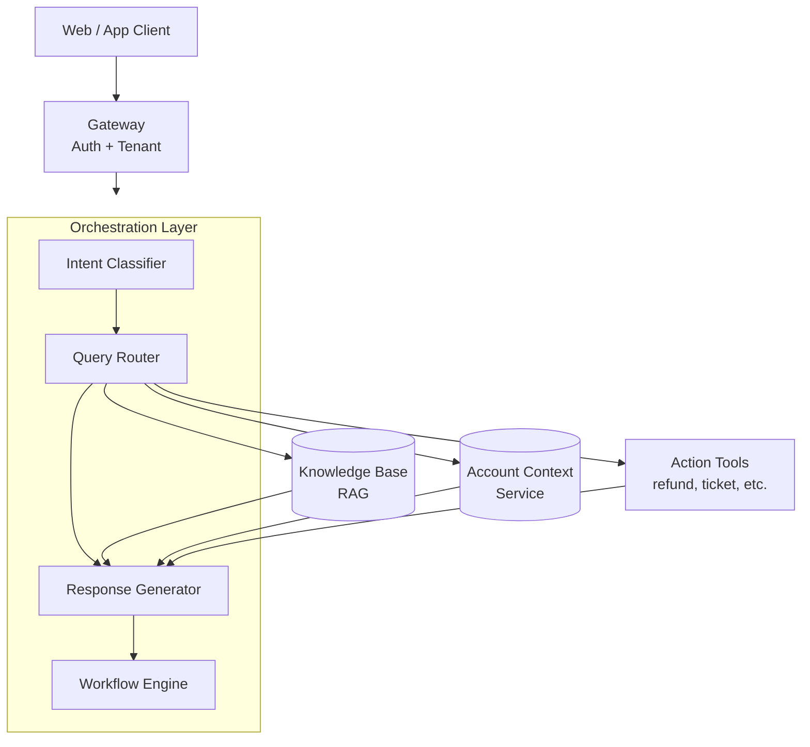
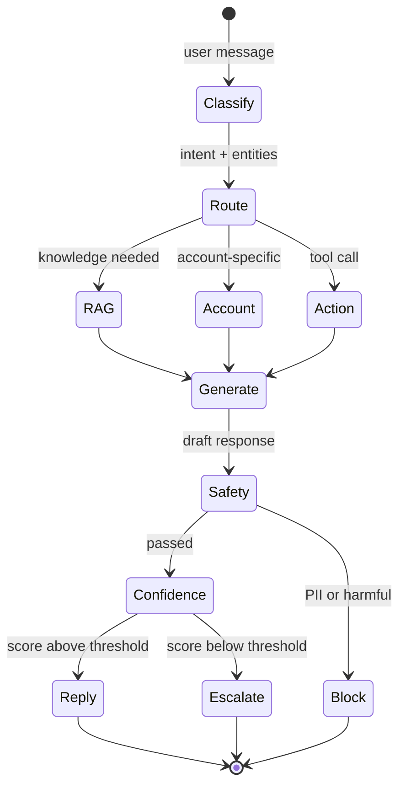
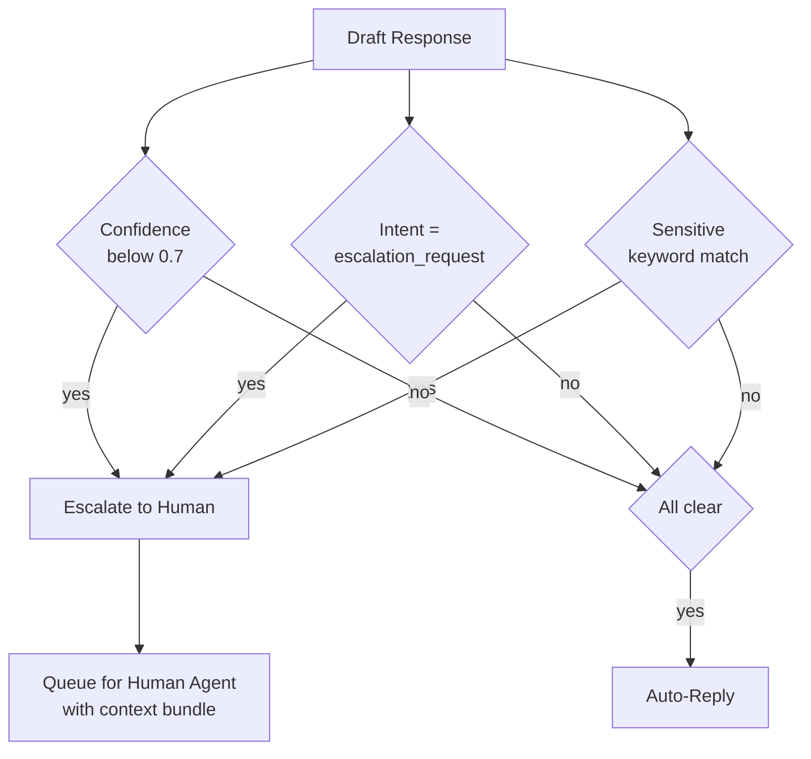

:::info 출처 · 라이선스
이 문서는 Om Bharatiya의 [AI System Design Guide](https://github.com/ombharatiya/ai-system-design-guide/blob/main/16-case-studies/02-conversational-agent.md)(MIT License, © 2026 Om Bharatiya)를 한국어로 옮긴 **비공식 번역본**입니다. 번역·편집 책임은 SecureNomad에 있습니다. 전체 안내는 [소개 · 출처 · 라이선스](../index.md)를 참고하세요. 번역 기준: 원문 커밋 `ed955b2`(2026-10-09).
:::

:::note 번역 주
원문은 외부 자료로, 제품명·모델명·버전·가격은 원문 표기를 유지합니다. 코드·머메이드·다이어그램은 원문 그대로 둡니다. GitHub 콜아웃은 Docusaurus admonition으로 변환했습니다.
:::

# 사례 연구: 고객 지원 대화형 에이전트

이 사례 연구는 B2B SaaS 기업의 프로덕션 고객 지원 에이전트 설계를 따라간다.

## 문제 정의

**회사:** 엔터프라이즈 고객 5만의 B2B SaaS 플랫폼

**현재 상태:**
- 월 지원 티켓 50만
- 평균 응답 시간: 4시간
- 고객 만족(CSAT): 72%
- 지원팀: 100명

**목표:**
- 흔한 쿼리 응답 시간을 5분 미만으로 단축
- CSAT를 85% 초과로 개선
- 티켓 60%를 인간 개입 없이 처리
- 에스컬레이트 티켓의 품질 유지

---

## 요구사항 분석

### 기능 요구사항

| 요구사항 | 설명 | 우선순위 |
|-------------|-------------|----------|
| 쿼리 이해 | 의도 분류·엔티티 추출 | P0 |
| 지식 검색 | 제품 문서·FAQ·과거 티켓 검색 | P0 |
| 계정 컨텍스트 | 사용자 구독·이력 접근 | P0 |
| 응답 생성 | 자연·정확·도움 되는 응답 | P0 |
| 대화 메모리 | 멀티턴 컨텍스트 | P0 |
| 행동 실행 | 티켓 생성·워크플로 트리거 | P1 |
| 인간 에스컬레이션 | 필요 시 전체 컨텍스트와 핸드오프 | P0 |
| 청구 문의 | 민감 금융 데이터 처리 | P1 |

### 비기능 요구사항

| 요구사항 | 목표 | 근거 |
|-------------|--------|-----------|
| 지연(TTFT) | 1초 미만 | 챗의 사용자 기대 |
| 지연(전체) | 5초 미만 | 참여 유지 |
| 가용성 | 99.9% | 비즈니스 크리티컬 |
| 정확도 | 95% 초과 | 고객 신뢰 |
| 에스컬레이션율 | 40% 미만 | 비용 효율 |
| CSAT | 85% 초과 | 비즈니스 목표 |

### 보안 요구사항

- 로그에 PII 없음
- 테넌트 격리(고객은 자기 데이터만)
- 모든 행동 감사 추적
- SOC 2 컴플라이언스
- 사용자에게 AI와 대화 중임을 알림: EU AI Act 제50조 투명성 의무가 2026-08-02부터 적용되고, Commission 가이드라인상 AI에 대한 일반 대중 인식이 상호작용을 명백하게 만들지 않음

---

## 아키텍처 설계

### 하이레벨 아키텍처

```
┌─────────────────────────────────────────────────────────────────┐
│                      CUSTOMER SUPPORT AGENT                      │
├─────────────────────────────────────────────────────────────────┤
│                                                                  │
│  ┌─────────────┐     ┌─────────────┐     ┌─────────────┐        │
│  │   Web/App   │────▶│   Gateway   │────▶│    Auth     │        │
│  │   Client    │     │             │     │  + Tenant   │        │
│  └─────────────┘     └──────┬──────┘     └─────────────┘        │
│                             │                                    │
│                             ▼                                    │
│  ┌──────────────────────────────────────────────────────────┐   │
│  │                   ORCHESTRATION LAYER                     │   │
│  │  ┌────────────────────────────────────────────────────┐  │   │
│  │  │  Intent        Query          Response    Workflow │  │   │
│  │  │  Classifier → Router →        Generator → Engine   │  │   │
│  │  └────────────────────────────────────────────────────┘  │   │
│  └──────────────────────────────────────────────────────────┘   │
│                             │                                    │
│         ┌───────────────────┼───────────────────┐               │
│         ▼                   ▼                   ▼               │
│  ┌─────────────┐     ┌─────────────┐     ┌─────────────┐        │
│  │  Knowledge  │     │   Account   │     │   Action    │        │
│  │    Base     │     │   Context   │     │   Tools     │        │
│  │   (RAG)     │     │   Service   │     │             │        │
│  └─────────────┘     └─────────────┘     └─────────────┘        │
│                                                                  │
└─────────────────────────────────────────────────────────────────┘
```

계층형 흐름으로. 오케스트레이션 계층이 세 병렬 컨텍스트 소스로 디스패치, 응답 생성기에서 조립:



### 대화 흐름

```
User Message
    │
    ▼
┌─────────────────┐
│ Intent Classify │─── billing, technical, account, general, escalation
└────────┬────────┘
         │
         ▼
┌─────────────────┐
│ Query Routing   │─── Which knowledge sources? Which tools?
└────────┬────────┘
         │
    ┌────┴────┬────────────┐
    ▼         ▼            ▼
┌───────┐ ┌───────┐ ┌──────────┐
│  RAG  │ │Account│ │ Actions  │
│ Query │ │Context│ │ (if any) │
└───┬───┘ └───┬───┘ └────┬─────┘
    │         │          │
    └────┬────┴──────────┘
         │
         ▼
┌─────────────────┐
│    Generate     │
│    Response     │
└────────┬────────┘
         │
         ▼
┌─────────────────┐
│  Safety Check   │─── PII, harmful, off-topic
└────────┬────────┘
         │
         ▼
┌─────────────────┐
│  Confidence     │─── Low confidence? Escalate
│    Check        │
└────────┬────────┘
         │
         ▼
    Response / Escalation
```

한 턴은 상태 기계다. 비용·신뢰에 중요한 두 게이트는 *safety*(시스템을 떠나기 전 통과해야)와 *confidence*(에스컬레이션 vs 자동 응답 결정):



---

## 컴포넌트 심층 분석

### 의도 분류

```python
INTENT_SCHEMA = {
    "type": "object",
    "properties": {
        "intent": {"type": "string",
                   "enum": ["billing", "technical", "account", "general", "escalation_request"]},
        "entities": {"type": "array", "items": {
            "type": "object",
            "properties": {"type": {"type": "string"}, "value": {"type": "string"}},
            "required": ["type", "value"],
            "additionalProperties": False,
        }},
        "confidence": {"type": "number"},
    },
    "required": ["intent", "entities", "confidence"],
    "additionalProperties": False,
}

class IntentClassifier:
    async def classify(self, message: str, history: list[dict]) -> dict:
        # Smallest tier: GPT-6 Luna ($0.10 / $0.50 per 1M tokens). Track p95
        # latency and use the lowest reasoning effort that holds accuracy.
        result = await client.responses.create(
            model="gpt-6-luna",
            instructions="Classify the customer's latest message.",
            input=[*history[-4:], {"role": "user", "content": message}],
            text={"format": {"type": "json_schema", "name": "intent",
                             "schema": INTENT_SCHEMA, "strict": True}},
        )
        return json.loads(result.output_text)
```

### 지식 베이스 (하이브리드 검색 + 리랭크)

```python
class SupportKnowledgeBase:
    async def retrieve(self, query: str, tenant_id: str, top_k: int = 8) -> list[dict]:
        # Long-context models tempt teams to skip reranking and pass 50 chunks.
        # At 500K conversations a month, a reranker (about $0.001 per turn) is
        # far cheaper than paying for 40 extra chunks of input on every turn.
        candidates = await self.sources.search(
            query, filters={"tenant_id": tenant_id}, limit=50
        )
        return await self.reranker.rerank(query, candidates, top_k=top_k)
```

### 응답 생성 (티어: Claude Haiku 4.5·Sonnet 5.5)

이 설계의 2025 버전은 한 모델에서 요청별 확장 thinking을 토글했다. 그 노브가 최신 모델에선 사라짐: Sonnet 5.5가 기본 적응형 thinking을 돌리고 `thinking: {type: "disabled"}`에 400을 반환, 깊이는 `output_config.effort`로 설정. Haiku 4.5는 effort 파라미터 거부. 요청별 다이얼은 이제 **모델 라우팅 + 노력**이다.

```python
class ResponseGenerator:
    ROUTINE_MODEL = "claude-haiku-4-5"   # $1 / $5 per 1M; no thinking unless enabled
    COMPLEX_MODEL = "claude-sonnet-5-5"  # $2 / $10 per 1M; adaptive thinking on by default

    async def generate(self, query: str, context: list[dict]) -> dict:
        is_complex = self.detect_complexity(query)  # billing disputes, multi-account issues
        request = {
            "model": self.COMPLEX_MODEL if is_complex else self.ROUTINE_MODEL,
            "max_tokens": 4096,
            "system": SUPPORT_SYSTEM_PROMPT,
            "messages": [{"role": "user", "content": f"Context: {context}\nQuery: {query}"}],
        }
        if is_complex:
            request["output_config"] = {"effort": "medium"}
        response = await self.anthropic.messages.create(**request)
        text = "".join(b.text for b in response.content if b.type == "text")
        return {"response": text, "model": request["model"]}
```

경로별로 지연을 예산하라, 시스템별이 아니라. thinking 토큰이 첫 가시 토큰 전 도착하고 약 1K면 전형 출력 속도로 몇 초가 걸리니, 복잡 경로는 1초 TTFT 목표를 못 맞춘다. 복잡 청구 턴에 자체 지연 목표를 주고 모델이 작업하는 동안 상태 줄을 스트림하거나, 사전 추론이 필요 없는 라우트엔 `thinking: {type: "between_tools"}`를 보내고 품질이 유지되는지 측정하라.

:::note
**프로덕션 지혜: 강제 마이그레이션을 예산하라.** 지원팀은 한 모델의 톤·거부 패턴을 둘러싸고 몇 달 가드레일을 튜닝하는데, 그 튜닝은 공짜로 전이되지 않는다. Sonnet 4.5가 2026-11-30 폐기. Haiku 4.5는 Claude API 폐기 하한 2026-10-15(아직 공지 없음, Anthropic 최소 60일 전), Foundry서 11/15 폐기, Haiku 5.5는 발표됐으나 미출시. 기대 톤·에스컬레이션·거부 거동을 담은 실제 대화 회귀 셋을 두고 모든 모델 변경에 돌려라.
:::

---

## 신뢰성 패턴

### 신뢰도 기반 에스컬레이션

```python
class EscalationHandler:
    def __init__(self, confidence_threshold: float = 0.7):
        self.threshold = confidence_threshold
    
    async def check_escalation(
        self,
        response: dict,
        intent: str,
        user_request: str
    ) -> dict:
        should_escalate = False
        reason = None
        
        # Low confidence
        if response["confidence"] < self.threshold:
            should_escalate = True
            reason = "low_confidence"
        
        # Explicit escalation request
        if intent == "escalation_request":
            should_escalate = True
            reason = "user_requested"
        
        # Sensitive topics
        if await self.is_sensitive(user_request):
            should_escalate = True
            reason = "sensitive_topic"
        
        if should_escalate:
            return await self.create_escalation(response, reason)
        
        return {"escalate": False, "response": response}
    
    async def is_sensitive(self, message: str) -> bool:
        sensitive_keywords = [
            "legal", "lawsuit", "lawyer",
            "refund", "cancel subscription",
            "competitor", "data breach"
        ]
        return any(kw in message.lower() for kw in sensitive_keywords)
```

에스컬레이션 결정은 세 독립 신호를 결합한다. 어느 하나라도 핸드오프를 트리거한다. 결정 트리로 시각화하면 OR 의미가 명확하고 네 번째 신호로 확장하기 쉽다:



### 멀티턴 메모리

```python
class ConversationMemory:
    def __init__(self, max_turns: int = 10):
        self.max_turns = max_turns
        self.redis = Redis()
    
    async def get_history(self, session_id: str) -> list[dict]:
        key = f"conversation:{session_id}"
        history = await self.redis.get(key)
        if history:
            return json.loads(history)
        return []
    
    async def add_turn(
        self,
        session_id: str,
        user_message: str,
        assistant_message: str
    ):
        history = await self.get_history(session_id)
        
        history.append({"role": "user", "content": user_message})
        history.append({"role": "assistant", "content": assistant_message})
        
        # Trim to max turns
        if len(history) > self.max_turns * 2:
            history = history[-(self.max_turns * 2):]
        
        await self.redis.setex(
            f"conversation:{session_id}",
            3600,  # 1 hour TTL
            json.dumps(history)
        )
```

---

## 평가와 모니터링

### 품질 지표

```python
class QualityMonitor:
    def __init__(self, sample_rate: float = 0.05):
        self.sample_rate = sample_rate
        self.judge = LLMJudge()
    
    async def evaluate(self, conversation: dict):
        if random.random() > self.sample_rate:
            return
        
        scores = await self.judge.evaluate(
            query=conversation["user_message"],
            response=conversation["assistant_message"],
            context=conversation["context"],
            criteria={
                "relevance": "Does the response address the user's question?",
                "accuracy": "Is the information correct based on the context?",
                "helpfulness": "Would this response help the user?",
                "tone": "Is the tone professional and empathetic?"
            }
        )
        
        # Record metrics
        for criterion, score in scores.items():
            metrics.record(f"quality_{criterion}", score)
```

:::warning
**트레이스가 여전히 모델 호출을 보는지 확인하라.** OpenAI Python SDK 3.0(2026-08-12)·Anthropic Python SDK 1.0(2026-08-20)이 둘 다 `httpx2`로 이동. Anthropic 마이그레이션 가이드는 OpenTelemetry HTTPX 계측·Sentry httpx 통합·respx·pytest-httpx·vcrpy가 무언가 httpx를 임포트하기 전 `httpx2.alias_httpx()`가 돌지 않으면 SDK 요청을 조용히 놓칠 수 있다고 경고. 위 같은 샘플링 모니터가 줄어드는 샘플에 건강한 수치를 보고하게 된다. SDK를 세트로 업그레이드하고 전후 스팬 수를 요청 수와 비교.
:::

### 대시보드 지표

| 지표 | 목표 | 실제 |
|--------|--------|--------|
| 지연(TTFT) | 1초 미만 | 0.8s |
| 지연(전체) | 5초 미만 | 3.2s |
| 정확도 | 95% 초과 | 94.3% |
| 에스컬레이션율 | 40% 미만 | 38% |
| CSAT | 85% 초과 | 87% |
| 해결률 | 60% 초과 | 62% |

---

## 비용 분석

### 대화당 비용 분해 (2026년 10월 정가)

대화당 4턴, 턴당 약 3K 입력 토큰(시스템 프롬프트·검색 청크·계정 컨텍스트·히스토리) 가정.

| 컴포넌트 | 비용 | 비고 |
|-----------|------|-------|
| 의도 분류 | $0.0003 | GPT-6 Luna ($0.10 / $0.50): 턴당 1회, 약 500 in / 50 out |
| 검색·리랭킹 | $0.0040 | 쿼리 임베딩 + 턴당 후보 50 × 약 400 토큰 리랭크(Voyage rerank-3, $0.05 per 1M): 턴당 약 $0.001 |
| 생성, 루틴 경로 | $0.0136 | 대화 80%에 Claude Haiku 4.5: 4 × (3K in / 250 out) = $0.017, 0.8 가중 |
| 생성, 복잡 경로 | $0.0148 | 20%에 Claude Sonnet 5.5: 같은 턴 + 턴당 약 1K thinking 토큰 = $0.074, 0.2 가중 |
| 품질 샘플링 | $0.0013 | 대화 5%를 중급 판정자가 채점 |
| **합계** | **약 $0.034** | **대화당, 프롬프트 캐싱 전** |

복잡 경로는 트래픽 20%·모델 지출 40% 초과인데, 대부분 출력 요율로 과금되는 thinking 토큰. 정적 시스템 프롬프트·도구 정의 프롬프트 캐싱이 입력 비중을 깎음(캐시 읽기가 두 모델 다 0.1배 과금).

### 월 비용 전망

| 항목 | 계산 | 비용 |
|------|-------------|------|
| 대화 | 50만 × $0.034 | $17,000 |
| 인프라 | 고정 | $2,000 |
| 인간 에스컬레이션 | 19만 × $5(인간 비용) | $950,000 |
| **합계** | | $969,000 |
| **전부 인간 대비 절감** | 50만 × $5 - $969K | 약 $1.53M/월 |

모델 지출은 총액의 2% 미만. 중요한 레버는 에스컬레이션율: 올바른 자동 해결로 옮긴 에스컬레이션 1포인트마다 월 약 $25,000 절감(5K 대화 × $5), 전체 모델 요금보다 큼.

---

## 교훈

### 잘된 것

1. **의도 기반 라우팅**이 관련 소스에 검색을 집중해 지연 감소
2. **신뢰도 기반 에스컬레이션**이 인간 부하를 줄이며 품질 유지
3. **계정 컨텍스트**가 응답을 더 개인화·정확하게
4. **구조적 출력·핀된 프롬프트 버전**이 샘플링 설정보다 일관성을 더 개선. temperature는 더는 믿을 노브가 아님: 최신 Claude 모델이 비기본 값에 400, GPT-6 Astra는 파라미터 미수용

### 처음에 안 된 것

1. **모든 것에 단일 모델** — 작업별 다른 모델 라우팅이 품질 개선
2. **너무 높은 에스컬레이션 임계** — 0.9 신뢰도로 시작해 에스컬레이션 과다
3. **전체 대화 히스토리** — 컨텍스트 한계 초과, 요약으로 전환

### 권고

1. 높은 에스컬레이션율로 시작해 신뢰도 개선에 따라 점차 낮춤
2. 에스컬레이션 이유별 CSAT 모니터링으로 약점 식별
3. 지원 특화 어휘로 임베딩 재학습
4. 피드백 루프 구축: 에이전트가 에스컬레이트 대화를 학습 데이터로 태깅

---

## 면접 워크스루

**면접관:** "SaaS 기업용 AI 고객 지원 시스템을 설계하라."

**좋은 응답 패턴:**

1. **요구사항 명확화** (2분)
   - "티켓 볼륨은? 채널은? 현재 CSAT는?"

2. **제약 명시**
   - "핵심 제약: 속도보다 정확도, 컨텍스트 손실 없는 에스컬레이션, 테넌트 격리"

3. **하이레벨 아키텍처** (3분)
   - 흐름 그리기: intent → routing → RAG → generation → safety → response/escalation

4. **핵심 컴포넌트 심층** (5분)
   - "신뢰도 기반 에스컬레이션을 상세히..."

5. **신뢰성 다루기** (3분)
   - "신뢰성엔 청구 쿼리에 자기 일관성, 멀티 제공자 폴백. 폴백은 벤더를 교차해야: Anthropic 상태 피드가 8월 중순\~9월 말 주요·심각 사고 최소 12건, OpenAI 9/29 한 사고가 API를 5시간 넘게 저하시켜, 99.9% 목표가 한 제공자에 기댈 수 없음"

6. **지표와 모니터링** (2분)
   - "핵심 지표: CSAT·해결률·에스컬레이션율·정확도 샘플링"

7. **비용 고려** (1분)
   - "월 50만 대화면 대화당 비용이 중요. 모델 라우팅이 도움."

---

## 참고 문헌

- Anthropic Customer Support Agent Guide: https://platform.claude.com/docs/en/about-claude/use-case-guides/customer-support-chat
- LangChain Agents: https://docs.langchain.com/oss/python/langchain/agents

---

*다음: [금융 분석 사례 연구](03-financial-analysis.md)*
