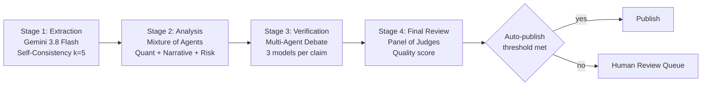
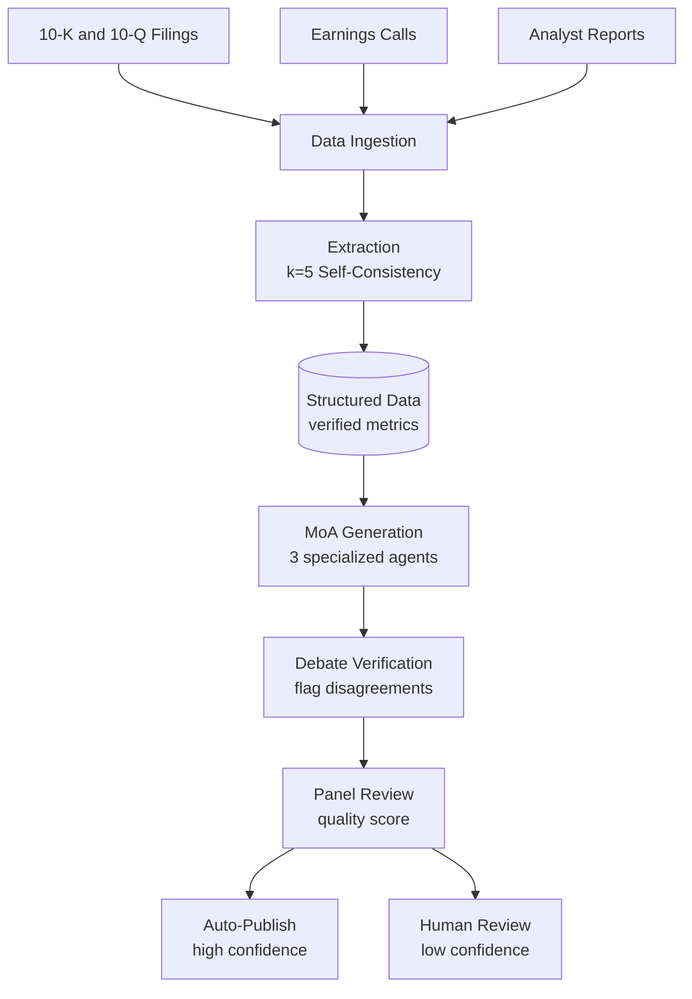
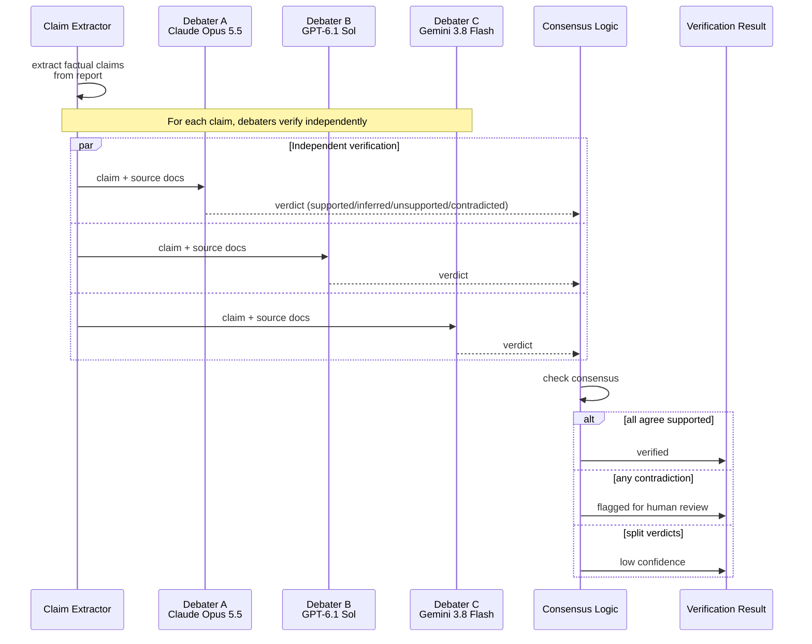

:::info 출처 · 라이선스
이 문서는 Om Bharatiya의 [AI System Design Guide](https://github.com/ombharatiya/ai-system-design-guide/blob/main/16-case-studies/03-financial-analysis.md)(MIT License, © 2026 Om Bharatiya)를 한국어로 옮긴 **비공식 번역본**입니다. 번역·편집 책임은 SecureNomad에 있습니다. 전체 안내는 [소개 · 출처 · 라이선스](../index.md)를 참고하세요. 번역 기준: 원문 커밋 `ed955b2`(2026-10-09).
:::

:::note 번역 주
원문은 외부 자료로, 제품명·모델명·버전·가격·수치는 원문 표기를 유지합니다. 코드·머메이드·다이어그램은 원문 그대로 둡니다.
:::

# 사례 연구: 앙상블 검증 금융 분석

이 사례 연구는 정확도가 결정적인 주식 리서치 리포트 생성용 고신뢰 AI 시스템 설계를 다룬다.

## 문제 정의

**회사:** 주식 리서치 리포트를 생성하는 투자사

**과제:**
- 리포트가 수백만 달러 투자 결정에 영향
- 환각 금융 데이터 무관용
- AI 생성 분석에 대한 규제 조사
- 현 수동 프로세스: 리포트당 8시간, $500 비용

**목표:**
- 리포트 생성 시간을 30분 미만으로 단축
- 정확도 99.5%+ 유지
- 컴플라이언스용 명확한 감사 추적
- 비용 목표: 리포트당 $50 미만

---

## 요구사항 분석

### 정확도 요구사항

| 데이터 유형 | 허용 오차 | 검증 방법 |
|-----------|-----------|---------------------|
| 금융 지표(EPS·PE) | 0% 오류 | 출처 검증 |
| 백분율 변화 | ±0.1% | 교차 검증 |
| 날짜 참조 | 100% 정확 | 출처 추출 |
| 회사명 | 100% 정확 | 엔티티 매칭 |
| 애널리스트 인용 | 축자 또는 플래그 | 인용 추출 |

### 컴플라이언스 요구사항

- 모든 주장이 출처 문서 인용
- 면책 없는 전망 진술 금지
- 명확한 AI 생성 고지
- 생성 프로세스 전체 감사 추적
- 게시 전 인간 검토

---

## 아키텍처 설계

### 하이레벨 파이프라인

```
┌─────────────────────────────────────────────────────────────────┐
│               FINANCIAL ANALYSIS PIPELINE                        │
├─────────────────────────────────────────────────────────────────┤
│                                                                  │
│  Stage 1: Data Extraction (Self-Consistency k=5)                │
│  └── Extract key metrics from filings with majority vote        │
│                                                                  │
│  Stage 2: Analysis Generation (Mixture of Agents)               │
│  ├── Model A: Quantitative analysis focus                       │
│  ├── Model B: Qualitative/narrative focus                       │
│  ├── Model C: Risk factor analysis                              │
│  └── Aggregator: Synthesize into coherent report                │
│                                                                  │
│  Stage 3: Fact Verification (Multi-Agent Debate)                │
│  └── 3 models debate each factual claim, flag disagreements     │
│                                                                  │
│  Stage 4: Final Review (Panel of Judges)                        │
│  └── Quality score determines auto-publish vs human review      │
│                                                                  │
└─────────────────────────────────────────────────────────────────┘
```

흐름으로 본 파이프라인. 각 단계가 일부러 다른 모델 클래스 사용: 추출은 멀티모달(차트·표), 생성은 서사 품질, 감사는 추론 깊이, 패널은 다양성 위해 싸고 여럿:



### 데이터 흐름

```
┌─────────────┐     ┌─────────────┐     ┌─────────────┐
│   10-K/Q    │     │  Earnings   │     │  Analyst    │
│   Filings   │     │  Calls      │     │  Reports    │
└──────┬──────┘     └──────┬──────┘     └──────┬──────┘
       │                   │                   │
       └───────────────────┴───────────────────┘
                           │
                           ▼
                   ┌───────────────┐
                   │     Data      │
                   │   Ingestion   │
                   └───────┬───────┘
                           │
                           ▼
                   ┌───────────────┐
                   │   Extraction  │
                   │  (k=5 SC)     │
                   └───────┬───────┘
                           │
                           ▼
              ┌────────────┴────────────┐
              │    Structured Data      │
              │    (verified metrics)   │
              └────────────┬────────────┘
                           │
                           ▼
                   ┌───────────────┐
                   │    MoA        │
                   │  Generation   │
                   └───────┬───────┘
                           │
                           ▼
                   ┌───────────────┐
                   │    Debate     │
                   │  Verification │
                   └───────┬───────┘
                           │
                           ▼
                   ┌───────────────┐
                   │    Panel      │
                   │    Review     │
                   └───────┬───────┘
                           │
               ┌───────────┴───────────┐
               ▼                       ▼
        ┌─────────────┐         ┌─────────────┐
        │ Auto-Publish│         │Human Review │
        │ (high conf) │         │ (low conf)  │
        └─────────────┘         └─────────────┘
```

머메이드로 본 데이터 계보 — 세 입력 소스가 하나의 검증된 출력으로 수렴:



---

## 앙상블 파이프라인

### Stage 1: 멀티모달 데이터 추출 (Gemini 3.8 Flash)

```python
from google import genai
from google.genai import types

class FinancialDataExtractor:
    """
    Gemini 3.8 Flash (GA) reads 10-K tables and charts as page images plus text.
    Gemini 3.1 Pro is still a preview model, and preview models carry weaker
    lifecycle guarantees than a compliance pipeline should depend on.
    """
    def __init__(self):
        self.client = genai.Client()

    async def extract_metrics(self, doc_pages: list[bytes]) -> dict:
        response = await self.client.aio.models.generate_content(
            model="gemini-3.8-flash",
            contents=[
                "Extract all balance sheet items into JSON.",
                *[types.Part.from_bytes(data=p, mime_type="image/png") for p in doc_pages],
            ],
            config=types.GenerateContentConfig(
                response_mime_type="application/json",
                response_schema=BalanceSheet,  # Pydantic model: fixed field names and types
            ),
        )
        return json.loads(response.text)
```

### Stage 2: 분석 생성 (Claude Opus 5.5)

```python
class AnalysisEngine:
    """
    Claude Opus 5.5 for qualitative synthesis and narrative coherence.
    """
    async def generate_report(self, data: dict) -> str:
        response = await self.anthropic.messages.create(
            model="claude-opus-5-5",
            max_tokens=16000,
            output_config={"effort": "high"},  # Opus 5.5 defaults to medium; set it explicitly
            messages=[{"role": "user", "content": f"Analyze: {data}"}],
        )
        return "".join(b.text for b in response.content if b.type == "text")
```

### Stage 3a: 추론 감사 (GPT-6.1 Sol)

```python
class AuditorAgent:
    """
    GPT-6.1 Sol at high reasoning effort audits claims for subtle accounting
    contradictions. A different model family from the generator is less
    likely to share the generator's blind spots.
    """
    async def audit_claim(self, claim: str, raw_data: str) -> dict:
        response = await self.openai.responses.create(
            model="gpt-6.1-sol",
            reasoning={"effort": "high"},
            input=f"Find any contradiction between the claim and the data.\n"
                  f"Claim: {claim}\nData: {raw_data}",
        )
        return self.parse_audit(response.output_text)
```

### Stage 3b: 멀티에이전트 토론 사실 검증

토론 단계가 단일 모델이 놓치는 미묘한 환각을 잡는다. 세 독립 토론자가 각 주장을 병렬 검증; 합의가 이기고 반대는 주장을 인간 검토로 플래그:



```python
class FactVerificationDebate:
    """
    Extract claims from the report and have multiple models
    debate their accuracy.
    """
    
    def __init__(self, debaters: list, rounds: int = 2):
        self.debaters = debaters
        self.rounds = rounds
        self.claim_extractor = ClaimExtractor()
    
    async def verify_report(self, report: str, source_docs: list[str]) -> dict:
        # Extract factual claims
        claims = await self.claim_extractor.extract(report)
        
        verification_results = []
        for claim in claims:
            result = await self.debate_claim(claim, source_docs)
            verification_results.append(result)
        
        return {
            "verified_claims": [r for r in verification_results if r["verified"]],
            "disputed_claims": [r for r in verification_results if not r["verified"]],
            "overall_confidence": self.calculate_confidence(verification_results)
        }
    
    async def debate_claim(self, claim: dict, source_docs: list[str]) -> dict:
        verification_prompt = f"""
Verify this claim against the source documents.

Claim: {claim['text']}

Source documents:
{self.format_sources(source_docs)}

Is this claim:
1. Supported: Explicitly stated in sources
2. Inferred: Reasonably derived from sources
3. Unsupported: Not found in sources
4. Contradicted: Conflicts with sources

Provide your verdict with evidence.
"""
        
        # Each debater verifies independently
        verdicts = await asyncio.gather(*[
            debater.generate(verification_prompt)
            for debater in self.debaters
        ])
        
        # Check consensus
        parsed_verdicts = [self.parse_verdict(v) for v in verdicts]
        consensus = self.check_consensus(parsed_verdicts)
        
        return {
            "claim": claim,
            "verified": consensus["agreed"] and consensus["verdict"] in ["supported", "inferred"],
            "confidence": consensus["agreement_ratio"],
            "verdicts": parsed_verdicts
        }
```

---

## 품질 게이트

### 자동 품질 검사

```python
class QualityGate:
    def __init__(self):
        self.thresholds = {
            "claim_verification_rate": 0.95,  # 95% claims verified
            "data_accuracy": 0.99,            # 99% metrics accurate
            "panel_score": 4.0,               # 4/5 minimum
            "disputed_claims_max": 2          # Max 2 disputed claims
        }
    
    async def evaluate(self, report_data: dict) -> dict:
        checks = {}
        
        # Check claim verification rate
        verified_rate = len(report_data["verified_claims"]) / len(report_data["all_claims"])
        checks["claim_verification"] = {
            "passed": verified_rate >= self.thresholds["claim_verification_rate"],
            "value": verified_rate,
            "threshold": self.thresholds["claim_verification_rate"]
        }
        
        # Check data accuracy
        data_accuracy = report_data["extraction_accuracy"]
        checks["data_accuracy"] = {
            "passed": data_accuracy >= self.thresholds["data_accuracy"],
            "value": data_accuracy,
            "threshold": self.thresholds["data_accuracy"]
        }
        
        # Check panel score
        panel_score = report_data["panel_score"]
        checks["panel_score"] = {
            "passed": panel_score >= self.thresholds["panel_score"],
            "value": panel_score,
            "threshold": self.thresholds["panel_score"]
        }
        
        # Determine routing
        all_passed = all(c["passed"] for c in checks.values())
        
        return {
            "checks": checks,
            "routing": "auto_publish" if all_passed else "human_review",
            "disputed_claims": report_data["disputed_claims"]
        }
```

### 인간 검토 인터페이스

```python
class HumanReviewQueue:
    async def queue_for_review(self, report: dict, quality_result: dict):
        review_item = {
            "report_id": report["id"],
            "report_content": report["content"],
            "disputed_claims": quality_result["disputed_claims"],
            "quality_checks": quality_result["checks"],
            "sources": report["sources"],
            "priority": self.calculate_priority(quality_result),
            "queued_at": datetime.now()
        }
        
        await self.review_queue.enqueue(review_item)
        
        # Notify reviewers
        await self.notify_reviewers(review_item)
```

---

## 결과와 지표

### 성능 비교

| 지표 | 수동 프로세스 | AI 파이프라인 | 개선 |
|--------|---------------|-------------|-------------|
| 리포트당 시간 | 8시간 | 25분 | 19배 빠름 |
| 리포트당 비용 | $500 | $41 | 92% 감소 |
| 사실 오류율 | 2.1% | 0.4% | 81% 감소 |
| 인간 검토 부하 | 100% | 28% | 72% 감소 |

### 품질 지표

| 품질 차원 | 목표 | 달성 |
|-------------------|--------|----------|
| 데이터 추출 정확도 | 99% | 99.3% |
| 주장 검증률 | 95% | 96.8% |
| 패널 품질 점수 | 4.0/5.0 | 4.2/5.0 |
| 규제 컴플라이언스 | 100% | 100% |

### 비용 분해 (2026년 10월 정가)

리포트당 약 200K 토큰 출처(10-K·10-Q 둘·어닝스 콜 전사)와 약 150 추출 주장 가정. Gemini 3.8 Flash는 인트로가 아니라 2027-01-01 정가($1.50 / $7.50)로 가격.

| 컴포넌트 | 가정 | 비용 | 비중 |
|-----------|------------|------|-------|
| 추출 (Gemini 3.8 Flash, k=5) | 5 × 200K in, 총 약 75K out | $2.06 | 5% |
| 분석 (Claude Opus 5.5, Mixture of Agents) | 제안자 3 × 220K in + 집계기; thinking 포함 약 48K out | $3.78 | 9% |
| 추론 감사 (GPT-6.1 Sol, high 노력) | 주장별 호출에 약 300K in(각 272K 장문 임계 훨씬 아래), 약 50K out | $1.10 | 3% |
| 토론 검증 (3 모델 패밀리) | 150 주장 × 토론자 3 × 2 라운드 × 약 8K in / 1K out | $29.25 | 70% |
| 패널 검토 | 중급 판정자 3 × 약 40K in / 2K out | $0.28 | 1% |
| 인프라·벡터 연산 | | $5.00 | 12% |
| **합계** | | **약 $41** | 100% |

*메모: 생성은 싸고, 검증이 요금이다. 토론 팬아웃(주장 × 토론자 × 라운드)이 지출의 약 70%이고, Opus 5.5 혼자 그중 $15.60. 레버는 주장 수: 주장을 중복 제거하고, Stage 1 구조적 데이터와 정확히 일치하는 숫자는 토론 건너뛰기. 토론 라운드 간 출처 발췌 프롬프트 캐싱이 입력 쪽을 더 깎음(캐시는 모델별이라 각 토론자가 자기 것 유지).*

---

## 면접 워크스루

**면접관:** "매우 높은 정확도 요건의 금융 리서치 리포트 생성 AI 시스템을 설계하라."

**좋은 응답:**

1. **정확도 요건 명확화** (1분)
   - "금융 데이터의 허용 오류율은?"
   - "규제 컴플라이언스 요건은?"
   - "지연이 우선인가 정확도가 우선인가?"

2. **핵심 과제 인정** (1분)
   - "핵심 과제는 금융 데이터에 환각이 용납 불가라는 것. 숫자 하나가 투자 결정을 오도할 수 있다. 신뢰성엔 앙상블 기법이 필요."

3. **하이레벨 아키텍처** (3분)
   - "각 단계에 다른 앙상블 기법의 다단계 파이프라인:"
   - "데이터 추출: 숫자에 만장일치 합의 위한 k=5 자기 일관성"
   - "분석: 다양한 관점의 Mixture of Agents"
   - "검증: 환각을 잡는 멀티에이전트 토론"
   - "품질 게이트: 게시 전 채점하는 판정자 패널"

4. **사실 검증 심층** (3분)
   - "사실 검증엔 리포트의 모든 사실 주장 추출"
   - "다양한 세 모델이 각 주장이 출처에 뒷받침되는지 토론"
   - "불일치하면 주장을 인간 검토로 플래그"
   - "단일 모델 검증이 놓치는 미묘한 오류를 잡음"

5. **비용-품질 트레이드오프** (2분)
   - "이 파이프라인은 단일 모델 생성보다 10-20배 비쌈"
   - "하지만 금융 리포트는 오류 비용(법적·평판)이 검증 비용을 훨씬 초과"
   - "신뢰도 기반 라우팅 구현: 고신뢰 리포트 자동 게시, 저신뢰 인간 검토"

6. **모니터링** (1분)
   - "추출 정확도·주장 검증률·패널 점수를 지속 추적"
   - "드리프트 탐지가 정확도 하락 시 알림"
   - "컴플라이언스용 전체 감사 추적"

---

## 핵심 학습

1. **자기 일관성만으론 불충분** — 수치 데이터 추출엔. 만장일치(k/k 투표)를 요구해야.

2. **멀티에이전트 토론이 가장 효과적** — 미묘한 추론 오류·환각 포착에.

3. **출처 귀속이 결정적** — 정확도·컴플라이언스 둘 다에. 모든 주장이 출처 문서에 링크해야.

4. **신뢰도 기반 라우팅이 필수** — 비용 관리에. 모든 리포트가 전체 앙상블 검증이 필요하진 않음.

5. **Human-in-the-loop가 여전히 필요** — 논쟁 주장·엣지 케이스에. 우아한 에스컬레이션으로 설계.

---

## 참고 문헌

- Verga et al. "Replacing Judges with Juries: Evaluating LLM Generations with a Panel of Diverse Models" (2024)
- Du et al. "Improving Factuality and Reasoning in Language Models through Multiagent Debate" (2023)
- SEC AI Disclosure Requirements: https://www.sec.gov/

---

*다음: [코드 어시스턴트 사례 연구](https://github.com/ombharatiya/ai-system-design-guide/blob/main/16-case-studies/04-code-assistant.md)(영문)*
